# WebHMI_设计器

可视化拖拽生成 HMI 画面的纯 Web 组态工具：**原生 JS（ES Modules，零构建）前端 + 零依赖 Python 后端**。按钮/输入控件的变量地址先占位、后对接，正好匹配"先组态、后连数据"的工控开发节奏。

## 2.0 有什么不一样（**一条长连接，HTTP 接口全删**）

1.x 里前端和后端靠一堆 HTTP 接口说话（`GET /api/vars`、`POST /api/plc`……），
每个页面一小时要发一千多个请求，跑一晚上就是几万个来回 —— 现场那种"用一阵子就有点钝"的感觉
有一部分就是这些攒出来的。**2.0 把接口全删了，只留一条 WebSocket 长连接**：

| | 1.x | 2.0 |
|---|---|---|
| 数据通道 | HTTP 接口 + SSE 推送（两条路都要测） | **一条 `/api/ws` 长连接**，双向收发 |
| `/api/*` 的 HTTP 接口 | 十几个 | **一个都没有**（一律 404，报文里告诉你改用 WebSocket） |
| 连接探测 | `GET /api/health` | 连上长连接收到的第一帧 `hello` |
| 登录 | `POST /api/login` + cookie | 长连接上的 `{t:'login'}` → token（存 localStorage） |
| 稳态 HTTP 请求 | 一个页面一小时 1000+ | **0**（只有静态文件和页面本身是 HTTP） |
| 退路 | 长连接建不起来 → 回落 SSE + 轮询 | **没有退路**（少一条路就少一类玄学问题） |

配套的改动：`server.py` 从一个 3500 行的巨无霸拆成 `server/core/` 下**一个功能一个文件**
（入口只剩 200 行左右，见下面「后端代码怎么找」）；脚本引擎把"每次运行都重新编译一遍函数"
改成了按代码缓存；变量表的内部变量不再无限增长；报警历史控件的行数上限（那是"越跑越卡"的主因）。
**版本号 2.0.0，和 1.x 的前端/后端不通用**（能力位里有 `ws_only`/`rpc`，前端一看 1.x 后端
就会直说「后端：版本不匹配」，而不是半懂不懂地跑出一堆怪现象）。

### 改成"只有一条长连接"时揪出来的几个真 bug

换通道本身不该改行为，但"所有请求都挤到一条连接上"逼出了几个 1.x 里被 HTTP 掩盖的问题
（全部已修，回归里都有对应断言）：

| 症状（现场会看到什么） | 真因 | 改在哪 |
|---|---|---|
| **在 `/`（现场那个地址）上按 `Ctrl+Shift+E` 进不去编辑器**；按 <kbd>Esc</kbd> 反而把运行画面退掉（客户看到一片白）；按 `Ctrl+Shift+V` **连管理员密码都不问**就把变量监控打开了 | 「这是运行页」这个身份在 2.0 里是**运行时**才定的（`/` 是通用外壳，后端发页面时不知道你登录没登录），而 `runtime.js` 把它读成了**模块加载时的常量** —— 于是 `/` 上这一族判断全是反的。只有后端注入过标记的 `/run` 是对的，所以老套件全绿也没发现 | `js/runtime/runtime.js`（`isRunOnlyNow()` 每次现算；`Ctrl+Shift+E` 另加「没有编辑器就绝不退出去」的保险） |
| 登录页**密码输对了却进不去**（跳到 `/__EDITOR__` 这个不存在的地址） | 登录页的占位符替换顺序反了：页内脚本是最后塞进去的，脚本里那个 `__EDITOR__` 没被替换掉 | `core/loginpage.py`（先塞脚本、再替换占位符） |
| 新机器/新浏览器打开运行页，**报警历史是空的**；刷新一次又好了 | 页面刚起来那一下（读工程、拉报警历史）比 WebSocket 握手还早，`request()` 立刻抛"长连接没连上"，而调用方大多**不会重试** —— 1.x 的 HTTP 请求随手就发得出去，没这个问题 | `js/api/wschannel.js`（`request()` 先等握手，最多 6 秒） |
| 脚本编辑器里按 <kbd>Tab</kbd> 进 4 个空格、回车一次跳好几行 | `initScriptEditor()` 不是幂等的：调两次就把键盘监听挂两遍（每个键处理两次） | `js/editor/scriptEditor.js`（加一次性守卫） |
| 日志最后几行偶尔"没打出来"（`python -c "import server; …; print(…)"` 这种脚本尤其明显） | 控制台走的是"后台线程 + 有界队列"，而那个线程是 daemon —— 进程一退队列里没写完的直接丢 | `core/applog.py`（`atexit` 里排空，最多等 0.5 秒） |
| 换台机器打开，报警历史空白但**一句提示都没有** | 读服务器那份失败时只有 404 会吭声，别的错（连接断了/500）静默 return | `js/runtime/alarms.js`（一律往控制台说清原因） |

## 给客户现场用：**打开地址就是运行态**，要改东西才登录

| 地址 | 谁用 | 要登录吗 | 能干什么 |
|---|---|---|---|
| **`http://<机器>:8866/`** | **客户 / 现场触摸屏** | **不用** | **默认就是这个**：只有运行画面 —— 看数据、按按钮、输入数值、切视图（`Ctrl+Shift+F`）**没有**工具条、面板、右键菜单，也退不出去。**要改 PLC 连接：按 `Ctrl+Shift+L` 直接弹设置框（2.1.4 起不用管理员密码）** |
| `http://<机器>:8866/edit` | 管理员（你） | **要**（默认密码 `admin123`） | 完整组态编辑器：改画面/变量/报警/脚本、连 PLC/OPC UA、存到服务器。现场运行页里按 **`Ctrl+Shift+E`** 也能直接切过来（没登录会先弹登录页） |
| `http://<机器>:8866/login` | 管理员 | 要 | 登录页（密码错了就在原地提示；`set_password.bat 新密码` 改密码） |
| `http://<机器>:8866/run` | 客户 | 不用 | 直接给运行页（带「只跑运行态」标记；老地址留着，客户手里那份地址不失效） |

> **2.1.4 现场口径**：客户机/AI 窗口开机直接进运行态，**开机不再自动弹那条快捷键提示**（嫌挡画面；要看得从编辑器里进运行态，或编辑器右键菜单「快捷键提示」）。**改 PLC 配置不用再输管理员密码**：运行页按 `Ctrl+Shift+L` 直接弹 PLC 连接设置，改完点「确定」即生效（`Ctrl+Shift+E` 进组态编辑、`Ctrl+Shift+V` 变量监控**仍然要登录**）。**「立即更新」也不用登录**（2.1.6）：客户机运行画面右下角点「⬆ 新版本」→「立即更新」就升级，现场操作工自己就能更。

> 本机开发想回到「编辑器在 `/`、运行页在 `/run`」的老习惯：`start_server.bat --editor-at-root`
> （**现场部署不要开**）。自动化测试用的就是这个模式，所以那 30 多个编辑器套件不用改地址。

**现场部署三步**（一次配好，以后客户只管打开地址）：

1. 管理员打开 `/edit` 登录，组态画面 + 在 🔌 PLC 里配好设备连接（**点「确定」时配置会存进 `server/data/plc.json`**）；
2. 「工具 ▾ → **存到服务器**」把工程写进 `server/data/hmi_project.LE`（运行页读的就是这一份；改完记得再存一次，客户刷新即见。**工程文件后缀是 .LE**，机器上老的 `hmi_project.json` 照样读得到）；
3. 客户机上打开 `http://<机器>:8866/`（全屏就用 `chrome --kiosk http://127.0.0.1:8866/`，或把它设成浏览器主页 / 开机启动）**后端启动时会按上次保存的配置自动连设备**，客户不用点任何「连接」。

### 客户机更省事的做法：原生窗口客户端（PyWebView）

**双击 `start_hmi_window.bat`** 就是一个原生窗口（WebView2），不用记地址、不用看控制台：

* **只开运行页（默认地址 `/`）**，并且在**本进程里**起后端（默认只绑 `127.0.0.1`，端口默认 8866，**被占用就自动换空闲端口**）；
* **进组态编器**：在运行页按 **`Ctrl+Shift+E`** ——**直接切到编辑器 `/edit`**（同一个窗口，不开第二个窗口）；没登录的话先落到登录页，输一次管理员密码就进编辑器。编辑器里用「**工程 ▾ → 去运行画面**」切回运行页，或者「**退出登录**」——退出后自动回到运行页，这个窗口就只剩运行页了（跟客户看到的一样）。
* 改现场那台设备的连接信息不用离开运行页：按 **`Ctrl+Shift+L`** **直接开 PLC 连接设置（不用输密码）**；`Ctrl+Shift+V` 变量监控仍要登录（同 `Ctrl+Shift+E` 进编辑器）；
* **关掉窗口 = 停服务**：轮询线程、长连接、监听端口一起停，进程退出 —— **端口立刻释放**，不用再跑 `stop_server.bat`，也不会留后台进程（这正是客户机最需要的一条）。
* **记住登录与账号密码**：窗口 profile 是**持久**的（`private_mode=False` + `server/data/webview`），登录会话**落盘**（`server/data/sessions.json`，只存 token 的 sha256）—— 关掉窗口再开、甚至重启后端，12 小时内都不用重新输密码；OPC UA 的账号密码由后端记着（`server/data/plc.json`），连接对话框和导入对话框会自动带回来，**不用每次重敲**。
* 参数：`--fullscreen`（一体机/触摸屏全屏）、`--edit`（一打开就是编辑器，要登录）、`--port 9000`、`--width/--height`、`--data-dir`、`--no-auth`（调试）、`--no-window`（只起服务）、`--mcp-live`（开放本机 MCP 实时操作当前窗口；MCP 修改会在窗口中显示并写入该实例的服务器）。
* 依赖：`pip install pywebview`，**双击 `install_desktop.bat` 一次搞定**；窗口用系统自带的（Microsoft Edge **WebView2** 运行时，Win10/11 一般都有）。
* 页面还是同一套：`/run` 只读运行、`/login` 管理员登录、`/` 要登录才能改 —— 窗口里也一样。
* **导出文件（CSV / 单页 / 控件包）在这个窗口里是弹系统的「另存为」框**（存哪儿自己选，存完状态栏给完整路径）。
  ⚠ 这跟浏览器里不一样，也不是"顺手加的功能"：WebView2 里网页那套 `<a download>` 下载**没人接**
  （宿主不处理 `DownloadStarting`）→ 下载被就地取消、**文件一个字节都不落盘**，而且不弹框不报错。
  所以桌面版由 `server/hmi_desktop.py` 的 `DesktopApi.save_text()` 弹框写盘
  （pywebview 保存框 —— 实测能弹出、能拿到路径 → Win32 通用保存框兜底 → 都弹不出来才写进
  「下载」文件夹并说明）。
  ⚠ 这条改动在 `server/hmi_desktop.py` + 前端 JS 里，**已经装好的 exe 要重新打包/升级才会带上**
  （`tools/build-release.ps1`；直接跑源码 `start_hmi_window.bat` 的话立刻生效）。
* 浏览器（`http://127.0.0.1:8866/`）里点导出**也弹保存框**（同一套按钮，走 `showSaveFilePicker`）；
  用**局域网 IP** 打开或换 Firefox 时那个接口不存在 → 自动退回"下载到「下载」文件夹"的老行为。
* **桌面窗口支持多开**：端口从 8866 起顺延分配。默认数据目录相同，因此多个窗口会访问同一份工程、PLC 配置和运行数据；要打开不同工程，请给每个窗口传不同的 `--data-dir`。不要让命令行后端和桌面窗口同时写同一个数据目录。
* 老机器没装 WebView2/pywebview 也不会开不了：客户端会打印 `pip install pywebview` 提示，**退回浏览器打开**（那种模式下关浏览器不会停服务，得用 `stop_server.bat`）。

**拦的是什么、不拦的是什么**（说清楚，免得以为是"全锁死"）：

* ⚠ 没登录不能：存工程（长连接上 `call /api/project`）、改 PLC 连接（`call /api/plc`）、OPC UA 浏览/导入、内部变量恢复初值、改日志设置 —— 一句话：**改配置的一律挡住**（401）。
* ✅ 没登录能用：`/run`、读工程（画画面要用）、**写变量**（现场按钮、输入、下拉框就靠它）、下发采集范围、实时推送 —— 这是 HMI 的本职，拦了客户就没法操作。
* 🔒 口令用 **PBKDF2-HMAC-SHA256** 存 `server/data/auth.json`（不存明文）；登录态有**两条并行的路**：登录页那条是 **HttpOnly + SameSite=Lax + Max-Age 12 小时**的 cookie，编辑器/运行页那条是**长连接上登录拿到的 token**（存 `localStorage['hmi-ws-token']`，下次连上直接 `?token=`）—— 两边都**落盘**到 `server/data/sessions.json`（只存 token 的 sha256），**关掉浏览器窗口、重启后端都不用重新登录**；连错 5 次锁 20 秒；**设备口令（OPC UA 用户名/密码）也只发给登录过的会话**（没登录时 `call /api/plc` 只说"有没有"）。`--no-auth` 可整体关掉闸门（本机开发、自动化测试用）。
* 🔁 忘了密码：`set_password.bat 新密码`，或删掉 `server/data/auth.json` 让它按默认密码重建（同时建议删掉 `sessions.json` 把已登录的会话也清掉）。

## 一分钟启动

```bash
# 方式一：双击 start_server.bat（一键启动，会自检 Python / 端口占用）
# 方式二：命令行
python server/server.py            # 自动打开 http://127.0.0.1:8866/run（现场页）
python server/server.py --port 9000 --no-browser
python server/server.py --host 0.0.0.0   # 需要局域网其它机器访问时才开（默认只绑本机）
python server/server.py --set-password 新密码  # 改管理员密码
python server/server.py --no-auth              # 本机开发：关掉登录闸门
python server/server.py --poll-always          # 不管有没有人看运行画面都一直采设备（默认：没人看就不采）
```

界面必须通过服务访问（`http://127.0.0.1:8866/`）。HTML/JS/CSS 一律 `no-store`，改了代码刷新即生效，不会出现「新 JS 配旧页面」的缓存事故。

启动/停止脚本（`start_server.bat` 只含 ASCII 字符——cmd.exe 在不同代码页下解析非 ASCII .bat 会出错，中文提示统一由 `server.py` 打印）：

| 脚本 | 作用 |
|---|---|
| `start_server.bat` | 找 Python → 起服务 → 自动开浏览器（**开的是现场页 `/run`**）；重复双击只会提示「服务已在运行」并打开页面，不会起第二个实例 |
| `start_server.bat --port 9000` | 换端口（参数原样透传给 `server.py`） |
| `start_plc_sim.bat` | 起**模拟 PLC**（Modbus TCP 从站 :502 + 网页调试台 :8899，**页面顶上带「从站通讯」开关**：关掉就停监听+断连接，验掉线用），没有真机也能联调 |
| **`start_hmi_window.bat`** | **客户机用：原生窗口（PyWebView） 内置后端，关窗口即停服务、端口立刻释放** |
| **`install_desktop.bat`** | 一次装好窗口客户端依赖（`pip install pywebview`） 检查 WebView2 运行时 |
| `set_password.bat 新密码` | 设置/修改管理员密码（看 `server/data/auth.json`；忘了密码也用它） |
| `stop_server.bat [端口]` | 按端口结束监听进程（窗口丢了但端口还占着时用） |
| `start_designer.bat` | 旧入口，直接转调 `start_server.bat` |

> ⚠ **不要直接双击 index.html**：浏览器禁止 `file://` 页面加载 ES 模块（`js/*.js` 会被 CORS 拦掉），界面不会启动。
> 直接双击会看到一句明确提示，照它做即可 —— 双击 `start_server.bat`，然后访问 `http://127.0.0.1:8866/`。
>
> ⚠ 后端能直接读写 PLC 变量，因此默认只监听 `127.0.0.1`，并且会拒绝带外部网页 `Origin` 的写请求（防「随便一个网页就能改设定值」）。要让局域网访问就显式加 `--host 0.0.0.0`，并确认现场网络可信。

## 版本号与「立即更新」（点一下就升级，**不用去拉代码**）

仓库根的 `version.json` 是**唯一的版本清单** —— 本地和远端读的是同一份：

```json
{ "app": "WebHMI_设计器", "version": "1.0.6", "date": "2026-10-04",
  "notes": "一句话说清这版改了什么（现场会看到这句）", "url": "http://124.221.183.24:3000/xiaoen/hmi-designer" }
```

| 想干什么 | 怎么做 |
|---|---|
| **发版** | 改 `version.json` 里的 `version` / `date` / `notes` → 提交推送。**完了** —— 现场机器打开编辑器就会看到「⬆ 有新版本 Vx.y.z」，点一下「立即更新」就升级完，不用你去每台机器上拉代码 / 拷文件 |
| **升级那台机器** | 编辑器状态栏的琥珀色徽标 → 点开 → **「立即更新到 Vx.y.z」**；或者**就在客户机的运行画面右下角**点「⬆ 新版本 Vx.y.z」→「立即更新」（现场那台机器不用开编辑器）。之后：下载代码包（约 5MB）→ 只覆盖程序文件 → 服务自动重启（画面与采集断几秒）→ 页面自动等它回来并刷新。**不想升这一版**：面板里点「忽略此版本」→ 这一版不再提示（记在这台机器的浏览器里，刷新/重开都记得）；**出了更新的版本号还会照常提示**（忽略只管点过的那一版） |
| **客户机点更新要不要密码** | **不要**（2.1.6 起）：运行画面右下角的徽标、面板里的「立即更新」直接可用 —— 现场操作工在触摸屏上点两下就升级完。更新接口 `POST /api/update/apply` 不在登录闸门里（它只换程序文件、不动现场数据；改工程/账号/配方那些仍然要管理员） |
| **看当前是哪个版本** | 编辑器状态栏右下角常显 `V1.0.6`（鼠标停上去：日期、build、更新源、检查结果、上次更新结果）；后端启动横幅和当天日志里也有 |
| **不想让它自己更新** | 什么都不用做：**提示归提示，不点就不更新**。要彻底关掉检查/更新：`HMI_UPDATE_URL=`（空串）关检查、`HMI_UPDATE_ARCHIVE=`（空串）关更新 |

### 更新时到底动了什么（三条铁律）

1. **只覆盖程序文件**：白名单 = `index.html`、`version.json`、`css/`、`js/`、`server/`、`docs/`、`tools/`、`test/`、根目录的 `*.bat/*.py/*.txt/*.xml`。
   **`server/data/` 一律不碰** —— 现场的画面工程（`hmi_project.LE`，老机器上那份 `hmi_project.json` 也认）、变量表（`vars.json`）、PLC 配置（`plc.json`）、报警记录、口令、掉电保持值全在那儿。
   ⚠ 代码包里**确实带着**这几个文件（它们在版本库里），所以这是代码里**显式跳过**的，不是"碰巧没覆盖到"（见 `server/updater.py` 的 `SKIP_PREFIXES`）。
2. **覆盖前先备份**：`server/data/_code_backup/<时间>_<旧版本>/`（带 `_manifest.json`：哪些是替换的、哪些是新加的；只留最近 3 份）。
3. **起不来自动回滚**：更新后由 `server/_restart.py` 把服务拉起来并**用长连接握手探活**（`core/hostutil.probe_service` 连 `/api/ws` 读 `hello`——2.0 没有 `/api/health` 可打了）；新版本 **45 秒内没应答或版本不对** → 按备份**还原替换过的文件、删掉新增的文件**，再用旧代码拉起来。结果写 `server/data/_update/status.json` + `logs/update-YYYY-MM-DD.log`，编辑器下次打开会在状态栏说一句「上次更新失败，已自动回滚」。

**现场服务起不来时的最后一条路**（不用打开编辑器、不用网络）：

```bash
python server/_restart.py --rollback     # 退回最近一次更新前的代码
# 然后重新双击 start_server.bat 或 start_hmi_window.bat
```

### 检查是怎么走的（以及为什么这么快）

* 后端用**标准库 `http.client` 直接拉**远端 `version.json` 比对版本号，**不需要 git**（现场一体机不一定装 git）；**不认 `http_proxy`**（车间代理会把内网地址一起代理掉，表现为"莫名查不到"）。
* **开机预热**：后端启动时后台先查一次，所以打开页面基本是秒出结果（实测首次查询 4ms）。
* 自动查成功一次后 **6 小时内不再问**（省流量）；人点「检查更新 / 立即更新」**只挡 2 秒内的连点** —— 必须真去拉一次。
  ⚠ 这条是踩出来的：以前 force 也吃那个 30 秒间隔，于是刚重启完（预热才拉过）点「立即更新」，会拿旧缓存回一句"已经是最新版本"（明明徽标还在说有新版）。
* 拉不到就**彻底安静**（现场没外网是常态）：不弹窗、不报错、不挂徽标，只在版本号的鼠标提示里写一句原因；**运行页（`/run`）压根不加载这套**，客户看不到也打扰不到（更新是管理员的事）。断网前查到过新版会保留上次结论并标「上次检查的结果」，不会因为一次断网就让提示凭空消失。
* `version.json` **带不带 UTF-8 BOM 都认**（记事本存出来的带 BOM 也照样读 —— 变量表 CSV 导入踩过同一个坑）。
* **排查**：长连接上 `call /api/update/check` 给判断结果（`same` / `newer` / `local_newer` / `error` / `disabled` + `error` 原因）、`{"force":1}` 当场重查；`hello` 帧的 `update.last` 是上一跳的落地结果。
* ⚠ **2.0 起自更新默认是关着的**（`_DEFAULT_UPDATE_URL = ""`，要开就设环境变量 `HMI_UPDATE_URL`）：因为 2.0 只通过 **exe 安装包**分发，代码包热更新那条路留着是为了现场应急，日常不走。

### 更新是怎么重启的

后端没法"自己重启自己"（模块早就加载完了，不换进程跑不上新代码），所以：

* 点「立即更新」→ 后端下载、覆盖、把状态写进 `server/data/_update/`（它不会被更新覆盖）→ 写重启标记 → **退出**
* `server/_restart.py`（被拉起来的 detached 助手）→ 等端口放开 → **按原来的启动方式**用新代码拉起来：
  `start_server.bat` 起的就还起命令行后端、`start_hmi_window.bat`（原生窗口）起的就连窗口一起拉回来；
  命令行重启会自动补 `--no-browser`（页面本来就开着，别再弹一个）
* 新进程的输出接进 `logs/update-YYYY-MM-DD.log`，**新代码起不来时的 traceback 就在那里** —— 不然现场只看到"服务没了"，查不出为什么
* 助手的 `--rollback` 是人工逃生口（见上）

> 命令行（`start_server.bat`）模式更新后，服务会**在后台 run**（控制台窗口回到提示符/关闭），
> 页面照常能开、日志照常写 `logs/hmi-*.log`；想恢复"有控制台窗口"的样子，关掉服务重新双击一次即可。

## 打包成 exe：客户机双击就用（安装包可选安装路径）

现场不想装 Python、不想记地址、不想看控制台 —— 那就用**安装包**。打出来的东西分两层：

```
C:\Program Files\WebHMI-Designer\          ← 安装时自己选的位置
├── WebHMIDesigner.exe                      ← 壳：Python 运行时 + pywebview + WebView2 桥接
├── _internal\                           ← 壳自带的东西（很少变，日常更新不碰）
├── frp\frpc.exe                          ← 自带的 FRP 客户端（16MB，跟安装包走，**不在代码包里**）
└── app\                                 ← **业务代码全在这儿（日常更新只换这一层）**
    ├── index.html  css\  js\
    └── server\  (server.py / modbus.py / updater.py / _restart.py …)

C:\Program Files\WebHMI-Designer\logs\    ← **日志默认就在这儿**（安装包已建好 + 给了写权限；现场好找）
C:\ProgramData\HMI-Designer\             ← 现场数据（安装/更新/卸载**都不会动它**）
├── data\   (画面工程 / 变量表 / PLC 配置 / 报警记录 / 口令 / 掉电保持值)
│   └── frp\frpc.toml  (内网穿透的配置：界面里配，自动生成，别手改)
└── logs\   (只在"安装目录写不进去"时才用：老安装包 / 权限极严的机器)
```

**日志在哪**：**默认在安装目录下面的 `logs\`** —— 双击安装目录进去就看见了，
按天的 `hmi-YYYY-MM-DD.log` / `update-YYYY-MM-DD.log` / `script-YYYY-MM-DD.log`。
装到 `C:\Program Files\...` 时安装包会给这个 `logs\` 加普通用户写权限（应用是普通用户跑的）；
万一还是写不进去（老安装包没重装、或权限特别严），程序会**自己按顺序退**到
`%ProgramData%\HMI-Designer\logs` → 数据目录下的 `logs`，并把"这次日志写在哪儿"记进启动日志
（见 `packaging/launcher.py` 的 `pick_log_dir`）。想看当前生效的目录：**工程 ▾ → 日志设置…**
里就写着（那是后端实际用的那个目录）。

**为什么非要拆成两层**：**运行中的 exe 不能覆盖自己**（Windows 会锁住正在执行的可执行文件）。
所以"更新"只能是"替换旁边那几个文本文件" —— 这样更新**不用重装、不弹 UAC**、只有几 MB；
只有"壳"本身（Python 运行时/pywebview）要升级时才需要重跑安装包。另外数据放 `%ProgramData%`
而不是安装目录，安装/更新/卸载就**根本碰不到现场工程与配置** —— 这是"更新不会删配置和工程"的
根本保证，比"更新时小心别删"可靠得多（`server/updater.py` 里还有第二道硬断言）。

### 打一个发布版

```powershell
.\tools\build-release.ps1                 # 本地产出 build\release\（不发出去）
.\tools\build-release.ps1 -SkipExe        # 只重打 app 代码包（壳没变时用，几秒）
# 发到发布仓库（需要凭据环境变量，别写进脚本）：
$env:HMI_GIT_USER='xiaoen'; $env:HMI_GIT_PASS='……'
.\tools\build-release.ps1 -Publish
```

产出三样（都在 `build\release\`）：

| 文件 | 多大 | 用途 |
|---|---|---|
| `WebHMI-Designer-Setup-<版本>.exe` | ~36 MB | 完整安装包：**可选安装路径**、开始菜单/桌面快捷方式、卸载器、静默安装 |
| `WebHMI-Designer-<版本>-app.zip` | ~3 MB | **日常更新用的代码包**（就是 `app\` 那一层） |
| `version.json` | 1 KB | 发布清单：版本/说明 + 代码包的 **sha256** + 壳最低版本，发到发布仓库根 |

安装包静默安装（批量部署/自动化用）：

```bat
WebHMI-Designer-Setup-1.0.6.exe --silent --dir=D:\HMI --no-shortcut --no-launch
WebHMI-Designer-Setup-1.0.6.exe --uninstall --dir=D:\HMI      :: 卸载（保留现场数据）
```

### 发布仓库（专门放包，源码仓库只放源码）

`http://124.221.183.24:3000/xiaoen/hmi-designer`（`release/` 目录 + tag 附件）

* `version.json` → 提交在仓库根（小文本，能直接 raw 拉）
* 两个大文件 → **tag `v<版本>` 的 Release 附件**（`…/releases/download/v1.0.6/…`），不进 git 历史
* ⚠ **同名附件 Gitea 会并存、按名字下载解析到第一个** —— 所以"同版本重发"必须先删旧附件
  （构建脚本已按 `releases/{release_id}/assets/{asset_id}` 删干净，并在上传后**下载回来比对 sha256**；
  客户端的 sha256 校验也拦得住这种"发了新版却下了旧包"）

### 更新是怎么走的（exe 版）

1. 编辑器状态栏「⬆ 有新版本」→「立即更新到 Vx.y.z」；客户机也可以直接在**运行画面右下角**点「⬆ 新版本 Vx.y.z」→「立即更新」
2. 后端从发布仓库下 **app 代码包**（先比对清单里的 sha256，不对就整包丢弃、代码一个字节不动）
3. 只覆盖 `app\` 里的程序文件：**`server/data` 一律跳过**，另有硬断言拒绝任何写进数据目录的路径
4. 覆盖前把要被替换的文件备份到 `<数据目录>\_code_backup\<时间>_<旧版本>\`
5. 写状态 → **退出** → `WebHMIDesigner.exe --hmi-update-helper`（exe 自带解释器，所以助手也是它）
   等端口放开 → 用新代码把 exe 重新拉起来（**连窗口一起**）→ 长连接握手探活
6. 45 秒没起来或版本不对 → **按备份自动回滚**（替换过的还原、新增的删掉）再用旧代码拉起；
   结果写 `data\_update\status.json` + `logs\update-*.log`，编辑器下次打开会提示「上次更新失败已回滚」
7. 人工逃生口：`WebHMIDesigner.exe --hmi-update-helper --rollback`（不用开编辑器、不用网络）

`version.json` 里的 `min_launcher` 比本机壳版本高时，就地更新会被**明确拒绝**并提示"装新版安装包" ——
运行时的升级不可能靠在旁边放几个 .py 完成。

### 第一次打开是什么样（装机当天）

服务器上还没有工程时，程序**照样进运行态**，显示内置的演示画面，右下角常显一句：

> **演示画面**（服务器上还没有工程）
> 管理员：**Ctrl+Shift+E** 登录 → 「工程 ▾ → 存到服务器」，客户机刷新即为正式画面

⚠ 以前这里只挂一条「服务器上还没有工程 + 去 /login」的提示就 `return`，**根本不进运行态** ——
客户第一次打开看到的是一句提示和一条通往编辑器的链接，像"装完不能跑"。现在只要本地有能显示的画面
（全新机器就是内置演示工程）就直接进运行态；连页面都没有时才退回那条提示。

图标：`packaging/hmi.ico`（由 `tools/make-icon.py` 生成，9 个尺寸，exe / 安装包 / 快捷方式都用它）
＋ `favicon.ico`（网页方式的页签图标）。设计取舍写在脚本开头：16px 下还要认得出，所以只有
"屏幕 + 波形 + 状态点"三个元素。

### 打包/发布时的注意事项（都是踩出来的）

* **打包要用稳定版解释器**：这台开发机的 `py -3.10` 是 **3.10.0b1（beta）**，PyInstaller 扫字节码会
  `IndexError` 崩掉；脚本默认用系统 Python 3.11（它也装了 pywebview/asyncua，窗口自检 `SELFTEST_OK`）。
* **装静态文件不能靠工作目录**：`SimpleHTTPRequestHandler` 默认按 cwd 找文件，源码方式跑时 cwd 正好是
  工程根目录看着没事，装到 Program Files 后 `js/*.js` 全 404 → **窗口能开、接口全对、就是白板**。
  现在 `HMIServer.translate_path` 一律从 ROOT 找。
* **安装器"跳过 data 目录"必须精确匹配**：一刀切 `data` 会把 `js/data/pinyin.js`（拼音数据）一起跳过 →
  同样的白板症状。规则改成只看 `server/data/`、`logs/`、`__pycache__`。
* **Inno Setup 拿不到**：它只发布在 GitHub，这台构建机连不上（winget 也因此卡死），所以默认用
  `packaging/installer.py` 这个自带安装器（一样有可选路径/快捷方式/卸载器/静默安装）。
  能上 GitHub 的机器把 `-Iscc <ISCC.exe>` 传进来就会优先用 Inno（`packaging/WebHMIDesigner.iss` 已备好）。
* **构建脚本是纯 ASCII 的**：这台机器的 shell 是 **Windows PowerShell 5.1**，无 BOM 的 UTF-8 脚本会被
  当 GBK 读、中文串直接把解析器搞崩（和仓库里 `.bat` 只写英文是同一个原因）；而且 5.1 没有
  `Invoke-RestMethod -Form`（上传附件得用 `curl.exe`）。

## 维护者 / 其他 AI 先看这几份

| 文档 | 内容 |
|---|---|
| [`docs/gitea-ops.md`](docs/gitea-ops.md) | **Gitea 操作手册**：仓库分工、提交/推送（含"推送被拒先 rebase"）、contents/Release/附件 API、**同名附件陷阱**、**乱码四类专章与排查表**、更新链路、铁律 |
| [`docs/build-release.md`](docs/build-release.md) | **打包与发版手册**：一键命令、壳+app 两层布局、打包环境要求（必须稳定 Python）、PS 5.1 的坑、发布环节做了什么、验收怎么跑、常见故障速查 |
| [`docs/comm-arch.md`](docs/comm-arch.md) | **通讯协议架构与「加一种协议」指南**：前端 `addrCatalog`/`addrInput` → WS RPC → `api.dispatch` → `server/comm` 注册表 → 地址引擎 `addr_model` / 数据源 `plcsource`·`opcua` 整条链；`GET /api/comm/protocols`、`POST /api/comm/validate` 的字段表、错误码、只读/内部变量语义；新增协议的 5 步清单；TS600 / INVT 前缀对照；老 `/api/plc` 兼容口径 |
| [`docs/ts600-modbus-tcp.md`](docs/ts600-modbus-tcp.md) | **TS600 TCP 现场手册**：通讯参数、报文格式、元件↔协议地址绑定表、功能码矩阵、读写样例、异常响应与 HMI 报错、与 INVT 写法差异（协议选错 = 内部变量）、32/64 位字序 |
| [`docs/ai-assistant.md`](docs/ai-assistant.md) | **AI 助手（对话式组态）**：整体架构、`server/data/ai.json` 配置、WS `{t:'ai'}` 帧（`ai_delta/ai_tool/ai_done/ai_error`）、`server/core/ai.py`（SSE 流 + 思维链开关 + 取消）、前端 `aiClient`/`aiTools`/`aiTranslate`/`aiPanel`、system prompt 与 20+ 工具 schema、文件改动清单与测试计划 |

> ⚠ **工作规则（用户明确要求）**：**不要自己 `git commit` / `git push` / `-Publish`** ——
> 只有用户说"保存/提交/推送/打包/发版"时才做；平时改代码只跑**不产生构建产物**的检查。

## 功能总览

| 功能 | 说明 |
|---|---|
| 可视化拖拽 | 左侧控件库拖入画布；拖动 / 8 柄缩放 / 框选 / Shift 多选 / 方向键微移 / 网格吸附(5px, Ctrl 临时关)；**画布可缩放：Ctrl+滚轮（锚定鼠标位置）、Ctrl+加/减/0、最下面状态栏右下角的 － 100% ＋ 适应·画布设置**，缩放比例记住 |
| **最近打开的视图（顶栏页签）** | 编辑器最上面那条 = **最近打开的页面页签**（像浏览器标签页）：点一下切过去；按**打开顺序**排、新打开的追加到右边（点页签不重排，免得跳来跳去）；**不设上限**：打开过的页都在条上（工程里删掉的页才剔掉）；摆不下时两边出现 ◀ ▶ 翻页箭头（滚轮上下滚也能左右滚），当前页签会自动滚进可视区。**页签尾巴有个 ✕，但只长在当前页签上**（别的页签那个叉是透明的、也不接收鼠标——鼠标扫过那个位置不会把它“点亮”，点那儿只会切到该页签；一排叉看着乱。想关哪个先点它一下、切成当前页后叉才出来）：只关这个页签、**页面本身不删**；右键还有「**关闭 / 除此以外关闭所有 / 删除**」——「删除」才是真删页面（跟页面列表一样先问一句）。**类型靠颜色区分**（跟左边页面列表的「弹」「底」徽标同配色）：**弹窗页页签橙色**、**公共底页签紫色**，当前页签的顶边也跟着变色、✕ 同色；页签上不再挂「公共底」文字标签（省地方，鼠标移上去 tooltip 里还写着「（公共底）/（弹窗）」）。页签记在**本机**（按工程名分开存），刷新浏览器、重开编辑器都还在；换工程不串。 |
| 面板停靠 | **五个面板（控件/页面/变量/清单/属性）可自由摆放**：拖标签到左/右/下边缘停靠（**拖动时有半透明落点预览，明确显示会停到哪**）、同一区域自动合并成标签页、拖到画布中间（或点 ⧉）变成浮动小窗（可拖动/右下角缩放/⇤ 停靠回去），空区域自动收起把空间让给画布，布局**跟着工程一起保存**（存文件 / 存到服务器都带走，换台机器、换个浏览器打开还是这个摆法）。落点判定：窗口左右两侧边缘 → 左/右区；**画布下方那条灰色带 → 底部区**；画布中间 → 浮动窗 |
| **AI 助手（对话式组态）** | **固定在最右边的侧栏（默认收起；工具栏 🤖 AI 开/关，不参与拖拽/停靠/分屏）**：**说人话直接改工程**——新建页面/弹窗/公共底、批量画控件、加变量并绑定、写脚本（还能语法检查）、加报警、**全工程翻译**；改动全走 `project.*`，**一步一个 Ctrl+Z**；删除类操作默认拦截（面板上勾「允许删除类操作」才放行）；模型默认小米 MiMo `mimo-v2.6-flash`（OpenAI 兼容，可换任意兼容接口），**API Key 只存后端** `server/data/ai.json`。详见 [`docs/ai-assistant.md`](docs/ai-assistant.md) |
| **右键菜单** | **应用内屏蔽浏览器右键，改成按目标给功能**：控件（剪切/复制/粘贴/**再复制一份/多重复制…**/置顶/置底/锁定/删除，多选时给对齐·均布）、画布空白（粘贴/全选/网格/画布设置/缩放）、面板标签（浮动·停靠到左·右·下）、浮动小窗标题（停靠回去）、控件清单行（定位/复制/锁定/删除）、页面行（切换/重命名/新建/删除）、变量行（复制变量名或名称+地址/添加/删除）、**最近打开的视图页签（关闭 / 除此以外关闭所有 / 删除）**、运行态（缩放三档·PLC 连接设置·变量监控开关·快捷键提示·退出运行，每项都带组合键）。输入框里保留浏览器原生菜单（复制粘贴/拼写检查要用），变量表例外——整行都是输入框，菜单照弹。键盘 ↑↓/Enter/Esc 可用 |
| 29 种控件 | **数值类控件（数值 / 数值显示 / 数据输入）都能选数据类型（int/uint/dint/udint/float·real/lreal/string）+  自己填小数位（0~6）**；按钮（**新建默认启用状态显示、默认绑定第一个变量，添加动作时变量自动同源**；比较条件仅数值/字符串变量显示，bool 直接开/关；**背景可真透明**——透明时可选独立边框色；**「延迟触发(ms)」可要求按住够久才执行，防误碰**）、指示灯（**默认 50×50、文字默认「里面」居中显示**；双状态文字灭时/亮时各配一段随变量切换；文字位置右侧/左侧/下方/里面四种，字号颜色自设；**点亮是圆形柔光，不会在圆外透出方块**）、文本、**数值（显示/输入二合一，属性里可设「可输入」或只读）**、矩形、圆形、图片占位、**表格（画格子：列数/行数/表头/单元格文字）**、**下拉框（组合框：选项选择，选一项写变量）**、**报警条 / 当前报警 / 报警历史（配合报警编辑栏用）**、**时钟（当前时间，格式自己定：预设「年-月-日 时:分:秒」「时:分:秒.毫秒」…或自定义 `YYYY年MM月DD日 hh时mm分ss秒`，还能加前缀/后缀，如「当前时间：… · 班次A」；等宽数字跳秒不抖；也可做倒计时/累计时长）**、**波形（多通道趋势抓取）**、**仪表盘 / 多状态图片 / 计时 / 管道 / 箭头**（见下表）、**滑动条 / 拨动开关 / 多档位 / 条码输入 / 参数表**、**配方**、**XY 波形**、**班次产量**（见下表） |
| 编组（组合） | 多选几个控件 → **Ctrl+G 组合**（工具栏/右键菜单里也有）：之后**点其中一个就选中整组**，一起移动、一起缩放（组内相对布局按比例保持）、一起删除/复制；**Ctrl+Shift+G 取消组合**；**组合里照样能单独改某一个控件**（四种入口，怎么顺手怎么来）：① 选中整组时，属性面板顶部列着「**组内控件（N 个）· 点一个只选它**」，点一下就只选中它、面板换成它自己的属性；② 画布上 **Alt+点击** 某个成员；③ 右键整组 → 菜单里直接列着成员名，点一个只选它；④ 控件清单里 **Alt+点击** 某一行只选它（普通点击仍是整组）。只选中组内某个控件时，面板顶部只给一个「**选中整组**」按钮（说明文字按现场要求已去掉），随时回到整组。⚠ 只选一个成员时拖动/缩放只动它自己，组不会散。⚠ 关键区别：**对齐/均分/等大小都把组当成"一个整体"** —— 左对齐时整组挪到基准边线，组内相对位置一动不动（不像普通多选那样把每个成员各自对齐）；等宽是把整组按比例缩放到基准宽度。整组选中时外框上有「组 N」角标，未选中的组成员有淡紫色虚线提示 |
| **框选（多选）** | 在画布上按住左键拉一个框 → **框到的控件都选中**（压住一点边就算，和以前一样；多选之后可以一起拖、对齐、复制、删除）。**画布外那一圈灰色区域也能起框** —— 从画布外按下、拖进画布，画布里的控件照样框得住（想框画布边缘那几个控件时，不用先精确点在画布里的空白处）；在画布外空白处点一下 = 取消选择；按在画布容器的**滚动条**上拖不会误清选择。缩放（25%~400%）、滚动画布容器之后，框选位置依然准确 |
| **面板表格列宽（变量 / 报警）** | 左区两张表的**列宽能拖**：鼠标移到表头两列之间的那条竖线上（光标变左右箭头）按住左右拖就是调那一列的宽窄，**双击那条线 = 恢复默认**。没拖过的表布局跟以前一模一样；拖过之后"拖多少就是多少"，**另一列（变量表=地址、报警表=内容）自动吃满面板剩下的宽度** —— 面板拉宽它自己跟着变宽，不会在右边留一条空带（面板被拖宽/停靠切换时也会自己重算）。宽度记在**本机**（跟面板折叠状态、画布缩放倍率一样，不写进工程文件），换台机器打开是默认宽度。两张表都加了**列边框线**（列与列之间一条竖线、表头那条重一点、整张表外圈一圈边框），列多的时候一眼看得出每格到哪儿结束 |
| **报警（报警编辑栏）** | 左区多了「报警」面板：一条报警 = **触发条件**（变量 + 比较符 + 阈值） + **内容**。**bool 变量也按阈值比**：阈值写 `0`（或 `false`）＝"为假时报警"、写 `1`（或 `true`）＝"为真时报警"，`=` / `≠` 都认（如 急停按下 = 0 → 报警）；阈值**空着**才是老口径"bool 自己就是状态"（为真报警）。**点上面「＋ 添加报警」开弹窗**，名称/级别/变量/比较/阈值/延时/启用 + 内容一次填完；**点「内容」格就在格子里就地改**（改一两个字不用等弹窗；Ctrl+Enter 或点别处存下、Esc 撤消，整段只记一步 Ctrl+Z）；**要写多行 / 插变量 / 看预览就点「内容」前面那个 ✎ 开弹窗**（行尾的「✎」和「✕」都按现场要求去掉了）。**每一行最左边可勾选、表头可全选** —— 勾上几条后底部出现「**删除选中 (N)**」一次删掉（批量删只弹一次确认；**一次批量删 = 一步 Ctrl+Z** 就能整体撤回来）。表头全选只管**当前筛选出来的**那些（筛选框里有字时，不会把藏起来的行也选上）。**表格自己是个滚动框**：左右滑动栏钉在表格底边（不是整张表的最下面），报警几百条也不用先滚到最低才够得着；面板高度自己吃满筛选框和底部按钮之间那块。内容用**大文本框**写，可多行、可点「插入变量」把 `{变量名}` 插到光标处（**按钮最多摆 6 个（正好一行），多的收进「＋还有 N 个…」，点开可收起；变量格里打字也会一起筛**），下面**实时预览**触发时会显示成什么；**变量格本身就是搜索框**（和属性面板同一套 `js/editor/varPick.js`：点进去先按框里已有的名字检索（清空 = 全量）、打字**只按变量名**过滤 —— 中文名照样输得进、搜得到，不再只列前 50 个），回车或点一行确认、Esc 收起。**支持 CSV**：`导出 CSV` / `导入 CSV`（列名 `名称,变量,比较,阈值,延时s,级别,内容,启用`，首行表头可有可无；级别写中文或 `info/warn/alarm/urgent`；启用写 `是/否`；内容里的逗号/引号/**换行**都按 RFC4180 转义，Excel 改完存回 CSV 再导进来即可，三种导入方式：同名更新 / 清空后替换 / 全部追加；非法行会跳过并逐行报原因，变量不存在只提醒不拦）。还能设**级别**（提示/警告/报警/紧急）、**延时**（条件要持续几秒才算，防抖动误报）、**启用开关**。条件成立 → 进「当前报警」记一条「报警历史」；条件恢复 → 自动移出并补上恢复时间。变量改名/删除会同步改掉条件与 `{引用}` |
| **脚本** | 左区「脚本」面板：一条脚本 = **触发方式 + 一段 JS**。触发方式五种：**进运行态时一次**（初始化）/  **定时**（每 N 毫秒）/  **循环**（每个运行周期 50ms）/  **变量变化时** / **变量条件成立时**（上升沿，成立只触发一次）。点「✎」开**近乎全屏的编辑器**（94vw×92vh）：左边代码区**有 JS 语法高亮**（注释/字符串/模板串/数字/关键字/内置对象/函数名/hmi.xxx 各自配色，光标行淡蓝底，选中半透明不挡字）+ 行号、Tab 缩进、回车自动缩进、Ctrl+S 保存，右边给**一条能直接点的变量例子**（`hmi.v.变量名 = true`，点一下插到光标处 —— 名字不是合法标识符时自动写成 `hmi.v['1号泵'] = true`；原来把变量表全列成按钮，变量一多就摊一大片）+  **API 速查**（点一下插入），下面一条日志区（语法检查、试运行 log、运行错误都在这）。脚本里用注入的 `hmi` 对象：**变量两种写法**（属性写法 `hmi.v.名字 = 值` / `if (hmi.v.bRun) …`，和 `hmi.get/set('名字')` 完全等价，属性写法打错名字当场报错；数字开头/带横线的名字用 `hmi.v['1号泵']`）· **`hmi.g`**（脚本自己的全局暂存：跨执行、跨脚本记得住，防抖标记/上次的值/累加器不用占变量表；界面上看不见、退出运行态清空）· `hmi.get/set`（写变量会下发 PLC）、**`hmi.log`（会落盘）/ `hmi.warn` / `hmi.logNo`（调试用、只在编辑器与面板里看、不写日志文件）**、`hmi.page/popup/hidePopup/back`、`hmi.alarms()`、`hmi.time()`、**`hmi.sim()`**（现在是不是"内部仿真"——没接真 PLC/OPC UA；**演示工程那段产线仿真脚本就靠它**：`if (hmi.sim()) { … }`，接上真设备就整段不跑，免得脚本去写 PLC 的输入区/未声明的量，把界面刷成一片「下发失败」）…；**算术/分支/循环/模板字符串都能写**（`1*5`、`for` 累加、`` `n=${n}` ``），只是「光写一个表达式」不会有输出 —— 用 `hmi.log(1*5)` 或 `hmi.set('x', 1*5)`，或者在编辑器里点「▶ 试运行」：它会像控制台一样把**最后一句的值**打出来（`1*5` → `= 5`，`let x=4; x*3` → `= 12`）。**数学函数不用 import、也不用装库**：脚本是 JS，标准 `Math` 直接可用 —— `Math.sin/cos/tan/asin/atan2/sqrt/pow/abs/round/floor/ceil/min/max/random` 与 `Math.PI`（`Math.sin` 收**弧度**，角度要 `x*Math.PI/180`；做正弦波用 `hmi.now()/1000` 当时间，编辑器「API 速查」里有现成例子可点着插入）。保存前先做**语法检查**（错了不保存），运行错误进日志并带行号，**连续出错 5 次自动停用**那条脚本（本次运行内）—— 停用会在**运行画面上挂提醒条**（以前现场只会看到"这脚本怎么不干活了"）；退出运行态所有定时器停掉。**日志**：内存里每条脚本留最近 60 行（脚本编辑器下面那条日志区），同时**按批落到服务器** `logs/script-日期.log`（按天、只留 3 天、带限速与每天体积上限）—— 运行态 `Ctrl+Shift+J` 打开「脚本日志」面板看实时那份、点「服务器历史」按天翻落盘那份（详见下面「**脚本日志：内存那份 + 服务器落盘那份**」）；保留几天、脚本日志每天多大在**工程 ▾ → 日志设置…**里改（不用重启后端） |
| 报警条 / 当前报警 / 报警历史 | **报警条**：一条横条，**当前所有报警拼成一串在里面一直滚**（`[时间] 内容 ● [时间] 内容 …`，分隔符可改；同一份内容放两遍做 `translateX(-50%)` 无缝循环，不会滚完跳回开头；滚动带用 `width: max-content` 撑到「两份内容」宽 —— 不写的话块级容器会取父容器（可视区）宽度，`-50%` 只走半个可视区，表现就是「滚一半突然跳回开头」）；按**滚动速度** px/s 折算时长、**装得下就不滚**（短文字不晃眼）、可关「超长滚动」；级别色、可闪烁、**背景色可点「透明」**（透明就只剩文字和边框；不设颜色时按最高报警级别着色）、默认**没报警就整条隐藏**；不想要拼接就把「拼接全部」勾掉 → 只显示最严重那条 +「还有 N 条」。**当前报警 / 报警历史都是表格**：级别 · 时间 · 内容（历史多一列「恢复」，当前报警可点「确认」）；**同时在报警的条数可能上千，控件最多画前 200 行**，多出来的在最后一行写「…还有 N 条报警」（2000 条全画出来时整块重建要 31ms、帧率掉到 50fps 以下，实测）。**时间格式可选**（时:分:秒 / 带 .毫秒 / 月-日 / 年月日…，也能自己拼 `YYYY MM DD hh mm ss SSS`），**历史可按天翻看**：`‹ › 今天` + 日期框，切到哪天就显示哪天的记录（历史记录存**服务器** `server/data/alarm_history.json` —— 换个地址（127.0.0.1 ↔ 局域网 IP）、换个浏览器、新开一个 PyWebView 窗口打开都还是同一份；**环形存储上限 5MB**，超了从最早那条开始丢，最近的一定留得住）。**报警声**：当前报警/报警条/报警历史属性里勾「报警声」→ **有新报警时响两声**（默认不勾 = 完全安静，调试不吵）。**点行跳转**：当前报警/历史的「点行跳转」、报警条的「点条跳转」填一个**页面名或页面 id** → 运行态点报警就跳到那页（如报警详情页）；翻页/日期/清空/确认这些按钮点了不跳 |
| 下拉框（组合框） | 属性里一行一个选项：`显示文字` / `显示文字=值`（如 `手动=0`）/ `显示文字=值=状态色`（如 `自动=1=#22c55e`）。**每个状态可以各配一个颜色**：「状态颜色」那栏一行一个色块（点色块选色、✕ 清掉，颜色就写回选项行末尾——不另存第二份表），当前选中那一项就按它上色，用在哪由**状态色用在**定：**背景（文字自动黑/白）**（默认，11 个状态一种文字色不可能都看得清，深色底自动配白字）/ **背景（用上面的文字色）** / **文字**；弹层里每个选项前面再带一个该状态的色块。**操作方式**三选一：**只能选**（点开列表挑一项）/ **可选也可输入**（列表末尾多一行「✎ 输入…」，点它弹软键盘手填，填的值不在选项里也照样写进变量并直接显示）/ **只显示状态**（不可操作、连小三角都不画——当状态牌用，如「机器状态」）。绑定一个变量，运行时选中某项就把**选项值**（或**序号**从 0 / 从 1，可切）写进变量并下发 PLC；变量被外部改（PLC 推送）时选中项自动跟着变；值不在选项里时显示 `--（当前 x）`（**可选也可输入**时直接显示这个值）；字符串变量则写选项文字本身。**弹层是自绘的**（原生 `<select>` 的列表行高由浏览器定，改不了也截不到图）：「**选项行高**」可调（默认 36px，触摸屏建议 40+）、「**最多显示几项**」超出滚动；下面空间不够会自动往上翻，并按可用高度限高，不会被画面边缘裁掉。**可筛选**：勾上「可筛选」，展开后弹层顶部带一个筛选框 —— 选项几十个时边打字边缩小范围，回车选第一个，重新展开自动清空 |
| 表格 | 就是**画一张表**：列数 1~12、行数 1~30、「画表头」开关、表头文字与单元格文字都用逗号分列（**一行一行写，像从 Excel 粘过来**；写不满的格子自动留空），行高/字号/对齐/文字色/表头底色/线色/线宽/圆角/斑马纹可调。纯文本渲染（格子里的 HTML 会被转义，不当标签执行），**不绑变量、不抢光标**，编辑态和运行态长得一样 |
| 数值显示的小数位 | 显示**和读回**都按小数位走：PLC 读回 `12.34567928314209`，`%.1f` 的输入框显示 `12.3`、`%.2f` 的显示控件显示 `12.35`，变量监控只留 6 位有效数字（`12.3457`）；**点进去又点出来（没改内容）不会把四舍五入后的值写回 PLC**，真改了才下发 |
| **整数的小数位（定点缩放）** | 数据类型选 int / uint / dint / udint 时，小数位不再是摆设：**N>0 = 按 10^N 定点缩放** —— PLC 通讯值 `123`、小数位 `2` → 屏上 `1.23`；**读、写、软键盘、步进全按屏上的数换算**（输入 `2.5` 写回 PLC `250`，步进 +`0.01` 写回 +`1`），范围限制也按屏上的数填。**N=0（默认）= 纯整数**，显示和以前一模一样；浮点 / 字符串路径不受影响。老工程里只有 `%d` 的整数控件**不会因为升级就小了 10 倍**（缩放只认 `%.Nf`，不认残留的 decimals）。MCP / AI 助手 / 外部脚本写控件属性时只给 `decimals` 不给 `fmt` 也没关系：工程层（`project.updateWidgetProp`）按属性面板同一套规则自动补 `fmt`。回归 `verify-number`（123→1.23、0→0.00、-123→-1.23、内联输入 2.5→250、软键盘缓冲 1.23、步进 +0.01→124） |
| **波形抓取** | 一个控件同时抓多路：**固定 8 路通道，每路一个下拉选变量**（每路一个变量格：输入框 + 候选表，留空即停用该路；同一变量只能占一路，撞了会被挡住并说明已在第几路）、逐路配色、**采样周期/时间窗口**、**纵轴自动或固定量程**、逐路**倍率×偏置**（显示值 = 原值×k+b，多路量级差很多时用它对齐，如 ×0.01）、网格/图例/线宽/小数位可调；**鼠标移上去出现光标读数**（竖线 + 各通道该时刻的值，点一下钉住、再点取消，右侧自动翻边不出框），运行态实时滚动绘制（约 30fps，canvas 自绘，缓冲只保留时间窗口内的数据），布尔量按 0/1 画；运行中**右键波形可清空记录 / 暂停-继续采样**（暂停时通道不再单独进入采集范围，恢复后重新加入）；编辑态显示静态预览便于调样式。<br>**抓取控制（两个可选变量，默认都不填）**：属性里多了「抓取控制」一组 —— **启动抓取**（填了变量 = **它为真才抓**；为假时曲线停在那儿，老数据不丢，通道不再单独进入采集范围。**留空 = 一直抓**，跟以前一样）/ **清除数据**（填了变量 = 它**从 0 变 1 那一刻**清空曲线一次；一直保持 1 不会反复清，得回 0 再来一次）。两个变量都**自动进采集范围**（不采就永远读不到值 → 永远开不了/清不掉），填了非 bool 变量会当场标红。<br>**导出 CSV**：运行态波形右上角有「导出 CSV」按钮（**新建控件默认不显示**，属性「导出 CSV」栏里勾「显示导出按钮」才出来；按钮文字可改并走多语言），导出当前缓冲里的数据 —— 列是 `时间,各通道变量名…`；UTF-8 BOM + CRLF，Excel 直接打开不乱码，文件名带项目名/页面名/控件名。<br>**双 Y 轴**：「双 Y 轴」勾上后，把要放右轴的通道号（1 开始，逗号分隔，如 `2,4`）填进「右轴通道号」；左右各自「自动/最小/最大」量程，右轴单独画刻度、网格只画一遍，图例里右轴通道带「(右)」。<br>（**XY 曲线已改成独立控件「XY 波形」**，见下一行：可选多对 X/Y、支持数组描点） |
| **XY 波形（独立控件）** | 专门画 X-Y 曲线（不是时间轴；**X 直接在控件里选变量**，不再借道「模式」）：属性「配对」一行一对 `X变量,Y变量`（逗号/空格都认，最多 8 对 —— **至少两对同时画**，每对一色、图例写 `X名→Y名`）。**数组描点**：X、Y 当前值**都是数组**时（老工程的 `real[]` / OPC UA 导入后成组的元素变量）按 index 两两配点、**每帧整条刷新不累加** —— 数组一下给一批点，不会因为采样对不齐丢帧/变形（点数 >20000 自动步长抽样）；标量对按刷新间隔累积轨迹（点数可设）。范围自动（留 5% 余量）或手动 X/Y 四边、网格/刻度/线宽/圆点/小数位/配色可调；X/Y 变量自动进本页采集范围。回归 `verify-xyplot`（20 项）。 |
| **班次产量** | 一个控件把「班次产量看板」摆出来：绑**总产量计数**变量（数值，属性面板里是**变量选择框**），另有一组「**统计变量**」——**OK 计数 / NG 计数 / 重置统计**也都是变量选择框（可以搜、点下拉选、新建变量；留空对应项显示「—」；三者互相独立，改 OK 不会动总产量那格）。显示：**班次时间段**（`班次开始` + `每班小时数`，默认 08:00 / 8 小时，跨午夜也行）+ 本班已过时间/进度条、**总产量 / OK / NG** 三格大数字（OK/NG 带「本班 +N」小字）。**每小时计数**：每秒采样、把**产量 / OK / NG 各自的小时增量**分别记到当前小时，最近 N 小时一行一个（列：`小时 | 产量 | OK | NG`，最新在上、本小时标「进行中」、表头显示本小时 产量/OK/NG）—— 就是"每小时读取生成计数"（OK/NG 没绑变量时对应列显示「—」）。**每小时数据会记住**（存这台机器 localStorage）：退出运行、刷新页面都**不丢**，重新进来还是之前的小时和 产量/OK/NG；**只有「重置统计」变量上升沿（手动清）才清空**。**查看之前的班次**：标题下历史条 `‹ 日期 ›`（`showHistory` 可关）—— 选哪天就列出那天开始的各班（`HH:MM–HH:MM · 产量 · OK · NG`，没记录显示「没有记录」），点某班主数据和小时表切成那班的数据（标题标「历史」、不跟实时刷新），「回到本班」一键回实时；历史保留 `historyDays` 天（默认 30，最多 366）—— 都是**本地按天存**，换页面/断线也在。数字千分位；颜色/字号/圆角/边框可调；变量自动进本页采集范围。回归 `verify-shift`（63 项：班次窗口跨天/跨午夜/24h/非法兜底、三格显示、OK/NG 绑定与否、**每小时 产量/OK/NG 增量与持久化读回（含老存档缺字段显示「—」）**、手动重置清空、按日期看历史班次与回本班、historyDays 清理、退出运行停采样）。 |
| **仪表盘 / 多状态图片 / 计时 / 管道 / 箭头** | 给轴监控和工艺示意图用的 5 个控件：**仪表盘**（绑数值变量，圆弧+绿/黄/红阈值分区+指针+数值，min/max/小数位/单位/起始角与扫过角可调）；**多状态图片**（绑变量，按值切图：多行「值=图片地址/dataURL」+ 兜底图，contain/cover/fill、圆角/边框 —— 停/运行/报警各一张图）；**计时/时长**（绑秒数变量，显示成 时:分:秒 / 天 时:分:秒 / 时:分，前缀/后缀走多语言，累计小时不按 24 取模）；**管道**（横/竖、粗细、内外壁色、圆角，可开**流动动画**并调速度；**流动方向可由变量控制**：绑一个「方向变量」后数值 >0 正向 / <0 反向（字符串 right/down/正/forward = 正，left/up/反/reverse = 反，0 或没绑按属性里的「流动方向」），反向时条纹倒着走，变量一变画面立刻跟着变）；**箭头**（上/下/左/右、大小、颜色、实心/空心、粗细；**方向同样可由变量控制**：数值 1/2/3/4 = 上/右/下/左（字符串 up/right/down/left、上/右/下/左、'1'~'4' 也认），0 或没绑按属性里的「方向」，箭头整体跟着转） |
| **滑动条 / 拨动开关 / 多档位 / 条码输入 / 参数表** | 5 个**能操作**的控件（写变量都走统一的「链路门」：断线/没读到数据时不写、界面不留假值，权限与「按条件启用」也照旧生效）：**滑动条**（拖手柄或点轨道直接写数值，水平/垂直、最小/最大/步长、是否显示值、单位、小数位、轨道/填充/手柄颜色 —— 拖动中只预览，**松手才写**）；**拨动开关**（绑 bool，点一下开/关，开/关文字与颜色可配，画面只由变量值决定）；**多档位旋钮**（一行一档 `显示=值=状态色`，点哪档写哪档，水平/垂直，当前档高亮；不写值时数字变量写档位序号、字符串变量写显示文字）；**条码输入**（扫码枪当键盘用：回车/失焦/**停顿自动提交**（可设毫秒）、可转大写/去空格/限制最小长度/提交后清空；触屏点一下弹**文字软键盘**手输）；**参数表**（一页把多个参数排成表：按行绑最多 32 个变量，显示名/单位每行一条、小数位、表头、只读行号、斑马纹；点某行弹软键盘改，按小数位+单位显示，外部改变量表格跟着变） |
| **现有控件补功能** | **指示灯**：闪烁（不闪/慢闪/快闪）——**只读 bool 两态**（真=亮、假=灭；不再有多状态映射，老工程残留的 states 键自动忽略）；**按钮**：图标（emoji / 图片地址 / dataURL，大字可调）；**数值控件**：**−/+ 步进**（步长可设、按输入范围自动截住、不会弹软键盘）；**表格**：**点行写变量**（行值按 bool/数字/文字自动转）+ 可选**点行跳页**；**时钟**：**倒计时 / 累计时长**（运行变量为真才走、假则冻住，累计超 24 小时不归零；留空一直走）；**下拉框可筛选**；**报警声 + 点报警跳页**（见报警那一行）。这些新属性都**不带说明文字**（面板保持干净） |
| **变量选择** | 凡是选变量的地方都是同一套（`js/editor/varPick.js`）：**框本身就是搜索框** —— **点进去先按框里已有的名字检索**（现场要求：点回来多半是找同名/近名的那个，一进去甩几百个变量、还得先删一个字符才检索，太绕；**框清空 = 浏览全部**，右侧 ✕ 一键清）、**边打字边过滤：名字优先，地址也算命中**（现场常常是**拿着 PLC 上的点位来找变量**——"MW100 是哪个变量"；名字命中的排前面，光地址命中的跟在后面并在行里打一个「**按地址**」小标记，一眼看出它为什么冒出来，也不至于把同名的挤下去。**类型不参与匹配**：打 `real` 不会冒出一堆 real 变量）、**框里那个名字变量表里没有 → 候选底下多一行「＋ 新建变量「xxx」」**：点它（或一个匹配都没有时直接回车）弹出「**新建变量**」——名称/数据类型/PLC 地址/字符数/掉电保持填完就建，**建完自动填回这个框**（动作/绑定立刻生效），变量表面板里也立刻有这一条（见 `js/editor/varAdd.js`）。**变量名永远在最左边**；类型和**短**地址作为右边的说明：`real · %MW100`、`已在通道2`、`类型不匹配`；OPC UA 那种长 NodeId 地址不塞进行里——不然变量名会被挤出可视区，只在悬停提示里给全，↑↓ 选、**回车或点一行确认**、Esc 关掉；右侧 ✕ 一键清空（波形里 = 停用这一路）。名字不在变量表里**当场标红**并悬停说明（否则运行起来是静默失效）。用在**数据绑定 / 波形 8 路通道 / 动作里的变量 / 报警表的变量格 / 脚本触发变量**上；波形里同一变量不能占两路（撞了退回原值并在状态栏说明）。运行时变量监控抽屉另有筛选框（名称或地址），折叠时一起收起 |
| 控件属性 | 右侧面板 schema 驱动：几何、外观（字号/颜色/**透明**/圆角/边框宽）、数据绑定、动作；**分组可点击收起/展开（记住状态）**；**改属性立即生效**——文本/数值/色板边输入画布边变，动作的增/删/改类型即时刷新列表 |
| 多页面 | 普通"页面" + "弹窗"两类；页面跳转、返回上一页 |
| 弹窗 | 弹窗页可设尺寸，支持多层弹出（后弹的层级更高）；**模态**：打开期间遮罩拦截后方点击，仅 ✕ / 配置动作可关；**标题栏可拖拽移动** |
| 点动/切换 | 按钮动作：点动（按住=TRUE/松开=FALSE）、切换（点击翻转保持）、置变量值、跳转页面、打开/关闭弹窗、返回上一页、**清空报警记录**。**换动作模式不会把变量清掉**（点动→切换→置值，变量一直是原来那个）；动作区还有个勾选「**变量与「状态显示」的变量一致**」（= 输入与输出同一个变量）：**新建的按钮默认就勾着**（动作里的变量跟着显示变量走，改一处即可）；取消勾选后动作变量各自可填。勾着时下拉会置灰，没选显示变量时会明确提示去选、不会把配好的变量清空（**老工程缺这个键的按钮照旧当没勾，不会被动改配置**） |
| **点击穿透（叠着的控件一起触发）** | 两个控件叠着放的时候（一个大方框压在按钮上、或者两个透明按钮压在一起），浏览器默认只把点击给最上面那个，下面的收不到。控件属性里多了一栏**「点击穿透」**，就一个勾：**不勾**（默认，点谁算谁，老画面一点不变）/ **勾上「穿透」**（点我照常算数、我自己的动作照做，**同时继续往下传** —— 压在下面的控件的动作也一起做；一次点击，叠着的都触发。方框自己没配动作时，它就等于"透过方框点到下面的按钮"）。往下传遇到**不穿透**的控件就停（那层是"实心"的），要继续往下就把那层也勾上；只认**同一层容器**（页面那层 / 弹窗那张卡片），不会把弹窗底下的主画面按钮一起点了；往下传的只有**点击类**动作（点动是"按住/松手"两个时刻，不属于一次点击的事）。**只作用于运行态**：组态画布上照样能点中、能拖（不然被压住的框就选不中了） |
| **点动松手必须停（丢事件/丢下发都兜住）** | 点动是「按住 = TRUE / 松手 = FALSE」**两个时刻**的一对动作，**丢了松手那一半 = 机器一直走**。现场（手机等触屏设备上映射端口看画面）报过"偶尔松手了输出还在、不是每次都复现"，两条成因都堵上了：<br>**① 松手事件送不到那个控件上** —— 手机上换页、**窗口尺寸一变（地址栏/软键盘/转屏）就把弹窗整层重画**，按着的控件已经不在文档里；下拉通知栏/来电/锁屏/切应用更是宿主直接把触摸拿走、一个事件都不补。以前松手只挂在控件自己身上，现在就按可靠性一路挂过去：控件自己（pointerup / pointerleave / pointercancel）→ **窗口捕获**（手指在哪儿抬起来都算、控件被重画照样收到）→ 触摸自家那套（touchend / touchcancel）→ 失焦 / 切后台 / pagehide → **下一次按下**（同一个 pointerId 又按下、或新按下的是"这一类的第一个指针" = 上一次按下早结束了）。<br>⚠ 手指**还在**活动触点表里就不动它：现场有"两根手指同时按两个按钮"（按住点动 + 按住使能）的用法，不许误停。诊断：控制台 `app.tapGuard.lastWhy` 就是"上一次松手是被谁补上的"；某些工控 WebView 连 touchcancel 都不发时，还有最后一道 `app.tapGuard.maxHoldMs`（**默认 0 = 不启用**，设 30000 = 按住超过 30 秒没收到松手就自己放开，宁可误停也不能一直走）。<br>**② 松手那笔写被吞掉** —— 按住期间后端轮询回读到的还是写之前的旧值（写还没落到 PLC），那条旧值把界面值盖回 FALSE；松手时按老规矩一看"值没变"→ 一个字节都不发，PLC 上那个 TRUE 就再没人收。现在：本地写**按"上一次写下去的目标值"**判断要不要发（不看界面值，界面值会被回读的旧值盖过），松手那笔还带 **force = 停止命令一定发**（跳过"值没变"早退、也跳过链路门"刚连上还没读到数据"，宁可发出去让后端报错，也不能静默吞掉停止命令）。另外本地写下去后有 **1 秒写后保护窗口**（`app.varStore.writeHoldMs` 可调）：窗口内回读到跟目标值不一样的旧值**先记账**（界面不闪），窗口一到重新读一次设备、**以设备为准**结账（设备没保持住就跟设备改回来并提示，详见下一行「写下去 ≠ 设备保持住了」） |
| **写下去 ≠ 设备保持住了（界面以设备为准）** | 现场（TS600 真机）：点一下切换按钮，HMI 上按钮和指示灯都亮了，PLC 上的输出只闪一下就灭了（三菱 FX 系：HMI 用 FC05 写 Y，PLC 不在 RUN 或程序里每扫描周期用 OUT 覆盖 Y，写了立刻被改回去）。以前本地写下去有 1 秒「写后保护窗口」，窗口内回读到跟目标值不一样的旧值**直接丢掉**；后端又只在"值变了"时才推一条 —— 那条"设备已经改回去了"的推送正好落在窗口里被丢掉，之后没有变化，界面就永远停在 TRUE（按钮、指示灯都亮着，设备早灭了）。现在：窗口内的回读**先记账**（界面不闪），窗口一到**重新读一次设备**再结账 —— 设备没保持住 → 界面跟着设备改回来，运行时状态栏弹「⚠ 设备没保持（变量）」（控制台 `app.varStore.lastWriteOverridden` 可查最近一次）。配套两条口径：**切换(toggle) 先读设备再写反值**（现场要求「一定要先读取再写入」；不拿界面缓存取反 —— 缓存可能正处在保护窗口里，会把"设备上已经是 FALSE 的点又写 FALSE"，点了没反应）；**后端读不到时不误判**（刚断/还没采到 → 保留本地值、不报"设备没保持"）。回归套件 `verify-write-verify` |
| **按钮延迟触发（防误碰）** | 按钮属性里填「**延迟触发(ms)**」：**按住够这么久才执行动作**（1000 = 1 秒），**中途松手 / 手指移出控件 = 取消，不算数**；按住过程按钮**底边有一条从左往右长满的进度条**（琥珀色，浅色按钮和深色按钮上都看得见），到点**满格变绿并一直亮着**（手不松就一直亮，松手才收）—— 一眼就知道"好了，可以松手了"。0  = 点一下立即执行（**老工程缺这个键同样按 0，行为不变**）。用在启停、清记录这类怕误碰的操作上（现场一般是 500~3000ms）。⚠ 只作用于「点击类」动作：点动（按住=TRUE/松开=FALSE）本来就是按住语义，不受影响<br> <br><sub>左：按住过程（琥珀色进度条）　右：到点（满格变绿，松手才收）</sub> |
| **操作权限（现场分级密码）** | 现场不是谁都能动关键按钮：**工程 ▾ → 权限管理…** 里配一张**等级表**（等级名 + 密码，可增删、可上下调高低），**每个控件属性里都有「权限等级」**（所有控件都能配，`不限` = 谁都能操作）。运行态点到权限不够的控件 → **弹密码框**（带数字键盘，触摸屏没实体键盘也能输），输对了才解锁，**这次动作不执行**（输完再按一次，不做"自动补执行"——防止解锁瞬间把启动命令下发出去）。解锁**高级别 = 低级别也都能操作**；解锁后控件角上的小锁变成 🔓，画面顶部出现「**已解锁 xx · 点这里退出权限**」小胶囊。**退出权限**三条路：① 点那个小胶囊；② `Ctrl+Shift+Q`；③ 按钮动作里配「**退出权限（锁定）**」。可配「**解锁后 N 分钟没操作自动上锁**」（0 = 一直有效）；每个控件属性里有「**密码框（权限不够时自动弹出）**」（不勾 = 点了没反应、不弹框不给提示）和「**小锁标记**」（**默认勾上**：等级不够时角上挂一个 🔒 ——一眼看出为什么点不动，解锁后自己消失；个别控件不想显示就把它取消勾选，运行态照样拦）。**刷新 / 关窗口 / 退出运行态 = 自动回到未解锁**（解锁状态只在内存里，不落盘）。密码跟着工程走（工程里是混淆串、组态端看得见原文、JSON 里不露明文），**权限管理关着时运行态完全不拦**（老工程行为不变） |
| **按条件启用（用变量判定：藏起来 / 锁住）** | 跟「操作权限」管的是同一件事（这个控件现在能不能操作），区别是**开锁的不是密码、而是变量条件**：控件属性里多了**「按条件启用」**一栏 —— **启用**一个勾 + **不满足时**（**看不见，也点不了** = 整个控件不显示，那块位置点不到它 / **看得见，但点不了** = 控件还在、值照常显示（灯、数值还能看），只是**动作不执行**，角上挂一个琥珀色 🔒（属性「条件锁标记」可单独关，尺寸随控件缩放）并悬停说明原因）+ **条件之间**（全部满足（与）/ 任一满足（或））+ **弹提示**（不满足时点了它，要不要在画面底部弹一句「条件不满足（b急停 ≥ 0）」；**默认不勾 = 不弹**，现场要画面干净 —— 原因鼠标停在那把 🔒 上照样看得到；只有「看得见，但点不了」这一档才有得弹）+ **一组条件**：每行「变量 ▸ 运算符 ▸ 值 ▸ 非」能加任意多条（bool 变量按真假比，值那格是「真 / 假」下拉；数值按 ≥ > ≤ < = ≠；每行都能勾**非**取反，所以"与或非"都表达得了）。<br>运行态里条件变量一变，控件**当场**跟着显示/隐没、锁上/解锁（不用重进运行态）；判定用的变量**自动进本页采集范围**（不采就永远读不到值 → 条件永远不成立，这是最难查的一类）。<br>⚠ 三道细节：① **缺键的老工程一个字都不变**（不勾启用 = 完全不受影响）；② 条件里**读不到值**（变量不存在/没数据）= 那条**不满足**（宁可不放行，不静默放行）；③ 只作用于**运行态**：组态画布上照样能选中、能拖（不然藏起来的控件就没法再编辑了）。<br>⚠ 藏起来时那块位置**归下面的控件**（HTML 的正常行为：它没了，点击落到压在下面那个看得见的控件上）—— 想要"那块位置整个空着不响应任何东西"，就别在它下面叠可点的控件。<br>和权限的关系：两道闸是**并且**（都要过）；条件不满足时**不弹密码框**（不是权限的事，弹了只会让人白输一遍密码）。 |
| **FRP 内网穿透（在外面用手机看画面 / 连 PLC）** | 现场：HMI 在车间局域网里，人想在**厂外拿手机看画面**（顺手也想连 PLC 调一下）。软件**自带 FRP 客户端**：编辑器 **工程 ▾ → FRP 内网穿透…**（`js/editor/frpSettings.js`）里填 **FRPS 服务器 / 服务器端口 / 认证 token / 映射端口**，勾「启用」保存 —— 后端把 `frpc` 拉起来（`server/core/frp.py`），手机打开 `http://<服务器>:<映射端口>/run` 就是运行画面（不用登录、不用装东西）。<br>**本机 IP / HMI 端口 / 手机该访问的地址都是自动算好显示出来的**（不用手抄）；**「另外还要映射的端口（PLC 之类）」能加任意多条**（一行：备注 / 本机 IP / 本机端口 / 远程端口 / 启用），**「从 PLC 连接填入」**一键把当前 PLC 的 `IP:端口`（Modbus 一般 502）填成一条映射 —— 在外面就能直连 PLC 调试。<br>⚠ 设置存**这台机器**（`server/data/settings.json`，跟"日志设置"一个口径，**不进工程**）；配置自动生成到 `<数据目录>/frp/frpc.toml`（**不往安装目录写**）；frpc 由后端当子进程盯着：**崩了自动重拉**、后端启动时上次开着就**自动接着开**、关软件时一起收掉；日志进 `logs/frpc.log`（对话框里能看最近 40 行）。<br>⚠ `frpc.exe`（frp v0.71.0 · Apache-2.0 · **16 MB**）跟着**安装包**装到 `<安装目录>\frp\` —— **不进日常更新的代码包**（否则每次改界面都要重下这 16 MB）；源码方式跑就读程序目录下的 `packaging/frp/` 或 `FRP/`（也能用环境变量 `HMI_FRPC` 指定）。**找不到它时界面会说清该放哪儿**，别的功能一概不受影响 |
| **清空报警记录（按钮动作）** | 按钮动作里选「**清空报警记录**」：一按就把**报警历史记录**清掉（报警历史控件里那个「清空记录」按钮是同一件事），两处清的都是**服务器上那份报警记录**（`server/data/alarm_history.json`，本机 localStorage 只是后端没开时的兜底）。**只清记录，当前报警不动** —— 当前报警是引擎每 200ms 按条件重算的，条件还在就立刻会回来，清了没意义。想防误碰就配上面的「延迟触发」，两个一起用 = 「按住 1 秒清记录」。**权限**：清空按钮按**控件自己的「权限等级」**拦（想保护历史记录就给那个控件配一级；没配 = 谁都能清）——没有单独的那一档设置了 |
| **按钮状态显示** | 按钮可绑定变量显示状态：bool → 开/关双态（文案、满足色/未满足色自设）；数值/字符串 → 六种比较符（== != > < >= <=）+  比较值。运行态随变量实时变色变字。**这两态属性就长在「按钮属性」里**（满足文字/未满文字/比较/比较值/满足底色/未满底色），**状态显示常开、没有开关**；没绑变量/没读到值时按「未满」那一态画。老工程里的老字段 `text`/`bgColor` 打开时自动迁到「未满文字/未满底色」（旧值优先，显式存了 `showState:false` 的也照迁、迁完删掉这个键），没绑变量的按钮就一直按「未满」那一态画，现场画面跟以前一样 |
| 数据输入输出 | **数值二合一控件**绑变量：**数据类型 int/uint/float/string + 小数位自设（0~6，0=无小数点；整数的小数位=定点缩放，见上面「整数的小数位」那一行）**+ 单位；运行态点击进入输入（**软键盘**[默认，可拖动] / 内联输入 可选），回车提交写变量。**可以给输入做「范围限制」**（上下限各自可以是固定值，也可以跟一个变量走）：软键盘上显示范围、**超界时输入框变红且一个字节都不下发**；**键盘弹出时默认挡住画面上的其他控件**（属性「屏蔽其他控件」，防误碰） —— 见下面「**输入范围限制：超界的值写不进 PLC**」 |
| **软键盘设置（工程级一处设置）** | **工程 ▾ → 软键盘设置…**，一处设置管所有输入控件（数值 / 文本 / 下拉框「✎ 输入…」）：<br>**起手方式** —— **按键清空重输**（默认：打开时照样显示现在是多少，但第一个「字符键」一按就先清掉它，直接输新的 —— 不用先按 C）/ **接着原值改**（老行为：按的键接在原值后面，改哪一位先按 ⌫）。⌫ 和 C 不算起手（按了就是改原值）；⇧ / 中英 / 符号页这些不出字符的键也不清；数字键盘的 ± 算起手（第一个键按它 = 输一个负数，从 - 打起）。一个键不按就点确定 = 原值不动。<br>**标题显示** —— 键盘顶上那一行写**变量名**（默认）还是**控件名**（现场认"线速度设定"比认 `Hr_LineSpd` 快；控件没名字时自动回落变量名），或者**都不显示**（现场嫌那一行字碍眼：标题栏就只剩右上角那个 ✕，空标题不占高度）。前两种模式下标题都照旧带着类型与字符数上限；「都不显示」只影响那一行字，起手方式、输入、⌫、确定/取消、点 ✕ 关键盘全都照旧（临时提示，比如"长度到顶了"，照样会显示一下）。<br>设置跟着工程走（存文件 / 存到服务器都带走），改一次是 Ctrl+Z 一步撤销。<br>**键盘弹出时要不要挡住画面上的其他控件**不在这里设，在**控件属性**里（「屏蔽其他控件」，默认勾着 = 默认禁止点别处）—— 见下面「**键盘弹出时挡住画面上的其他控件**」。<br>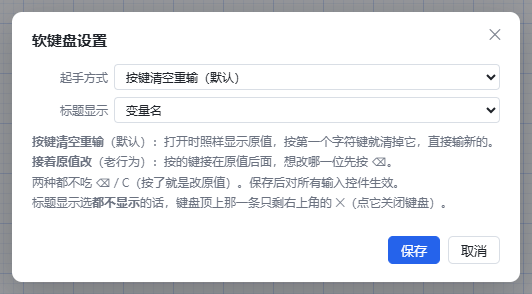 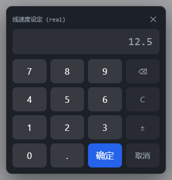 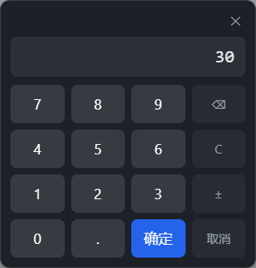<br><sub>左：设置对话框（起手方式 + 标题显示）　中：首键清空重输 —— 标题是控件名，显示区里淡色的 12.5 是原值，按第一个数字键就换成新值　右：标题显示「都不显示」—— 顶上那一行空了，✕ 仍钉在最右边（跟有标题时一个位置）</sub> |
| **数据导出（CSV / 单页 / 控件包）** | 变量表 / 报警表 / 脚本表导出 CSV、单页导出 `.page.json`、控件包导出 `.hmiw.json`、**工程「另存为」** —— **点导出就弹系统的「另存为」框，存哪儿自己选**，存完状态栏把路径写出来（浏览器只知道文件名，桌面包给完整路径）。两条弹框路：**桌面窗口**（exe / `start_hmi_window.bat`）走 `server/hmi_desktop.py` 的 `save_text()`（pywebview 保存框，实测能弹出、能拿到路径；弹不出来还有 Win32 通用保存框兜底，再不行就写进「下载」文件夹并说明 —— **绝不静默丢文件**；工程「保存」按上次的完整路径写回、不再弹框）；**浏览器**走 File System Access 的 `showSaveFilePicker`。⚠ 桌面版为什么不能靠下载：exe 是 PyWebView + WebView2 窗口，`<a download>` 的下载**没有宿主处理**（没人接 `DownloadStarting`）→ 下载被就地取消：不弹框、不报错、**文件一个字节都不落盘**（实测下载库里 `state=2`「已取消」、路径全空）。⚠ 浏览器那套要**安全上下文**（`127.0.0.1` / `localhost` / `https`）：用**局域网 IP** 访问或 Firefox/Safari 时保存框接口不存在 → **自动退回"下载到「下载」文件夹"的老行为**；在保存框里点取消则什么都不做 |
| 对齐/均布 | 左对齐/居中/右对齐/顶/中/底 + **水平等间距分布 / 垂直等间距分布**（≥3 个） |
| 变量类型 | bool / int / uint / dint / udint / real / lreal / string，含 PLC 地址占位列 |
| **控件清单** | 左侧「清单」tab：列出页面所有控件及配置，**点击行跳转定位高亮**该控件。**顶上那一条（页面下拉 + 「底」+ 「Aa」）吸顶**：清单几百行时滚下去照样能换页 / 切「底」/ 切「Aa」，不用先滚回顶部（跟变量面板、报警面板的筛选框同一套做法）。**类型徽章按"家族"配色**（操作/数值/文本表格/报警/波形/图形 一眼分得清，同类型同色）；**配置那一列**：Modbus/TCP 显示「变量名 @%MW100」（短地址是现场查点位要用的），**OPC UA 那种长 NodeId 不显示**（跟变量名基本重复、又长到塞不下）；行尾「Aa」按钮可**隐藏控件名称**（只留类型 + 配置，自动名如"数值4"是噪音；名字悬停仍能看到），选择记在本机；旁边「**底**」按钮可**把公共底那一层的行收起来**（只想看这一页自己的控件时用它，选择同样记住）。配了操作权限的控件挂 `🔒 等级名` 标记<br>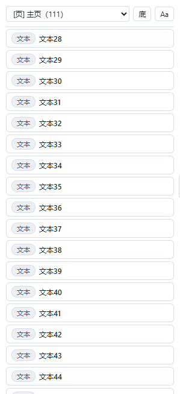<br><sub>滚到清单中间：页面下拉那一行还钉在顶上</sub> |
| 变量表 | 名称 / 类型(8 种) / **PLC 地址**（+ 字长·长度） / 保持；**「添加变量」后自动跳到新那一行**（变量上千时新变量落在最末尾：以前得自己滚到底去找、找到还得再点一下才能改名。现在**滚过去 + 闪一下 + 名称格直接聚焦并全选** —— 建完就能直接打字改名/填地址；搜索框里有词时先把词清掉，不然新变量被搜索条件挡着，看着像"没建上"；右键菜单「添加变量」那条路一样跳）。**每行可勾选、表头可全选 →「删除选中 (N)」一次删掉多个**（没人引用的不弹确认，删错 Ctrl+Z 就回来；还被控件/报警引用时才拦一下，并说明有几处引用会被清空）。**行尾不再有「✕」**（现场要求）：删一条 = 勾上它再点「删除选中 (1)」，或在这一行上右键「删除变量」；数组/前缀组表头行尾的整组「✕」同样去掉了 —— 组左边那个勾选框就是"一次选整组"，勾上再点「删除选中」。**地址按类型给标准写法**：**bool 用位地址** `%MX0.0`（也可 `%QX0.0` 线圈 / `%IX0.0` 只读输入，位号照写：`%IX0.1`、`%QX2.3`），**字类型用** `%MW100`／`%MD50`（写错风格鼠标停在地址格上会提醒），**直接写数字也行**：`100` = `%MW100`；老写法 `HR100` 在输入 / CSV 导入 / 打开老工程时自动转成 `%MW100`，一张表里不会三种写法混着；**CSV 导入导出**（Excel 互通：导出带 BOM；导入按名称 upsert，同名更新、新名追加，非法行跳过并回报；**导入自动认编码**：UTF-8（有/无 BOM）、UTF-16（带 BOM）、**GBK·GB18030·Big5** —— Excel 在中文 Windows 上「另存为 CSV」默认就是 GBK，以前按 UTF-8 读会全是乱码）|
| **按页采集（通讯效率）** | 运行态**只轮询当前页面用到的变量**（控件绑定 / 按钮动作 + **报警条件里的变量**，打开着的弹窗也算；**正在抓取的波形通道例外：所有页面都采** —— 波形采样本来就跨页面在跑，切走再回来中间不能是一段死值；**「启动抓取」为假或右键暂停全部波形时，通道退出采集范围**（现场口径：抓取关着就别占轮询带宽；「启动抓取/清除数据」两个控制变量照样采，抓取一开通道立刻回到采集范围）），别的变量不占带宽；**连续地址自动合并成一次读**（`%MW100/102/104` → 1 次读回 5 个字，块内最多 125 字）；切页面/开关弹窗立刻重新下发采集范围（**切走的那一页立刻退出采集，不留尾巴** —— 免得来回翻几页「在采的变量数」一路涨；想让上一页再留一会儿就设 `app.scopeKeep.keepMs = 10000`），状态栏显示「**本页 N 变量/M 块**」，**运行页面变量监控的固定头**上也常显这一行 ——「**PLC 在线 · 本页 N 变量/M 块**」（设备掉线变「PLC 离线」、没接设备是「内存模拟」、编辑器里是「该页 …」预览）：现场看画面时不用去翻状态栏，`Ctrl+Shift+V` 一开就在最顶上（列表滚动也不会把它顶走）。变量监控里给不在采集范围的变量标「**未采集**」，监控标题的「(在采 N/共 M)」鼠标停上去会说清**这 N 个是怎么来的**（本页 x 个 + 报警条件 y 个 + 波形通道 z 个），控制台 `app.scopeSummary()` 也能看同样的明细。**轮询在 Python 后端跑**，所以浏览器切到后台、页面关掉、断网重连都照旧通讯；切回前台会自动补一次范围下发 + 拉当前值。**轮询周期最小可以填 1ms**：那是「尽可能快」的意思 —— 读完一轮立刻读下一轮、不排队不补跑，实际周期 = 读一轮的耗时（现场 TS600 实测：单帧往返 1.5~2ms，一页 8 块约 15ms、11 块约 20ms），状态栏和 PLC 对话框都会显示**实测 xx ms/轮** |
| **OPC UA 数据源** | 工具栏 🔌 PLC 里**协议可选 Modbus TCP / OPC UA**（OPC UA 时自动隐藏 Modbus 专属的字序/站号/字序体检，换成端点·安全策略·用户名密码·默认命名空间）。变量表**地址列填完整 NodeId**（`ns=4;s=\|var\|CODESYS Control Win V3.Application.PLC_PRG.bRun`）；**NodeId 没规律 → 两种导入**：①**CODESYS/Invtmatic 导出的「符号配置」XML 离线导入**（不用连服务器：符号、IEC 类型、可写性全在文件里，NodeId 按 `ns=…;s=\|var\|设备名.应用名.POU.符号` 拼，数组/结构体列出但不勾），②连上服务器 **浏览节点树**勾选导入（可按名称/路径/NodeId 过滤）。**导入时「设备名」可直接改**（CODESYS 里工程显示名和运行设备名经常对不上，比如 XML 里是 `Device`、跑起来是 `CODESYS Control Win V3 x64`）：打开文件后自动把 XML 里的设备名/应用名回填进输入框，**改一下就按新名字把 NodeId 全部重算**（不用重新选文件），原来勾好的那些按 POU 路径保留，确认导入后变量表里就是能用的 NodeId；已经导错了的可以在工具栏 🔌 PLC 里点一次「修正 OPC 地址」按符号尾名对齐。取数走**按页采集 + 一次请求多节点批量读**（状态栏 `本页 N 变量/M 块`），类型由服务器给（**没有字序、没有字长**这回事）；写只读节点/NodeId 不存在/服务器掉线都会在界面上说明原因，**掉线自动重连** |
| **OPC UA 联调工具** | `server/opcua_sim.py` = 模拟 OPC UA 服务器 + 网页调试台：节点按 CODESYS 符号写法（`ns=4;s=\|var\|设备.Application.POU.符号`），**`--import-symbol-xml` 直接用真工程导出的那份符号配置 XML 建节点**；网页里能改值、给数值节点开**自动仿真**（正弦/斜坡/随机）、看**通讯日志**（HMI 写进来的值标成「来自写入端」），还带一个**只读节点**和一个**数组节点**专门验异常路径；支持 `--user/--password` 测带身份的连接 |
| **掉线提醒 + 恢复后重读现场数据** | **Modbus / OPC UA 一样**：运行页面里设备断了 → 顶部红条**只说两件事**：`PLC 已断开（IP:端口）`／`OPC UA 已断开（端点）` + `已断开 N 秒`（后端给的原因如 `timed out` **不摆在屏幕上**，挂在那一行的悬停提示里；掉线期间的值不下发、恢复后重读这些口径也不再往条子上堆），**连不上要连续 5 秒才挂红条**（后端一轮读超时就 online=false，界面要是跟着报，抖两三秒又变绿，看着像设备在反复掉线；这段"观察期"里的抖动一句都不喊，连上就没这回事），每 10 秒再闪一次；**断开期间写的值不会留在界面上**（下发失败自动把设备上的真实值读回来盖掉，免得看着像"已经改了"）；**恢复后立刻把现场数据整套重新读下来**并显示「已重新读取现场数据（N 个变量，其中 M 个和界面上不一样）」，再收回绿条 —— 这两个数**只数设备变量**：**内部变量（地址留空）不算**（它不来自设备、是 HMI 自己算/自己存的，没得比；现场反馈"老说有两个不一样"，就是它）。⚠ 本页没用变量时后端也会**保活探测**一次（否则"没东西可读"会被当成一切正常，断了永远发现不了） |
| **下发失败提示（运行页面）** | 运行页面里写变量被拒（地址无效 / 只读节点 / 从站异常 / 身份校验没过）→ 顶部琥珀色横条「`下发失败（变量名）`」+  后端给的原因，**6 秒自动收起**；挂的位置和掉线红条错开，两条同时来也不互相遮挡。同一条只对**同一个变量**生效（写别的变量会换成新的一条），退出运行即清掉 |
| **运行界面：一个按钮都不摆 + 组合键** | 运行态主页面**干干净净只有画面**——原来左上角的「PLC 设置」按钮、右下角的「退出运行 / 适应窗口」、右上角的变量监控标题栏**全部收起来**，现场全屏看画面时不被任何控件压住。功能都还在，改走**两个键一起按**的快捷键（单字母太容易误触，所以单按 `F`/`V` **不再生效**）：<br>`Ctrl+Shift+E` **退出运行**（`Esc` 也照旧退）· `Ctrl+Shift+L` **PLC 连接设置**（运行中直接改协议/端点/变量，确定即生效）· `Ctrl+Shift+V` **变量监控显示/隐藏**（一开就是变量列表，画面自动让位）· `Ctrl+Shift+F` **切换视图**（原始 → 适应 → 填满 三档轮换）· `Ctrl+Shift+Y` **切换语言**（工程里有多门语言才有；运行中就能切；**手机 / 触摸屏没有键盘时：双指轻点画面**弹同一个语言列表）。<br>**进运行态会飘一条快捷键说明**（7 秒后自动收起、点一下立刻收起）—— ⚠ **2.1.4 起只在编辑器里进运行态才飘**（客户机/AI 窗口开机直接进运行态时**不弹**，现场嫌它挡画面；想看得从编辑器进运行态，或编辑器右键菜单「快捷键提示」再叫出来），菜单项每项都标着对应组合键；内部变量模式下右键菜单里还多一项「**内部变量：恢复初值**」（模拟值调乱了、或看着像"改了没反应"时一键回初值）。**内部变量运行**（没连 PLC、走内存模拟）时左下角**常显琥珀色提示**「内部变量运行中（未接 PLC）」／「未连上后端，本地模拟中」，接上真 PLC 自动消失。<br>**客户页面（`/`）上只留 `Ctrl+Shift+F`、`Ctrl+Shift+L`（2.1.4 起直接开 PLC 连接设置，**不要管理员密码**）和（多语言工程的）`Ctrl+Shift+Y`**：`Esc` 退不出去、`Ctrl+Shift+V`/`E` 只提示「需要管理员」并给出登录入口 —— 见上面「给客户/现场用」 |
| 运行预览 | ▶ 运行（F5 同）全屏模拟 HMI 设备；**视图三档**：**原始**（1:1，画布多大就多大）／**适应窗口**（默认，等比缩到整幅都在窗内，短边留黑边）／**填满窗口**（**拉伸铺满整窗** —— 边上不留黑边，且**页面里的控件一个不少、全在窗内**，比例和窗口不一致时会被拉伸；抽屉打开时缩到左边继续铺满，不会被抽屉压住），`Ctrl+Shift+F` 依次轮换、右键菜单里能直接点某一档（当前档打勾），**选的档位记在 localStorage，下次进运行态照旧**；⚠ **窗口比画布窄时（手机竖屏 / 小窗口）也必须整幅等比例缩进窗内**：画布盒子（`#rtPage`）尺寸**永远等于画布尺寸**（CSS `flex: none`，见 runtime.css 那段说明）—— 它是居中容器里的弹性子项，默认 `flex-shrink:1` 会被窗口压扁，而内容仍按画布坐标摆出去，于是右边一截被 `overflow:hidden` 切掉、比例也不对（现场手机上就是"宽度不够时后面显示不出来"）。检查这套用 `verify-fit-narrow`（785×970 / 360×640 / 1280×400 三档窗口 + 换页 + 三档视图）；右侧变量抽屉**进运行态整个收起**（画面吃满整窗），`Ctrl+Shift+V` 或右键菜单叫出来，**叫出来时画面自动避让**（不被面板压住），再点标题栏可折叠成只留标题栏；抽屉上方是**筛选框 + 「只看本页」+「不看后台」**（**只看本页**默认勾着：变量上千个时不整列出来，只列本页在采的；勾掉就列全部 —— 变量表只写地址不绑控件时改值要用它。**不看后台**：把**波形通道（示波器）、报警条件**这类「一直在后台采」的变量收起来 —— 它们跟当前画面无关，列表常被它们占满；**只有波形在用的才收**，本页别的控件上也在用的（同一个量既有曲线又有数值）照旧列；两个勾选都记在 localStorage。**监控列表里只留"真出事"的说明行**（本页没用到变量 / 后端是旧版本），「在采 N 个 = 本页 + 报警条件 + 波形通道…」那份拆解挪到了标题 `(N/M)` 的悬停提示里，不再占列表）。**运行态显示控件无输入光标、文字禁选中（主页面+弹窗层），仅数据输入 input 例外** |
| 指示灯发光 | 点亮时的外发光画在圆**外面**（圆形柔光），不会被控件的圆角方框裁成方块 |
| 光标语义 | **不是输入框的地方一律不出现「文本输入光标」（I 形）**：面板标题、变量名、状态栏、弹窗正文、软键盘显示屏都算；该有的光标照旧（按钮 pointer、画布控件 move、工具箱 grab、分隔条 col-resize、缩放柄 resize） |
| 复制粘贴 | Ctrl+C / Ctrl+V（**可跨页面**）；**Ctrl+X 剪切**（复制进剪贴板 + 删掉选中，锁定的控件不动）；**Ctrl+D 再复制一份**（右下堆叠 +16）；**Ctrl+Shift+D 多重复制**：份数 1~100、排列方式（向右 / 向下 / 网格 / 右下堆叠）、行列间距，**序号步长可设（+1/+2…，填 -1 就倒着排**：bAlarm5→bAlarm4→bAlarm3），**地址也按间隔往后排**（默认按类型：bool/16 位 1 个字、real/dint 2 个、lreal 4 个、string 按长度；也能手填，**填负数就往前排**），**新变量直接自动建进变量表**（类型/长度/初值照抄源变量，地址是递增后的；不勾就只提示缺哪些变量）——一排控件既各自一个变量、又不会漏建；名字没数字的（rSpeed）默认也会排成 rSpeed1/rSpeed2，想共用同一个变量就选「保持同一个变量」。多选时整块复制保持相对布局；源地址写法算不出来（`DB1.DBD4` 这类）会明确提示手填 |
| 撤销重做 | Ctrl+Z / Ctrl+Y（快照式 60 步；一次多重复制 = 一步撤销） |
| **对话框右上角都有 ✕** | 组态里所有弹窗（PLC 连接设置、添加/编辑报警、权限管理、画布设置、多重复制、软键盘设置、API 帮助…只要是 `showDialog` 开的）**右上角都有一个 ✕**，点它 = 「取消」（关掉、不提交）；运行态的密码卡片也一样。⚠ 弹窗一大（PLC 设置、API 帮助）以前只能滚到底部找「取消」，现在 ✕ 和底部按钮都**不跟着正文滚**（只让正文滚），随时关得掉；`Esc` 照旧 |
| **工程管理** | 工具栏上直接显示**工程名**（点一下就能改名，保存/打开的文件名、浏览器标签都跟着它走）。**新建 / 打开 / 保存 / 另存为 / 存到服务器 / 从服务器读都在工具栏的「工程 ▾」下拉里**（不再排一长排按钮）—— 工具栏上**连「保存」按钮也不摆了**（现场要求：那一排太挤），保存走「▾ → 保存」或 **Ctrl+S**（同一条路）：
**新建**工程可选空白（1 个空白页、变量表空的）或带示例的演示工程（**内置模板：单线切割机 · 7 个页面 / 46 个变量 / 报警 + 仿真脚本**，见下面「内置工程模板」一节 —— 换模板不用改代码，重新生成 `js/data/demo-project.js` 即可）；**打开**工程（选 .json 文件）会整份替换，替换前会先问一声并说明当前这份已备份。
**保存 = 写回同一个文件**（第一次保存会先问你存哪，之后点「保存」或 Ctrl+S 直接写进去不再打扰，只在状态栏显示「已保存：xxx.LE（时间）」）；想换个文件用「**另存为…**」。**工程文件默认后缀是 `.LE`**（保存/另存为/导出、服务器上那份都用它），**老的 `.json` 照样能打开、另存为时也能选**（现场手上那些老文件一个都不用转）。
**PLC 配置跟着工程走**：在工具栏 🔌 PLC 里连一次，IP/端口/站号/轮询周期/字序就记进工程，保存/导出一起带走；打开一份带 PLC 配置的工程、而本机连的不是那台时，会问一句「要不要按工程里的配置连」（不会静默改设备）。**面板布局也跟着工程走**：五个面板摆在哪、有没有分屏、浮动窗在哪，都存在工程里（`layout.dock`）—— 存文件 / 存到服务器一起带走，换台机器、换个浏览器打开还是这个摆法（老版本存在 localStorage 里的布局，第一次打开会自动搬进工程）。**本机浏览器里没有工程时**（客户机/PyWebView 每次打开都是新 profile）启动会**自动从服务器把上次「存到服务器」那份读回来**（状态栏会说一句），本机已经有工程则绝不动它。⚠ **换工程不会把原来那份弄丢**：「工程 ▾」菜单里有「**恢复上一个工程**」（显示上一份的名字/页数/变量数），新建、打开、读服务器之前都会自动备份一份。**自动保存存在这台设备的浏览器里**（localStorage，键 `hmi-designer-project-v1`，**点状态栏那句「已自动保存 …」有详细说明**）——不是磁盘文件、也不在服务器上；换浏览器 / 换端口 / 用 127.0.0.1 与局域网 IP 打开都是各自一份，清浏览数据就没了，所以要留档请用「保存」或「存到服务器」。**「存服务器 / 读服务器」和「保存 / 打开」不是一回事**：保存/打开读写的是**你本机的 .json 文件**（想要几个版本存几个、能拷走发给别人）；存/读服务器读写的是**跑 server.py 那台机器上的 `server/data/hmi_project.json`**（只有一个槽位、每次覆盖，读之前会确认并备份）—— 现场那台设备上换个浏览器/换台电脑接着编就用它，只想交付的话不用管这两个按钮 |

### 输入范围限制：超界的值写不进 PLC

数值类输入控件（**数值** / 老「数据输入」）属性里多了一栏**「输入范围限制」**，勾上以后：

| 干什么 | 说明 |
|---|---|
| **上下限各自可以写死，也可以跟变量走** | 每端一个「固定值 / 变量」下拉：固定值直接填数（`0` / `100` / `12.5`）；选「变量」就填一个数值变量（现场常见的就是**配方上下限由 PLC 下发**）。两端各管各的：只填一端 = 只卡那一端；两端都留空 = 等于没配 |
| **软键盘上明说能输多少** | 输入框下面一行 **`范围 0 ~ 100`**；变量型的显示成 **`范围 Hr_SpdMin(0) ~ Hr_SpdMax(120)`**（变量名 + 当前值）。**PLC 把限值改了，键盘上当场跟着变**（不缓存旧范围） |
| **越界 = 红框 + 写不进去** | 输入超范围时**键盘上的输入框变红**、范围那一行标红并挂一句「✕ 超出范围」、**确定按钮变灰**；就算绕过按钮去提交，也**一个字节都不下发**（键盘不关，就在这一屏改，不用重新点控件）。内联输入（没勾「软键盘输入」的数值控件、老「数据输入」控件）同样：输入框变红，回车/失焦都不写，值保持原样 |
| **还没输完的中间态不算越界** | 刚按 `±`（显示 `-`）或打完小数点（`1.`）这种状态不标红 —— 不然键盘看着像坏了 |

几条口径（都是现场踩出来的）：

* **老工程一个字都不变**：没勾范围限制、或者存档里根本没有这几个键 → 不显示那一行、也不做任何拦截（新控件这个勾**默认是关的**）。
* **当上下限用的变量会进本页采集范围**（跟绑定变量、报警条件一视同仁）。不采就永远读到 `undefined`，限制会**静默失效** —— 看着配了范围、实际一个值都不拦，比"不让输"危险得多。
* **限值变量还没读到值时**（刚进页面 / 后端断开）：那一端**不拦**，但键盘上写成 **`rMax(?)`**、原因挂在悬停提示里 —— 明说"这一端还没读到"，而不是装作拦住了。
* **下限比上限大**（两个限制变量交叉了）→ 范围行照实显示，并且**任何值都写不进去**（配错了就拦住，不放一半过去）。
* 面板里给范围变量选变量时**只能选数值变量**：填了 string / bool 变量当场标红并说清为什么（拿字符串当边界同样是静默失效）。

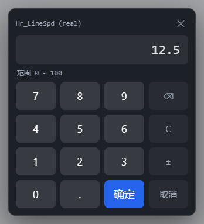 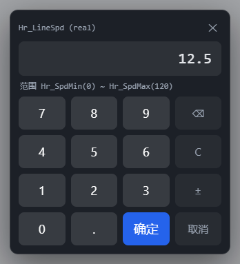 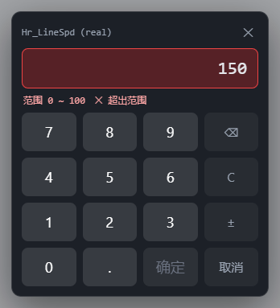
<sub>左：固定值范围（0 ~ 100）　中：上下限跟着变量走（`Hr_SpdMin(0) ~ Hr_SpdMax(120)`）　右：输入 150 → 输入框变红、范围行标红、确定变灰，数据一个字节都不下发</sub>

### 键盘弹出时挡住画面上的其他控件（防误碰）

软键盘一弹出，它下面那一层**默认盖上一张遮罩**：运行画面上**其他控件、弹窗一律点不动**（点哪儿都没反应，只有键盘上的键、取消、✕ 能用，`Esc` 也照旧收键盘）。现场最怕的就是"输着设定值，手一滑按到旁边的**启动**"—— 这一层就是为它加的。

* **开关在控件属性里**：数值控件的「**屏蔽其他控件**」，**默认勾着**（= 默认就禁止点别处）。
* **取消勾选 = 老行为**：还能点别处 —— 点另一个输入控件就把键盘换过去（老画面/老习惯不受影响；老工程里没这个键 → 按"挡住"走，因为这是更安全的默认）。
* 遮罩自己**不带任何动作**：点它不关键盘（关只有键盘上的取消 / ✕），免得手指一滑把刚输了一半的值丢了；遮罩**压在弹窗之上**，键盘开着时弹窗也点不动。
* 下拉框「可选也可输入」那种键盘同样默认挡住（那个控件属性里没有这一项，按默认走）。

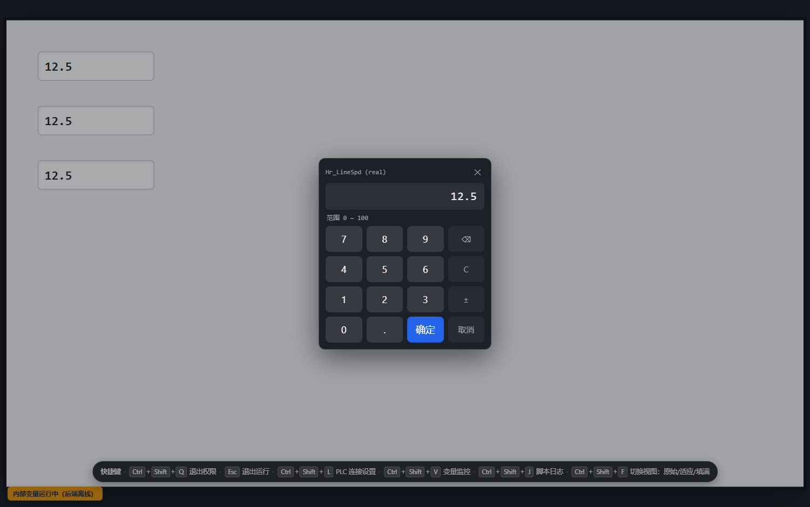
<sub>键盘弹出时整块画面被遮罩挡住（画面上其他控件、弹窗都点不动），只有键盘能操作</sub>

### 公共底：每页都一样的东西，只写一次

页面上总有一部分是**每页都长一样**的：底部导航条、顶部标题栏、常显报警条、公司 logo 底板……
以前只能在每一页上各画一遍，改一处就得挨页改。**公共底**就是把这一层单独拿出来写一次；
**一个页面可以叠多层**（导航条一层、标题栏一层、报警条一层……现场要的至少 6 层，实际不设上限）：

| 干什么 | 怎么做 |
|---|---|
| 建一个底 | 左区「页面」面板 → **＋ 新建公共底**（列表里紫色「底」角标 + 左边紫条，跟页面/弹窗并列）。底就是一个页面，双击进去像画普通页一样画控件 |
| 让页面叠上底 | 点开那个页面（画布空白处）→ 右侧「属性」面板 → **公共底 → 添加一层** 里选一个；列表里每层一行，带 **↑ ↓ 换层序 / ✕ 去掉这一层**。页面行右键菜单里也能「＋ 叠一层 / ✕ 去掉第 N 层」。普通页名字后面会挂「**垫：底1、底2**」小标签 |
| 层序 | 列表**从上到下 = 从底层到顶层**（第 1 个画在最下面，后面的依次叠上去）；页面自己的控件永远压在所有底上面 |
| 改底 | 到左区点开那个底改 —— 改一次，**所有套用它的页面一起变**。底页属性面板会告诉你「被 N 个页面套用」 |
| 在普通页上碰到它 | 画布上底那一层**点不动**（防止在普通页里误改，影响所有页面），鼠标移上去是紫色虚线 + 淡紫底，**双击直接跳到那个底**去改；左区「清单」里底那一层的行也带「底」标记（多层各自标它属于哪个底），点一下同样跳过去 |

几条要记住的口径：

* **层序固定**：按属性面板里的列表顺序从下往上叠，每层整体加一个 z 基准，**不跟别的层混着比 z** —— 底上后画的控件 z 再大也压不住它上面那层和页面内容。
* **运行态一模一样**：底上的按钮照常能点（公共导航条就是靠它跳页）、指示灯照常亮、文本照常显示变量；绑定的变量也照常按页采集（**每一层**的变量都在采集范围里）。
* **弹窗不套底**：弹窗有自己的尺寸和标题栏，坐标系对不上；要复用就把控件直接复制进弹窗。
* **删底不炸**：删掉一个底，套用它的页面自动去掉这一层（其余层和页面自己的控件都不动）；底引用悬空（别人给的工程）也会自动清掉。
* **老工程照旧能开**：2.0.10 及更早的工程只有单个 `baseId`，载入时自动迁成 `baseIds=[那个底]`；存出去时 `baseId` 仍同步成第一层（老版本读新工程还能显示第一层）。
* 存文件 / 存到服务器 / 导出 JSON / Ctrl+Z 撤销 / MCP 都照常带着底走（底就是页面对象，不另存一份；单页导出带的是它套的**各层**底）。
* 回归套件：`node test/verify-base.mjs`（52 项：分层 z、点不动/双击跳转、运行态能点、按页采集、**一个页面叠 6 层**、属性面板增删移、存读往返、老工程迁移、删底清引用）。


<sub>编辑态：底下那一层（标题栏 + 底部导航条）画在页面上，右侧属性面板里「公共底」列表可以叠多层、换层序；左区页面面板里「垫：公共底1」就是它。</sub>

### AI 助手（对话式组态）

窗口**最右边**有一条固定的「**AI 助手**」侧栏（**默认收起**；开/关用工具栏 🤖 AI 或「工程 ▾ → AI 助手…」，**不参与拖拽/停靠/分屏**）：像聊天一样说要求，模型直接调工具改工程（不是给建议）。
设计/接口/提示词契约见 [`docs/ai-assistant.md`](docs/ai-assistant.md)。

| 能干什么 | 例子 |
|---|---|
| 新建页面 / 弹窗 / 公共底 | 「新建一个叫『配方管理』的页面，加 3 个按钮：读取、保存、返回」 |
| 批量画控件 | 「在产线监控页画 4 个指示灯 + 一个数值显示，横排均匀摆」 |
| 加变量、绑控件 | 「加一个 bool 变量『急停』和一个 real 变量『线速度』，绑到刚才的控件上」 |
| 写脚本 | 「定时 200ms 让线速度按正弦摆动，用 hmi.set 写变量」；写完还能 `check_script` 语法检查 |
| 报警 | 「加一条报警：急停为 0 时报警，内容『急停按下』」 |
| 全工程翻译 | 点「翻译整个工程」：按原文整句去重 → **每批 40 条**分批调模型（一批返回不全会自动拆半重试，防截断丢条）→ 写进多语言表 → 一次 `project.commit`，**Ctrl+Z 可整体撤销**。英文/德文常比中文长：勾着「**自动缩放字号适配**」时翻完会**只缩字号、不动控件位置和大小**，把放不下的控件缩到刚好放下（最小 8px），仍放不下的会在结果里点名。实测（MiMo `mimo-v2.6-flash`）：21 条约 1 批 12s；100 条约 3 批 35~40s |

怎么用：

* **打开 / 关闭**：工具栏 **🤖 AI** 一键开关（或 **工程 ▾ →「AI 助手…」** 打开）；关的时候点面板标题栏 **✕**。它**固定贴在窗口最右边**，画布自动让出宽度；**不能拖走、也不能停靠/分屏**（跟左中右那些面板不一样）。开关状态记在本机 `localStorage`，换工程不影响。
* **窗口窄的时候**（≤1024px）它变成盖在右侧的抽屉，用 ✕ / 🤖 AI 收起。
* **配置**（第一次用）：面板里 `⚙ 设置` 选 **服务商**（下拉里是「已经加过的」配置）或点「**＋ 新增 / 换服务商**」从预设里挑 —— 预设带好地址和默认模型：**小米 MiMo**、**LM Studio（本机/局域网）**、**OpenAI**、**DeepSeek**、**自定义**，然后填 **API Key** 保存。同一台机器加过的服务商都在下拉里，**以后换回来不用重填 Key**（Key 存在后端，下拉只显示掩码 `sk-****abcd`）。默认对小米 MiMo：`https://api.xiaomimimo.com/v1` + `mimo-v2.6-flash`（OpenAI 兼容，换任何兼容接口都行）。
  **API Key 只存后端** `server/data/ai.json`，前端只拿到掩码（`sk-****abcd`）；也能用环境变量 `HMI_AI_KEY` / `HMI_AI_BASE_URL` / `HMI_AI_MODEL` 兜底。面板上**不显示模型名和 Key 状态**（只有左上角一个状态点，鼠标悬停才提示）。
  **测试连接**（2.2 修）：会真的问模型一句 —— 地址写错（比如 LM Studio 少 `/v1`、服务端 200 回一段 error JSON）现在会**明确报失败**并提示「要以 `/v1` 结尾」，不会再误报「成功」；LM Studio / OpenAI 这类服务默认不回流式用量，现在会自动带 `stream_options.include_usage`，面板的 `↑输入 ↓输出 tok` 才有数（小米 MiMo 不加这个参数，避免它 400）。
  配置文件 `server/data/ai.json` 里现在有 `profiles`（每个服务商一条：地址/模型/Key/参数）和 `active`（当前用哪条），换服务商只改 `active`，Key 不会丢。
* **工具调用默认折叠**：一轮里调了多个工具（或模型爱一轮调一个、散卡片攒到第 3 个）会收成一行「🔧 调用 N 个工具 / 工具名 × 次数 / ✔ 全部成功」，点开才看每个工具的明细；有失败会自动展开。
* **每轮用时 + token 用量**：每轮一开始就挂一行「第 N 轮 · 用时 0.0s」**实时走**，这一轮结束时定格成「第 N 轮 · 用时 x.xs · ↑输入 ↓输出 tok」；多轮对话末尾再给一行「共 N 轮 · 总用时 x.xs · ↑累计输入 ↓累计输出 tok」（每轮都是整段上下文一起发，所以输入 token 会一轮比一轮大）。
* **审美 / 排版**（2.2 新增）：AI 不再自由乱摆坐标，而是按**工控视觉规范**干活 —— 8px 栅格、页面留白 16、卡片间距/内边距 16、字号层级 24/16/14/12、一页最多 3 类色，并沿用工控色板（`#11283f` 深色条 / `#35c8d2` 强调 / 白卡 `#d8e2eb` 描边 / `#24518f` 主按钮）；新页面优先用 **`apply_layout_recipe`** 套现成骨架（总览 / 看板 / 操作三套，一次铺几十个控件只占 1 步撤销），画完自动 **`tidy_layout`** 对齐收边、再用 **`inspect_layout`** 自检出界/重叠/字号/配色。工程里已有页面的主色和字号会自动写进给模型的简报，新页面跟着老页面走。
* **安全闸**：改动全走 `project.*`，**一步一个 Ctrl+Z**；删除/覆盖类工具（删页面/控件/变量/脚本/报警）默认被拦截，要先勾面板上的「**允许删除类操作**」。
* **可关思维链**：MiMo 默认会带推理过程，设置里「关闭思维链」勾上（后端发 `"thinking":{"type":"disabled"}`）响应快一倍多、面板更清爽。
* **工具调用不算轮次**（2.2）：对话轮次本来就不限，工具往返（调一次 → 回灌 → 再想）不吃轮次预算；设置里的「工具批次上限」填 `0`（默认）= 不限制，只是怕模型一直反复调工具时留个保险。`最大 tokens` 放宽到 200000、`单次超时` 放宽到 3600 秒（设置里 `最大 tokens` 和 `输入预算` 都按 **k token** 填，比如 `200` = 20 万 token、`60` = 6 万 token），只有明显非法的值才会被夹。翻译仍是每批 40 条自动分批（超长/截断自动拆半重试）。⚠ 改了后端 `server/core/ai.py` 的边界/默认值后要**重启设计器服务**才生效（只刷新页面不够，否则保存仍按旧边界夹：典型现象填 0 变 1、填 100 变 20）。
* **省 token / 省钱**（2.2）：接口是无状态的，每轮都要把历史重发一遍，所以——① 工具结果进历史前统一瘦身（长字符串截到 200 字、长数组截到 150 项；控件目录只留 `type/尺寸/属性键名`，其它工具超 1200 字只留摘要 + "已截断"；`get_project` 查页面只回"控件几何 + 属性键名"，要看某个控件的属性值用 `widgetId` 单独查）；② 会话历史滑动窗口（最近 8 条原文，更早的工具结果折叠成占位、长回答截到 500 字）；③ **会话压缩**：历史超过 9000 字或 40 条消息时，把更早的对话自动压成一段「前情提要」系统消息（只留用户要求 + 已做过什么 + 工具调用次数），原文只留最近 6 条，越跑越长的长任务不会再"每轮几百 K"；④ 单次提问「输入预算」默认 6 万 token，到量自动停手并提示"再发一句「继续」会重新给一份预算"（设置里可改，0 = 不限）；⑤ **工具 schema 瘦身**：27 个工具的参数说明只保留"猜不到的"（枚举/格式），`x/y/w/h` 这类不再写说明 —— 工具定义从 11.7k 字符降到 8.4k，配合①②③，每轮固定开销（系统提示 3.4k + 工程简报 0.3k + 工具定义 8.4k）从约 15.4k 字符降到约 12.1k 字符（≈ 8.4k token → ≈ 6.6k token，省两成多）；⑥ **缓存命中可见**：每轮用量显示成 `↑8.4k(缓存 7.1k) ↓39 tok` —— 系统提示和工具定义这种"每轮都一样的前缀"，服务商会按 prompt cache 命中价计费（比正常输入便宜很多），所以每轮都重发并不等于每轮都按原价买。**最直接的省法：每个新任务点一次「清空」，历史清零后下一轮输入回到 2k 量级。** ⑧ **一轮干完（2.2，最省钱的一条）**：以前模型习惯"一个动作一轮"，一轮 6~10k token，复杂页面要 8~9 轮。现在三件事让它尽量一轮收工：**整页一次读**（`get_project{page}` 一次返回整页所有控件的几何+属性值+绑定+动作，`detail:"brief"` 才只看键名）、**整页一次画**（`add_widget{items:[{type,x,y,props,variable}, …]}` 一个调用画任意多个任意类型控件、只占 1 步撤销）、**变量顺手建**（`variable` 可以直接写 `{"name":"x","type":"real"}`，不存在就自动建好，不必先 `add_vars`）；系统提示里加了【一轮干完】段，明确"工具按顺序执行，建页面→画控件→排版→自检可以全放同一轮"，并说明"能一次发齐却分多轮属于错误用法"。⑦ **工具按需下发 + 提示词瘦身**：不再每轮都把 27 个工具的 schema 全发 —— 按你这句话的关键词只发相关工具组（说"报警"才带报警工具、说"脚本"才带脚本工具，基础集 12~17 个），schema 从 8.4k 字符降到 3.9~5.4k；系统提示从 3.4k 压到 2.6k（控件速查表只留 `type=中文名`，尺寸由 catalog 提供），工程简报从 1.6k 压到 0.9k（变量不再逐条带 PLC 地址、超过 24 个只列前 24 个）。三项合计：**每轮固定开销 13.4k 字符 → 约 7.9k 字符（≈10k token → ≈5.9k token，省约 41%）**。
* **不思考也不会原地打转**（2.2）：关掉思维链（thinking=disabled）时模型容易反复发**同一个查询**（你截图里"每轮调用 2 个 get_project ✔ 全部成功"就是这么来的，纯烧钱没进展）。现在：同一个查询（同参数的 `get_project` / `list_*` / `get_widget_catalog` / `check_script`）**一次任务里只真正执行一次**，重复的直接回"这个查询本回合已执行过，结果在前面"；连续 **3 轮**整轮都是重复查询就停手，并建议你把设置里的「思考过程」改成 **交给模型（auto）**，或直接说清要改哪一页、哪个控件、改成什么。
* **失败会自动纠偏**（2.2）：工具调用失败时，右侧会标红并把错误回灌给模型 —— 第一批失败就注入纠偏提示（"别重复同样的参数、**也别再猜 id**，先查真实名字"），同类错误（报错里的 id/数字已归一化比较，不会因为 `_8`/`_9` 就当成新错误）**连续 3 批**还失败就停手，直接告诉你最后一条报错，并给出「换个说法 / 手动改一下 / 把报错发我」三个选择。另外失败结果**不会被瘦身砍掉关键信息**：`compactToolMessage` 对 `ok:false` 单独放宽到 2200 字并保留 `hint/widgets/variables/pages/types` 这些"真实清单"，`get_project` 查页面也改成紧凑行（`名称|id|类型|x,y|w×h|属性键名`，上限 2400 字）——以前超过 1200 字整包被砍，模型看不到 id 只能猜（线上"没有控件 rect_标题条"就是这么来的）；失败卡片还会把「可用：…」清单摊开给用户看。**控件引用 id / 名称两种写法都认**（`get_project{widgetId}`、`update_widget{ids}`、`delete_widgets{ids}`、`select_widgets{ids}` 都可以填 `w_xxx` 也可以填「启动按钮」这种名称 —— 模型把名称当 id 传是很常见的，以前会为此白跑一轮、还一直报"没有控件 文本5"）；真查不到时，会把这一页**「名称」= id（类型）**的完整清单一起回给模型，它不用再一个个瞎猜。
* **权限**：`ai` 相关接口与帧只给**管理员**（登录后）用 —— 运行态观察员用不了。
* **回归**：`python test/verify-ai-backend.py`（假模型，纯标准库；含服务商 profiles 与「少 /v1 不误报」用例）· `node test/verify-ai-e2e.mjs`（浏览器 + 假模型全链路）· `node test/verify-ai-modules.mjs` / `node test/verify-ai-panel.mjs`（模块/UI）。

  **本机 / 自建模型（LM Studio + Qwen3 等）**：这类模型常不认 `thinking:disabled`，只认正文里的 `/no_think`。设置里「思考过程」选「关闭」时，后端会自动在请求最后一条消息后补 `/no_think`（不改你的会话历史）；选「交给模型」就按模型自己的节奏（1.7B 这种小模型一句话可能要 10s 上下，建议 4B 以上再跑真任务）。测试连接也放宽了：只要模型吐过 token 就算连接成功，会附一句「只回了思考内容」的说明。

### 多语言（画面文字全部导出来翻译）

现场的机器要出给别人用、或者要中英双语的，画面上的文字可以**一次性全部导出成翻译表**，翻译好再导回来：

| 干什么 | 怎么做 |
|---|---|
| 加一门语言 | 编辑器「工程 ▾ → **多语言 / 翻译…**」→ 语言区「添加语言」：填代码（如 `en`、`ru`、`pt-BR`）+ 显示名（留空用内置名），回车即可。可以加多门 |
| 导出翻译表 | 同一个对话框点「**导出翻译表 CSV**」：把所有画面文字按 `分类,位置,字段,原文,控件ID,字号px,<语言1>,<语言1>字号%,<语言1>字号px,<语言2>,…` 导出（UTF-8 BOM + CRLF，Excel 直接打开不乱码，中文不会变乱码）；**「字号px」= 这条文字所在控件的基础字号**（每个控件可能不一样）；**每门语言三列**：译文、全局「字号%」、**该控件在这门语言里的实际字号px**（在属性面板英文下单独调过字号就记在这列）；「控件ID」用来把每行对回控件（导回时按它恢复各语言字号）。把 `原文` 那一列对应的译文填进语言列即可 |
| 不同语言字号不同 | 每门语言后面跟一列 **`<语言>字号%`**（50~200，100 = 不缩放；导出时每行都写同一个值，Excel 里改一行即可）。对话框里每门语言那行也有「**字号**」输入框 —— 比如英文比中文长、嫌挤就填 85~90；日文偏小就填 110。**切到哪门语言，画面就按那门语言的百分比缩放控件文字**（编辑画布和运行画面都一样），字号存在**工程**里、跟着翻译表导出/导入一起走。默认 100% 时一个字都不变。**给单个控件在某门语言里单独调的字号也会导出/导入**（`<语言>字号px` 列），换台机器/重新导回不会"大大小小对不上" |
| 属性面板跟随当前语言 | 切到英文后，**属性面板里的文字属性显示的是译文**（不是中文原文）；直接在那里改 → **只改这门语言的译文**（原文不动、其它语言不受影响），画布立刻重画、能撤销、存工程带着。**字号也一样**：英文下看到的字号 = 基础字号 × 英文「字号%」；在英文下改字号 → **只影响这个控件的英文显示**（切回中文还是原来的基础字号），不用再靠"改一次全部语言一起变"。默认语言下改文本/字号就是改原文/基础字号（和以前一样）。
| 导回译文 | 点「**导入翻译表 CSV**」选填好的文件 → 报告「填了 N 条 / 跳过 M 条」。译文按**原文整句**对应（同一句原文全工程共用一份译文），没填的行保持原样；表里的「字号%」列也会一并生效 |
| 运行时切语言 | **运行中按 `Ctrl+Shift+Y`**（Y = 语）弹语言列表，点一项即可；再按一次、按 `Esc`、点空白处都能收起（客户机 `/run` 也支持 —— 那个页面不加载编辑器模块，所以这里单独挂了这套；**右下角不再放「🌐 语言」浮标**，现场要求画面保持干净）。**手机 / 现场触摸屏没有键盘**：**双指轻点画面**弹同一个语言列表（两根手指几乎同时落下、都不拖动才算 —— 单指轻点照常点按钮、单指划动/双指拖动画画面、输入框上的双指点按都**不会**误弹）。**不再靠长按/右键**（Chrome 长按照样弹它自己的「选字/复制」气泡，我们的菜单出不来还容易误点画面控件）；运行页上浏览器自带的右键/长按菜单被拦掉，不会挡住画面（输入框里仍可正常选字粘贴）。**编辑器里用「多语言 / 翻译…」对话框的「预览语言」下拉切换**（外面不再放语言选择）。切完画面当场换（按钮/标签/表头/下拉选项/单位/**报警文字**全跟着变），选择只记**这台浏览器**（刷新/重开还是上次那门语言） |
| 预览 | 对话框里「预览语言」下拉；编辑画布会跟着重画，方便一边翻译一边看效果 |
| 会翻什么、不翻什么 | 翻：页面名、弹窗标题、控件上的文字（按钮/标签/表头/单元格/下拉选项/单位/前后缀/无报警提示…）、**报警名称与内容**（含 `{变量}` 的整句模板也能翻；**报警条 / 当前报警 / 报警历史、编辑画布预览都翻**，历史里已经记下来的那条也会按翻译表重新显示；报警定义后来被删掉的，历史里存的中文也按翻译表兜底翻）。**不翻**：变量名、PLC 地址/NodeId、数值、时间格式串 |

* 语言列表和译文**跟着工程走**（存进工程文件、导出/存服务器都带着），换台机器打开照样有；「现在用哪国语言」只记在本机浏览器（现场一台机器切一次即可）。
* 老工程没有多语言配置也照样打开（当只有默认语言）；加了语言才写进工程。
* 回归套件：`node test/verify-i18n-panel.mjs`（32 项：菜单入口/加语言/导出 CSV/导入译文/预览切换/删语言）、`node test/verify-i18n-runtime.mjs`（10 项：画布与运行态切语言后文字真的变、报警文字带变量替换、右键菜单换语言、没配译文原样显示）。

### 配方（整套参数存下来，需要时一键应用）

换规格/换模具时要把几十个参数一起改 —— 「配方」就是给一整套参数起个名字存着，下次一键写回去。

**画面上用**：工具箱里「配方」控件，属性里「变量」一栏写**要参与配方的变量**，一行一条，支持三种写法（现场不用再一个个挑 32 格）：

| 写法 | 含义 |
|---|---|
| `rSpeed` | 单个变量 |
| `调速参数` | **整组**：变量表里 `调速参数[1]…调速参数[N]` 全部元素（按数字顺序） |
| `调速参数[1..20]` | **连续范围**：该闭区间里变量表存在的那些元素（起>止 自动交换；只取存在的，没展开的元素跳过） |

运行画画面上：填名字 → 「保存当前」把这一组变量的当前值存成配方；点配方行的「应用」→ 一键写回（危险操作先确认）；可开「允许删除」。**点配方行的名字/行本体 → 选中它，下面出「数据表」**：列出这个配方存了哪些变量、各自的值；点**数值**格弹控件内置小键盘（0-9 . - ⌫ 确定/取消，触摸屏可用），字符串/bool 格行内输入，改过的行标「*」并提示「未保存」——「保存修改」直接存回服务器（要管理员 + 确认），「还原修改」丢弃草稿；有未保存改动时切换配方会先问一句。配方变量**自动进本页采集范围**（接真 PLC 也读得到当前值）。文字走多语言，属性面板不摆说明文字。回归：`node test/verify-recipe-widget.mjs`（63 项：解析规则/保存/应用/删除/重新解析/老配置兼容/**数据表显示/小键盘改值/保存修改落库/还原/未保存切换确认**/多语言）。

**接口规矩**（后端）：

| 接口 | 说明 |
|---|---|
| `GET /api/recipes` | 列配方名：`{ok, names:[…], count}`；加 `?full=1` 连每个配方的变量/值一起给（**读不用登录**） |
| `POST /api/recipes` `{action:'save', name, vars:{变量名:值}}` | 保存/覆盖一个配方（**要管理员**，未登录 401 `need_login`） |
| `POST /api/recipes` `{action:'apply', name}` | 应用配方：逐个变量写入（内部变量走本地、PLC 变量照常下发），返回 `{ok, applied:[写成功的变量名…], failed:[{name,error}…]}` —— **单个变量失败不挡其它变量**，坏变量逐条给原因；配方不存在 → 404（**操作员**就能应用） |
| `POST /api/recipes` `{action:'delete', name}` | 删除（幂等：本来没有也回 ok；**要管理员**） |

* 配方存在数据目录 `server/data/recipes.json`（原子写：先写 `.tmp` 再替换），**属于现场数据、不进版本库**（`.gitignore` 已排除）；文件损坏时后端打 warn 并按空表处理，不影响其它功能。
* 配方名 ≤100 字、单个配方 ≤5000 个变量（防手滑）；`hello.features` 里有 `recipe`，前端据此判断后端支不支持。
* 回归套件：`node test/verify-recipe.mjs`（25 项：保存/覆盖/取回、应用后值变、坏变量逐条报错、404、幂等删除、管理员闸门、落盘结构无 `.tmp` 残留）。

### 历史数据报表（服务器按周期记录 + 导出 CSV）

现场要"把过去一段时间的数据拿出来做报表/追溯"：后端可以按固定周期把一组变量的值记在**服务器**上（不是浏览器），事后挑时间段导出 CSV。

* **设置**：编辑器「工程 ▾ → **历史记录…**」：开启/关闭、采样周期（500~60000ms）、保留天数（1~90）、变量（一行一个，最多 256 个）；下面显示「已有几天 / 多少条记录 / 最近一条时间」。改设置要管理员，**查询/导出不用登录**。
* **导出**：同一个对话框选时间段（最近 1 小时 / 24 小时 / 7 天 / 今天 / 自定义起止）+ 变量（留空 = 用采样变量）→ 「导出 CSV…」。CSV 是 **UTF-8 BOM + CRLF**，表头 `时间,变量…`，时间 `YYYY-MM-DD hh:mm:ss.mmm`，Excel 直接开；单次最多 20000 行（超了提示缩小时间范围）。
* **记录在哪**：服务器数据目录 `history.json`（配置）+ `history/YYYY-MM-DD.jsonl`（按天追加），保留天数到了自动清旧文件；都是现场数据，不进版本库。
* **什么时候记**：守护线程按周期直接读数据源当前值（不发通讯、不和轮询抢 I/O）。接真设备时**只在设备确实在轮询时记录**（没人看画面时轮询本来停着，硬记会得到一条"设备没变化"的假直线）；要夜间无人值守连续记录，后端加 `--poll-always`（或环境变量 `HMI_POLL_ALWAYS=1`）。内存模拟随时都记。
* 后端接口：`GET /api/history`（设置+统计）、`GET /api/history?from&to&vars`（查询）、`POST {action:'export'}` / `GET /api/history/export.csv`（CSV 字符串）、`POST {action:'settings'}`（要管理员）；`hello.features` 里有 `history`。
* 回归套件：`node test/verify-history.mjs`（后端 32 项：设置/夹回/采样/查询/CSV/清理/闸门）、`node test/verify-history-panel.mjs`（界面 13 项：对话框字段、保存读回、越界夹回、统计、真下载 CSV/BOM/表头/变量过滤/自定义时间段）。

### 多用户 / 角色（账号登录）

原来只有一条「管理员密码」。现在除了它，还能建**账号**（现场口径：**只留「管理员 + 操作员」两种**——工程师用管理员；维保/操作工用操作员，**只能改设备连接**）：

| 角色 | 能干什么 |
|---|---|
| **管理员 admin** | 全部：画面/变量/PLC/日志/用户/配方保存删除/存工程 |
| **操作员 operator** | **只能改设备连接**：PLC / OPC UA 的连接与参数（连接/断开/测试/改地址协议/地址解析）。画面、变量写入、配方、用户、日志、存工程一律拒绝 |

* **登录**：打开 `/login`。**「账号」留空 = 原来的管理员密码登录**（老现场不用改习惯）；填账号 = 账号表里的用户。管理员登录进编辑器；操作员登录**直接进运行画面**（`/run`），在那里可以打开设备连接设置改 PLC。
* **管理**：编辑器「工程 ▾ → **用户与角色…**」：加账号（账号名/密码/角色）、改角色、启用/禁用、改密码、删除；修改立即生效。
* **安全**：密码只存「盐 + sha256 哈希」（列表接口不回密码）；账号存服务器 `users.json`（现场数据、不进库）；**最后一个启用中的管理员不许删/降级/禁用**（免得把自己锁在外面）；已登录的会话带角色，断线重连不变味。
* 兼容：老数据里的「观察员 viewer」账号仍按只读处理（登录能看、写不了），但新建/改角色不再提供这个角色。
* 老会话（升级前的登录态）按管理员算；`--no-auth` 模式全按管理员（开发/本机方便）。
* 回归套件：`node test/verify-users.mjs`（后端：账号存储/登录两路/角色闸门/**操作员只放行设备连接**/写变量拒绝/最后管理员保护）、`node test/verify-users-panel.mjs`（界面：登录页账号格/错密码/管理员登录、面板加账号/改角色/禁用/改密码/删除、不回密码、操作员登录进运行画面）。

### 掉电保持变量（HMI 内部定义，全局可用）

变量表里 **地址留空 = 内部变量**：值由 HMI 自己维护（控件动作、脚本 `hmi.set`、变量监控里手改），
不读也不写 PLC。**写内部变量永远不会报「未在变量表声明」**：前端下发时会带 `internal: true`，
后端表里还没有这个名字（刚新建、或这份后端上正挂着另一个工程）也照收、存在自己这边、绝不碰 PLC；
**不带这个标记的未知名字仍然照旧挡住**（脚本临时量、打错字不许发给设备）。
在那一行勾上「**保持**」就是**掉电保持** —— 现场那句「直接在 HMI 里定义掉电保持、
全局可以用」就是它：

| 关心的事 | 说明 |
|---|---|
| 值存哪 | 跑后端那台机器的 `server/data/retain_vars.json`（原子写，每 2 秒合并落盘）。换浏览器、换台电脑打开都还是这个值 |
| 什么时候还在 | 后端重启 / 整机断电再上电，值照旧；**没勾**保持的就只在内存里，重启回初值 |
| 谁都能用 | 控件按变量名绑定 · 脚本里两种写法都行：**属性写法** `hmi.v.本班产量 = hmi.v.本班产量 + 1`（读、写都像普通属性，中文名直接点出来）/ 函数写法 `hmi.get('本班产量')` / `hmi.set('本班产量', 0)` · 变量监控里手改 —— 全工程一套 |
| 和 `hmi.g` 的区别 | 内部变量是**工程的**全局量：能绑控件、能掉电保持、别的地方都看得见 —— 要"给界面用 / 给 PLC 侧参考"的值放这儿。`hmi.g` 是**脚本自己**的暂存：只在脚本之间共享、界面上看不见、退出运行态就清空（防抖标记、上次的值、累加器放这儿）。见下面「顺便说说：脚本里的全局量有两种」 |
| 接没接 PLC | **都行**。以前接了真 PLC 时内部变量写下去会报「地址 '' 无效：未填写」→ 界面挂一条"下发失败"；现在内部变量一律走本地，PLC 变量照旧按地址读写（失败原因也照旧如实报） |
| 开机下发 PLC？ | **不会**。掉电保持只保 HMI 自己的值（开机偷偷写设备不可预料）；要写给 PLC 就在脚本/控件里显式做 |
| 想恢复初值 | 运行态右键 →「内部变量：恢复初值」；接 PLC 时**只重置无地址的内部变量**，一个字节都不碰 PLC |
| 批量维护 | CSV 导出/导入带「保持」列（是/1/true 都算）；MCP 用 `hmi_add_vars {retain:true}`、`hmi_set_var {retain}` |

顺带两处界面调整（左面板默认只有 300px 宽，列多了地址会被挤成一条缝）：

* 「保持」是一列小勾选框：**只有内部变量能勾**，有 PLC 地址的行是灰的（那种变量的保持归 PLC 的
  RETAIN/PERSISTENT 管，HMI 存一份只会在开机时"偷偷写设备"）。
* **去掉了「初值」列**（现场要求）：PLC 变量的值由通讯读回来，初值填了也用不上，新变量一律 0/false；
  内部变量真要给个开机值，用 CSV 的「初始值」列或 MCP 的 `hmi_set_var`。
  原来的「字长」列并进了地址格：有地址的看悬停提示，内部变量显示灰字「N 字」，
  字符串/数组就在同一格填字符数 / 元素个数。

回归套件：`node test/verify-retain.mjs`（26 项：勾选写进工程、CSV 往返、落盘、跨重启、
PLC 模式下内部变量照样读写、恢复初值、取消保持清存档、脚本写入）。

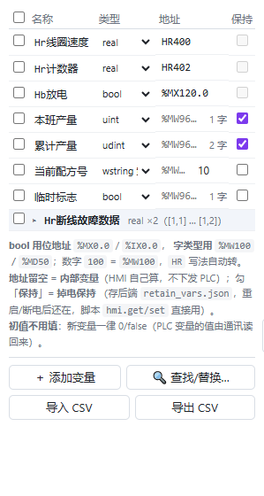

<sub>变量表：地址留空的「本班产量 / 累计切割次数」勾了保持（紫色小勾）；有 PLC 地址的那几行勾选框是灰的（保持归 PLC）；
地址格里那个灰字「1 字 / 2 字」是类型决定的字长，字符串/数组那里改成填字符数/元素个数。</sub>

### 脚本里的全局量：内部变量 vs `hmi.g`（脚本怎么写变量更省事）

脚本里读写变量有**两种写法，完全等价**（属性写法只是少打几个字，内部就是调 `get/set/has`）：

```js
hmi.v.rSpeedSet = 1200          // = hmi.set('rSpeedSet', 1200)（类型收敛、下发 PLC、链路门都一样）
if (hmi.v.bRun) { … }           // = hmi.get('bRun')
hmi.v.本班产量 = hmi.v.本班产量 + 1   // 中文变量名直接点出来
hmi.v['1号泵'] = true           // 名字是数字开头 / 带横线 / 带空格 → 用方括号
hmi.v['arrw[3]'] = 999          // 数组元素照旧
```

* 属性写法**多一条防打错字**：读/写**变量表里没有的名字当场报错**（带行号进日志）。
  函数写法 `hmi.get` 对没声明的名字给 `undefined`（那是为了能判断"有没有这个变量"），
  而日常写法打错一个字静默给 `undefined`，就变成"这段脚本永不生效"——现场最难查的一类问题。
  想先判断在不在，用 `hmi.has('名字')`。
* **`Math` 那种内置对象不受影响**：`hmi.v` 只认变量表里的名字。

**脚本自己的全局暂存 `hmi.g`**（跨执行、跨脚本记得住，**不占变量表**）：

```js
// 触发方式=定时 100ms：边沿判断 + 计数，都不用专门建变量
hmi.g.count = (hmi.g.count || 0) + 1
const now = hmi.v.rSpeed > 3000 ? 1 : 0
if (now !== hmi.g.last) { hmi.warn('状态变了：', now); hmi.g.last = now }
```

| 想放的东西 | 放哪 | 为什么 |
|---|---|---|
| 给界面用 / 要绑控件 / 要掉电保持 / 别人（PLC 侧、另一个脚本要"看得见"）也要用的量 | **变量表里的内部变量**（地址留空，要保命勾「保持」） | 全工程一套：控件绑定、变量监控、CSV、报警条件都能用它；值还能落盘 |
| 只是脚本自己要记的：防抖标记、上次的值、累加器 | **`hmi.g.名字`** | 不用为它建一条变量、不污染变量表；但它**界面上看不见、不落盘**，退出运行态/刷新即清空（**进运行态也是全新的**） |

脚本的 `let/const` 是**每次执行都重置**的（每次跑都是新的函数作用域），所以"想记住上次的值"别用 `let`，用上面两种之一。

回归套件：`node test/verify-script-vars.mjs`（31 项：属性写法读写/类型收敛/中文名/数组元素、打错字报错、
`hmi.g` 跨执行跨脚本与清空时机、改名连属性写法一起改、编辑器里的速查与帮助例子能跑）。

### 脚本日志：内存那份 + 服务器落盘那份

脚本里的 `hmi.log()` / `hmi.warn()` / 运行错误，以前**只活在浏览器内存里**（每条脚本最近 60 行）：
刷新就没、退出运行态就没，而**运行页（`/run`）上根本看不见** —— 现场出了事一点痕迹都没有。现在分三层：

| 在哪看 | 是什么 | 会丢吗 |
|---|---|---|
| 运行态 **Ctrl+Shift+J →「脚本日志」面板** | 所有脚本的日志合成一条时间线（带**脚本名**、级别配色），外加「⚠ N 个脚本已停用」徽标 | 刷新 / 退出运行态就没了（内存那份） |
| 同一个面板 →「**服务器历史**」 | 读服务器上**落盘**的那份 `logs/script-YYYY-MM-DD.log`，`‹ ›` 按天翻 | 不丢。按天落盘、**只留最近 N 天**（默认 3 天，可在下面那个设置里改） |
| 脚本编辑器下面那条日志区 →「**服务器日志**」按钮 | 同上，给组态的人在编辑器里查历史 | 不丢 |

**两个写入通道，别用错**（这是 `hmi.logNo` 存在的理由）：

| 写法 | 编辑器「▶ 试运行」 | 运行态面板 | 日志文件 |
|---|---|---|---|
| `hmi.log(…)` / `hmi.warn(…)` | 看得见 | 看得见（默认） | **会落盘**（有 20 行/秒限速 + 每天体积上限，默认 10MB） |
| **`hmi.logNo(…)`** | **看得见**（灰斜体标成调试） | **默认不显示**，勾面板上的「调试」才显示 | **永远不写**（只在内存里） |

`hmi.logNo` 就是"写脚本时打中间值看看"的通道：循环里每一步、每个分支走了哪条，尽管打，
不会占日志文件的限速额度与每天体积上限（否则真出事时那份日志里全是调试噪音）。
内存里每条脚本留最近 60 行，满了**先丢最旧的调试输出** —— 不会把你 `hmi.log` 打的那几行挤掉。
要"事后还能查"的日志就用 `hmi.log`。

**内存里到底存多少（日志量再大也不会把内存撑爆）** —— 不会，两笔账是分开的：

| 在哪 | 上限 | 说明 |
|---|---|---|
| 浏览器内存（每条脚本） | **60 行**（环形缓冲） | 不管打多少行，内存里就留最近 60 行；`hmi.logNo` 打的调试行**先被丢** |
| 浏览器内存（送后端队列） | 400 行 | 满/超速就丢并记数（面板上写出来），不会无限攒 |
| 面板 DOM | **最多 200 行** | 面板只画这么多；「服务器历史」也只读文件**尾部**（≤300 行 ≈ 120KB） |
| 服务器磁盘 | **默认 10MB/天**（可在设置里调到最大 100MB；3 天 ≈ 30MB） | 这是**文件**的上限，跟浏览器内存一点关系没有 |

真正会卡的只有一条路：**面板/日志区开着 + 脚本疯狂打日志**（10ms 一行 = 一秒上百行）——
每行都重画一次面板的话，主线程会被 200 行 DOM 整块重建吃掉。所以两处都做了**合并刷新**：
运行态面板最多 250ms 画一次、脚本编辑器的日志区最多 200ms 画一次（用户动作——打开面板、
点试运行、点清空——仍然立刻画）。回归里用 MutationObserver 数过：脚本按 100 行/秒狂刷 2 秒，
面板只重建 **7 次**（≈4 次/秒），DOM 行数 60，内存快照 60 行。

* **「脚本连续出错 5 次自动停用」现在现场看得见**：运行画面挂一条琥珀色提醒条（`脚本「X」已自动停用`，
  20 秒后自己收），面板头上也有徽标、里面写明是哪条、什么原因；停用这件事**同样落盘**，事后查得到。
  （以前引擎广播了这件事，但运行态没人接 —— 现场只会觉得"这脚本怎么不干活了"。）
* **脚本写变量不进 cmd 那行操作日志**：后端控制台那句 `[var] xxx = 1` 只记**人在触摸屏上的操作**
  （按钮 / 输入框 / 变量监控里手改）。脚本写的值（`hmi.set` / `hmi.v.x = …`）请求体里带 `from=script`，
  后端**不打这行** —— 脚本可能每 100ms 写一次，那行会把 cmd 刷爆（现场反馈：数据太多）；
  脚本要留痕用 `hmi.log()`（上面那三层日志就是给它准备的）。写失败仍然报，但**同一个变量同一句话
  10 秒内只报一次**，免得真正的故障被刷走。
* **限速与上限**（工控机的盘不能被日志写满，每一层都留了闸）：
  前端**按脚本令牌桶**（20 行/秒、突发 40 行，队列满了丢最早的并记下"丢了多少行"，面板上如实写出来）；
  后端再兜三道 —— 单请求最多 200 行、单行文本最多 500 字（超了截断）、
  **每天最多 10MB（默认值，可在设置里调到最大 100MB）**（到顶写一行"已到上限"然后当天不再记）。
  什么概念：`hmi.log` 每次写一行约 60 字节，10MB ≈ **17 万行** —— 按事件记几行的正常工程连零头都用不到；
  就算是"每个运行周期（50ms）都记一行"这种极端写法，也要连着记两个多小时才到顶。
  文件按天存、随服务日志一起**只留最近 N 天**（默认 3 天），所以最坏情况占 30MB 左右（调到 100MB 时是 300MB）。
* **这两个参数在软件里就能改**：**工程 ▾ → 日志设置…** →「日志保留 1~30 天」+「脚本日志上限 0.5~100MB」，
  勾着对话框里那行"现在占多少（服务/脚本/更新各多少 MB）"一起看，**改完立刻生效、不用重启后端**
  （保留天数改小了当场清一次；上限下次写入就用新值）。这两项是**这台机器**的设置
  （存服务器的 `server/data/settings.json`，**不进工程**、换机器不带走），要管理员权限；
  界面上没设过时按环境变量 `HMI_LOG_KEEP_DAYS` / `HMI_SCRIPTLOG_MAX_MB` 兜底，
  **界面里设过就以界面为准**（顺序：界面 > 环境变量 > 默认；上限最大 100MB，填 9999 也会被压回 100）。

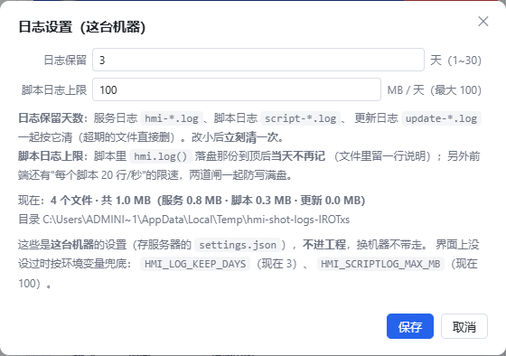

<sub>工程 ▾ → 日志设置…：保留几天 + 脚本日志每天多大；对话框里直接写着"现在占多少（服务/脚本/更新各多少）"，
改完立刻生效、不用重启后端（保留天数改小了当场清一次）。</sub>
* **不用登录**：脚本跑在运行页上，客户机没人登录（跟 `/api/vars`、`/api/alarms` 同一个口径）。
  但**面板本身在客户机上要管理员密码**（它跟变量监控一样会露出变量值）；那条"脚本已停用"的提醒条人人可见。
* 落盘文件长这样（好读、好 grep）：`[2026-10-04 22:41:02] [产量脚本] [warn] 状态变了：1`
  脚本名/级别里的方括号会换成圆括号（不然字段解析会串），正文里的方括号**照原样**（`arrw[3]` 不会被改坏）。

回归套件：`node test/verify-script-logs.mjs`（26 项：接口三道上限、CRLF/方括号/换行收拾、按天读回、
脚本真的写→后端真的有、运行态面板与「服务器历史」、自动停用提醒条与徽标、限速生效且如实报丢弃）。

### 变量「在哪用到 / 替换」（查找引用）

变量表几百条时，"这个变量到底有没有用？都在哪儿用？"靠翻是翻不出来的。**Ctrl+F**（或变量面板上的
**🔍 查找/替换…**、变量行右键 →「查找引用」、控件右键 →「查找变量「xxx」在哪用到」）打开一个对话框：

| 能干的事 | 说明 |
|---|---|
| 查引用 | 打变量名（或名字的一部分，默认「包含匹配」）**也可以直接打地址** → **一处一行**列出来：控件绑定 · 波形第几通道（含通道配色 / 量程键）· 按钮动作 · 报警触发条件 · 报警内容里的 `{变量}` · 脚本触发变量 · 脚本代码里的两种写法（`hmi.get/set('名字')` 与 `hmi.v.名字`）。**没被引用的变量会明确写"没被引用"** —— 这就是"有没有用"的答案 |
| 按地址查 | 现场常常是**拿着 PLC 上的点位找变量**（"MW2000 是哪个变量？用在哪？"）：查找框里直接打 `MW2000` / `%MW2000` / `HR2000` / 纯数字 `2000` 都行（跟变量表里"地址写法自动统一"是同一套归一化），出来的那条会打一个「**按地址**」标记、右边照旧显示地址，**它的引用也照常一处一行列出来**（能定位、能替换）。名字命中的排在地址命中的前面；精确匹配（不勾「包含匹配」）时 `MW2000` 与 `%MW2000` 都算命中 |
| 定位 | 每行右边「定位」：控件 → 跳到那一页并选中它；报警 → 打开那条报警的编辑框；脚本 → 打开脚本编辑器。（公共底上的控件会写明是「公共底「底1」」，一眼看出它不属于当前页） |
| 显示上次的搜索 | 只记**最后一次**查的那个词（不攒一串历史）：下次打开自动填回去、结果立刻重跑。**Ctrl+F** 打开时如果正选着一个控件，就直接查它绑的那个变量 |
| 替换 | 上面选一个变量（左边那个圆点），下面填「替换为」→「全部替换」：**所有引用一起换**（含脚本里的字符串），**一步 Ctrl+Z 全回来**；勾「删掉旧变量」= 换完把已经没人引用的旧变量一起删掉 |

顺带修掉一个老毛病：**变量改名时，脚本里 `hmi.get('名字')` 这种字符串写法以前改不到**（脚本会静默失效，
现场最难查的一类问题）。现在改名/替换会连脚本的触发变量、`hmi.get/set/has('名字')`、
以及**属性写法 `hmi.v.名字` / `hmi.v['名字']`** 一起改 ——
函数写法只动**第一个参数位置**上的字符串，`hmi.set('sMode', 'a')` 里当值用的 `'a'` 不会误改；
属性写法如果新名字**不是合法标识符**（数字开头/带横线），点写法会自动退成方括号（`hmi.v['1号泵']`，
否则 `hmi.v.1号泵` 是语法错）；
改完如果脚本里还有别处出现旧名字（不是这两种写法），会在结果里标一行"自己看一眼"，不擅自改。

回归套件：`node test/verify-varsearch.mjs`（43 项：八种引用逐条扫到（含属性写法）、公共底标注、没引用明说、
**按地址查**（`MW102` / `%MW102` / `mw102` / `HR102` / 纯数字都认，命中打「按地址」标记、引用照常列出来、
名字命中的排前面；界面上也验一遍）、
上次搜索填回来自动重跑、**Ctrl+F** 打开（选中控件时直接查它那个变量）、定位跳转、
替换全量生效（两种写法都改）+ 一步撤销、右键菜单入口）。

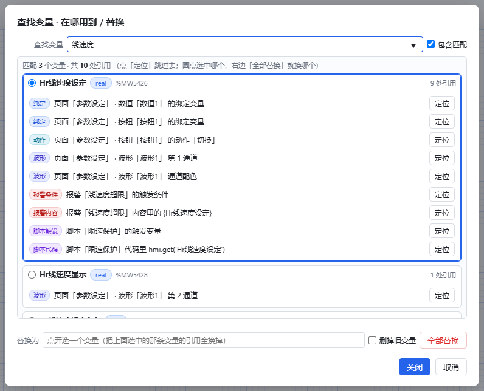

<sub>查找「线速度」：匹配到 3 个变量、共 10 处引用，一处一行；圆点选中的那个就是右边「全部替换」要换掉的。</sub>

### 页面面板：按类型分组 + 单页导出导入

左区「页面」面板把三种页面分开摆、并且能收起（现场要求"画面的和画面在一起、弹窗和弹窗在一起，方便观察"）：

* **分组**：页面 / 弹窗 / 公共底 各一组，组表头写清个数（空组不显示）。点表头 ▸/▾ 收起展开，
  **收起状态记在本机**；**切到某一页时它所在那组自动展开**（免得"切过去了却看不见自己在哪"），
  收起时表头右边直接写「当前：xxx」。
* 分组和「▤ 分组 / ☰ 平铺」按钮**一样大**（都在列表上方那行）；点它可以在分组和
  "按建立顺序一列到底"的平铺之间切换，状态也记住。
* **行上一个按钮都不摆**（复制 / 导出 / 删除全在**右键菜单**里）—— 行只留「角标 + 名字 + 垫：底1」，
  名字那一栏能多显示几个字。右键里有：复制此页 / 多重复制此页 / 导出这一页 / 导入页面 /
  新建页面·弹窗·公共底 / 删除（公共底也能复制、也能删）。
* 顶部的「＋ 新建 ▾」是个**下拉**（原来四个按钮并排，面板窄的时候会挤出边界）：
  新建页面 / 弹窗 / 公共底 · 复制这一页 / 多重复制页… · 导入页面… / 导出这一页…。

### 单页导出 / 导入（把一页画面搬到别的工程）
右键页面行（或「＋ 新建 ▾」）→「导出这一页…」得到一个 `<工程名>-<页名>.page.json`，
在**别的工程**里「导入页面…」（或直接把文件拖到页面列表上）就多出一页：

| 导出文件里带什么 | 说明 |
|---|---|
| 这一页的控件 | 几何 / 属性 / 绑定 / 动作 / 组合全带 |
| 它用到的**变量** | 控件绑定、波形通道、通道配色量程、动作里的变量（含公共底上的）；没用到的不带 |
| 它套的**公共底** | 连底上的控件和它用到的变量一起带 —— 不带的话导进来就少一条导航栏 |
| 跳转/弹窗**目标页的名字** | 导进别的工程时按名字重新对上；对不上就清空那个动作并在报告里点名 |

导入时：新页面正正经经生成新 id（不会和现有控件撞）、页名重了自动加序号（排线 → 排线2）、
变量缺的补上 / 同名的**保留你工程里的**（地址不同只提醒，不静默改你的地址）、
**一步 Ctrl+Z 全回来**。⚠ 报警和脚本不跟着搬：它们是"整机"的（条件挂在变量上、脚本是全局的），
跟着一页走容易搬出重复报警/重复脚本。

回归套件：`node test/verify-pagegroup.mjs`（23 项：分组/收起/记住/切页自动展开/平铺开关/行右键）、
`node test/verify-pageio.mjs`（23 项：导出内容、导进别的工程、变量与底、跳转按名字对上、
重名加序号、同名变量保留、一步撤销、整份工程挑一页、菜单入口）。

## 操作权限（现场分级密码）

现场经常是这样：画面谁都能看，但**启停、参数设定、清记录**只能让班长/工程师动。这套东西就是干这个的。

**怎么配**（都在组态里，运行时不用改任何东西）：

1. **工程 ▾ → 权限管理…**（属性面板的「操作权限」组里也有这个按钮）：
   * 勾上「**启用**」——不勾 = 运行态完全不拦（老工程行为不变）；
   * 「**自动上锁**」填分钟数：解锁后**没操作**这么久就自动退出权限。**默认 0 = 不自动锁** ——
     解锁后一直有效，只有**刷新 / 关窗口 / 退出运行态**，或手动「退出权限」才回到未解锁（切页面、开关弹窗都不算）；
     对话框里只留「分钟没操作自动退出权限（0 = 不自动锁）」这一句，详细口径在输入框的悬停提示里；
   * 「**清空报警记录**」不再单独配一档：报警历史控件里的「清空记录」按钮按**那个控件自己的权限等级**拦 ——
     想保护历史记录就给报警历史控件配一级（跟别的控件一个口径）；**没配等级 = 谁都能清**；
   * **等级表**：一行一个等级，填名字 + 密码；`▲ ▼` 调高低、`✕` 删除、`＋ 添加等级`。
     **越靠下等级越高**，解锁最高那级 = 下面所有级也都能操作。
     **密码在框里看得见**（下次进来就是上次设的那个，直接改；清空 = 这一级不设密码）。
     没设密码的等级保存时**不再拦一下**（不弹提示），那种等级运行态就是解不开。
     工程里存的是**混淆串**（异或 + Base64，JSON 里看不到明文），但**能还原** —— 它挡的是
     "随手打开工程文件瞟一眼"，不是有心的攻击者；**能拿到工程文件的人本来也能改工程**。
     老版本工程里用哈希存的那一份照样能验，只是框里显示不出来（那一格会写「重填一次就能显示」）。
     删除某一级时，配了那一级的控件会**自动改回「不限」**（否则它们会卡在一个不存在的等级上，谁都解不开）。
2. **逐个控件配权限**：选中控件 → 属性面板「**操作权限**」三行（**一直显示**，不管有没有选等级、
   权限管理开没开都能改）：
   * **权限等级**：选一级（`不限` = 谁都能操作）。所有控件都能配（按钮、数值输入、下拉框、指示灯…），
     控件清单里也会挂一个 `🔒 等级名` 标记，一眼看出哪些控件要密码；
   * **密码框**（默认勾着，面板上是个裸勾选框，说明在标签和悬停提示里）：不勾的话，权限不够就**点不动** ——
     不弹密码框、也不给提示（不想让现场看到密码入口时用；这时建议留着下面的小锁标记，
     好让人知道为什么点不动）；
   * **小锁标记**（默认勾上）：这个控件**等级不够**时，角上挂一个 🔒 小标记，解锁后自动消失。
     只画一个锁、不写等级名（等级名挪到悬停提示和密码框上）；角标还会跟着控件大小缩放。
     个别控件不想显示就把它取消勾选（运行态照样拦，只是画面上没有标记）。

**运行时是什么样**：

* 控件角上默认就挂一个 **🔒**（等级不够时才有）：解锁后标记自己消失（不变成 🔓，画面保持干净）；
  只画一个锁、不写等级名（等级名在悬停提示和密码框上）；单个控件不想显示就在属性里把「小锁标记」取消勾选；
* 权限不够时点要权限的控件：**默认弹出密码框** —— 上面写着要哪一级，**还能自己改选解锁哪一级**
  （比如手里只有「操作员」的密码就先解它；解开的等级按包含关系一并放行），带数字键盘、触摸屏也能输；
  密码错了留在框里提示「密码不对」；对了就解锁，**再按一次**才执行 —— 不做"解锁后自动补执行"，
  因为解锁那一瞬间手可能还按在启停按钮上，自动补一下就把机器开起来了。
  解锁的等级**还不够**时（控件要「工程师」、只解了「操作员」）会明说一句，不用猜为什么没反应。
  某个控件不想给密码入口（属性里「密码框」那个勾不勾）：权限不够就**点不动**，
  不弹框也不提示；
* 解锁后画面顶部有个小胶囊「🔓 **操作员** 点这里退出权限」——点它就是交回权限（触摸屏上唯一的退出入口）；
* 退出权限：① 点小胶囊；② `Ctrl+Shift+Q`；③ 按钮动作里配「**退出权限（锁定）**」（交班时按一下就交回去）；
* 到点自动上锁（只有在上面填了分钟数时才可能发生）会提示一句「超过 N 分钟没操作，已自动退出权限」；
  **默认不自动锁**：解锁后一直有效，直到**刷新 / 关窗口 / 退出运行态**（解锁状态只在内存里，不落盘）或手动退出；
* 权限管的是**控件操作**（按钮动作、数值输入、下拉框选择）。变量监控抽屉、脚本 `hmi.set` 不走这套 ——
  那些本来就是调试/组态手段（客户机上要管理员密码）。

> 和**管理员登录**不是一回事：管理员登录管的是"能不能改组态"（后端 PBKDF2 + 会话，
> 见上面「给客户/现场用」那节）；这里的**操作权限**管的是"运行画面上能不能操作某个控件"，
> 只存在工程里、只在浏览器本地校验，客户机不用登录也能用。

## 长时间运行 / 内存（跑一整晚不涨）

现场报过一次「跑了一晚上，WebView2 那个进程 6 个 G」。查下来的结论分两半 —— 一半是虚的，一半是真的：

**先量，别猜。** 用真工程数据（玉邦6：12 页 / 280 变量 / 24 报警）+ 真引擎（Edge，和 WebView2 同内核）
做了三组隔离复现（运行页 8 分钟、编辑页「编辑态也一直采」6 分钟、窗口最小化 12 分钟），页面内部全部是平的：
JS 堆 4~5MB 上下浮动、DOM 节点数一动不动、V8 堆采样里活着的对象一共 0.3MB。**页面本身不漏。**
波形控件的缓冲也不是元凶：它按「时间窗口 ÷ 采样周期」留点，现场那份工程两个波形加起来才 3900 个点（<1MB）。

**真凶：每个写变量请求都在新建一条 TCP 连接。**
`http.server` 默认是 HTTP/1.0 —— 一问一答就把连接关掉。而运行态写变量是**每秒十几发**的
（脚本定时写、点动、报警落盘），于是每个写请求 = 新建 TCP + 后端新起一个线程 + 一个 TIME_WAIT。
实测：连写 300 次变量 = **345 个 TIME_WAIT**；现场那台机器上 `/api/health` 的累计写入已经 39 万次、
TIME_WAIT 以 **18 个/秒**的速度在涨 —— 跑一晚上就是几十万次连接的生死，浏览器网络服务与 Python
两边都被拖（线程数在 20 秒里 18 → 34 地跳）。这条跟画面上有没有波形控件无关，所以"把示波器删了还在涨"。

修法（`server/server.py`）：

* `HMIServer.protocol_version = "HTTP/1.1"` —— **连接复用**。前提三条都满足才敢开：
  ① 每个响应都带 `Content-Length`（`_json`/`_html`/`_redirect`、静态文件也带）；
  ② 请求体**必须读完**（`_body_bytes()`：来源被拒/要登录/限流这些提前 return 的分支以前会把请求体留在
     连接里，复用之后那些字节会被当成下一个请求解析 —— 整条连接串包，所以 `do_GET`/`do_POST` 一进来就先读）；
  ③ SSE 是永不结束的流，没有 `Content-Length`，明确 `Connection: close` + `close_connection = True`。
  效果：同样 300 次写，**TIME_WAIT 345 → 0**，每次请求 2.81ms → 1.85ms。
  （**SSE 在 2.0 已经整个删掉了**，见下面第二步 —— 这一段留着是为了说清 keep-alive 那三条前提。）
* 诊断计数器（`conns` / `reqs`）：**2.0 从 `/api/health` 挪到了长连接的 `hello` 帧**里
  （hello 的 `ws` 段，见下）。**正常应该 `reqs` 一动不动**（2.0 的 HTTP 只剩静态文件），
  `conns` 每个页面一条；还在涨就说明有东西在偷偷发 HTTP（旧前端 / 中间加了代理）。
  现场排查内存问题先看这两个数。
* 回归断言：`test/verify-plc.mjs` 里「50 次写不许开 50 条连接」（判据就是这两个计数器，实测 请求+51 / 连接+0）；
  2.0 另加一条更狠的 —— `test/verify-ws-only.mjs`：**进运行态晾 6 秒，`/api/*` 的 HTTP 请求数必须是 0**。

### 第二步：一条长连接，把那些「例行公事」的轮询全替掉

连接复用解决的是「一次写新建一条 TCP」，但**请求本身还是一个都不少**。加完 keep-alive 之后，一个页面
一小时仍然有一千多个 HTTP 请求，全是定时发的例行公事：

| 原来 | 频率 | 一个页面一小时 |
|---|---|---|
| `GET /api/plc` 问设备状态（运行页每 3 秒 / 编辑器每 3 秒） | 0.33 次/秒 | 1200 |
| `POST /api/poll` 续「我还在看画面」的命 | 每 10 秒 | 360 |
| `GET /api/vars` 全量补读 | 每 30 秒 | 120 |
| `POST /api/vars` 写变量 | **一次写一个请求**（脚本一秒钟十几发） | 上万 |

这些请求每一个都要走一遍「HTTP 解析 → 找路由 → 起一个响应 → JSON 序列化」。量不大，但**一直在**，
而且跑一晚上就是几万个来回 —— 现场那种「用一阵子就有点钝」的感觉，一部分就是这些攒出来的。

现在改成**一条 WebSocket 长连接**（`GET /api/ws`），上面四件事全在这一条连接上双向走：

* **变量推送**：后端轮询发现值变了 → 推 `{"name","value"}` / 一批变化合成 `{"vars":{…}}`
  （帧格式与 SSE **完全一样**，所以两条通道共用同一套解析，换通道不影响任何控件逻辑）；
* **写变量**：从「一个 POST」变成这条连接上一个几十字节的帧。脚本一个周期写一堆变量还能用
  `{"t":"writes","items":[…],"id":N}` **一次往返写完一批**；
* **设备状态**：后端**每秒推一条**（`{"t":"status",…}`），前端 `getPlc()` 直接拿缓存那份 ——
  `runtime.js` 的 `plcWatchTick` / `toolbar.js` 的 `refreshPlcStatus` **一行都没改**，
  还是照旧每 3 秒「问」一次，只是这次问的是内存；
* **在线登记**：`poll_gate` 的「我在看运行画面」直接**绑在这条连接上**（接进来登记、断开自动注销、
  后端每秒钟给连着的那几条续命）。前端那套 10 秒心跳 + `sendBeacon` 注销**整个没了** ——
  顺带修掉一个老毛病：页面被强杀时 `sendBeacon` 发不出去，后端要白采 30 秒。

实现要点（都在 `server/wschannel.py`，纯标准库、零依赖）：

* **一条连接两个线程**：读线程（收帧 → 交给 `on_message`）+ 写线程（发队列 → 发帧）。
  写全部集中在写线程，所以不需要写锁；读线程要回话（pong / close）也是往队列里塞。
* 客户端帧**必须**带掩码（RFC 6455 §5.3），不带直接断；单帧 / 单消息 / 发送队列都有上限。
* **不能用 socket 超时**（这条踩得最深）：`rfile` 是 `socket.makefile()` 包出来的 `SocketIO`，
  **一旦读超时一次**就置上 `_timeout_occurred`，之后任何读都直接抛 `OSError` —— 整条连接作废。
  所以「给长连接设个短超时当心跳」这条路是死的。`HMIServer` 上那个用来回收空闲 keep-alive 连接的
  `timeout = 30` 会在握手时被明确清掉（`wschannel.handshake` 里那行 `settimeout(None)`），
  连接的活性改由**服务端每秒跑一次的心跳线程**统一管：发协议级 ping（浏览器**自动**回 pong，
  JS 一行都不用写）、90 秒没收到任何帧就收掉。`test/verify-ws.py` 里专门有一条「静置 35 秒后长连接仍然可用」防回归 ——
  把那行清超时的代码删掉，这条**立刻**红（实测 26/26 → 24/26，连接 30 秒就被自己掐了）。
* **半死连接**（TCP 还在、对端不推了）靠前端看门狗兜：6 秒没收到任何帧就主动重连 + 补一次全量。
  它替掉了原来那个「每 30 秒盲补一次全量」的兜底轮询。
* **不支持的自动退回：没有了（2.0 只有一个通道）**。长连接建不起来就是**离线**（本地模拟模式），
  状态栏那颗「后端」灯会说清「离线」。因为后端压根没有别的接口可退 —— 这也是 2.0 敢把
  HTTP 接口全删的前提：**"两条路"意味着两条路都得测、都会出问题**，1.x 里那条 SSE 退回通道
  和它的回落断言（`verify-sse-batch.mjs`）在 2.0 已经整个删除。

**稳态零 HTTP**是有回归断言的，不靠嘴说：

* `test/verify-ws-only.mjs`（真浏览器，19 条）：**没登录**打开 `/` 就是运行页、编辑器代码**根本没加载**；
  进运行态后晾 6 秒，**`/api/*` 的 HTTP 请求数必须是 0**；HTTP 只剩静态文件；
  长连接的握手在 CDP 的 `page.on('websocket')` 里抓得到；写/读变量确实在这条连接上走；
  老接口（`/api/health`、`/api/vars` …）一律 404 且报文里写着"改用 WebSocket"；
  长连接上登录 → token → 刷新页面还是登录态。
* `test/_smoke_api.py`（纯标准库，58 条）：**后端侧**的接口面 —— hello 字段 / 版本号跟 `version.json` 一致 /
  `ws_only`+`rpc` 能力位 / 登录闸门（401）/ 长连接登录 + token 续接 / 热路径（写、批量写、读、下发采集范围、ping）/
  `{t:'call'}` 的每一个接口 / 非 `/api/` 路径返回 403 / 注销。
* `test/verify-ws-browser.mjs`（真浏览器）：帧级别的双向收发、批量写、外部写值推到画面、
  从画面改的值**没有产生任何 HTTP 请求**。
* hello 帧的 `ws` 段：连接数 + 每条连接的收发帧数 / 空闲秒数 / 排队帧数，还有 `reqs` / `conns`。
  **长连接建立之后 `reqs` 应该一动不动**；还在涨就说明有东西在发 HTTP，现场一眼能看出来。

**顺带修掉的报警历史（"越跑越卡"的另一半）** —— 上表那些请求是"量"的问题，
报警历史是"越用越慢"的问题。报警记录是现场唯一会一直涨的那份数据（文件按 5MB 环形封顶，
实测一天能到 **3 万多条**），而「报警历史」控件原来是**当天有多少条就建多少个 `<tr>`**
（`maxRows` 只拿来算滚动区的高度，**完全没限制画多少行**），`alarms:changed` 每来一次就整块重建 ——
一天 3 万条 = 每次重绘 3 万次 `fmtTime` + `escapeHtml` + 3 万次 DOM 插入。旁边的「当前报警」控件
早就用 `LIST_MAX` 挡过同一件事，历史这份漏了。现在按同一套路给历史加了 `HIST_MAX = 800` 行上限
（多出来的写一行「…这一天还有 N 条更早的记录」，角上「共 N 条」仍是**真实总数**），
`test/verify-alarmhist-cap.mjs` 验它（塞 3000 条 → 实际画 801 行，最新那条在最上面）。

同一份数据上还有三处"每条报警都要付一遍"的开销，一并修了：

* **localStorage 落盘**（`js/runtime/alarms.js`）：原来每条报警都 `JSON.stringify` 一份
  （最多 1MB）+ 一次**同步**的 `setItem`，还带一次整个数组的排序 —— 几万条时一次几十毫秒，全在 UI 线程上。
  现在拆成两条路：用户主动的「清空 / 确认」立刻写（低频），**每条报警都走的那个热路径合并写**
  （1.5 秒内的几十条并成一次），关页面时 `pagehide` 再补一次。这份本来只是"后端没开时的兜底"，
  真正按时间顺序落盘的是服务器那份。
* **`ringTrim` 每次都排序**：记录本来就是往后追加的，现在先 O(n) 判一下有序、有序就不排（几万条时省掉一次排序）。
* **进运行态读服务器那份是 O(n×m)**：原来是 `!remote.some(s => sameOccurrence(s, r))` ——
  对每一条本地记录扫一遍整个远端数组，两边各几万条就是**上亿次比较**，进运行态直接冻几秒。
  `sameOccurrence` 要求两边 key 相同，所以改成按 key 建索引，语义完全一样、比较范围缩到"同一个报警的那几条"。
* 服务器那边（`server.py`）：`_alarm_add` 每加一条都扫一遍整个 `items` 找同 key 的旧记录 → 按 key 建索引
  （实测 20000 条批量去重 **0.02 秒**）；`_alarms_save` 原来是"丢掉最早的一成 → 把整份重新序列化 → 再量"
  来回十几趟，现在先按字段长度**估算**出切点、真正的 `dumps` 只做一次（估算偏小还有精确兜底），
  实测 40000 条压到 92% 上限、保留的确实是最新的那一批。

顺带把两处「只会往后加」的东西加了上限：

* **波形缓冲**（`js/runtime/trend.js`）：单通道**硬上限 3000 点**（8 路 ≈ 1.3MB/控件）。
  原来只按「窗口 ÷ 采样周期」留点 —— 两个值都是属性面板里的数字，窗口给 600s、采样给 20ms
  就是每通道 3 万点、一个控件十几 MB，而且每帧要遍历全部点重画。现在窗口越长，采样周期**自动放宽**
  （窗口一秒不少，只是老数据变稀）；另外删掉的波形控件，它的缓冲/光标也会跟着清掉。
* **`window.__appErrors`**（`js/main.js`）：只留最近 200 条 —— 那个数组原来只加不减，
  一旦某个错误在运行态里反复出现（定时器里的异常、失败的 promise），跑一晚上就是几十万条字符串。

## 大工程性能（变量上万 / 控件上千 / 报警上千）

现场工程会很大：变量 1 万、控件 1000、报警 2000。这类规模下最怕的不是数据本身，而是
**「改一个值就把整张表/整个画布重建一遍」** —— 一次 3 秒，拖一下就变幻灯片。现在的做法是
「只动该动的」，实测数据（隔离副本、Chromium headless，同机对比）：

| 场景 | 规模 | 改之前 | 现在 |
|---|---|---|---|
| 变量面板重画 | 10000 变量 | 9557ms | **9ms**（只画可视区 34 行） |
| 改一个变量 | 10000 变量 | 3402ms | **14ms** |
| 属性面板重画 | 10000 变量 | 1462ms | **12ms**（下拉只放 50 个 + 搜索） |
| 报警栏整表重画 | 2000 报警 | 2720ms | **2ms**（只画可视区 30 行） |
| 改一条报警 | 2000 报警 | 3379ms | **4ms** |
| 报警筛选 / 导入 CSV | 2000 报警 | 508ms / 3297ms | **1ms / 10ms** |
| 画布「改一个属性」 | 1000 控件 | 39ms | **1.5ms** |
| 画布选中一个 / 全选 | 1000 控件 | 15ms / 45ms | **4ms / 7ms** |
| 画布方向键微移 | 1000 / 2000 控件 | 64ms / 116ms 每次 | **4ms / 10ms 每次** |
| 运行态 2000 条同时报警 | 2000 报警 | 列表重建 32ms、每帧 20ms | **3.8ms、每帧 17ms**（只画前 200 行） |

做法（都是「能少干就少干」，不改变任何操作习惯）：

* **长列表窗口化**（`js/core/vlist.js`）：变量表、变量监控、控件清单、报警表都只渲染可视区那几十行，
  上下用撑高的占位顶着；行高实测校准，正在编辑的那一行不会被回收；面板切回来时按新高度重算窗口。
* **指纹比对**：变量表 / 报警表各自算一个「内容指纹」，拖控件、改属性、点选都会广播 `project:changed`，
  指纹没变就直接返回，不重画。
* **画布局部重画**：`project.updateWidgetProp()` 这类改动只标脏那一个控件，画布替换它一个 DOM 节点；
  拖动/对齐/方向键微移是**直接改元素样式 + 标记「DOM 已同步」**，提交时不再重建。只有加/删/换页/撤销
  这类结构变化才整块重建。
* **控件按 id 查找改 O(1)**：选中、属性刷新、编组判断会按 id 查上千次，原来是每次 `find` 一遍（O(n²)），
  1000 个控件时只选中一下就要 20ms；现在按「页对象 + 数组引用 + 长度」缓存一张 Map。
* **属性编辑延迟 300ms 生效**（`PROP_DEBOUNCE_MS`）：连着打字/拖色板时不会每一帧都写工程 + 重画画布 +
  下发 PLC（设备忙的时候会被打爆）；失焦/回车/松开色板立刻落地。
* **变量的候选表是现画的，不是原生 `<datalist>`**：点进去/一打字才按关键字过滤，一次最多画 300 行（再多的靠继续打字缩小范围）。
  原生 `<datalist>` 的候选弹层是浏览器自己的原生素件 —— 长相控制不了、过滤规则由它定（按名称搜是底线，不该赌浏览器行为），
  自动化里也**拍不到**（回归用例写不出来），所以自己画一套（变量上千时也不把上万条 option 建出来）。
* **查表不用数组**：CSV 导入的同名匹配、变量是否存在，都换成 `Map`/`Set`（2000 行导入从 3.3 秒降到 10ms）。
* **「数据类型」跟着变量自动切换**：绑了变量时这一格显示的就是变量的类型（real→float、int→int、string→string、bool→int），
  避免出现「变量是 int、控件却写着 string」这种对不上的组合。**能不能改看连接方式**：Modbus TCP（含没配 PLC 的老工程）可以改，
  改的是**变量表里**的类型；OPC UA 的变量是导入的、类型以 PLC 为准，只看不改；bool（以及认不出的类型）没有对应的数值格式，
  数值控件按 0/1 显示，这一格固定 int 并锁住（硬派 change 事件也写不进去，要改去「变量」面板改）。

## 前端 ↔ 后端协议（**2.0：只有一条长连接，一条 HTTP 接口都没有**）

> 2.0 的后端**不提供任何 HTTP 接口**：`/api/*` 的 GET/POST 一律 **404**（报文里会明说"改用 WebSocket"）。
> 浏览器必须走 HTTP 的只剩三件事 —— 取静态文件、取页面外壳、把 `/api/ws` 升级成长连接。
> 其余**全部**通讯都在这条长连接上双向走：变量读写、设备状态、工程存取、报警、脚本日志、
> 更新检查、登录/注销，一个不落。（源码 `js/api/backend.js` ↔ `server/core/api.py`）

```
GET  /api/ws             ★ 唯一的数据通道（WebSocket 升级；带 ?token=<登录令牌> 可直接接上）
GET  /  /run  /login     页面外壳：/ 登录后是编辑器、没登录就是运行页；/run 永远给运行页；/login 登录页
GET  /api/*              404（2.0 没有 HTTP 接口了）
```

**长连接上收发的帧**（`{t:...}` 里的 `t` 就是"帧类型"）：

```
前端 → 后端：
  {t:'call', id, path:'/api/xxx', method, body}   调一个接口（path 取值见下面那张表）
  {t:'write'|'writes'|'declare'|'poll'|'status'|'ping', …, id}
  {t:'login', id, password} · {t:'logout', id, token} · {t:'session', id}
  {t:'ai', op:'chat', id, body:{messages, tools?, response_format?, …}}   AI 对话（流式；要管理员）
  {t:'ai', op:'cancel', id}                                              取消上面那次对话

后端 → 前端：
  {t:'hello', …}      连上第一件事就发它：build / version / features / auth / plc / opcua /
                      status / cfg / vars / update / ai —— **以前 `GET /api/health` 那一整份**，
                      字段一个不少（前端只认一份口径，不搞两套）
  {t:'ack', id, ok, status, data}                   call / login / logout / session 的回执
  {t:'pong', id}                                    ping 的回执
  {t:'ai_delta', id, text?, reasoning?}             AI 流式增量（正文 / 思维链分开）
  {t:'ai_tool',  id, calls:[{id,name,arguments}]}   模型要调的工具（arguments 是 JSON 字符串）
  {t:'ai_done',  id, finish_reason, content, usage, elapsed_ms}
  {t:'ai_error', id, message, code}                 code: forbidden/no_key/http/timeout/network/cancel/busy
  {t:'status', …} · {"name","value"} · {"vars":{…}} · {"alarm":…}   后端主动推
```

**`{t:'call'}` 认的 path**（和 1.x 的接口**同名同义**，只是不再走 HTTP；`method` 默认 POST）：

```
GET  /api/vars           读全部变量            {vars:{name:value}}
POST /api/vars           写变量 {name,value}   → 广播给所有在线前端（**不用登录**：HMI 的本职）
POST /api/vars/declare   同步变量表元数据（名称/类型/地址）+ 本页采集范围（**不用登录**）
POST /api/vars/reset     内部变量（内存模拟）恢复变量表初值；{clear:true} = 整份清空（要登录）
                         （接了真设备时明确拒绝：别拿它去盖 PLC 的值）
GET  /api/project        读工程存档（**不用登录**：运行页要拿它画画面）
POST /api/project        存工程存档（要登录）
GET  /api/alarms         读报警历史（**不用登录**：运行页要显示它）
POST /api/alarms         报警记录落盘 {clear|add|patch}（**不用登录**：报警是运行页产生的，
                         同写变量；存 server/data/alarm_history.json，环形 5MB）
GET/POST /api/plc        PLC 连接/断开/测试（**不用登录**：运行页 Ctrl+Shift+L 直接改连接，protocol=modbus|opcua）
GET/POST /api/scriptlog  脚本日志：读 / 追加（**不用登录**，脚本在运行页上跑）
GET/POST /api/logsettings 日志设置：保留天数 / 脚本日志每日上限（要登录）
POST /api/opcua/browse   浏览 OPC UA 节点树（导入变量用，只读，**不用登录**）
POST /api/opcua/parse-xml 解析 CODESYS 符号配置 XML（离线导入地址，**不用登录**）
GET  /api/update/check   版本检查（自更新默认关着，见下面「更新」）
POST /api/update/apply   立即更新（**不用登录**：运行画面右下角徽标一点就更新，2.1.6 起）
GET/POST /api/ai/config  AI 配置读/写（**要管理员**；key 读出来只给掩码，写空串=不改）
POST /api/ai/test        AI 连通性测试：用已存配置发一条极短对话（**要管理员**）
```

**登录也是长连接上的原生消息**（不再是 `POST /api/login`）：`{t:'login',password}` 成功后
这条连接就是管理员，同时回一个 token —— 前端存 `localStorage['hmi-ws-token']`，下次连上直接
`?token=` 秒接上（刷新页面、重启后端都不用重输密码）。**没有登录闸门时**（`--no-auth`）一切都开放。

**哨兵**：`features` 里有 `ws_only` 和 `rpc` 两个能力位。1.x 的后端没有它们 —— 前端一看就知道
"这是老后端"，状态栏直接说「后端：版本不匹配」，而不是半懂不懂地跑出一堆怪现象。
`features` 里还有 `ai`（AI 助手）等能力位：AI 面板据此判断这个后端支不支持对话，老后端上直接提示「后端不支持」。

数据流：启动时先建长连接 → 收到 `hello` 才算在线 → 读初值 → 控件动作在**同一条连接**上下发 →
后端广播回来刷新全部绑定控件。连不上就是**离线**：本地模拟模式（变量抽屉手动改值，逻辑照常跑）。

### 接真实 PLC（Modbus TCP，已可用）

前端变量表的**地址列**直接写 Invtmatic/CODESYS 的地址，后端按地址去读写 PLC（PLC 作 Modbus TCP 从站，我们作主站）。

**「断开（回到内存模拟）」是当场生效的动作**：点它就连同那个对话框一起收掉，并在状态栏说一句「已断开，回到内存模拟数据源（内部变量）」。
⚠ 以前是弹个 alert、对话框留在原地 —— 用户接着很自然会点「确定」，而「确定」的语义是"按上面这些参数去连"，
于是刚断开又连回去了，看着像断开没生效（现场反馈过）。现在断开后没有「确定」可点。

**链路门：没连上不许传，连上了先读到数据才许操作**（现场要求："没有连接成功是不能进行数据传输和获取的；
连接成功后必须先读取数据来，才可以操作变量，变量值也要先变"）：

- **没连上（PLC/OPC UA 离线）**：写操作**一个请求都不发** —— 不是"发了失败"，是根本不发；
  界面上的值**恢复成上一次读到的那份**（不留假值）。
  ⚠ **不提示**（现场要求）：运行画面顶上那条「PLC 已断开」红条已经把话说清楚了，不再叠一条
  "未下发"；组态编辑器的状态栏也不挂。**原因仍记在 `varStore.lastWriteError` 并往控制台 warn 一句**，
  查"刚才那下怎么没生效"时有据可查。
- **刚连上、但这条链路上还没读到过数据**：同样不下发（也**不提示**，同上）。
  **只有一次「全量读」（`readVars` 回来那一份）才算读到数据** —— 单条增量推送（后端推来某个变化值、
  别的客户端写值回显…）**不算**：否则刚断连恢复时后端只要推来一个变化值，整页还停在旧值上就被当成
  "读完了"，操作工在旧值控件上一点就把基于旧值算出来的命令写进 PLC 了。全量读的入口只有三处：
  进运行态的 `readVars`、plcWatch 的"先读一遍"、写失败/重连后的 `resync`。
  读到之后才允许操作 —— 顺序上就是"**先把设备上的值读下来、界面上的变量值先变**，然后才让人动"。
  链路状态一变（连上 / 断开 / 换设备）就**重新等一次读**：每次连上都要先读一遍。
  **长连接断线重连**同理：前端手里的值是断线前那份，先作废"读到过数据"的标记，等这次全量补读回来再放行写。
- **内存模拟**（没接设备）不受限制（值本来就由 HMI 自己产生）；**内部变量**（地址留空）也不受限
  （它不碰设备，值存在后端）；变量表里**没有的名字**接上设备后一律挡下（别把脚本的临时量发给 PLC）。
- 这套只在浏览器侧拦「写」；**采集**是后端轮询线程的事（它连不上本来就采不到，能连上就照 `poll_ms` 采）。

**按页采集（省通讯）**：进运行态后前端把「本页变量名」一起发给 `call /api/vars/declare` 的 `active` 字段，后端**只轮询这些变量**，并把地址按区域排序后**合并成尽量少的读请求**（寄存器：间隔 ≤ 8 个字并进同一块，单块 ≤ 125 字；线圈/离散位：按**元件区分段**并块，间隔 ≤ 64 位、单块 ≤ 2000 位，**绝不跨元件区**——TS600 把没映射的地址当非法数据地址，一次 FC01/FC02 从 M32767 连到 S0 会整块被判 02 异常）。实测一组：4 个变量（100/102/104 连续 + 200）→ **2 次读**，全部 12 个变量 → 7 次读。
采集范围和块数在 `hello` 帧（以及每秒推一次的 `{t:'status'}`）的 `status` 段里：`scoped / active / blocks`（实测一组：变量表 15 个，在某个页面上只采 5 个、合并成 2 次读）；后端是旧版本时前端会明说 —— 变量监控顶上那句 + 徽标「后端旧版·全量采集」，省得以为是按页采集没生效；`active` 省略 = 全部采集（老行为）。
**不在运行态就不跟设备通讯**（现场要求）：编辑器里改画面、或者根本没人打开运行页面时，后端**不轮询设备** ——
不读数、连 `_connect()` 都不调，一个字节都不发（免得占着通讯口、和编程软件抢）。
做法是**登记制**（`server/poll_gate.py`）：运行页面（编辑器的「运行预览」、客户页 `/run`）进运行态时
就在**自己那条长连接上**登记（接进来登记、断开自动注销，不靠客户端定时心跳 —— 页面被强杀也不会
剩一条僵尸登记让后端白采）。**只要还有一条在线登记就照常采**，一条都没有就停 —— 所以「编辑器开着
一个标签、机器上 kiosk 在跑」不会互相影响。状态栏那颗「后端」小灯会写清楚现在是什么状态：
**编辑态**「后端：在线 · 该页 N 变量/M 块」、**运行态**「后端：在线 · 本页 N 变量/M 块」
（`hello`/`status` 里的 `paused / running_clients / always` 也能看）。
> 编辑态那个数字是**预览**：编辑器把当前页的采集范围下发给后端算出来的「运行起来会采多少」——
> 口径和运行态完全一样（本页 + 公共底 + 所有页面的波形通道 + 报警条件），算法也在后端，
> 所以切页面它就会变；而这时候后端并没有在读设备（现场反馈过"切页面那个数怎么不变"，
> 原因是编辑态压根没在采、那个数字是上次运行留下的）。
> **点那颗「后端」灯 = 编辑态也一直采设备**（再点一下关掉）：调试时想一边改画面一边看 PLC 上的值就用它。
> 命令行等价开关：`--poll-always` 启动、`HMI_POLL_ALWAYS=1`、或长连接上发 `{t:'poll', always:true}`
> （自动化测试用的就是它，不然套件里连上 PLC 也读不到数）。

进运行态之后，**采集就跟浏览器在不在前台无关了**：轮询线程在后端跑，切后台照旧采
（脚本/波形/报警的节拍另有 `ticker.js` 兜住，见上面那段）；只有**退出运行态**或**长连接断掉**
（页面关掉/卡死）才会停。按页采集的范围下发见上一段。

**页面切到后台，脚本和波形不会「变成一秒一次」**：浏览器对**不可见页面**的定时器会降频
（Chromium 把页面 `setInterval` 压到最快 1 秒一次），脚本的「定时 / 循环」、波形采样、报警延时判定
如果直接用 `setInterval`，后台期间就会变成一秒一拍 —— 现场看到的是「算出来的值不连续、抓的波形一段一段」。
所以这三处都走统一节拍器 `js/runtime/ticker.js`：**三路唤醒源合流**（页面定时器 + Web Worker 定时器 +
后端数据推送 `vars:changed`），谁先到算谁的，同一时刻去重。实测（把页面定时器按浏览器后台行为压到 1 秒）：
裸 `setInterval(100)` 3 秒只跑 **3 拍**，节拍器 3 秒跑 **153 拍**（其中 150 拍来自 Worker 心跳）。
诊断：控制台 `import('/js/runtime/ticker.js').then(m => m.tickerStats())` 能看订阅数 / 总拍数 / Worker 拍数。
> 极端情况：浏览器把整个页面**冻结**（长时间不可见时的强化节流）时，前端脚本会暂停 —— 但后端轮询照旧、
> 数据不丢；要「设备侧一刻不停」的采样，就把这段逻辑放到 PLC 程序里，别依赖操作屏上的浏览器。
**按类型分风格**：bool 用位地址 `%MX0.0`（`%MX字节.位`，同一片内存；输出线圈 `%QX0`、只读输入 `%IX0`），字类型用 `%MW100`／`%MD50`——新建工程的默认模板就是这么配的：

| 地址写法 | 含义 | 用到的功能码 |
|---|---|---|
| `%MW96` | 保持寄存器 96（16 位字） | FC03 读 / FC06、FC16 写 |
| `%MD48` | 双字 = `%MW96`(低16位)  + `%MW97`(高16位)  | 同上（两个字） |
| `%MB194` | 字节 = `%MW97` 的低字节（偶=低、奇=高） | 同上（读改写，不碰另一个字节） |
| `%MX195.0` | 内存位 = `%MW97` 的 bit8 | 同上（读改写） |
| `%QX0` / `%QX1.2` | 输出位（线圈） | FC01 / FC05、FC15 |
| `%QW0` | 输出字 = `%QX0.0`…`%QX1.7` 这 **16 个线圈**拼出来的字 | FC01 / FC15 写（**不是寄存器**） |
| `%QB2` | 输出字节 = `%QX2.0`…`%QX2.7` 这 **8 个线圈** | FC01 / FC15 |
| `%QD8` | 输出双字 = `%QW16`+`%QW17` = **32 个线圈** | FC01 / FC15 |
| `%IX0` / `%IX1.2` | 离散输入（位，只读） | FC02 |
| `%IW5` | 输入寄存器（只读） | FC04 |
| `%IB200` | 输入字节 = `%IW100` 的低字节（只读） | FC04 |
| `%ID60` | 输入双字 = `%IW120`(低)+`%IW121`(高)（只读） | FC04 |
| `HR100` / `4x0100` / `40101` | 兼容老写法 → 保持寄存器 | FC03/06/16 |
| `MX100.0` / `mw200` / `QX0` | **百分号可以省**：等同 `%MX100.0` / `%MW200` / `%QX0`（变量表、新建变量、CSV 导入、老工程打开时都会自动补上 `%`；输入框里怎么敲都行） | 同上 |

> 映射关系与手册「表 5-6 位/字节/字/双字对应关系」一致（`%MD48` 的低字在低地址；
> M / I / Q 三个区共用同一套 X / B / W / D 换算）。
> **输入区（`%IX`/`%IW`/`%IB`/`%ID`）只读**：往这些变量写值会被明确拒绝（提示里带上你写的地址），
> 不会静默失败；要写就用 `%QX`/`%QW`/`%QB`/`%QD` 或 `%MW`/`%MD`/`%MB`/`%MX`。
> 地址格鼠标停在上面会提示它对应哪个寄存器、**这个类型占哪几个寄存器**；写错会标红。

**字长按「类型」算，不是按地址写法算**（这一点最容易踩坑）：

| 类型 | 占几个寄存器 | 例子 |
|---|---|---|
| `real`、`dint`、`udint` | **2 个字** | 地址写 `%MW100` → 用 100、101；写 `%MD50` → 也是 100、101（老写法 `HR100`、纯数字 `100` 一样，变量表会自动转成 `%MW100`） |
| `lreal` | **4 个字** | 地址写 `%MW130` → 用 130…133 |
| `int`、`uint`、`bool` | 1 个字 | `%MW96` / `HR96` |
| `string` | 按**长度**（字符数） | 长度 10 → 5 个字（`%MW200…204`），见下面「字符串」 |

写和读、单点读和轮询都用同一条规则，所以 `real` 不管地址写成 `%MW100`、`%MD50`、`HR100` 还是 `100` 都读得到对的值
（变量表里统一显示 `%MW` 写法，后端仍旧几种都认）。
（以前轮询按地址字长取数：`real` 配 `%MW100`/`HR100` 只读 1 个字，16 位被当成 double 解，
界面上会出现 `6.4757e-320` 这种非规格化数 —— 表现为「**int/uint 都能传，real/dint 就是不对**」。
现在这种字数不够的声明会明确报错，不会再悄悄给出鬼数。）

**bool 三种落法都能写**：`%QX0`（线圈）、`%MX194.0`（内存位，读改写那一位）、
`%MB243`（字节，只改那个字节）、`HR0`/`%MW0`（整字，写 0/1）。
以前 bool 落在**整字或字节**地址上写会直接报 `unsupported operand type(s) for |`（界面上只看到「下发失败」），已修。

**字符串（string）要选范围**：一个字装两个字符（先低字节、尾部 0 当结束符），
范围有两种写法，等价：

- 变量表「**长度**」列填**字符数**（例如 10 → 占 5 个寄存器）
- 地址里直接写段：`%MW200[10]` = 从 200 起 10 个字 = 20 个字符（CSV 里也能这么写）

### 地址 ↔ 模拟器调试台的对照

调试台是按 `%MW` 行显示的，双字在**偶数行**的 `%MD` 列写（`%MDn` = `%MW2n` + `%MW2n+1`）：

| 变量表里写的 | 实际寄存器 | 调试台里 |
|---|---|---|
| `HR100` + `dint`/`real` | 100、101 | 第 100 行，`%MD50` 列 |
| `HR102` + `real` | 102、103 | 第 102 行，`%MD51` 列 |
| `HR104` + `int` | 104 | 第 104 行，无符号列 |
| `%MD48` + `real` | 96、97 | 第 96 行，`%MD48` 列 |

鼠标停在变量表的地址格上就会看到这层对应关系（现在也会把 `%MD` 叫法写出来）。

**双字/浮点字序：4  种都能选**（工具栏 **🔌 PLC → 双字字序**，存进配置，重连后还在）：

| 字序 | 含义 | `REAL 12.5`（0x41480000）落成 |
|---|---|---|
| `CDAB` | 低字在前（字交换）★默认，Invtmatic/CODESYS 常用 | MW96=0x0000 MW97=0x4148 |
| `ABCD` | 高字在前（大端） | MW96=0x4148 MW97=0x0000 |
| `BADC` | 高字在前 + 字内字节交换 | MW96=0x4841 MW97=0x0000 |
| `DCBA` | 低字在前 + 字内字节交换 | MW96=0x0000 MW97=0x4841 |

认不准是哪种？对话框里点 **「按 4 种字序各读一次」**（**只读，不写 PLC**）：
它把同一个地址的原始寄存器读出来，按 4 种字序各解一遍，量级正常的那个就是对的
（例如 `CDAB：33.3` 是绿的，其余是 `4.17e-8`、`9.13e-36` 这种）。当前在用的字序前面有个 ●。
连接后状态栏也会带上当前字序：`PLC：在线 192.168.1.10:502（N 变量，字序 CDAB）`。
填了认不出的字序，后端会直接拒绝（不再静默按默认值跑）。


**连接方式**：工具栏 **🔌 PLC** → 填 IP / 端口 / 站号 / 轮询周期 / 字序 → 「测试连接」→ 确定。
连上后状态栏显示 `PLC：在线 192.168.1.10:502（N 变量，字序 CDAB）`，运行模式的控件、变量监控、波形都走真实 PLC；
写变量（按钮动作、数值输入、变量抽屉）会下发到 PLC。

**改地址不用重连**：变量表里改名称/类型/地址/长度、加变量、删变量，都会立刻把新映射下发给后端
（删掉的变量后端也不再采集/广播）。以前只有「点连接」那一下才同步，改完地址看着像没改，很容易误判成通讯坏了。

**PLC 掉线会主动喊**：运行页面里如果 TCP 断了（后端连不上 PLC / 一直读失败），顶部挂一条红条
`⚠ PLC 已断开（IP:端口）　已断开 N 秒　<后端给的原因>`，**每 10 秒再闪一下**提醒，断多久一目了然；
恢复后闪一条绿的「PLC 已恢复连接」再自动收起。红条不吃点击，不挡画面上的按钮；退出运行即停止提醒。
**连不上要连续 5 秒才挂红条**（观察期）：后端一轮读超时/抛错就把 `online` 置 false
（Modbus 一次读超时、OPC UA 一次请求没回来都算），界面要是跟着就报，抖两三秒又变绿「已恢复连接」，
看着像设备在反复掉线 —— 现场反馈"一断就报太快了"。现在**只记下"第一次发现连不上"的时刻**，
连续到 5 秒还没好才挂红条；时长从第一次发现起算，所以红条一出来写的就是「已断开 5 秒」，真实断开时长不会漏。
观察期里数据面照旧（链路门看的是后端的原始状态，写照样不发，宁可拦住也不写假值）。
节奏可调：控制台里 `app.plcWatch.pollMs = 3000`（多久问一次）、`app.plcWatch.remindMs = 10000`（多久再提醒一次）、
`app.plcWatch.offlineDelayMs = 5000`（连不上连续多久才喊；设成 `0` 回到"一断就报"）。

**后端忘重启会被当场指出**：后端在 `hello` 帧里报了 `build` + `features`（能力表），
前端发现跑的**不是配套版本**时，PLC 对话框顶上会红字提示「后端是旧版本，这里的设置不会生效 —— 关掉后端重新运行
`start_server.bat`」。旧后端会把「字序 / 字长 / 字符串长度」这些新参数**静默当默认值用掉**，
这正是「明明改了却还是老样子」最常见的坑（改完后端代码必须重启服务才生效，前端刷新页面即可）。

**写没写进去，状态栏会说话**：每次下发都在状态栏给结果 —— 成功显示 `下发正常（变量名）`，
失败显示红字 `⚠ 下发失败（变量名）`，鼠标停上去是后端给的原因（地址无效 / 从站异常 / `%IW`·`%IX` 只读 …）。
失败时值只改在界面上、PLC 没收到，所以这一条一定要看。以前失败只在浏览器控制台里 `console.warn` 一句，
现场最难查的就是「界面变了、PLC 没变」。

**一串失败不会被放大成一场"回读风暴"**：下发失败后前端会把设备上的真实值读回来盖掉界面上那个假值
（否则看着像"已经改了"）。这一步做了**合并**：短时间内来的失败攒 120ms **只回读一次** ——
不然脚本连着写十几个量、设备又刚好断了的时候，每次失败都整套读回来，把后端/PLC 打满，
表现就是「下发失败」刷屏 + 页面越来越卡。

**控制台被点住，后端不会跟着死**（现场真踩过）：Windows 控制台一旦被点住就进入「标记/选择」模式
（窗口标题会变成「选择 …」），这时**谁往它写谁就卡住**。后端是多线程处理请求的，
写变量那个请求里有一句 `print("[var] x = 1")` —— 控制台一被点住，那个线程就永远停在写屏上，
浏览器那边请求不返回 → 界面上「下发失败」刷屏、页面卡住、连刷新都刷不动（看着像软件坏了）。
现在**日志写控制台那半边走后台线程 + 有界队列**：队列满就丢日志（并说一句丢了多少行），
请求线程一秒都不等；日志文件那半边照旧同步写（`logs/hmi-YYYY-MM-DD.log`）。
控制台真被点住了，在**那个黑窗口里按一下 Esc/回车**就恢复。

**日志只留最近 3 天，自动清理**（现场机器磁盘不大，日志堆着没意义）：启动时清一次、
跨天换文件时再清一次，删的都是**文件名里带日期且超出窗口**的 `hmi-YYYY-MM-DD.log` /
`update-YYYY-MM-DD.log` / `script-YYYY-MM-DD.log`（日期认文件名，不认 mtime —— 拷贝、备份还原会把
mtime 改掉，文件名不会）；名字不合规的文件（`hmi-备份.log`、别的东西）一个都不碰，
删了几个会在当天日志里留一行说明。
**保留几天可以在软件里改**：**工程 ▾ → 日志设置…**（1~30 天，改小了当场清一次）；
没在界面上设过时按环境变量 `HMI_LOG_KEEP_DAYS` 兜底（默认 `3` = 今天 + 前两天）。

### 没有 PLC 也能联调：模拟 PLC（可改数据）
```bash
# 方式一：双击 start_plc_sim.bat
# 方式二：命令行
python server/plc_sim.py                                  # Modbus :502，网页 :8899
python server/plc_sim.py --port 15020 --web-port 8899     # 换端口（502 被占用时）
python server/plc_sim.py --import-csv 变量表.csv           # 按变量表预置数据（列：名称,类型,地址,初值）
```

- **Modbus TCP 从站**：FC01/02/03/04/05/06/0F/10，地址无偏移（`%MW96` = 寄存器 96），与手册一致。
  一帧多个寄存器/线圈是**整体生效**的（不会出现「前半帧新值、后半帧旧值」的半帧数据）
- **网页调试台**（`http://127.0.0.1:8899/`）：直接改 `%MW` 字 / `%MD`(DINT·REAL) / `%QX`·`%IX` 位；
  **顶上有「从站通讯」总开关**：关掉 = **停止监听 Modbus 端口 + 断开所有现有连接**（主站那边立刻是连接失败／掉线，就是"拔网线"的现场；日志写 `从站已关闭：停止监听 :502，断开 N 个连接`），
  **数据区不受影响**（关着照样能改值，改好再勾上就重新监听原端口，主站下次轮询就拿到新值）；开着时标题栏显示 `监听 :502（N 个连接）`；
  **REAL 一栏可以直接填浮点**（写本行+下一行两个字，低字在前），显示只留 6 位有效数字；
  **「位 %MX」一列**：每行 16 个小格 = 这一字的 16 位（**上排**低字节 `%MX(2a).0~.7`、**下排**高字节 `%MX(2a+1).0~.7` —— 也就是 `%MX0.0~%MX1.7` 正好是 `%MW0`、`%MX0.0` 是第 0 位），**点一下翻转那一位**：从站里**先读回当前字 → 只改这一位 → 再整字写回**，同字其他 15 位一个都不动（和 HMI 写 `%MX` 的语义一致，日志里会写 `%MX4.3 = ON（%MW2: 0x0000 → 0x0008，只改这一位）`）；每格悬停能看到它对应的 %MX 地址；
  **「自动输出」是两个勾选框**（不用先勾「自动」）：勾 **REAL** 就在两个字上跑浮点正弦（说明列会写占哪两个字），去掉勾就是单字整数正弦；
  **改值回车即发**（数字框里填完按回车、或点到别处就写进寄存器）；刷新**不会动你正在输入的那一格**、也不会把刚点的勾冲掉（右上角还有**暂停刷新**能把画面整个定住）；
  右侧**通讯日志**逐帧显示收到的请求，一眼看出通讯是否正常；
  顶上还有一块**「设备在读什么」**（**主站读走多少个 %MW / %IW / %QX / %IX**：个数=去重后的地址个数、读次数、地址压成区间，
  按主站 IP 分开列并标「几秒前还在读」；**对着变量表核，数少了就是有变量没被读**——地址写错 / 没勾轮询；
  「清零统计」清一下再等一会儿，就知道它接下来在读哪些地址。只统计主站读走的（FC01/02/03/04），写进来的看通讯日志）
- 设计器里连 `127.0.0.1 : 502`（或你指定的端口）就能跑通全链路

> 文件底部还留了一个 `ModbusSource` 模板注释——现在真机对接已经由 `server/modbus.py` 实现，
> 换数据源只需在设计器里点「连接」，不用改代码。

### 接 OPC UA 服务器（CODESYS / Invtmatic 内置 OPC UA Server）

工具栏 **🔌 PLC → 协议选 OPC UA**：填**端点**（`opc.tcp://192.168.1.10:4840`，只填 IP 或 `IP:4840` 也认）、
**安全策略**（None + 匿名；要用户名密码就填上）、**默认命名空间**（NodeId 里没写 `ns=` 时按它补，CODESYS 应用符号一般是 **4**）、
轮询周期 → 「测试连接」看到命名空间列表 → 确定。

⚠ **点「确定」不会立刻当成功**：后端的 connect 只是「发起连接」（OPC UA 在后台线程里连），前端会**轮着看实际状态，最多等 4 秒
—— 真在线才报「已连接」**，一直没在线就弹「连接没有成功：<后端给的原因>」并**把对话框留在原地**让你改端点/身份再试
（以前这里直接报成功，明明没连上也说连上了）。「测试连接」和「端点诊断」可以先探路：端点诊断能看出服务器接受哪种身份
（匿名被禁的 CODESYS 会明说「只接受用户名密码」）。

**寻址方式完全不同**（这是和 Modbus 最大的区别）：

| | Modbus TCP | OPC UA |
|---|---|---|
| 地址列写什么 | 寄存器地址 `%MW100`（有规律、能手写） | **完整 NodeId** `ns=4;s=\|var\|CODESYS Control Win V3.Application.PLC_PRG.bRun`（没规律） |
| 类型/长度 | 自己配（real=2 个寄存器、字符串按长度…） | **服务器给**（INT/UINT/REAL/LREAL/BOOL/STRING/WSTRING/数组…），没有字序、没有字长这回事 |
| 一次能读几个 | 连续地址合并成一块 | 一次请求可带多个节点（8 个变量 = 1 次读），状态栏 `blocks` 就是每轮的读次数 |

**类型是怎么翻译的**（导入 XML / 浏览节点时自动填进变量表）：

| IEC 类型（CODESYS） | 变量表类型 | 说明 |
|---|---|---|
| BOOL | `bool` | |
| SINT / INT | `int` | |
| USINT / UINT / WORD / BYTE | `uint` | |
| DINT / LINT | `dint` | |
| UDINT / ULINT / DWORD / LWORD | `udint` | |
| REAL | `real` | |
| LREAL | `lreal` | |
| **STRING(n)** | `string` | 长度列自动填 n（XML 里 `size=81` → **80 字符**）。⚠ CODESYS 的 STRING 是**按字节**算的：**中文写不进去**（写就报 `BadOutOfRange`），要存中文用 WSTRING |
| **WSTRING(n)** | **`wstring`** | 长度列自动填 n（`size=162` → 80 个宽字符）。**中文/日文用它**；Modbus 侧一个字一个字符（STRING 是 2 字符 1 个字），所以两种类型**不能混用** |
| **ARRAY [1..13] OF INT** | **`int[]`** + 个数 13 | 一个符号 = 一段数据：读回来是 13 个值，能整段写，也能**只写某个元素**（`arrw[3]`，后端按「读整段→改一个→写回」处理）；多维数组会列出来但不默认勾 |

- **数组（两种协议都支持，同一个变量模型）**：
  - **OPC UA**：CODESYS 的 `ARRAY [1..13] OF INT` 就是一个节点，读回来 13 个值 → 变量表类型 `int[]` + 个数 13
  - **Modbus**：同一段连续寄存器 —— 元素按类型依次摆（`int[]` 每元素 1 字、`real[]`/`dint[]` 每元素 2 字、`lreal[]` 每元素 4 字，字序规则和单变量一样），
    变量表里**写法完全一样**（`real[]` + 个数 4 + 地址 `%MW100` → 占 MW100…107）
  - **绑定**：① **表格控件**：属性里勾「数组填充」，绑上数组变量，元素按行填进格子（一行 3 列 × 5 行摆 13 个元素），可设「起始元素/元素格式」；
    ② **文本/数值控件**：属性里「数组元素」填 `0/1/2…` 就只显示（并可编辑）那一个元素，`-1`=整段（`[1, 2, 3]` 只读）；
    ③ **脚本**：`hmi.get('arrw')` / `hmi.set('arrw[3]', 999)`（只写那一个元素，后端按读改写处理）

**NodeId 手敲不现实，所以有两条导入的路**（变量表面板的「**从 OPC UA 导入…**」按钮，或连接对话框里同名按钮）：

1. **CODESYS 导出的符号配置 XML（推荐，不用连服务器）**
   在 Invtmatic/CODESYS 里：右键「**符号配置**」对象 → **导出符号配置** → 得到 `OPCUA.<设备>.<应用>.xml`，
   在设计器里选它 → 自动列出发布了哪些符号、什么 IEC 类型、能不能写 → 勾选 → 一键生成变量。
   - NodeId 按 CODESYS 的约定拼：**`ns=<默认命名空间>;s=|var|<设备名>.<应用名>.<POU>.<符号>`**
     （设备名/应用名从 XML 的 `ProjectInfo` 里读，界面上也能改）
   - 类型与长度全部自动带过来（见上面那张类型对照表）：**字符串长度**、**数组的元素类型与元素个数**、
     可写性（`access="ReadOnly"` 的会标出来）
2. **连上服务器浏览节点树**（没有工程源文件、或想核对实际发布结果时）
   填端点 → 「浏览节点」→ 按 名称/路径/NodeId 过滤 → 勾选 → 导入。只读操作，不写任何节点。


导入是**按名 upsert**：同名同 NodeId 只更新类型；同名但 NodeId 不同（不同 POU 里重名很常见）自动加序号（`rSpeed_2`），不会把原来那条冲掉。
变量表 CSV 导出/导入也直接吃 NodeId（十几个字符的 `ns=4;s=|var|…` 原样往返，不会被当成 Modbus 地址改坏）。

**采集与报错都看得见**：按页采集照样生效（只轮询本页用到的变量 + 报警条件变量），
写只读节点、NodeId 不存在、服务器断电这些都会在状态栏/变量表里说清楚原因；
**服务器断了自己重连**（约在 5 秒内标记离线、恢复后自动接上，不用手点连接）。

**依赖**：OPC UA 走第三方库 asyncua，装一次就行：

```bash
python -m pip install "asyncua<2"      # 必须 1.x：asyncua 2.x 在 Python 3.10.0b1 上会直接抛异常
```

没装/装错版本时，`hello` 帧会报 `opcua.available=false` 并把安装命令带出来，
连接对话框顶上会出现红字提示 —— **Modbus 那条路完全不受影响**（它是零依赖的标准库实现）。

> 为什么锁 1.x：本机 `py -3` 是 **Python 3.10.0b1**（2021 年的 beta），它没有 `types.UnionType`，
> 而 asyncua 2.x 的二进制序列化在它上面会 `TypeError: issubclass() arg 1 must be a class`。
> `server/opcua.py` 顶部有一行兼容补丁（补 `types.UnionType`），配合 1.1.5 实测可用；
> 以后把后端跑在 Python 3.11+ 上就可以直接用 2.x。

#### 连不上？先点「端点诊断」（这一步不需要登录）

OPC UA 的报错是协议级的（`BadSessionNotActivated` / `BadIdentityTokenInvalid`），光看这句话查不出东西。
对话框里那个 **「端点诊断」** 按钮走的是 **GetEndpoints**（**不建会话**），所以**登录被拒时照样能问到**：
服务器是谁、开了哪些端点、每个端点用什么安全策略、**接受哪种身份**（匿名 / 用户名 / 证书）——最后直接给出该怎么办。

实测三种典型情况：

| 诊断结果 | 意思 | 怎么办 |
|---|---|---|
| `安全策略 None`，**身份方式（一个都没声明）** | **CODESYS 工程里没开匿名访问**（连的时候会报 `BadUserAccessDenied` 或 `BadSessionNotActivated`） | 见下面那步 |
| 只有 `Basic256Sha256` 之类，没有 `None` | 服务器**只接受加密连接** | 要么在 CODESYS 里给 None 端点也开上，要么等证书支持（v1 只做 None） |
| 压根连不到（`TCP 连不上`） | 端口上没服务 / IP 不对 / 防火墙 | 先 `telnet IP 4840` 或看是不是连到了「OPC UA 本地发现服务 LDS」（LDS 也爱占 4840，但它不接会话） |

#### 「连上了，可变量就是不动」——八成是设备名对不上

CODESYS 的符号 NodeId 里带着**设备名**：`|var|<设备名>.Application.<POU>.<符号>`。
而符号配置 XML 里那个 `devicename` 是**导出那份工程**的设备名 —— 运行时上跑的应用若是从别的工程下载的，
整张变量表就会全部 `BadNodeIdUnknown`：**连接是通的、状态栏在线，但一个变量都不刷新**（变量表里那些变量会进 `bad_address`）。

实测（本机 Invtmatic Studio + CODESYS Control Win V3 x64）：

| | NodeId |
|---|---|
| XML 导入来的（导出那份工程设备名叫 `Device`） | `ns=4;s=\|var\|`**`Device`**`.Application.GVL.a` → 读不到 |
| 运行时实际发布的 | `ns=4;s=\|var\|`**`CODESYS Control Win V3 x64`**`.Application.GVL.a` → 值正常 |

三种解法，任选：

1. **点「按服务器实际符号纠正地址」**（推荐）：连上后对话框会自己跳出提示行，
   它从服务器把真实 `|var|` 符号全捞回来，按**符号尾巴**（`GVL.a`）对号入座，一键改地址 ——
   设备名/命名空间写错都能救，改完整张表立刻恢复通讯。
2. **用「从服务器导入变量…」在线浏览**重导一遍：拿到的就是服务器真实 NodeId，压根不用管设备名。
3. 离线导入时把对话框里的「**设备名**」改成运行时上那个（CODESYS 设备树里设备的名字，本例是 `CODESYS Control Win V3 x64`）。

> 密码不进工程文件：接口配置里存的是端点/用户名等，「密码」只留在本机浏览器的 localStorage ——
> 工程 JSON 是要拷给别人、要存档的，凭据不该跟着跑。

**在 CODESYS/Invtmatic 里打开匿名（实测这台 Invtmatic Studio V3.0 + CODESYS Control Win V3 x64）**：

1. 设备树里双击设备下的 **OPC UA Server** 对象 → 「**安全设置 / Security Settings**」；
2. 在端点（`None`）那一行勾上身份方式 **Anonymous（匿名）**（要用用户名密码就勾 `Username` 并在用户管理里建用户）；
3. **重新下载（Download）到运行时**——这个设置是随应用下发的，不下等于没改；
4. 回设计器点「测试连接」。

> 只要匿名没开，任何客户端都连不上，报错就是那句看不懂的 `BadSessionNotActivated` ——
> 这不是本工具的毛病，是服务器端的用户管理设置。

### 没有真 PLC / 没有 CODESYS 也能联调：模拟 OPC UA 服务器

```bash
# 方式一：命令行（推荐先用这个把全链路跑通）
python server/opcua_sim.py                                    # 端点 opc.tcp://127.0.0.1:4841/hmi/，网页 :8898
python server/opcua_sim.py --port 4840                        # 真机默认端口（本机 4840 常被 OPC UA 发现服务占着）
python server/opcua_sim.py --user ua --password ua            # 打开用户名密码（测「带身份」的连接）
python server/opcua_sim.py --import-symbol-xml 符号配置.xml    # ★ 按 CODESYS 导出的同一份 XML 建节点
```

- 节点按 **CODESYS 符号写法**造：`ns=4;s=|var|CODESYS Control Win V3.Application.PLC_PRG.bRun`
  （命名空间故意注册成 ns=4，和真机一致；`--import-symbol-xml` 时设备名/应用名直接用你 XML 里的）
- **网页调试台**（`http://127.0.0.1:8898/`）：改值 / 数值节点可开**自动仿真**（正弦·斜坡·随机，波形联调用）/
  右侧**通讯日志** —— HMI 写进来的值会标成「**来自客户端**」，一眼看出「按钮到底写没写进去、写成多少」
- 默认带一组演示节点（`bRun` / `iCount` / `rSpeed` / `rSet` / `sMode` / `rTemp`…，早年跟着演示工程起的名字，
  跟现在的内置模板没关系），还有一个**只读节点**（写它会被拒）和一个**数组节点**
- 典型用法：`--import-symbol-xml` 拿真工程导出的 XML 起服务器 → 设计器里**导入同一份 XML** 生成变量表 → 连接即通，
  地址和真机一字不差

## 内置工程模板（首次打开 / 「新建 ▾ → 演示工程」用的那一份）

新装的机器、或者刚点了「新建 ▾ → 带示例的演示工程」，看到的**不是**几块示例控件，而是一套完整的
**单线切割机**画面（`工程演示`）：7 个页面（主页 / 自动运行 / 手动操作 / IO 监控 / 参数设置 / 报警记录 / 报警详情弹窗）、
262 个控件、46 个变量（16 路 DI + 8 路 DO + 4 路 AI + 运行/计数/参数）、7 条报警、一份**产线仿真脚本**
（每 500ms 跑一遍，把速度/温度/张力/计数算出来 —— 没接 PLC 也能看着画面动起来）、外加一套**权限等级表**
（操作工 / 工程师，带密码）。现场拿到就能照着改成自己的画面。

- **模板就在 `js/data/demo-project.js`**，是**生成文件，别手改**：它由一份真工程 JSON 转出来。
- **要改模板**：用设计器打开那份工程 → 改 → 「保存」→ 跑
  `python tools/gen-demo-project.py <工程.json>`（默认输出 `js/data/demo-project.js`）。
  脚本头部写着当前这份模板的来源文件；`tools/gen-demo-project.py` 里的说明也讲了为什么内嵌成 JS 模块
  （种子工程走同步路径，fetch 是异步的，而且 exe 版要离线可用）。
- **面板布局（`layout`）不进模板**：那是一个人"怎么摆面板"的偏好，不是画面内容 ——
  带进来的话，所有人新建的工程、每台新装的机器第一次打开，看到的都是别人摆的面板。
  真要把摆法也带走，把生成脚本里那两行删掉重新生成即可。
- 模板里那段**产线仿真脚本带 `hmi.sim()` 护栏**（只在"内部仿真"时驱动模拟量）：接上真 PLC/OPC UA
  之后这段整段不跑，值由 PLC 给 —— 否则脚本会去写**输入区**（`%IX…`，PLC 侧只读）和 `_lenAcc`
  这类内部量，真设备下这些写会被拒，界面上就是不停「下发失败」（每次失败还会回读整张变量表 → 越刷越卡）。
- **换了模板要 `SEED_VERSION` +1**（`js/core/project.js` 顶部）：现场机器上那份**没人动过的**旧模板，
  会在下次打开时自动换成新的。
- ⚠ **动过的工程绝不被覆盖**：判"没人动过"只认 `meta.autoSeed` 这一个标记，而任何一次修改
  （`project.commit()`）都会把它摘掉 —— 所以哪怕模板版本号涨了，用户自己改过的工程也一个字都不会被动。

## 文件结构（高内聚低耦合）

```
hmi-designer/
├── index.html                 入口页面（纯结构，无逻辑）
├── start_server.bat           Windows 一键启动（自检 Python/端口，纯 ASCII）
├── stop_server.bat            按端口停止服务
├── start_designer.bat         旧入口（转调 start_server.bat）
├── css/
│   ├── base.css               主题变量 / reset / 通用表单
│   ├── layout.css             三栏布局 / 工具栏 / 面板 / 画布辅助
│   ├── widgets.css            控件外观（编辑=运行，所见即所得）
│   └── runtime.css            运行模式 / 弹窗 / 变量抽屉
├── js/
│   ├── main.js                组装入口（依赖注入 + 初始化顺序）
│   ├── core/
│   │     ├── eventBus.js        事件总线（模块解耦唯一通道）
│   │     ├── contextMenu.js     应用内右键菜单（屏蔽浏览器菜单 + provider 注册）
│   │     ├── utils.js           纯工具（id / %格式化 / 深拷贝）
│   │     ├── project.js         工程数据模型（唯一数据源）
│   │     ├── history.js         撤销/重做（快照，回调注入防循环依赖）
│   │     ├── storage.js         自动保存 / 导入导出
│   │     ├── csv.js             变量表 CSV 导入导出（纯函数，Excel 互通）
│   │     ├── addrCatalog.js     协议目录（/api/comm/protocols 缓存 60s + 本地 FALLBACK + 校验封装）
│   │     └── addrInput.js       地址输入控件（前缀下拉 + 正文 + 红/灰提示，接 varAdd/varsPanel）
│   ├── widgets/
│  │  ├── registry.js        控件注册表 + 渲染分发 + 动作类型表
│  │  ├── shared.js           控件之间共用的 helper（ARR_TYPES / splitLine / pickTimeFmt…）
│  │  ├── defs/               **一控件一个文件**（button.js / lamp.js / … / trend.js）
│  │  │  ├── index.js          只做 import，顺序 = 工具箱排列顺序
│  │  │  └── alarmShared.js    三个报警控件共用的取数与排版 helper
│  │  └── defs.js            薄壳：只 import defs/index.js（老路径不破）
│   ├── data/
│   │     ├── pinyin.js          软键盘中文输入的字表（生成文件，见 tools/gen_pinyin.py）
│   │     └── demo-project.js    **内置工程模板**（生成文件，见 tools/gen-demo-project.py）
│   ├── editor/
│   │     ├── dock.js            面板停靠系统（拖出浮动 / 合并标签 / 停靠左·右·下 / 布局持久化）
│   │     ├── menus.js           各处右键菜单的内容定义
│   │     ├── canvas.js          画布：选择/框选/拖动/缩放(8柄)/网格/对齐/拖放/画布缩放
│   │     ├── toolbox.js         控件工具箱（拖拽源）
│   │     ├── properties.js      属性面板（schema 驱动 + 动作编辑器）
│   │     ├── pagesPanel.js      页面/弹窗管理
│   │     ├── varsPanel.js       变量表
│   │     ├── opcuaImport.js     OPC UA 导入变量（符号配置 XML 离线 / 浏览节点树在线）
│   │     └── toolbar.js         顶部工具栏 + 通用对话框
│   ├── runtime/
│   │     ├── runtime.js         运行引擎：页面栈/弹窗栈/动作执行
│   │     ├── trend.js           波形抓取：多通道采样缓冲 + canvas 逐帧绘制
│   │     └── varstore.js        变量运行值（本地模拟↔后端同步核心）
│   └── api/
│       ├── backend.js         后端对接层（**2.0 只有长连接这一条路**，没有任何 HTTP 调用）
│       └── wschannel.js       WebSocket 长连接客户端（重连/退避/半死看门狗）
└── server/
    ├── server.py              **入口**：命令行 + 启动 + 兼容再导出（实现都在 core/ 里）
    ├── core/                  后端实现（一个功能一个文件，索引见 core/__init__.py）
    │   ├── paths.py           路径与目录常量（数据目录/日志目录/各存档文件）
    │   ├── settings.py        这台机器的设置（日志保留天数 / 脚本日志上限）
    │   ├── applog.py          运行日志：按天轮转、自动清理、控制台同时落盘
    │   ├── scriptlog.py       脚本日志（hmi.log 落盘那份）
    │   ├── auth.py            管理员口令、会话、登录限流
    │   ├── hostutil.py        host 判定 / 端口占用探测
    │   ├── opcualib.py        可选依赖 asyncua 的唯一入口（缺包也能起）
    │   ├── versioninfo.py     构建标识 + 版本清单 + 检查更新
    │   ├── updateapply.py     「立即更新」：下载代码包 → 覆盖代码 → 自己重启
    │   ├── loginpage.py       登录页 HTML
    │   ├── alarmstore.py      报警历史存档（5MB 环形）
    │   ├── retain.py          掉电保持变量的落盘
    │   ├── sourcebase.py      数据源抽象基类
    │   ├── plcsource.py       PlcSource（Modbus/OPC UA 轮询与读写）+ PLC 配置
    │   ├── datasource.py      内存模拟 + **当前数据源** + 连接管理 + 设备状态
    │   ├── broadcast.py       广播扇出（所有在线长连接共用一份序列化结果）
    │   ├── varapi.py          变量读写的唯一实现（内部变量 / 采集范围 / 保持值）
    │   ├── api.py             ★ **所有接口的唯一实现**：`dispatch(method, path, query, body, ctx)`
    │   ├── wsbridge.py        长连接服务端胶水（帧协议在 wschannel.py；{t:'call'} 转到 api.py）
    │   └── handler.py         HTTP 处理器：**只剩静态文件 / 页面外壳 / /api/ws 升级**
    ├── comm/                  通讯协议注册表（base.py + 每协议一个文件：modbus / ts600 / opcua；
    │                          目录与地址校验接口 `/api/comm/*` 的实现在 core/api.py，说明见 docs/comm-arch.md）
    ├── wschannel.py           WebSocket 帧协议（RFC 6455，纯标准库）
    ├── modbus.py              Modbus TCP 主站 + %MW/%MD/%MB/%MX 地址解析（零依赖）
    ├── plc_sim.py             模拟 PLC：Modbus TCP 从站 + 网页调试台（改数据/自动正弦/通讯日志）
    ├── opcua.py               OPC UA 数据源（asyncua）+  NodeId 解析 + CODESYS 符号配置 XML 解析
    ├── opcua_sim.py           模拟 OPC UA 服务器 + 网页调试台（CODESYS 符号节点 / 自动仿真 / 写入日志）
    ├── poll_gate.py           「有没有人在看运行画面」的闸门（没人看就不跟设备通讯）
    ├── addr_model.py          地址模型（按页采集 / 连续地址合并的规划）
    ├── hmi_desktop.py         桌面壳入口（pywebview + WebView2 原生窗口）
    ├── updater.py             「立即更新」：下载代码包 / 白名单覆盖（跳过 server/data）/ 备份 / 回滚
    └── _restart.py            更新后的重启助手：等端口→起新版→查健康→起不来自动回滚（含 --rollback 逃生口）
```

**后端代码怎么找**（原来 server.py 一个文件 3500 行，改一个功能要在几千行里翻；现在按功能分了
`server/core/` 下面 21 个文件，`server.py` 只剩 200 行左右的入口）：

| 想改什么 | 看哪个文件 |
|---|---|
| 某个接口（比如 `/api/plc`） | `core/api.py`（**2.0 所有接口都在这一个文件里**） |
| 新增/修改**通讯协议**（Modbus TCP / TS600 TCP / OPC UA…）、地址前缀与校验口径 | `comm/`（协议注册表，一个协议一个文件）、`addr_model.py`（地址引擎）；**先读 [`docs/comm-arch.md`](docs/comm-arch.md)** |
| 变量读写的行为（内部变量、写失败的原因） | `core/varapi.py` |
| 设备状态/连接、内存模拟、Modbus/OPC UA 轮询 | `core/datasource.py`、`core/plcsource.py` |
| 推送（服务端主动发的帧） | `core/broadcast.py`、`core/wsbridge.py`、`wschannel.py` |
| 报警记录存档 | `core/alarmstore.py` |
| 数据目录 / 存档文件路径 | `core/paths.py` |
| 日志（轮转、清理、脚本日志） | `core/applog.py`、`core/scriptlog.py` |
| 登录 / 口令 / 会话 | `core/auth.py`、`core/loginpage.py` |
| 版本与「立即更新」 | `core/versioninfo.py`、`core/updateapply.py` |

⚠ 拆开之后有**两条铁律**（写在 `core/__init__.py` 里，改之前先看一眼）：

1. **会被"换掉"的变量不许直接 `import`** —— `_source`（连/断设备时换对象）、`AUTH_ENABLED`
   （`--no-auth` 会改）、`_apply_running`、`ALLOW_ANY_ORIGIN`。`from .x import _source` 拿到的是
   导入那一刻指向的对象，换完就指错了（表现是"连上 PLC 了还读内存那份"）。一律走访问器：
   `datasource.get_source()` / `auth.AUTH_ENABLED` / `updateapply.is_applying()` / `handler.ALLOW_ANY_ORIGIN`。
2. **只有"往里加/改"的容器可以直接 import**（dict / list / Lock 本身不会被换对象）：
   `_extra_internal`、`_err_seen`、`_ws_clients`、`_source_lock`、`_alarm_lock` 都是这类。

依赖方向是单向的（自下而上，`core/__init__.py` 里有完整图）：
`paths/hostutil/settings → retain/broadcast/opcualib/alarmstore → applog/scriptlog/auth/loginpage/versioninfo/updateapply → plcsource → datasource → varapi/wsbridge → api → handler`。

依赖方向（无环）：`editor/* → core, widgets, runtime(varstore)`；`runtime → core, widgets, api`；`api → core(eventBus)`；`core → widgets(registry)` 仅 project 取默认值。

后端侧同理：`server/core/` 下面**一个功能一个文件**，依赖单向自下而上（图见 `core/__init__.py`），
入口 `server.py` 只解析命令行、拉起服务、再把 core/ 里的名字兼容再导出（`import server as hmi`
那些老写法照旧能用）。回归体检：`python test/_smoke_api.py`（十秒级，把每个接口打一遍 ——
搬家/重构之后先跑它）、`python test/verify-ws.py`（长连接协议）。

**通讯协议和地址模型都是可替换的**：协议目录（名字/前缀/示例/默认地址）与单地址校验由后端
`GET /api/comm/protocols`、`POST /api/comm/validate` 提供，前端只按返回的
`valid / writable / unsupported / code` 上色，**不写死协议**；地址解析全在 `server/addr_model.py`
（后端准绳）与 `js/core/addrMap.js`（前端 `normAddr` 与老后端兜底）。加一种协议 =
`server/comm/` 加一个文件 + `addr_model.PROFILES` 加一套地址模型 + 一份测试，前端一行不用改：
步骤与接口字段见 [`docs/comm-arch.md`](docs/comm-arch.md)。（`/api/plc` 老接口 JSON 形状不变，老前端/老脚本照旧可用。）

## 新增一个控件（一控件一个文件）

控件库是**声明式**的：一个控件 = `js/widgets/defs/<type>.js` 里一个 `register({...})`。
工具箱、属性面板、运行态、按页采集全都从注册表读，**不用改别的任何文件**。

三步：

```bash
# 1) 新建 js/widgets/defs/gauge.js，照抄一个最像的控件改（下面是最小骨架）
# 2) 在 js/widgets/defs/index.js 里加一行 import（位置 = 它在工具箱里的位置）
# 3) 刷新编辑器页面即可（零构建、no-store，不用重启）
```

```js
// js/widgets/defs/gauge.js
import { register, rutil } from '../registry.js';
const { escapeHtml, varValue } = rutil;

register({
  type: 'gauge', title: '仪表', sub: '绑定数值',
  defaults: { w: 120, h: 120, min: 0, max: 100 },          // w/h 是几何，其余进 props 当初值
  props: [                                                   // 属性面板 schema（面板按这个长出来）
    { key: 'min', label: '最小值', type: 'number' },
    { key: 'max', label: '最大值', type: 'number' },
  ],
  binding: { variable: { types: ['int', 'real'], label: '绑定变量' } },
  actions: [],                                               // 空数组 = 属性面板不出「动作」那一栏
  render(w, mode, vars) {
    const v = varValue(w, vars);
    return `<div class="w-gauge">${escapeHtml(v ?? '')}</div>`;   // 返回 body 的 innerHTML
  },
});
```

几条必须知道的（踩过的地方）：

* **`props[].key` ↔ `defaults` ↔ `render` 里读的 `w.props.xxx` 三处要对齐** ——
  render 里读了、props 里没写，属性面板上就改不了它。
* 属性面板支持的 `type`：`text`（默认）/ `number` / `color`（空 = 透明）/ `check` /
  `select`（配 `options:[{v,t}]`）/ `textarea` / `image` / `dtype` / `stateColors`；
  通用修饰：`label` / `defVal` / `defFrom` / `min` / `max` / `group`（单独一栏可折叠）/ `hint` / `showVarType:'notBool'`。
* **编辑态和运行态共用同一个 render**，靠 `mode === 'edit' | 'run'` 分支（想组态时点不动就判断 mode）。
* 变量一变会自动重画（运行态按 `rutil.stateVarOf(w)` 建索引）；canvas 自绘的控件加 `selfDrawn: true`。
* 交互控件填 `actions: ['tap','toggle','setValue',…]`（见 `registry.js` 的 `ACTION_DEFS`）；
  要"点进去输入"那种得去 `runtime.js` 里按 type 挂钩子（`input`/`number` 是硬编码的）。
* 外观写在 `css/widgets.css`（外层 `.wd` / `.wd-body` 由注册表自动加）。
* ⚠ **`type` 一旦存进工程就当它是永久 id**：删掉它，老工程里那个控件会因为 `registry.get()` 返回空而整个渲染不出来（`def.render` 会抛）。要淘汰就改成 `hidden: true` 留着兼容。

改完/加完记得跑一次（MCP 那边的控件库是**快照**，不自动跟）：

```bash
node test/verify-widget-split.mjs                              # 控件库回归（18 项：结构约定 + 两态渲染 + 与基线逐字节比对）
node ../hmi-mcp/tools/extract-catalog.mjs                       # 重新生成 AI 用的控件库目录
node ../hmi-mcp/tools/extract-catalog.mjs --live http://127.0.0.1:8866   # 和运行中的注册表逐项比对
```

```

工具箱、属性面板、运行时自动生效。


> 📖 **更细的一版**：[docs/add-widget.md](docs/add-widget.md) —— 属性 schema 全表（9 种 `props[].type` + 通用修饰字段）、
> `render` 的规矩与白名单 helper 全表、动作类型全集、抄哪个文件的索引、坑清单，
> 以及**手写 `.hmiw.json` 的完整格式和三个可直接复制导入的完整例子**（有 `test/verify-doc-examples.mjs` 盯着，不会失效）。

## 控件包：把控件导出去给别人用（.hmiw.json）

画布上选中控件 → 右键 →「**导出为控件包…（给别人用）**」→ 得到一个 `.hmiw.json`；
别人在画布空白处右键 →「**导入控件包…**」→ 控件落到他当前页上（整体挪开一点、夹进画布，
用到的变量缺的自动补进变量表），**一步 Ctrl+Z 可整体撤销**。

* **内置控件**：包里只有数据（几何/属性/绑定/动作），**一行代码都不含**，导进去零风险。
* **自定义控件**（别人自己写的类型）：包里带 `render` 源码 —— 导入 = 在你机器上执行别人的 JS，
  所以**导入前会把源码全文摊开让你点头**（性质同「脚本」面板），而且
  ① 不带「允许导入代码」一律拒绝；② 导入前**先冒烟渲染一次**，跑不起来的定义当场拒掉并回滚，
  不留"半成品定义"；③ **不许覆盖内置类型**；④ 没有对应类型的实例宁可跳过，也不留一块渲染不出来的空白。
* 导进来的自定义控件定义**跟着工程走**（换台机器打开这份工程照样能渲染），
  控件库里带紫色「**包**」角标，导入后控件库当场重建、立刻能拖。

细节（包里有什么、render 能用哪些 helper、CSS 怎么跟着走、已知限制）见
**[docs/widget-pack.md](docs/widget-pack.md)**；回归套件 `node test/verify-widget-pack.mjs`（18 项）。


<sub>导入带自定义控件的包：先看清 render 源码再点头。</sub>

## 自动化测试（80 套件 / 1500+ 项断言）

测试**无需 npm install**：playwright-core 位于托管 node workspace（`~/.workbuddy/binaries/node/workspace`），脚本用 `createRequire` 锚定该目录；Chromium 复用本机 Playwright 缓存（`chromium-1234`）。

```bash
# ★ 常用：只跑「跟这次改动有关」的套件（自己起隔离后端 + 自己并行，一条命令）
node tools/run-suites.mjs --changed

# 先看看会跑哪些（不跑、秒回）
node tools/run-suites.mjs --changed --list

# 点名跑（改下拉框就只跑它）
node tools/run-suites.mjs verify-select

# 全量（发版前 / 大改动之后）
node tools/run-suites.mjs --all
```

> **不在测试上花冤枉时间**（这是硬规矩）：
> * 改一处 → `--changed`。它按 `tools/suite-map.json`（改了哪些文件 → 该跑哪些套件）**只挑相关的**，
>   并且 **并行跑**（默认按核数自动 2~4 路，每路一个隔离后端）。实测：只碰 `js/editor/properties.js`
>   → 10 个套件 58 秒（串行要两分半），比全量 69 个套件快十几倍。
> * **上次没过的套件会被一直带着跑**，直到它通过（每个套件各自记"上次跑过"的时间，**过了才盖章**）——
>   改了 A 把 B 弄挂，下次点 A 不会再漏掉 B；反过来只跑了一个套件也不会把别的脏套件藏起来。
>   记录在 `out/.suite-run.json`。
> * 「这次该跑哪些」是**按套件**算的：某个套件的驱动文件（控件定义/面板/运行时/它自己的测试…）
>   比它上次跑过的**更晚**被改过 → 它就算脏。没归属到任何规则的套件会列成「孤儿套件」提醒你。
> * 改动的**影响面大**（`js/core/**`、`js/runtime/**`、`js/editor/**`、`index.html`、`server/**`）时
>   工具会提示"建议 --all" —— 提示归提示，跑不跑由你定。
> * 没有对应套件的改动（纯文案、纯截图脚本、CSS 微调）就**别跑**，刷新页面手工看一眼更快。
> * 加了新套件记得挂进 `tools/suite-map.json`；没被任何规则覆盖的套件，`--changed` 会列成
>   「孤儿套件」提醒你（不会静默漏掉）。
> * 只想验语法（1~2 秒）：`python tools/check-syntax.py`（python 全量编译 + 前端 ESM 解析）。

⚠ 批量跑的时候后端要**关掉登录闸门**：`python server/server.py --port 8877 --no-browser --no-auth`
（套件里大量直接调 `call /api/plc`、`call /api/project`，开着闸门会被 401 挡在门外）。
最省事的办法就是上面那条 `node tools/run-suites.mjs …` —— 它自己起隔离后端（随机空闲端口 + 临时数据目录 +
`--no-auth`），**并行时每一路各起一个**，跑完关掉、临时目录删掉。单跑套件时才需要自己起后端。
两个套件例外，它们**自带后端**（跑哪种模式都行）：`verify-run-only.mjs`（开闸门的后端 + 临时数据目录）、
`verify-ws-only.mjs`（同样自带，用来验"没登录就是运行页"）。
`verify-desktop.mjs`（拉起窗口客户端，会**短暂弹出一个原生窗口**，几秒后自己关掉）。
**功能行为一律在浏览器里**（Playwright）—— pywebview 窗口里跑的也是 Chromium。
所以「进编辑器 / 登录 / 改连接 / 切换页面」这些都在 `verify-run-only.mjs` 里验证
`verify-desktop.mjs` 只管窗口这层壳（进程、端口、profile 持久化）。
另外套件之间会互相留变量值（内存模拟落盘到 `server/data/vars.json`），
逐个跑之前先 `call /api/vars/reset {"clear":true}` 清一下，判断才不会被上一轮的残留值带偏。

> **2.0 起套件里的 Node 侧 `fetch` 是"改道"过的**（`test/_wsfetch.mjs` 的 `installNodeFetchPatch`）：
> 每个套件拿到端口后一行 `installNodeFetchPatch(PORT)`，之后所有发往后端 `/api/*` 的 fetch
> 都自动变成**长连接上的 `{t:'call'}`**（返回的仍是 Response，套件里的断言一行没改）。
> 登录也一并接上了 —— 套件原来那套「`POST /api/login` 拿 cookie → 之后带 Cookie 打接口」照旧能用：
> 带 Cookie 的走**管理员那条连接**、不带的走**访客连接**，两边互不串味。
> **只改后端那个端口**：套件打模拟器（`plc_sim` / `opcua_sim` 的 `/api/state`、`/api/write`）
> 是真 HTTP 服务，原样放行 —— 这也是"套件里一个字节的 HTTP 接口都打不到后端"的保证。
>
> **Python 侧同理**（`test/_wspy.py`，纯标准库的长连接小客户端）：那几个 Python 套件
> （`_smoke_api.py` / `verify-exe-update.py` / `verify-update-apply.py` / `_py_soak.py`）
> 原来用 `urllib` 打 `/api/*`，2.0 里那些接口没了 —— 它们现在都从这条长连接走。
> `verify-update-apply.py` 里连"HTTP 小助手"都保留了原名（里面自动改道），所以套件正文一行没动。
>
> 那些**1.x 专有的测试设施**已经删干净：`verify-sse-batch.mjs`（SSE 回落）、
> `verify-ws.py`（HTTP 版长连接套件）、以及各处 `GET /api/health` 探活
> （现在一律"连一次长连接读 hello"，后端自己的探活 `core/hostutil.probe_service` 也是这条路）。

（`verify-plc.mjs` 会自己拉起一个模拟 PLC，端口**现取现用**（不写死），跑完自动关掉，
所以跟你手动开的那个模拟器不会互相抢端口。）

> **2.0 的回归现状**：`node tools/run-suites.mjs --all` 跑 69 个套件，
> 只剩 **2 条历史遗留红**（不是这次改出来的）—— `verify-plc` 的
> 「模拟 PLC 写 `%MD48`=12.5 → 后端读回 12.5」两条：同一份用例在 1.x 的 HEAD 上同样不过
> （双字地址读写那条老账，现场用 `%MW` 地址没问题）。
> 另外 `/api/health`、SSE、`POST /api/poll`、`--keep-alive` 这类**1.x 专有**的断言
> 都按 2.0 的口径重写了（比如"50 次写不许开 50 条 TCP"改成"50 次写一个 HTTP 请求都不发"）——
> 换通道不改行为，但**判据得跟着换**，否则红的是断言不是功能。

| 套件 | 覆盖 |
|---|---|
| smoke / smoke2~8 | 早期临时脚本（加载/拖放/运行/点动/切换/跳转/弹窗、UI 修复回归）；正式回归看下面的 `verify-*` |
| verify-image-props | 图片属性面板结构 |
| verify-fold | 属性分组折叠 + 状态记忆 |
| verify-number | 数值控件：默认勾选一致性 / 数据类型 / 小数位 / 软键盘；**「数据类型」绑了变量就跟着变量走（Modbus TCP 下可改=改变量表里的类型，OPC UA / bool 只看不改）**；**旧「数值显示」控件也换成「数据类型 + 小数位」下拉（int/uint/dint/udint/float/lreal/string，不再是 3 个浮点格式），老工程只有 fmt 时照旧按 fmt 显示**；**整数小数位=定点缩放（123+2位→1.23，输入 2.5 写回 250，软键盘/步进同倍率），默认 0 不缩放，老 %d 整数控件不受升级影响** |
| **verify-keypad-mode** | 软键盘设置（工程 ▾ → 软键盘设置…）：**默认就是「按键清空重输」**；老工程（存档里没有 `keypad` 键）/认不出的写法也都落到「按键清空重输 + 变量名」；菜单入口与状态后缀、对话框两组两选一（选项顺序 replace,edit）、存进工程 JSON 往返、**一步撤销 + 重做（两项一起退回、一起重做）**；运行态 —— **接着原值改**（12.5 → 按 7 → 12.57；文本 abc → abcx）、**首键清空重输**（打开照样显示 12.5 且显示区标 `.fresh`、标题栏**不挂**模式文字，按 7 → 7；⌫ 算改原值（12.5 → 12. → 接 3 = 12.3）、C、± 首键从 - 打起 / 非首键翻符号、小数点、**一个键不按就确定 = 原值不动**、取消不写；全键盘：字母/⌫/清空/中文拼音都能起手，⇧ 不算起手）、**标题显示**（控件名 / 变量名切换、控件名为空回落变量名）、切回 edit 后老行为一个字不变 |
| **verify-vars-jump-find** | **变量表：新建后跳过去 + 按地址搜索（21 项）** ——现场两条：①「新建变量时应该自动跳到新建变量的位置」②「搜索搜不到变量地址 MW100 之类的」。①在 300+ 变量（变量表**窗口化渲染**、只画可视区那几十行）时点「添加变量」：新那一行**被画出来且在视野内**、名称格**已聚焦并全选**（能直接改名）、搜索框有词时先被清掉（新变量不能被条件挡着）、右键菜单那条入口一样跳；②变量表搜索：按地址 `MW100`／`%MW100`／大小写都能搜到且不误伤（名称/类型照旧）；**选变量的地方**（属性面板那个框）以前只认名字，现在**按地址也搜得到**并打「按地址」标记、名字命中的排在前面（`Motor1` 出一串 bMotor1x）、类型仍不参与匹配 |
| **verify-vars-csv** | 变量表 CSV 导入导出全链路；**地址写法统一（HR100/100 → %MW100、%mw200 → %MW200、段写法、4x 标准写法与 DB1.DBD4 这类不动、面板里手打即时转换、CSV 导入转换、打开老工程时把存档里的 HR321 转成 %MW321）**；**地址风格：bool 走 %MX/%QX/%IX、字类型走 %MW/%MD、位地址按位递增（%MX0.0→%MX0.7→%MX1.0）、默认模板 bool 用 %MX0.x**；**多选删除：勾选/全选、批量删除只弹一次确认、没人引用时勾一条删一条也不弹确认（走「删除选中」）、Ctrl+Z 一步步撤销回来、删掉引用一起清空、**行尾的「✕」已经去掉（表 5 列）** |
| **verify-scope** | 按页采集 + 连续地址合并：`_plan()` 只规划采集范围内的变量、100/102/104 三个变量并成 1 次读（6  变量 → 4 次读）、采集范围里不存在的名字被剔掉、位地址单独成块、`status` 里有 scoped/active/blocks；运行态**只采本页 5 个变量（含报警条件那个位）=  3 块**、状态栏显示「本页 5 变量/3 块」、变量监控给别页变量标「未采集」、切页面采集范围跟着换（4 变量/4 块）、**报警条件变量始终在采（写 1 后报警真的触发）**、每秒读数明显少于全量（35 vs 52 次/秒、4 块  vs 6 块）、**页面关掉后后端 reads 仍在涨（约 100 次/1.8 秒）**、**「不在运行态就不通讯」（poll_gate）：没人登记时 reads 不再涨、登记后立刻恢复、注销后又停、`/api/poll` 回 paused/running_clients** |
| **verify-script** | 脚本功能：面板（新建/列表/启用/行内改触发/删除）、**编辑器尺寸（≥90vw×88vh、代码区 >60% 宽 >45% 高）**、行号、Tab 缩进、**变量区只给一条例子（点一下整句插到光标处）+  API 速查照旧能点着插**、语法错误拦住不保存、**Ctrl+S 保存**、**试运行**（log 进日志、set 真写变量、给出耗时）、五种触发各跑一遍（init 写值 / interval 累加 / cycle 翻转 / 变量变化 / **条件成立切页面**）、运行错误带行号、**连续出错 5 次自动停用**、退出运行态定时器停掉、面板删除；**表达式能力**（算术 / 分支 / 循环 / 模板字符串 / 对象，试运行把最后一句的值打出来）、**标准 `Math` 直接用**（`Math.sin(Math.PI/2)` → 1、`Math.round(Math.sqrt(2)*100)/100` → 1.41、`Math.max` 多参数 —— 不用 import、不用装库） |
| **verify-script-logs** | 见上面「脚本日志」那一节（落盘三道上限 + 运行态面板 + 自动停用提醒条 + **`hmi.logNo` 不落盘** + **合并刷新不卡** + 日志设置对话框；52 项） |
| **verify-script-enter** | 脚本编辑器**回车换行**专项（现场反馈「打完 `{}` 在里面回车换不了行」）：代码区是「文字透明的 textarea + 一层 `<pre>` 显示高亮」，用户看见的字来自高亮层；而 `setRangeText()` **不触发 input 事件** → 以前回车/Tab 只重画了行号、漏了高亮层，插进去的字**看不见**（看着就是"回车没反应"）。现在回车 / Tab / 点变量插入统一走 `afterEdit()` 当场重画两层；回车本身也做细了：`{}` 中间回车展开成三行（收尾括号自己一行、光标停在缩进上）、行尾 `{ [ (` 自动缩进一级、光标右边是收尾括号时新行退一级、空白行回车不越缩越深、中文输入法组字时的回车（上屏）不再被当成换行；断言口径 = **每一次让代码变长的键，高亮层文本必须等于 textarea 的值**（18 项） |
| **verify-script-vars** | 脚本里变量「怎么写更省事」（`hmi.v` / `hmi.g`）：属性写法读写与函数写法完全等价（类型收敛、string/bool 都按变量类型来、数组元素 `hmi.v['arrw[3]']` 读写都行、中文变量名能直接点、数字开头的名字走方括号）；**打错字当场报错**（读也报、写也报，不留垃圾键，报错信息里给 `hmi.has` / `hmi.g` 两条出路）；代理边角（`Object.keys`/`in`/`String`/`JSON.stringify` 不炸，变量真叫 `toString` 也读得到）；**`hmi.g`** 跨执行记得住（1→2→3）、跨脚本共享、退出/进运行态清空；**改名**连属性写法一起改（点写法照旧点、方括号照旧方括号、新名字不是合法标识符时自动退成方括号）、一步撤销；编辑器里 API 速查与「? 帮助」有这两条、例子插进去**真能跑**（31 项） |
| verify-lamp-text | 指示灯双状态文字 / 四种文字位置 / 运行态无输入光标 |
| verify-btn-default、verify-btn-transparent、verify-button-state | 按钮默认态 / 真透明背景 / 状态显示双态 |
| **verify-frp** | **内置 FRP 客户端（35 项）** ——现场：在外面用手机看画面（顺手连 PLC）。用**假的 frpc**（`HMI_FRPC` 指到一个只睡不干活的 .bat）把整条链路测通，不需要真 frps 服务器：读现状（默认没开；**自动探到本机局域网 IP**；**本机端口 = 后端实际监听的那个**；找得到 frpc；没接 PLC 时 plc 提示为空）；**开启 → 生成 frpc.toml + 拉起进程**（配置里有 serverAddr/serverPort/token、**画面那条** 127.0.0.1:本机端口→远程、**PLC 那条** 192.168.1.10:502→远程、**端口没填全的条目不进配置**、两条 `[[proxies]]`、**起了就把 pid 记进 `<数据目录>/frp/frpc.pid`**）；**画面映射的本机端口一律跟后端实际端口走**（`settings.json` 里存着旧端口 12345 也不作数，配置里映射的还是当前端口 —— 现场"端口一变手机打开就是空白"）；设置落进 `settings.json` 的 `frp` 段（不进工程）；状态里给**手机该访问的地址**和这次的映射清单；**停止**（顺带把 pid 记录清掉）；**手动杀掉 frpc → 看门狗自动重拉（新 pid）**；配置不全时的说法（没映射 / 没服务器地址都明确报错）；**界面**（对话框回填服务器·端口·token·映射端口·PLC 那一行、**本机端口是只读显示、写的就是后端当前端口**、现状里「本机」固定 127.0.0.1 + 局域网 IP 另起一行、写着手机地址与两条映射、`＋ 添加一条` 能加、**frpc 找不到时明确说该放哪儿**） |
| **verify-frp-boot**（.py，真起进程，约 10 秒） | **开了 FRP，重开软件它得自己起来**（现场报的 bug：界面里开着，关掉再开 frpc 不自己起，还得人手点一次「保存并应用」）。原因不在 frp.py，在**启动路径有两条**：`server/server.py`（start_server.bat / 服务方式）启动时有 `frp.ensure()`，而 `server/hmi_desktop.py`（**桌面窗口**——客户机装出来跑的就是这条）自己起服务、不走 server.py 的 main，**以前漏了这一步**。所以本套件不测接口，而是**真把两条路各起一遍**（桌面那条用 `--no-window`，不弹窗），现场那份 `settings.json`（frp 开着 + 服务器 + 画面映射 + PLC 一条）摆好，断言：软件一打开就**自己生成 `frpc.toml`**（服务器·token·画面那条的 **localPort = 当前后端端口**、PLC 那条一起写进去）、**frpc 进程真在跑**（不是只写了个配置）、日志里写明「上次是开着的 → 自动启动 frpc」；收尾两关：**正常关**（terminate）和**强杀**（taskkill /F，跑不到收尾代码）→ frpc 都不许剩下；`server.py` 那条路同样各验一遍（起来 + 强杀不剩） |
| **verify-frp-orphan**（.py，秒回，不用后端/浏览器） | **frpc 不许留在机器上跑**（现场报的 bug：软件关了它还在跑）——只靠 `atexit()`/`finally` 收不住：关控制台窗口、任务管理器结束进程、`taskkill /F` 这些路径**根本不跑 Python 代码**。两条断言链：① **job object（KILL_ON_JOB_CLOSE）**——真起一个"假后端"，把子进程绑进 job，然后 `taskkill /F` 强杀假后端，**子进程必须跟着没**（绑不上 job 会先报出来，免得这关变成假通过）；② **收尸**——上次没善终留下的野 frpc，后端一起来按 `frp/frpc.pid` 收掉；**认错人不许杀**（pid 对得上但 exe 不是自己起的 → 一根手指头都不碰）、**别的实例还开着（owner 还在）也不收**（不抢别人的 frpc） |
| **verify-gate** | **控件「按条件启用」（36 项）** ——现场两条：① 像权限锁那样锁住控件，但**开锁靠变量条件**（多个变量 + 与/或/非）；② 条件不满足时**整个控件不显示**、那块位置也点不了它。断言：属性面板那一组（启用 / 不满足时两个选项 / 条件之间与·或 / **弹提示开关（默认不勾）** / ＋添加条件 / 每行变量格挂候选表 + 运算符 + 值 + 非 + ✕；**bool 变量 → 运算符只留 = ≠、值变「真 / 假」下拉**）；**提示文案**（值没填写成「（空）」；数值/bool/非 都照原样写）；运行态 **hide**（`display:none`、点它自己动作不执行、那块位置归下层看得见的控件、条件一满足**当场**出现并能点）；**lock**（控件还在 + `.rt-gate-locked` + 🔒 角标 + 悬停说明原因 + 点它动作不执行 + **默认不弹**「条件不满足」那条小提示、**勾上「弹提示」才弹** + 条件满足即解锁、角标消失）；**按住中点动按钮的条件变不满足（控件藏起来）→ 松手不能把输出卡在 TRUE**（跟松手兜底那套连着）；**与 / 或 / 非**（只满足一条拦住 / 都满足放行 / 任一满足放行 / 一条都不满足藏起来 / 勾「非」反过来 / bool 写 `=false` 按真假比 / 数值 `iMode ≥ 5`）；**条件变量自动进采集范围**、条件变量**不存在**时判定不满足（不静默放行）、不勾「启用」= 老工程行为一个字不变、组态画布照常可选中可拖 |
| **verify-perm** | 操作权限（现场分级密码）：等级表增删改排序（密码跟着工程走、看得见、**权限那一块**里不露明文、老哈希仍可解锁、留空=清掉密码；没设密码保存时**不再弹提示**）、**对话框右上角的 ✕**（可见、在右上角、点了=取消关掉；运行态的密码卡片也有）、权限管理对话框里**没有**「清空报警记录」那一档、也**没有那堆说明文字**、控件上的「权限等级 / 密码框（不够时自动弹出）/ 小锁标记」三行属性（小锁默认勾上、可逐控件关掉）、运行态"不够就弹密码框且动作不执行"、**不勾自动弹出时点不动且不提示**、密码错拦得住、**密码框里能改选解锁哪一级**（默认是这次需要的那一级）、解锁的等级还不够时明说一句、解锁后能操作且**高级别包含低级别**、解锁后角标自动消失、等级不够时角标就是一个 🔒（不带等级名）、退出权限三条路（小胶囊 / Ctrl+Shift+Q / 按钮动作「退出权限」）、清空记录按控件自己的等级拦（没配=随便清）、自动上锁可配（默认不锁）、关掉权限管理不拦（老工程行为不变）、删等级时引用它的控件改回「不限」 |
| **verify-dtype-lock** | 「数据类型」这一格什么时候能改：Modbus TCP 下可改（改的是变量表里的类型）、OPC UA 下只读（类型以 PLC 为准，硬派 change 也写不进去）、**bool 变量→显示 int 且锁住**（附可见说明，写明变量是 bool）、没绑变量的控件只决定自己的显示格式、切协议时面板当场跟着变 |
| **verify-persist** | 跨浏览器持久化（**PyWebView 每次都是新浏览器**那件事）：报警记录存服务器（另一个浏览器打开照样看得到、两个页面同时判定不记重复、清空也连服务器一起清）、报警记录**环形存储 5MB** 超了丢最早的、面板布局跟着工程走（存服务器带着、新浏览器打开照样摆对）、本机没有工程时启动**自动从服务器读回**（本机有工程则绝不覆盖） |
| **_smoke_api.py**（Python，58 项） | **后端接口面的总闸**（纯标准库，自己起一个**开着登录闸门**的隔离后端）：hello 帧字段齐全 / 版本号跟 `version.json` 一致 / 能力位里有 `ws_only`+`rpc` / **hello 带 `ws` 诊断段（连接数 + `reqs`/`conns`，没登录时不给对端地址明细）** / 页面 200 / **老接口（`/api/health`、`/api/vars`…）一律 404 且报文里写着"改用 WebSocket"** / 管理接口没登录 401 / **设备连接（`/api/plc` 与 OPC UA 浏览）没登录也放行、`GET /api/plc` 带口令** / 长连接上登录 + token 续接 / 热路径（写、批量写、读、下发采集范围、状态、ping）/ `{t:'call'}` 的每一个接口 / 非 `/api/` 路径 403 / 注销 |
| **verify-ws-only** | **"一条 HTTP 接口都没有"这件事本身**（真浏览器，19 项）：没登录打开 `/` 就是运行页、**编辑器代码根本没加载**（`app.getZoom` 是 undefined）；进运行态后晾 6 秒，**`/api/*` 的 HTTP 请求数必须是 0**；HTTP 只剩静态文件；长连接握手在 CDP 里抓得到；写/读变量确实在这条连接上走；空工程返回 null；老接口全 404；长连接上登录 → 刷新页面还是登录态 |
| **verify-ws-browser** | 帧级别的双向收发（真浏览器，15 项）：编辑器（不进运行态）也建长连接、运行页长连接就绪；进运行态后晾 6 秒 **`/api/plc` / `/api/poll` / `/api/vars` 各 0 次**；外部写的值经长连接推到画面；长连接上的批量帧 `{"vars":{…}}` 一条刷多个控件、报警帧 `{alarm:…}` 转成 `alarms:remote`；从画面改的值真的写进后端且**没有产生任何 HTTP 请求**；长连接在收帧、没有卡住等应答的请求；**能力表里没有 `websocket` 时直说「版本不匹配」且**没有 SSE 回落（2.0 就一条路） |
| **_t_fetchpatch.mjs**（Node 自检） | **套件那套改道本身**（11 项）：访客/管理员两条连接分流、`POST /api/login` 拿 cookie、带 cookie 才算管理员、不带就是访客、**别的端口（模拟器）原样走 HTTP 不被劫持**、老接口仍 404、**后端重启后能自己接回来**（管理员用 token 秒接上，不用重输密码） |
| **_t_loginpage.py**（Python 自检） | 登录页三个占位符都被替换掉（尤其是页内脚本里那个 `__EDITOR__`）—— 这条一红，现场就是"密码对了进不去" |
| **_t_editreturn.mjs**（真浏览器自检） | **在 `/`（现场那个地址）上从运行页回到编辑器**这一整条链路：`/` 是运行页 → Esc 退不出去 → `Ctrl+Shift+V` 要管理员密码 → `Ctrl+Shift+E` 落到 `/login` → 输密码 → 同一个 `/` 是编辑器 → `/run` 上再按回编辑器 → 刷新仍是编辑器 |
| **_wspy.py**（Python 长连接小客户端，纯标准库） | 给 Python 套件用的：`hello()` 探活 / `api(port, path, …)` 调接口 / `connect()` 复用一条连接。**没有它，那几个 Python 套件在 2.0 上一条都跑不了**（HTTP 接口全删了） |
| **_t_wspy.py**（自检） | 上面那个小客户端本身（9 项）：握手、hello、GET/POST、带 query 的路径、一条连接连着调多次、连不上要干净返回 None |
| **_check_imports.py**（体检） | 每个用到改道的套件是不是**真的在顶层** import 了 `installNodeFetchPatch`（写在注释/探针字符串里不算 —— 这个坑踩过三次） |
| **_py_soak.py**（内存体捡，8 分钟起） | 把后端起在当前进程里、按现场节奏（每秒十几次写）压，量 RSS/线程/各表长度并用 tracemalloc 抓"谁在涨"。**2.0 起写值走那条长连接**（不再是 `POST /api/vars`），所以它顺手把 v2 要守的两条线也量出来了：`conns` 应当始终 1、`reqs` 一动不动 |
| **tools/check-package.py**（打包验收） | 打完包读一遍产物：清单里的版本/sha256、app 包里必需文件在不在、**有没有混进 `server/data` 或 `__pycache__`**、安装器载荷干不干净 |
| **verify-alarmhist-cap** | **报警历史控件的行数上限**（9 项）：一天 3000 条记录时画出来的 `<tr>` 是 **801 行**（`HIST_MAX=800` + 1 行提示）而不是 3000 行、多出来的有一行「…还有 N 条更早的记录」写明真实剩余、角上「共 N 条」仍是**真实总数**（上限只影响画多少行，数据没丢）、**截的是最早的、最新的排在最上面** |
| **verify-btn-hold** | 按钮延迟触发 + 清空报警记录：默认 `holdMs=0`、属性面板那一行（含说明文字、超上限收敛到 60000、**老工程缺键显示 0 而不是 undefined**）；运行态**按住 120ms 松手不执行 / 按住 520ms 执行一次（松开不再重复）/  到点进度条满格 +100% 且变绿（松手才收）/  移出控件即取消（超过阈值也不执行）/ 取消后再按照常能用**、延迟触发=0 的按钮点一下立即执行且不挂进度层（老行为回归）；**「清空报警记录」动作**（动作下拉里有、短按不清、按住够久 → 历史清空 + localStorage 一起空、当前报警不受影响）、存档往返 |
| **verify-tap-release** | **点动"松手必须停"（32 项）** ——现场：手机等触屏设备上映射端口看画面时，点动偶尔"松手了输出还保持"，不是每次都复现。用**真触摸**（CDP 派发，不是拿鼠标冒充）把每条成因各造一遍：<br>**A 松手事件送不到控件上**：真触摸按住正常松手 TRUE→FALSE（触摸通道自检）、**触摸被系统抢走后下一次按下先把上一次放开**、**两根手指同时按不许被误放开**（按住点动 + 按住使能那种用法）、**按住中换页**（控件被重画）抬手要回 FALSE、**按住中弹窗被 resize 整层重画**（手机地址栏/软键盘/转屏那条路）抬手要回 FALSE、按住中**切后台**（visibilitychange=hidden）要回 FALSE、按住中**窗口失焦**要回 FALSE；`app.tapGuard.maxHoldMs` 最后一道保险（设 250ms：没到点还按着 / 到点自己放开 / 理由记成 `max-hold`）、**默认 0 不启用**（按住 420ms 仍是 TRUE，老行为不变）、正常松手理由记成 `pointerup`。<br>**B 松手那笔写被吞掉**：按住期间**后端回读的旧值不许把界面值盖回去**、松手那笔**必须真的下发 FALSE**（不能被"值没变"吞）、**刚重连还没读到数据**时"按住"照旧被链路门拦但**松手照发**、**设备掉线时松手也照发**（成败由后端说，不静默吞）。<br>**D 老行为回归**：鼠标点动按住 TRUE/松开 FALSE、按住后移出控件立刻放开、同一个 pointerId 又按下先放开上一次、长按点动（没到点/到点/松手三段）、没配变量的点动一个字节都不发、**连着写同一个值不刷屏**、**回读确认后继续重复写不发**（别改成刷屏） |
| **verify-fit-narrow** | **窗口宽度不够时整幅等比例缩进窗内（12 项）** ——现场：手机竖屏（785×970）上看运行画面，右边一截不显示、比例也不对。根因是画布盒子被弹性布局压扁（`flex-shrink:1`）→ 盒子 `overflow:hidden` 先切内容、再乘缩放，切掉的还是切掉的。断言：窄窗 / 极窄窗（360×640）/ 矮窗（1280×400）三种尺寸下**布局盒子始终等于画布尺寸**、`scaleX === scaleY`、缩放值就是 `min(可用宽/画布宽, 可用高/画布高)`、**画面四角（尤其右下角那个控件）完整可见不越界**、换页回来照样对、**「填满窗口」档窄窗下所有控件仍在窗内**、「原始尺寸」档 1:1 不缩放、「适应窗口」档宽窗口下比例仍是 1024/600 且居中（老行为回归） |
| **verify-opcua** | OPC UA 全链路（87 项）：**Python 侧** NodeId 解析（CODESYS 符号/数值/裸符号/缺 ns 用默认/空值·端点·`i=非数字` 明确报错）、地址识别与 Modbus 区分、端点归一化、UA 类型↔变量表类型、**写入按节点类型收敛**（Float 写 int、字符串转 Double）；**模拟服务器**（CODESYS 符号节点、类型/只读/数组标记、自动正弦）；**后端**：能力表、测试连接（含连不上的人话）、**浏览节点树 + 过滤 + 起始节点不存在时明确报错**、连接后 `mode=opcua`/批量读 `blocks=1`、读值（含中文/`lreal`）、**坏 NodeId 只标它自己不拖累别人**、写数值/布尔/中文串都真的落到服务器、**写只读节点与不存在节点都明确报错**、调试台改值能被轮询读到、按页采集、**服务器挂掉 → 离线 + 原因、恢复后自动重连**；**浏览器**：连接对话框协议切换（Modbus 字段与字序体检隐藏、导入按钮出现）、测试连接、**从符号配置 XML 离线导入**（设备/应用名回填、IEC 类型映射、数组列出但不勾、导入生成变量）、在线浏览勾选导入（过滤+全选匹配）、**`normAddr` 不再改坏 NodeId（空格保留）而 Modbus 归一化照旧**、变量表地址格 NodeId 提示、CSV 往返、状态栏 OPC UA 在线、运行态取值 |
| **verify-desktop** | 现场客户端**这层壳**（PyWebView 层5 项；页面上的功能都在浏览器套件里测）：真开一个 WebView2 原生窗口 ，里面是只读运行页、挂着 js_api ；**关窗口后进程退出、端口立刻连不上**；**窗口 profile 是持久的**（`private_mode=False` + 数据目录里的 `webview/`，不持久的话关窗口就把登录清了）；`--edit` 打开的是编辑页（要登录）；`--no-window` 模式下 `/run` 不用登录、`/` 会 302、`POST /api/plc` **放行**（2.1.4 起设备连接不设闸门）、`POST /api/project` 仍 401；**端口被占用时自动换空闲端口**（请求 58714 端口，实际 58723）；`--no-auth` 下 `/` 直接可用；被结束的实例端口也释放 |
| **verify-run-only** | 给客户用的（4 项）**自己拉起一个带登录闸门的后端**（临时数据目录，默认密码）——hello 帧带 auth 状态、登录页有密码框和回 `/run` 的出口；**密码错留在登录页并提示**、密码对进编辑器（工具条/工作区在、`runOnly=false`）、存工程/改 PLC 连接放行；**客户机（无 cookie）**：`GET /` 被转到 `/login`、`GET /run` 直接进运行画面并画出服务器上的工程（`body.run-only`、工具条/工作区 hidden、没有右键菜单）；**Esc 退不出去**、**开机不弹快捷键提示条**、`Ctrl+Shift+L` **直接弹 PLC 连接设置（不要密码）**、`Ctrl+Shift+V` 只提示「需要管理员」并给 `/login` 链接、`Ctrl+Shift+F` 切视图照常；**接口闸门**：没登录时存工程返回 401+need_login、`/api/vars/reset` 被挡，但**改设备连接（`/api/plc`、`/api/opcua/browse`）放行且配置里带口令**，写变量（实时到页面上的就是长连接那条路）、下发采集范围、读工程照旧放行；管理员改名再存，客户刷新 `/run` 就看到新工程（标题跟着走）；重启后端后**会话还在**（不用重输密码）；注销后又被挡回登录页 |
| **verify-run-update** | 运行画面右下角「有新版本」提示 + 一键更新（20 项，**自带后端 + 页面里把 checkUpdate/applyUpdate 换成可控假货**，不碰真更新源）：没有新版本 / 后端不支持更新检查时**什么都不显示**（也不去发请求）；有新版本时右下角出现小徽标（fixed 贴右边、写明新版本号、**被「还没有工程」提示条占着时自动往上让开、互不遮挡**）；点徽标弹更新面板（当前版本 → 新版本、notes 原样换行、稍后/忽略此版本/立即更新、开在徽标上方）；「稍后」关面板、徽标留着；**「忽略此版本」→ 面板收起、徽标消失、版本号记进 localStorage，同一版再查也不提示；换成更新的版本号（V2.2.1）照旧提示**；「立即更新」**先失败**（面板说清原因、按钮变「再试一次」不卡死）**再成功**（等后端重启回来 → 面板「更新成功」→ 写 `sessionStorage` 标记 → 自动刷新；刷新后徽标消失）；编辑器页面不挂这个徽标（编辑器有自己状态栏那套） |
| **verify-run-lang-key** | **运行页切语言：快捷键 `Ctrl+Shift+Y` + 手机/触摸屏「双指轻点画面」（18 项）** ——现场：原来说「画面右键/长按弹语言菜单」，但手机 Chrome 长按照样弹它自己的「选字/复制」气泡，菜单出不来还误点画面控件；手机又没键盘 → 入口统一成**键盘快捷键 + 双指轻点**。自带后端跑真页面：进来**没有菜单**（画面干净）；**按 `Ctrl+Shift+Y` 弹语言列表**（每门语言一项、当前打 ✓、位置在画面中上方）；**再按一次收起**；**菜单开着按 `Esc` 只收菜单、不退出运行**；**点空白处菜单关闭且画面点击照常生效**（没有吞点击）；**选 English → 画面当场变 Start、选择记在本机（`hmi-lang`）、菜单收起**，再切回中文恢复「启动」；**运行页右键被拦掉**（浏览器原生菜单不弹）**且不再弹语言菜单**；**触摸屏长按 0.7 秒**：不弹我们的菜单、浏览器补的 `contextmenu` 也被拦（手机不再弹「复制/全选」气泡）；**单指轻点不弹**；**★ 双指轻点画面弹语言菜单**；**双指按下后一起划动（拖动/捏合）不弹**；**输入框上双指轻点不弹**（留给选字/粘贴）；**★ 双指轻点菜单里选 English 也能真切**（吞点击只吞按下的画面元素，不吞菜单项）；快捷键提示里有 `Ctrl+Shift+Y 切换语言`；**编辑器页面按这组键不弹运行页菜单**；无 JS 异常 |
| **verify-runtime-chrome** | 运行界面（干净 + 组合键 + 三档视图 + 提示条 + 导入改设备名 + 连接确认）：运行主页面**不摆任何按钮**（退出/适应窗口/PLC 设置/工具条全收起，**按有没有布局盒子判可见性**，别被 `position:fixed` 的 `offsetParent` 坑到）、变量监控整个收起、内部变量提示常显、**编辑器里进运行态照旧飘提示条（7 秒后自动收起）；客户机 `/run` 开机不弹**（客户机那条见 verify-run-only）；**单字母 V/F 不再生效**（防误触）、`Ctrl+Shift+V` 显示变量监控且画面自动避让 / 再按收起画面变大、`Ctrl+Shift+F` **按 原始→适应→填满 循环**且三档语义正确（1:1 / 等比不裁 / **拉伸铺满整窗且页面内 17 个控件一个都没超出窗口**）、**填满时打开抽屉画面缩到左边继续铺满且不被抽屉压住**、档位写进 localStorage 且刷新后仍是那一档、**`Ctrl+Shift+L` 弹出的 PLC 对话框压在运行层上面**（z-index 120000 + `elementFromPoint` 命中对话框）、`Ctrl+Shift+E` 退出运行且提示收掉；**写失败挂「下发失败（变量名）」琥珀条（带后端原因）并 6 秒后自动收起**；**从 OPC UA 导入时改设备名 → NodeId 立刻按新设备名重算（不用重选文件）且保留原勾选**；**点「确定」前必须真连上**（端点连不上 → 报「连接没有成功」且对话框不关、不写进工程配置；真连得上才报成功并关掉） |
| **verify-fixes** | 审计修复回归：工程不被演示种子覆盖 / 多层弹窗叠加 / 撤销合并 / 内联输入不丢内容 / 抽屉不夺焦点 / 锁定不被 Delete / 跨页粘贴 / 缩放钳位 / 页面名转义 |
| **verify-runtime-ui** | 运行态界面：变量名常显（数值行不被输入框挤掉）/ 变量监控折叠与状态记忆 / 画面等比例适应窗口且不压面板 / 缩放后点击与弹窗拖拽仍准 |
| **verify-popup-size** | 弹窗高度：内容区 = 页面属性里的「弹窗高」（标题栏不吃内容）、卡片总高 = 标题栏 + 内容区、贴底控件完整可见（底边不被切）、无标题栏时总高就是弹窗高、只有标题没关闭按钮同样成立、比窗口还高的弹窗卡片自己滚 |
| **verify-prop-live** | 属性即时生效：动作增/删/切类型立刻刷新（连点不叠加、删除不会秒回、旧下标不串行）/ 文本·数值·色板·名称改完生效（**输入防抖 300ms 后落地**）且不打断输入 / 控件清单同步 |
| **verify-cursor** | 光标语义：37 处检查——非输入控件不出 I 形光标（面板文字/变量名/弹窗正文/软键盘显示屏），该有的 pointer·move·grab·col-resize·resize 柄一个不少，输入框仍保留 text |
| **verify-dock** | 面板停靠：默认三栏不变 / 点标签切换 / 拖到右·下边缘停靠并合并成标签 / 拖到中间变浮动窗 / 浮动窗可拖动且内部按钮仍可用 / ⇤ 与 ⧉ / 空区自动收起 / 刷新后布局保持 |
| **verify-canvas-zoom** | 画布缩放：Ctrl+滚轮与快捷键/按钮、锚定鼠标位置、缩放后拖动与拖放的坐标换算、适应窗口、超出视口仍可滚到左上角、比例持久化、不影响运行态 |
| **verify-context-menu** | 右键菜单：浏览器菜单被屏蔽（合成可取消事件验证 preventDefault）、控件·空白·面板标签·浮动标题·清单行·页面行·变量行的菜单内容与动作、**Ctrl+X 剪切（删掉选中 + 还能粘回来 + 锁定控件不动）**、多选给对齐、粘贴禁用态、贴边不出屏、Esc/点别处关闭、输入框保留原生菜单、运行态菜单收起 |
| **verify-list** | 控件清单显示口径：类型徽章按家族配色（不同家族不同色、同类型同色、走 CSS 类不是内联色）、配置列 Modbus 短地址照旧显示 / NodeId 式长地址与 OPC UA 下一律只给变量名、悬停提示里名称不丢、「隐藏名称」开关收起后配置照旧且刷新仍记得、**公共底那一层的行**（带「底」标记 + 跳到底页改的提示）与「**底**」开关（收起后本页控件照旧、刷新仍记得）、点击行仍能定位选中 |
| **verify-update** | 版本显示 + 「有新版本」提示 + 「立即更新」入口（**套件自己起后端 + 自己起假更新源**，`--all` 里就能跑）：状态栏常显当前版本号（拿不到版本就不显示，不挂「V?」）、版本号鼠标提示里有版本/日期/build 与"点它=检查更新"（**不再堆更新源地址**）、远端有新版 → 琥珀色「⬆ 有新版本 Vx.y.z」常驻且只写版本号、提示里有「当前 → 最新（含日期）」、点徽标与「工程 ▾ → 检查更新…」都能开对话框（**只讲这次更新了什么**：当前版本 / 新版本号+日期 / 新版说明 —— 流程细节、更新源、仓库链接不摆进去）、「立即更新」按钮在对话框里、**下载不到代码包时说清原因（HTTP 404）且按钮能重试、服务不受影响**、**更新接口挂掉时彻底安静**（版本号照常显示、不挂徽标、不弹 alert、不留未捕获异常）、**运行页（/run）不出现编辑器这一套状态栏/对话框**（运行页自己那套右下角徽标见 `verify-run-update`） |
| **verify-log-dir**（.py，秒回，不用后端/浏览器） | **日志默认放安装目录下的 `logs\`**（现场："不要放 %ProgramData%，不好找"）——盯改动面就一件事：`HMI_LOG_DIR` 显式指定 → 听它的（多套部署/自动化测试靠这条）；不指定 → **默认 `<安装目录>\logs`**，且不再往 `%ProgramData%` 写；安装目录写不进去（老安装包没重装/权限极严）→ 退 `%ProgramData%\HMI-Designer\logs` → 再不行退 `<数据目录>\logs`（**永远不让"写不了日志"把程序卡住**）；`HMI_LOG_DIR` 指到写不进去的地方也照样往下退；**数据目录没被动**（仍是 `%ProgramData%\HMI-Designer\data`）；安装器会建 `<安装目录>\logs` 并给 Users 写权限（建不出来返回 None、安装照常完成）、数据目录那侧**不再预建 logs**（老的那个一概不删）。末了两条是**真跑一遍壳**（非 frozen 模式直接 `python launcher.py`，配一个假 app）：安装目录下真出现 `logs\launcher.log`、传给 app 的 `HMI_LOG_DIR` 就是它、启动日志里写明"日志在哪儿" |
| **verify-exe-update**（.py，需先打包） | **打包成 exe 之后的真实验收**（在临时目录里真装真跑，不碰真仓库）：壳能起来并对外服务（frozen + 内置 pywebview）、`app\js` 里的前端文件一个不少、关键静态文件（含 `js/data/pinyin.js`）真取得到、`/run` 注入运行页标记、点「立即更新」→ 从清单里的地址下包（**带 sha256 校验**）→ 服务用新版本自己回来、**壳（exe + _internal）一个字节都没变**（证明"不用重装、不弹 UAC"）、**现场数据（工程/口令/PLC 配置）一个字节没动**、备份与更新日志都落在**指定的那个 logs 目录**里（本套件显式钉 `HMI_LOG_DIR`；产品默认的"日志放安装目录下"由 `verify-log-dir.py` 覆盖） |
| **verify-update-apply**（.py，需真起进程） | 「立即更新」整条链路（**在临时副本里跑，不碰真仓库**）：更新成功（下载→只覆盖代码→服务自动重启→版本号变了）、**包里版本跟远端对不上 → 拒绝且代码一个字节没动**、**包里夹带的 `server/data/hmi_project.json` 不许写进来**、非白名单文件（shots/*.png）不落地、**新版起不来（server.py 故意语法错）→ 自动回滚**（服务用旧版本回来、替换过的文件还原、新增的文件删掉、status 记 rolled_back）、**console-bat 启动的也能自己回来**、**现场数据（工程/口令）全程一个字节没动**、逃生口 `--rollback`、清单里 `app_zip` 的 url/file 两种写法（**优先 url** —— 优先 file 会去 raw 路径找包 → 404）、回归：**刚重启完点「检查更新」不会被预热缓存糊弄** |
| **verify-boot** | 启动自检：file:// 双击打开立刻给「用 start_server.bat」提示、正常访问不误报、入口模块加载失败 4 秒后给 Ctrl+F5 提示、HTML/JS 版本不匹配（缺面板）仍能启动不白屏 |
| **verify-plc-alarm** | 运行页面 PLC 掉线提醒：连死端口 → **刚发现连不上的头几秒不报警**（默认观察期 5 秒，`app.plcWatch.offlineDelayMs`）→ **连续到 5 秒才挂红条**（等出来的那一下写的就是「已断开 5 秒」，真实断开时长不漏）→ 顶部红条（`PLC 已断开（IP:端口）` + **只有**「已断开 N 秒」这一句，后端原因只在悬停提示里）、第一次就闪、时长递增、过提醒周期再闪、不吃点击（不挡按钮）、恢复后绿条「已恢复」+「已重新读取现场数据（N 个变量，其中 M 个和界面上不一样）」几秒后自动收起、**这两个数只数设备变量（地址留空的内部变量一个都不算 —— 现场反馈"老说有两个不一样"就是它）**、退出运行不再提醒 |
| **verify-log-block** | **控制台写不动时不拖死后端**（现场踩过的"整个后端像死了"）：机制层 —— 用一个 write 会睡 30 秒的假控制台模拟"窗口被点住"，3000 行日志必须**立刻返回**并丢掉多余的（旧代码会一直卡着）；端到端 —— 把后端的 stdout 接成**没人读的管道**灌满它，再打 `/api/vars` / `/api/vars/declare` / `/api/health`，请求都必须在 1 秒内返回 |
| **verify-script-logs** | 脚本日志「看得见 + 留得住 + 软件里能设置 + 调试输出不落盘」：`POST /api/scriptlog` 写 `logs/script-日期.log`（一行一条、正文里的换行制表换空格、**脚本名里的方括号换圆括号、正文里的方括号照原样**、级别统一小写、单行超长截断、单请求最多 200 行、请求体过大 413、**每天 100MB 上限（默认 10MB，界面里可改到最大 100MB；env 只允许往小调，填 9999 也会被压回 100）**到顶写一行说明就不记了）、`GET /api/scriptlog` 按天读回（结构化字段、**CRLF 不残留 `\r`**、limit 生效、那天没日志给空列表不是报错、带"哪几天有"给界面翻页）；**日志设置**（`GET/POST /api/logsettings`）—— **默认 3 天 / 10MB**、存进 `settings.json`、**改小保留天数当场清一次**、**改上限不用重启立刻生效**、重启后设置还在、没设过时按环境变量兜底、**界面里设过就以界面为准**、乱填被夹回合法范围（999 天 → 30、9999MB → 100）、**没登录时读/改都被 401 挡**；**`hmi.logNo`**（调试通道）—— 内存日志里有（试运行/面板看得到、级别 dbg）、面板默认不显示但写明"还有 N 行调试输出"、**文件里一个字都没有**（同一条脚本的 `hmi.log` 却落了盘）、一口气打 90 行时内存只留 60 行且**真日志不被挤掉**、API 速查与「? 帮助」里都有它；浏览器侧 —— 脚本里 `hmi.log/warn` **真的落到文件里**、运行态 **Ctrl+Shift+J** 打开面板看到脚本名与内容、面板里点「服务器历史」读到落盘那份、**脚本连续出错被自动停用 → 画面挂提醒条 + 面板徽标 + 也落了盘**、10ms 刷屏脚本**限速生效（落盘行数被压住）且丢了会如实报数、**「工程 ▾」菜单里真有「日志设置…」且对话框里改完点保存真的落到服务器**（52 项） |
| **verify-log-prune** | **日志只留最近 3 天、自动清理**：摆好"30 天前 / 4 天前 / 前天 / 昨天 / 9 天前的 update 日志 / **5 天前的脚本日志** / 不是日志的文件 / 名字不合规的文件"，起服务后 —— 超窗口的 `hmi-*.log`、`update-*.log`、**`script-*.log`（hmi.log 落盘那份）** 被删、窗口内留着、**别的文件一个都没动**、当天那份照常建并在里面留一行"清掉 N 个旧日志"；`HMI_LOG_KEEP_DAYS=1` 时只留今天（窗口可调） |
| **verify-link-gate** | **链路门**（没连上不许传 / 连上了先读到数据才许操作）：内存模拟照常写；**接 PLC 但连不上**时写操作**一个 `/api/vars` 请求都不发**、界面上的值恢复成写之前那份（不留刚敲的假值）、**两边都不提示**（状态栏不挂"未下发"、运行页面不弹条 —— 掉线红条已经说了），原因仍记在 `lastWriteError` 里；内部变量（地址留空）不受限；**在线但还没读到数据**时同样拦住（理由"正在把设备上的数据读下来"），**收到一批设备数据后**才放行；链路一变化（断开→再连上）就重新等一次读；最后连真模拟 PLC：**先读到设备上的 12.5（界面值先变）**、之后才允许写，且设备侧确实收到 |
| **verify-alarm** | 报警系统：**bool 变量按阈值比（现场报的 bug：`b急停 = 0` 时报警判不出来 —— 以前 compareVal 遇到 bool 直接返回它自己、根本不看阈值，于是"等于 0"永远不成立；现在阈值写 0/1（或 true/false）就按 0/1 比，阈值空着才是老口径"bool 自己就是状态"）**、**同时 350 条报警时列表只画前 200 行 + 一行「还有 N 条」**（少量报警不出现这行）、**报警条背景色点「透明」真的透明（以前清了颜色会回落到报警级别色 → 变红；属性面板那个「透明」按钮现在会点亮）**、编辑栏（增删改/条件/延时/内容 {引用} 提示/筛选、**多选删除**：勾选/表头全选/筛选后全选只选看得见的/批量删只弹一次确认/一次删=一步撤销/行尾不再有 ✎·✕、**点内容格就地改（不开弹窗）/ ✎ 开弹窗 / Ctrl+Enter 存 / Esc 撤消 / 一步撤销 / 表格自己滚（横向栏钉在表格底边）**）、引擎（条件触发、内容填变量、延时、恢复补恢复时间、确认、退出停引擎）、三个报警控件（报警条默认无报警隐藏、**拼接滚动：两条报警拼成一串（各自带时间戳、● 分隔）、超长 → .roll + ab-ticker 无缝循环（'-50%' 两份内容）、短到装得下就不滚、分隔符可改、关「拼接全部」退回「还有 N 条」、关「超长滚动」不滚**；两张表 级别/时间/内容/恢复）、**时间格式（默认 / 时:分:秒.毫秒 / 自定义）**、**按天翻看（‹ › 今天 + 日期框，三天数据各看各的）**、清空历史、变量改名/删除联动、存档往返 |
| **verify-alarm-csv** | 报警弹窗编辑 + 变量搜索 + CSV：内容格宽度（原来是 20px 小框，现在是可点按钮）、**「＋ 添加报警」开弹窗填条件+内容**（**右上角有关闭 ✕**）、行尾 ✎ 编辑同一条（点「内容」前面那个 ✎ 开弹窗；取消整条不改）、变量搜索（名称/地址/类型、匹配计数、回车选第一个、Esc 清空、**超过 50 个只放前 50 个 + 提示搜索，超出的照样搜得到**）、插入变量到光标处、实时预览、多行内容保留；**导出 CSV（BOM/8 列表头/逗号引号换行转义）→ 清空 → 原样导入必须逐字段一致**、级别中英文/启用 是·否/延时夹取/阈值为数字、非法行跳过并报错、缺变量只提醒、替换·追加·同名更新三种模式、选文件导入 |
| **verify-pageio** | 单页导出 / 导入：导出负载（页面控件 + 用到的变量 + 套的公共底 + 跳转目标页名字 + 内部保持变量的 retain）、导进**另一个工程**（新 id、缺的变量补上、底一起建并套上、跳转按页名对上）、重名页自动加序号、同名变量保留现有地址并在报告里提醒、目标页不存在时清空动作、**一步撤销**、整份工程 JSON 挑一页导、页面行右键与「＋ 新建 ▾」入口 |
| **verify-pagegroup** | 页面列表按类型分组 + 展开收起：三组表头（页面/弹窗/公共底，空组不显示）、同类的排在一起、组表头带个数、点表头收起展开、**收起状态记住（刷新还在）**、切页时那一组自动展开、收起时表头写「当前：xxx」、分组/平铺开关（状态记住）、**行上不摆按钮**（复制·删除·导出走右键）、公共底右键也能复制此页、右键复制永远只复制一份（不受上次对话框份数影响） |
| **verify-varsearch** | 变量查找引用 / 替换：七种引用逐条扫到（控件绑定/波形通道+配色量程/动作/报警条件/报警内容 {变量}/脚本触发/脚本代码 hmi.get·set）、公共底上的控件标注、没引用的变量明说、**按地址查（`MW102`/`%MW102`/`mw102`/`HR102`/纯数字都认，命中打「按地址」标记、引用照常列出来、名字命中的排前面、精确匹配两种写法都算命中；界面上也验：出变量行 + 标记 + 引用行 + 查不到时的文案）**、模糊与精确匹配、**只记上次那个词**（打开自动填回并重跑、不攒历史）、**Ctrl+F 打开**（选中控件时直接查它绑的变量）、点「定位」跳到那页并选中控件、**替换全量生效（含脚本字符串）+ 一步撤销**、变量行与控件右键入口 |
| **verify-retain** | HMI 内部**掉电保持**变量：变量表「保持」列（只有无地址的内部变量能勾、有地址的行禁用）、表下方提示写清"地址留空=内部变量、勾保持=掉电保持"、勾选写进工程、CSV 往返带保持列、值落盘 retain_vars.json、**跨后端重启值还在**、没勾的回初值、**PLC 模式下内部变量照样能读写**（以前报地址无效）、恢复初值只重置内部变量、取消勾选清掉存档、脚本写入 |
| **verify-base** | 公共底（type:'base'，**可叠多层**）：页面套用/取消、层间 z 不混着比（底上 z 写多大都压在下面那层/页面下面）、普通页上点不动 + 双击跳到底页、运行态底上的按钮能点/灯能亮/变量照采、清单与页面面板标记、存读往返不被拍平、删底清引用、悬空引用容错、**一个页面叠 6 层**（数据模型 / 层序 / 画布与运行态 z 顺序 / 采集范围含所有层变量 / 属性面板 ✕ 去掉一层 + 下拉叠回来 + ↑↓ 换层序 / 存读往返 / 老工程单 baseId 自动迁移） |
| **verify-group** | 编组：**组合里单独改某一个：面板「组内控件」列表点成员只选它（属性切成它自己的）、提示里的「选中整组」回到整组、右键菜单列成员名、清单 Alt+点击只选它（普通点击仍整组）**、Ctrl+G 组合 / Ctrl+Shift+G 取消、状态栏「已选中 1 组」、外框「组 N」角标、点组内一个即选中整组、整组一起拖动（位移一致）、**整组缩放（组内相对布局按比例保持）**、Alt+点击单独选组内一个、复制粘贴成「新的一组」、删除整组、撤销、右键菜单入口、存档往返；**对齐/等宽按「整体」处理：左对齐/顶对齐后组内相对位置一字不变、等宽把整组按比例缩放到基准宽** |
| **verify-select** | 下拉框（组合框）：注册与工具箱、选项解析（`文字=值` / 纯文字 / 空行 / `文字=值=颜色`、颜色名与半截色码不当颜色）、**状态颜色**（面板一行一个色块、写回选项行末尾、✕ 清掉、「选项」文本框同步）、**状态色三种用法**（背景＋文字自动黑/白、背景＋自己的文字色、只染文字，弹层里带色块）、**操作方式**（只能选 / 可选也可输入：多一行「✎ 输入…」、点它开软键盘填值写变量、值不在选项里直接显示 / 只显示状态：不展开不画小三角）、老工程的 `readonly` 勾自动迁成操作方式、底色自动配文字（深底白字/浅底黑字）、编辑态禁用不挡拖动、运行态可点选一项写变量（选项值 / 序号 0 / 序号 1）、变量外部变化时选中项跟着走、值不在选项里显示占位「--（当前 x）」、只读模式、字符串变量写文字、属性面板、存档往返 |
| **verify-table** | 表格控件：注册与工具箱、默认 3×3、列数/行数、表头文字按逗号分列、单元格文字一行一行落格（多余行忽略、缺格留空）、关表头、行高/字号/对齐、斑马纹开与关、线色、HTML 转义、属性面板（列数/行数/画表头/表头文字/**多行单元格文字**改完即时生效且不打断输入）、运行态 WYSIWYG 且无输入框无 I 形光标、工程存档往返 |
| **verify-clickthrough** | 点击穿透：叠着的两个控件（方框压住按钮）—— 不勾时只有上面那个触发（老行为不变）、勾上「穿透」时**点一下两个都触发**（再点一下仍是两个都触发）、方框自己没配动作时穿透 = 透过方框点到下面的按钮、三层叠着时一路往下传并在**不穿透**那层停住、只作用于运行态（组态画布照样点得中拖得动）、属性面板勾选框的回显与写回 |
| **verify-trend** | 波形控件：8  路槽位下拉（未选=停用、同变量不重复占路、颜色启用态）、编辑态预览、运行态按采样周期抓多路、布尔按 0/1、时间窗口裁剪、**光标读数（悬停跟随 / 点击钉住 / 再点取消 / 退出清空）**、量程只影响显示不改缓冲、删除变量时槽位置空不移位、改名联动、多控件各自独立缓冲、变量变化不重建画布（selfDrawn）、**抓取控制（属性里「启动抓取 / 清除数据」两格：填非 bool 变量当场标红、分别写进 bindings.startVar / clearVar 不串、两个变量都在采集范围里；运行态：**启动抓取=0 不再抓新点且老数据不丢**、置 1 接着抓、**清除数据的上升沿清空一次**、一直保持 1 不反复清、回 0 再置 1 又清一次）**、**导出 CSV（时间轴表头、BOM+CRLF、文件名、点按钮真下载）**、**双 Y 轴（右轴通道映射、图例标「右」、左右刻度各自算）**；**原 XY 模式已移除**（属性里不再有 mode/autoX/xMin/xMax/xyPoints/xVar；老工程残留这些键一律按时间轴画、CSV 只有时间列） |
| **verify-xyplot** | 独立 XY 波形控件：注册/工具箱、pairs 解析（逗号/空格、最多 8 对、非法行跳过）、**标量对轨迹累积**（n 随时间增长、范围合理、canvas 有像素）、**数组描点**（X/Y 都是数组 → kind=array、n=数组长度、连续两拍不累加、数组变数据变、长度不等取 min）、手动/自动范围、无 hint、无未捕获 JS 异常 |
| **verify-shift** | 班次产量控件（38 项）：注册/工具箱/属性面板无 hint、MCP 静态==在线；**班次窗口纯函数**（08:00 8h、07:00 落 00:00–08:00、22:00 跨午夜、24h 班、非法兜底、小时 key）；编辑态显示总产量/本班/OK/NG/进度；运行态 100→+25 本班=25、每小时当前小时增量并标「进行中」、OK/NG 绑了显真实值+增量、没绑显「—」、**重置变量上升沿本班归 0 且小时表清空**（保持 1 不反复）、改总产量 1.5s 后自动跟上、**退出运行后停止采样**（sampledAt 不再前进） |
| **verify-widgets-display** | 新增显示控件：仪表盘 / 多状态图片 / 计时 / 管道 / 箭头 —— 注册与工具箱顺序、属性面板能选中且改一格就生效、画布上真鼠标点选、编辑态 DOM/样式、3 个绑变量控件的运行态刷新（仪表盘超限变色、多状态图片切图与兜底图、计时各格式）、多语言字段（单位/前后缀切语言后变） |
| **verify-i18n-panel** | 多语言界面：「工程 ▾ → 多语言 / 翻译…」入口与对话框、默认语言行标「原文」不可删、加语言（内置显示名）、导出翻译表 CSV（表头 `分类,位置,字段,原文,<语言>`、含画面原文、BOM+CRLF）、导入译文 CSV 后字典生效、预览语言切换后画布文字变、删语言（连同译文）、设为默认语言、关对话框提交一次 |
| **verify-i18n-runtime** | 多语言在画面上的落地：编辑画布切 English 按钮/标签变、运行态切 English 也变、**报警条文字按语言显示（含 `{变量}` 模板替换）**、运行态右键「语言 / Language」能换且画面当场重画、换回中文恢复、导出/导入翻译表、没配译文的文字原样显示不变空白 |
| **verify-i18n-switch** | 多语言**怎么切**（11 项）：编辑器里用「多语言」对话框的「预览语言」切换（切了画布文字当场变、切回中文恢复）；存服务器后打开**运行页 `/run`**（客户机那种、不加载编辑器模块）—— **右下角没有语言浮标按钮**、**按 `Ctrl+Shift+Y` 弹语言菜单**、选 English 画面变、选择记本机（`hmi-lang`）、再按 `Ctrl+Shift+Y` 切回中文、**右键被拦掉且不弹语言菜单**、刷新后保持上次语言 |
| **verify-i18n-fontsize** | 多语言**字号不同**（10 项）：默认 100% 不变（24px 还是 24px）；en 设 85% 切过去 → 24×0.85=20.4px；改 120% → 28.8px；切回中文回 24px；对话框每门语言有「字号%」输入框且值来自工程、面板里改 90% 画布当场 21.6px；**运行页 `/run` 同样按语言缩放**（中文 24px / English 90% → 21.6px）；无 JS 异常 |
| **verify-i18n-prop** | **切语言后属性修改还生效吗**（8 项）：英文态下在属性面板改文字 → 画布显示新原文的译文；改字号 → 基础 30px 按 en 的 90% 显示 27px；改颜色立刻变；**改成没译文的新文字 → 显示新原文**（不是旧译文）；切回中文 → 原文 + 基础字号 30px；无 JS 异常 |
| **verify-widgets-input** | 交互控件（50 项）：滑动条（拖动中只预览**松手才写**、点轨道跳值、水平/垂直换算、clamp+步长）、拨动开关（来回翻、画面只由变量值决定）、多档位（点档写值/写序号/字符串写文字、当前档高亮与状态色）、属性面板无 hint、**链路门挡下值不变且恢复后能写**、多语言切换 |
| **verify-widgets-param** | 条码输入 + 参数表（47 项）：条码回车/minLen/自动提交/转大写去空格/提交后清空/软键盘文字输入；参数表点行开软键盘→确定→变量与显示同步、外部改变量表格跟着变（**多变量刷新**）、只读行/空行/表头不响应、string 行走文字键盘；无 hint、多语言 |
| **verify-widgets-upgrade** | 现有控件补功能（29 项）：指示灯**只读 bool 两态**（schema/默认值里没有 states、binding 只 bool、老工程残留 states 被忽略）+ 闪烁 class（亮才闪）、按钮 emoji/dataURL 图标 + 确认弹窗（确定才执行/取消不执行）、数值 ±步进（范围 clamp、不弹软键盘）、表格点行写 bool/数字 + 跳页、时钟三模式（倒计时变量真假、累计超 24h 不归零）、五类控件无 hint |
| **verify-alarms-ext** | 报警声 + 跳转（23 项）：三控件 sound/jumpPage 属性且无 hint、**没勾报警声 0 个振荡器 / 勾了新报警响两声**（AudioContext spy）、点当前报警行按**页面名**跳页、点报警条按**页面 id** 跳页、点历史行跳页、留空原地不动、确认按钮不回归不误跳、翻页/今天/清空不误跳 |
| **verify-recipe** | 后端配方接口：保存/列表（`?full=1` 取回整表）/同名覆盖、应用后变量值真的变、坏变量逐条报错但合法变量照写、应用不存在 404、删除幂等、管理员闸门（`--auth` 模式下未登录存/应用 = 401）、`hello.features` 含 `recipe`、落盘结构且无 `.tmp` 残留 |
| **verify-recipe-widget** | 配方控件（49 项）：注册/工具箱/属性面板无 hint、**连续范围解析**（`数组名[1..5]`、整组、起>止交换、只取存在的元素、认不出跳过、512 截断、老 `bindings.variables` 兼容）、运行态保存（后端逐值核对）→ 改乱 → 应用恢复、**运行中改变量表后重新解析**、删除、多语言 |
| **verify-history** | 后端历史报表（32 项）：配置保存/读回/越界夹回、开采样后查询到真实值、时间范围过滤、CSV（BOM/CRLF/表头/时间毫秒/行数）、关采样不再增长、保留天数清理旧文件、`--auth` 下改设置 401 而查询导出放行、`hello.features` 含 `history` |
| **verify-history-panel** | 「历史记录…」对话框（13 项）：字段与默认值、保存真写后端（含越界夹回写回输入框）、统计能显示记录数、**真下载 CSV**（BOM/表头/行数/时间列）、只导出指定变量、自定义时间段 0 行、起止为空回退、无 JS 异常 |
| **verify-users** | 多用户/角色后端（51 项）：账号存储（盐哈希、无明文/无 `.tmp`）、登录两路（管理员密码 / 账号）、密码错与禁用拒绝、角色闸门（operator/viewer 改配置 403）、viewer 写变量拒绝、配方 apply 分权、最后管理员保护、会话带角色、`hello.features` 含 `users` |
| **verify-users-panel** | 多用户界面（14 项）：登录页「账号」格与错密码提示、管理员密码登录进编辑器、用户面板加账号/改角色/禁用/改密码/删除（全部真写后端）、列表不回密码、操作员账号登录直接进 `/run` |
| **verify-var-add** | **变量框里顺手新建变量（22 项）** ——现场：在按钮动作的变量框里直接打一个还没定义的名字（`Hb反向点动[7]`），希望弹窗问一句、并且能把**地址/数据类型**一起设好。断言：名字已在变量表 → **不给**「＋ 新建变量」那一行；不在 → 候选底下给；点它弹出「新建变量」（名字预填、9 种标量类型、地址按协议给提示、有「掉电保持」、非字符串时字符数那格收着）；建 bool + 地址 `HR7` → **归一化成 `%MW7`**、对话框关闭、**名字自动填回变量框**、动作里真的写进了工程；地址留空 = 内部变量 + 勾保持（有地址时保持自动禁用）；选 string → 字符数那格出现、填 24 → `len=24`；**没有匹配时直接回车就弹新建**（有匹配时回车照旧选第一个、不误弹）；重名 → 报错不关框不重复建；取消 → 什么都不建；变量表面板里搜得到这条 |
| **verify-varpicker** | 变量选择（`js/editor/varPick.js`）：绑定格/波形 8 路/动作变量格都是「输入框 + 候选表」、**点进去先按框里已有的名字检索**（框清空才是全量候选）、候选行带类型+地址、**名字优先 / 地址也算命中**（打 `HR500` 出 `rTemp` 并打「按地址」标记，名字命中的排在前面；`real` 这种类型不参与匹配）、**变量表里没有的名字给「＋ 新建变量」那一行（名字已存在时不给）**、按名称与中文名过滤、回车或点行选中且写完收起、Esc 收起、不在变量表的名字标红、✕ 清空（波形 = 停用该路）、波形撞路被拒并提示；运行时监控抽屉「只看本页」默认勾着、勾掉恢复全量、按名称与地址筛选、Esc 清空、折叠时收起、「不看后台」默认不勾（勾上把**波形通道/报警条件**这类后台一直在采的收起来，**只有波形在用的才收**、本页别的控件也在用的照旧列、选择记 localStorage）、列表里只留"真出事"的说明行（本页没用到变量 / 后端旧版），拆解信息在标题 (N/M) 的悬停提示里 |
| **verify-clock** | 时钟控件：注册与工具箱、默认 190×34 + 默认格式「YYYY-MM-DD hh:mm:ss」且显示的就是系统当前时间、编辑态与运行态都会自己走（毫秒格式 100ms 一拍、其它 1 秒一拍）、预设与自定义格式（`YYYY/MM/DD/hh/mm/ss/SSS`）互不干扰、前缀后缀、字号/文字色/加粗/居中/背景（含透明）/边框/圆角、等宽数字、不需要绑变量、存档往返、走时定时器只有一个 |
| **verify-csv-encoding** | CSV 导入的编码识别：`decodeText` 认 GBK / UTF-16LE（BOM）/  UTF-8（有无 BOM）；**用真的 GBK 字节文件**走「选择 CSV 文件…」导入报警表（名称/变量/内容/级别逐字段对），UTF-16 文件同样不乱码，变量表 GBK 导入后中文变量名正确，导出仍带 BOM |
| **verify-project-ext**（.py，秒回，不用后端/浏览器） | **工程文件后缀 .LE（老 .json 照样读得到）** ——现场要求：工程文件统一 `.LE`；机器上那份老的 `hmi_project.json` 必须还能读（升级上来工程不能"消失"），而且**不许删**（要回退旧版本时它还在）。断言：两份都没有 → 读到 None；**只有老 .json → 读得到它**；写一次 → 写的是 `hmi_project.LE`，**老文件一个字节没动**；两份都在 → 以 `.LE` 为准（现场在用那份）；老文件坏了 → 还是 None（不把后端拖崩） |
| **verify-project** | 工程管理 + 按钮动作变量：**工具栏「工程 ▾」下拉（新建/打开/保存/另存为/存到服务器/从服务器读）**、**工具栏上不再有「保存」按钮（走 ▾ 菜单 / Ctrl+S）**、**「保存」写回同一个文件（第二次不再弹窗，只在状态栏提示）、「另存为」才另选文件**、不支持覆盖的浏览器退回下载并说明清楚、**PLC 配置记进工程并在「另存为」弹窗里可见、打开带配置的工程会问要不要按它连**、**切换动作模式（点动→切换→置值→跳页面→点动）变量一路不丢**、换成用不上变量的动作类型再切回来会默认跟显示变量同源、「变量与显示的变量一致」勾上后动作变量跟着显示变量走（那一格变只读）、**没选显示变量时勾上不会清空已配的变量**（给提示，补选后自动跟上）；工具栏工程名（改名 → 写进工程 + 浏览器标签）、**保存的文件名带工程名与日期、后缀是 .LE**（另存为时选老后缀 `.json` 也照写）、新建（空白/演示）真的换掉工程、**换工程前自动备份 + 「恢复上一个工程」能把原来那份找回来**、**打开 `.LE` 与老 `.json` 都能整份替换**、**打开坏文件只报错不动当前工程**、「存到服务器」写的是 `hmi_project.LE` |
| **verify-plc** | PLC 对接：地址解析与编解码（`%MW/%MD/%MB/%MX/%QX/%QW/%QB/%QD/%IX/%IW/%IB/%ID`，含手册表 5-6 的字/字节/位对应）、**I/Q 两区全族读得到（`%IX`/`%IW`/`%IB`/`%ID`）、Q 区能写（`%QW`=16 线圈、`%QB`=8 线圈且不盖邻居、`%QD`=32 线圈）、输入区写被明确拒（只读区一个接口都不放行）**、**4 种双字字序（ABCD/CDAB/BADC/DCBA）的寄存器布局与往返、老配置 low/high 别名、乱填字序被拒**、**字长按类型算（real/dint=2、lreal=4，地址只写 `%MW` 也读得对；字数不够明确报错而不是给出 6.4757e-320）**、**字序体检接口（4  种候选）**、自动拉起模拟 PLC（端口现取现用）、后端切换数据源并轮询、模拟器改值→界面读到、界面写值→寄存器落位（REAL/线圈/内存位，含 DCBA 落位）、**`%MX` 位读回也按声明的位号（`%MX0.0`=bit0、`%MX1.0`=bit8、`%MX1.7`=bit15 各认各的，不再都当第 0 位）**、**改地址立即生效不用重连**、**写失败在状态栏可见并给原因**、**模拟器多寄存器/多线圈写整帧生效（不留半帧）**、坏地址列出、对话框连接与状态栏（含字序）、**断开：点「断开（回到内存模拟）」当场生效并**把对话框一起收掉**（不会让人接着点「确定」又连回去）、反馈走状态栏不弹 alert** |
| **verify-duplicate** | 多重复制：Ctrl+D 堆叠复制 + 名称/变量递增 + 一步撤销、对话框（份数/排列/间距/序号步长/地址间隔/自动建变量）、向右·向下·网格排列的精确坐标、多选整块复制保持相对布局、波形多通道名+颜色+量程联动、右键入口；**地址递增（real 自动 +2 字：%MW102/104/106；手填间隔 1 → %MW201/202；间隔 -2 → %MW298/296）**、**自动建变量（名字没数字也排成 rDup1/2/3、类型初值照抄、不建悬空绑定；关掉就只回报缺哪些变量）**、**序号步长 -1 倒着排（bDown5→bDown4→bDown3）**、位地址算不出来时另给「地址待填」提示、「保持同一个变量」时的老行为（三个副本都指 bRunCmd） |

## 快捷键

| 键 | 功能 |
|---|---|
| F5 / ▶ | 进入运行；Esc 退出 |
| Ctrl+Z / Ctrl+Y | 撤销 / 重做（连击类操作——方向键微移、连续拖动、连续改属性——合并为 1 步） |
| Ctrl+C / Ctrl+V | 复制 / 粘贴（剪贴板存控件数据，**可跨页面粘贴**） |
| Ctrl+X | 剪切：复制进剪贴板并删掉选中（锁定的控件不动） |
| Ctrl+S | 保存工程为文件（后缀 `.LE`，文件名带工程名与日期；老 `.json` 也能另存为到；「存服务器」是另一件事，Ctrl+S 不会写服务器） |
| Ctrl+D | 再复制一份（右下堆叠，名称/变量名递增） |
| Ctrl+Shift+D | 打开「多重复制」对话框（份数/排列/间距/序号步长/地址间隔/自动建变量） |
| 双击画布上「公共底」那一层的控件 | 跳到那个公共底去改（普通页上它点不动，改一次所有套用它的页面一起变） |
| Ctrl+F | **查找变量**：它在哪些地方被用到 / 替换成别的变量（编辑态；选中控件时直接查它绑的那个变量） |
| Ctrl+A | 全选当前页 |
| Delete | 删除选中（**自动跳过锁定控件**） |
| 方向键（+Shift） | 微移 1px（10px） |
| 拖动中按 Ctrl | 临时关闭网格吸附 |
| Alt+点击控件 / 清单行 | 只选中组合里的这一个（不选整组）——单独改它的属性用 |
| Ctrl+滚轮 | 画布缩放（以鼠标位置为锚点） |
| Ctrl+= / Ctrl+- / Ctrl+0 / Ctrl+9 | 画布放大 / 缩小 / 100% / 适应窗口 |
| 双击工具箱条目 | 在画布(40,40)直接创建 |
| 拖面板标签 | 拖到左/右/下边缘 = 停靠；拖到画布中间 = 浮动窗口 |
| 双击浮动窗口标题 | 停靠回原来的区域 |
| 右键 | 弹出对应功能的菜单（控件/空白/面板标签/清单行/页面行/变量行/运行态各不相同）；输入框里仍是浏览器原生菜单 |
| 双击页面名 | 重命名页面 |
| 运行态：Esc / Ctrl+Shift+E | 退出运行（`Esc` 只在没有别的层要关时才退：下拉框、软键盘、弹窗先关；运行主页面没有任何按钮，退出靠这个） |
| 运行态：Ctrl+Shift+L | 打开 PLC 连接设置（对话框会压在运行画面**上面**；改完点确定立即生效） |
| 运行态：Ctrl+Shift+V | 变量监控显示 / 隐藏（显示时画面自动避让，隐藏后画面吃满整窗） |
| 运行态：Ctrl+Shift+J | **脚本日志**显示 / 隐藏：脚本里 `hmi.log/warn` 与运行错误都在里面（下面「脚本日志」那一节） |
| 运行态：Ctrl+Shift+F | 切换视图三档轮换：原始 1:1 → 适应窗口 → 填满窗口（填满是拉伸铺满、控件全在窗内；档位记住） |
| 运行态：Ctrl+Shift+Y | **切换语言**：弹语言列表，点一项画面当场换（工程里有多门语言才有；客户机 `/run` 上也能用，不要管理员密码。再按一次 / `Esc` / 点空白处收起）。**手机 / 触摸屏没有键盘：双指轻点画面**弹同一个列表 |
| 运行态：双指轻点画面 | **切换语言**（触摸屏专用，等同 `Ctrl+Shift+Y`）：两根手指几乎同时落在画面上、都不拖动才弹；单指轻点照常点按钮，不误触 |
