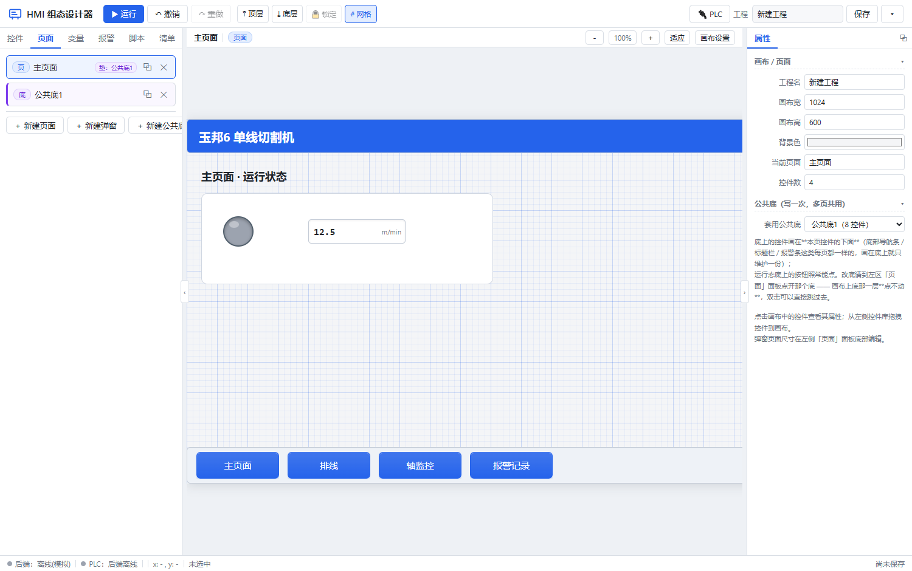
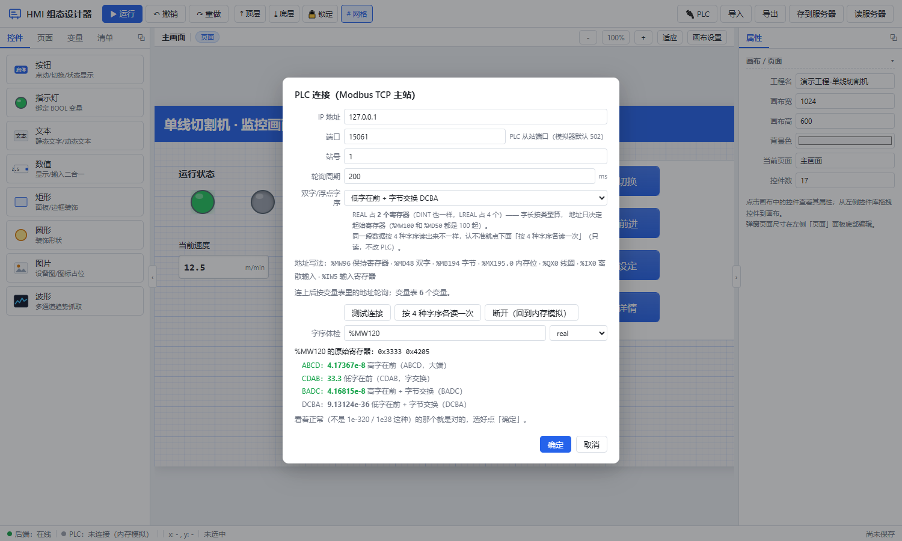
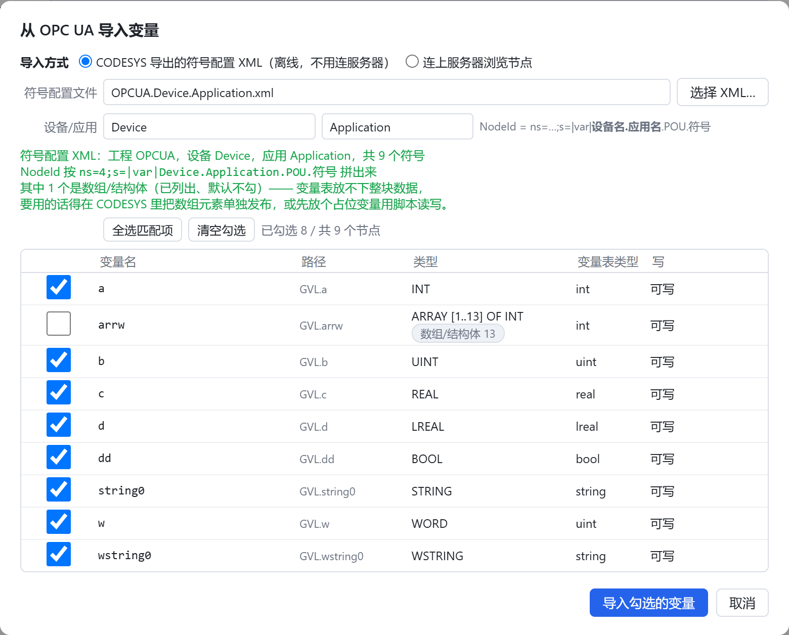
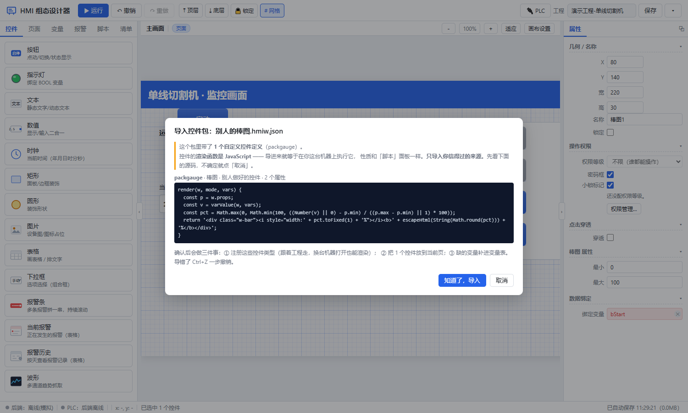

# HMI 组态设计器

可视化拖拽生成 HMI 画面的纯 Web 组态工具：**原生 JS（ES Modules，零构建）前端 + 零依赖 Python 后端**。按钮/输入控件的变量地址先占位、后对接，正好匹配"先组态、后连数据"的工控开发节奏。

## 给客户现场用：**打开地址就是运行态**，要改东西才登录

| 地址 | 谁用 | 要登录吗 | 能干什么 |
|---|---|---|---|
| **`http://<机器>:8866/`** | **客户 / 现场触摸屏** | **不用** | **默认就是这个**：只有运行画面 —— 看数据、按按钮、输入数值、切视图（`Ctrl+Shift+F`）**没有**工具条、面板、右键菜单，也退不出去 |
| `http://<机器>:8866/edit` | 管理员（你） | **要**（默认密码 `admin123`） | 完整组态编辑器：改画面/变量/报警/脚本、连 PLC/OPC UA、存到服务器。现场运行页里按 **`Ctrl+Shift+E`** 也能直接切过来（没登录会先弹登录页） |
| `http://<机器>:8866/login` | 管理员 | 要 | 登录页（密码错了就在原地提示；`set_password.bat 新密码` 改密码） |
| `http://<机器>:8866/run` | 客户 | 不用 | 老地址，会 **302 跳回 `/`**（客户手里那份地址不失效） |

> 本机开发想回到「编辑器在 `/`、运行页在 `/run`」的老习惯：`start_server.bat --editor-at-root`
> （**现场部署不要开**）。自动化测试用的就是这个模式，所以那 30 多个编辑器套件不用改地址。

**现场部署三步**（一次配好，以后客户只管打开地址）：

1. 管理员打开 `/edit` 登录，组态画面 + 在 🔌 PLC 里配好设备连接（**点「确定」时配置会存进 `server/data/plc.json`**）；
2. 「工具 ▾ → **存到服务器**」把工程写进 `server/data/hmi_project.json`（运行页读的就是这一份；改完记得再存一次，客户刷新即见）；
3. 客户机上打开 `http://<机器>:8866/`（全屏就用 `chrome --kiosk http://127.0.0.1:8866/`，或把它设成浏览器主页 / 开机启动）**后端启动时会按上次保存的配置自动连设备**，客户不用点任何「连接」。

### 客户机更省事的做法：原生窗口客户端（PyWebView）

**双击 `start_hmi_window.bat`** 就是一个原生窗口（WebView2），不用记地址、不用看控制台：

* **只开运行页（默认地址 `/`）**，并且在**本进程里**起后端（默认只绑 `127.0.0.1`，端口默认 8866，**被占用就自动换空闲端口**）；
* **进组态编器**：在运行页按 **`Ctrl+Shift+E`** ——**直接切到编辑器 `/edit`**（同一个窗口，不开第二个窗口）；没登录的话先落到登录页，输一次管理员密码就进编辑器。编辑器里用「**工程 ▾ → 去运行画面**」切回运行页，或者「**退出登录**」——退出后自动回到运行页，这个窗口就只剩运行页了（跟客户看到的一样）。
* 改现场那台设备的连接信息不用离开运行页：按 **`Ctrl+Shift+L`** 输一次管理员密码，直接开 PLC 连接设置（`Ctrl+Shift+V` 变量监控同理）；
* **关掉窗口 = 停服务**：轮询、SSE、监听端口一起停，进程退出 —— **端口立刻释放**，不用再跑 `stop_server.bat`，也不会留后台进程（这正是客户机最需要的一条）。
* **记住登录与账号密码**：窗口 profile 是**持久**的（`private_mode=False` + `server/data/webview`），登录会话**落盘**（`server/data/sessions.json`，只存 token 的 sha256）—— 关掉窗口再开、甚至重启后端，12 小时内都不用重新输密码；OPC UA 的账号密码由后端记着（`server/data/plc.json`），连接对话框和导入对话框会自动带回来，**不用每次重敲**。
* 参数：`--fullscreen`（一体机/触摸屏全屏）、`--edit`（一打开就是编辑器，要登录）、`--port 9000`、`--width/--height`、`--data-dir`、`--no-auth`（调试）、`--no-window`（只起服务）。
* 依赖：`pip install pywebview`，**双击 `install_desktop.bat` 一次搞定**；窗口用系统自带的（Microsoft Edge **WebView2** 运行时，Win10/11 一般都有）。
* 页面还是同一套：`/run` 只读运行、`/login` 管理员登录、`/` 要登录才能改 —— 窗口里也一样。
* ⚠ 同一台机器上**只跑一个**：要么命令行后端（`start_server.bat`），要么窗口客户端；两个一起跑会共用 `server/data` 里的存档。
* 老机器没装 WebView2/pywebview 也不会开不了：客户端会打印 `pip install pywebview` 提示，**退回浏览器打开**（那种模式下关浏览器不会停服务，得用 `stop_server.bat`）。

**拦的是什么、不拦的是什么**（说清楚，免得以为是"全锁死"）：

* ⚠ 没登录不能：存工程（`POST /api/project`）、改 PLC 连接（`POST /api/plc`）、OPC UA 浏览/导入、内部变量恢复初值 —— 一句话：**改配置的一律挡住**（401）。
* ✅ 没登录能用：`/run`、读工程（画画面要用）、**写变量**（现场按钮、输入、下拉框就靠它）、下发采集范围、SSE 实时推送 —— 这是 HMI 的本职，拦了客户就没法操作。
* 🔒 口令用 **PBKDF2-HMAC-SHA256** 存 `server/data/auth.json`（不存明文）；登录态是 **HttpOnly + SameSite=Lax + Max-Age 12 小时**的 cookie，会**落盘**到 `server/data/sessions.json`（只存 token 的 sha256）—— **关掉浏览器窗口、重启后端都不用重新登录**；连错 5 次锁 20 秒；**设备口令（OPC UA 用户名/密码）也只发给登录过的会话**（没登录时 `GET /api/plc` 只说"有没有"）。`--no-auth` 可整体关掉闸门（本机开发、自动化测试用）。
* 🔁 忘了密码：`set_password.bat 新密码`，或删掉 `server/data/auth.json` 让它按默认密码重建（同时建议删掉 `sessions.json` 把已登录的会话也清掉）。

## 一分钟启动

```bash
# 方式一：双击 start_server.bat（一键启动，会自检 Python / 端口占用）
# 方式二：命令行
python server/server.py            # 自动打开 http://127.0.0.1:8866/run（现场页）
python server/server.py --port 9000 --no-browser
python server/server.py --host 0.0.0.0   # 需要局域网其它机器访问时才开（默认只绑本机）
python server/server.py --set-password 新密码  # 改管理员密码
python server/server.py --no-auth              # 本机开发：关掉登录闸门
```

界面必须通过服务访问（`http://127.0.0.1:8866/`）。HTML/JS/CSS 一律 `no-store`，改了代码刷新即生效，不会出现「新 JS 配旧页面」的缓存事故。

启动/停止脚本（`start_server.bat` 只含 ASCII 字符——cmd.exe 在不同代码页下解析非 ASCII .bat 会出错，中文提示统一由 `server.py` 打印）：

| 脚本 | 作用 |
|---|---|
| `start_server.bat` | 找 Python → 起服务 → 自动开浏览器（**开的是现场页 `/run`**）；重复双击只会提示「服务已在运行」并打开页面，不会起第二个实例 |
| `start_server.bat --port 9000` | 换端口（参数原样透传给 `server.py`） |
| `start_plc_sim.bat` | 起**模拟 PLC**（Modbus TCP 从站 :502 + 网页调试台 :8899），没有真机也能联调 |
| **`start_hmi_window.bat`** | **客户机用：原生窗口（PyWebView） 内置后端，关窗口即停服务、端口立刻释放** |
| **`install_desktop.bat`** | 一次装好窗口客户端依赖（`pip install pywebview`） 检查 WebView2 运行时 |
| `set_password.bat 新密码` | 设置/修改管理员密码（看 `server/data/auth.json`；忘了密码也用它） |
| `stop_server.bat [端口]` | 按端口结束监听进程（窗口丢了但端口还占着时用） |
| `start_designer.bat` | 旧入口，直接转调 `start_server.bat` |

> ⚠ **不要直接双击 index.html**：浏览器禁止 `file://` 页面加载 ES 模块（`js/*.js` 会被 CORS 拦掉），界面不会启动。
> 直接双击会看到一句明确提示，照它做即可 —— 双击 `start_server.bat`，然后访问 `http://127.0.0.1:8866/`。
>
> ⚠ 后端能直接读写 PLC 变量，因此默认只监听 `127.0.0.1`，并且会拒绝带外部网页 `Origin` 的写请求（防「随便一个网页就能改设定值」）。要让局域网访问就显式加 `--host 0.0.0.0`，并确认现场网络可信。

## 版本号与「立即更新」（点一下就升级，**不用去拉代码**）

仓库根的 `version.json` 是**唯一的版本清单** —— 本地和远端读的是同一份：

```json
{ "app": "HMI 组态设计器", "version": "1.0.4", "date": "2026-10-04",
  "notes": "一句话说清这版改了什么（现场会看到这句）", "url": "http://124.221.183.24:3000/xiaoen/hmi-designer" }
```

| 想干什么 | 怎么做 |
|---|---|
| **发版** | 改 `version.json` 里的 `version` / `date` / `notes` → 提交推送。**完了** —— 现场机器打开编辑器就会看到「⬆ 有新版本 Vx.y.z」，点一下「立即更新」就升级完，不用你去每台机器上拉代码 / 拷文件 |
| **升级那台机器** | 编辑器状态栏的琥珀色徽标 → 点开 → **「立即更新到 Vx.y.z」**：下载代码包（约 5MB）→ 只覆盖程序文件 → 服务自动重启（画面与采集断几秒）→ 页面自动等它回来并刷新 |
| **看当前是哪个版本** | 编辑器状态栏右下角常显 `V1.0.4`（鼠标停上去：日期、build、更新源、检查结果、上次更新结果）；后端启动横幅和当天日志里也有 |
| **不想让它自己更新** | 什么都不用做：**提示归提示，不点就不更新**。要彻底关掉检查/更新：`HMI_UPDATE_URL=`（空串）关检查、`HMI_UPDATE_ARCHIVE=`（空串）关更新 |

### 更新时到底动了什么（三条铁律）

1. **只覆盖程序文件**：白名单 = `index.html`、`version.json`、`css/`、`js/`、`server/`、`docs/`、`tools/`、`test/`、根目录的 `*.bat/*.py/*.txt/*.xml`。
   **`server/data/` 一律不碰** —— 现场的画面工程（`hmi_project.json`）、变量表（`vars.json`）、PLC 配置（`plc.json`）、报警记录、口令、掉电保持值全在那儿。
   ⚠ 代码包里**确实带着**这几个文件（它们在版本库里），所以这是代码里**显式跳过**的，不是"碰巧没覆盖到"（见 `server/updater.py` 的 `SKIP_PREFIXES`）。
2. **覆盖前先备份**：`server/data/_code_backup/<时间>_<旧版本>/`（带 `_manifest.json`：哪些是替换的、哪些是新加的；只留最近 3 份）。
3. **起不来自动回滚**：更新后由 `server/_restart.py` 把服务拉起来并轮询 `/api/health`；新版本 **45 秒内没应答或版本不对** → 按备份**还原替换过的文件、删掉新增的文件**，再用旧代码拉起来。结果写 `server/data/_update/status.json` + `logs/update-YYYY-MM-DD.log`，编辑器下次打开会在状态栏说一句「上次更新失败，已自动回滚」。

**现场服务起不来时的最后一条路**（不用打开编辑器、不用网络）：

```bash
python server/_restart.py --rollback     # 退回最近一次更新前的代码
# 然后重新双击 start_server.bat 或 start_hmi_window.bat
```

### 检查是怎么走的（以及为什么这么快）

* 后端用**标准库 `http.client` 直接拉**远端 `version.json` 比对版本号，**不需要 git**（现场一体机不一定装 git）；**不认 `http_proxy`**（车间代理会把内网地址一起代理掉，表现为"莫名查不到"）。
* **开机预热**：后端启动时后台先查一次，所以打开页面基本是秒出结果（实测首次查询 4ms）。
* 自动查成功一次后 **6 小时内不再问**（省流量）；人点「检查更新 / 立即更新」**只挡 2 秒内的连点** —— 必须真去拉一次。
  ⚠ 这条是踩出来的：以前 force 也吃那个 30 秒间隔，于是刚重启完（预热才拉过）点「立即更新」，会拿旧缓存回一句"已经是最新版本"（明明徽标还在说有新版）。
* 拉不到就**彻底安静**（现场没外网是常态）：不弹窗、不报错、不挂徽标，只在版本号的鼠标提示里写一句原因；**运行页（`/run`）压根不加载这套**，客户看不到也打扰不到（更新是管理员的事）。断网前查到过新版会保留上次结论并标「上次检查的结果」，不会因为一次断网就让提示凭空消失。
* `version.json` **带不带 UTF-8 BOM 都认**（记事本存出来的带 BOM 也照样读 —— 变量表 CSV 导入踩过同一个坑）。
* **排查**：`GET /api/update/check` 给判断结果（`same` / `newer` / `local_newer` / `error` / `disabled` + `error` 原因）、`?force=1` 当场重查；`GET /api/health` 的 `update.last` 是上一跳的落地结果。

### 更新是怎么重启的

后端没法"自己重启自己"（模块早就加载完了，不换进程跑不上新代码），所以：

* 点「立即更新」→ 后端下载、覆盖、把状态写进 `server/data/_update/`（它不会被更新覆盖）→ 写重启标记 → **退出**
* `server/_restart.py`（被拉起来的 detached 助手）→ 等端口放开 → **按原来的启动方式**用新代码拉起来：
  `start_server.bat` 起的就还起命令行后端、`start_hmi_window.bat`（原生窗口）起的就连窗口一起拉回来；
  命令行重启会自动补 `--no-browser`（页面本来就开着，别再弹一个）
* 新进程的输出接进 `logs/update-YYYY-MM-DD.log`，**新代码起不来时的 traceback 就在那里** —— 不然现场只看到"服务没了"，查不出为什么
* 助手的 `--rollback` 是人工逃生口（见上）

> 命令行（`start_server.bat`）模式更新后，服务会**在后台 run**（控制台窗口回到提示符/关闭），
> 页面照常能开、日志照常写 `logs/hmi-*.log`；想恢复"有控制台窗口"的样子，关掉服务重新双击一次即可。

## 打包成 exe：客户机双击就用（安装包可选安装路径）

现场不想装 Python、不想记地址、不想看控制台 —— 那就用**安装包**。打出来的东西分两层：

```
C:\Program Files\HMI-Designer\          ← 安装时自己选的位置
├── HMIDesigner.exe                      ← 壳：Python 运行时 + pywebview + WebView2 桥接
├── _internal\                           ← 壳自带的东西（很少变，日常更新不碰）
└── app\                                 ← **业务代码全在这儿（日常更新只换这一层）**
    ├── index.html  css\  js\
    └── server\  (server.py / modbus.py / updater.py / _restart.py …)

C:\ProgramData\HMI-Designer\             ← 现场数据（安装/更新/卸载**都不会动它**）
├── data\   (画面工程 / 变量表 / PLC 配置 / 报警记录 / 口令 / 掉电保持值)
└── logs\   (按天的运行日志、更新日志)
```

**为什么非要拆成两层**：**运行中的 exe 不能覆盖自己**（Windows 会锁住正在执行的可执行文件）。
所以"更新"只能是"替换旁边那几个文本文件" —— 这样更新**不用重装、不弹 UAC**、只有几 MB；
只有"壳"本身（Python 运行时/pywebview）要升级时才需要重跑安装包。另外数据放 `%ProgramData%`
而不是安装目录，安装/更新/卸载就**根本碰不到现场工程与配置** —— 这是"更新不会删配置和工程"的
根本保证，比"更新时小心别删"可靠得多（`server/updater.py` 里还有第二道硬断言）。

### 打一个发布版

```powershell
.\tools\build-release.ps1                 # 本地产出 build\release\（不发出去）
.\tools\build-release.ps1 -SkipExe        # 只重打 app 代码包（壳没变时用，几秒）
# 发到发布仓库（需要凭据环境变量，别写进脚本）：
$env:HMI_GIT_USER='xiaoen'; $env:HMI_GIT_PASS='……'
.\tools\build-release.ps1 -Publish
```

产出三样（都在 `build\release\`）：

| 文件 | 多大 | 用途 |
|---|---|---|
| `HMIDesigner-Setup-<版本>.exe` | ~36 MB | 完整安装包：**可选安装路径**、开始菜单/桌面快捷方式、卸载器、静默安装 |
| `HMI-Designer-<版本>-app.zip` | ~3 MB | **日常更新用的代码包**（就是 `app\` 那一层） |
| `version.json` | 1 KB | 发布清单：版本/说明 + 代码包的 **sha256** + 壳最低版本，发到发布仓库根 |

安装包静默安装（批量部署/自动化用）：

```bat
HMIDesigner-Setup-1.0.4.exe --silent --dir=D:\HMI --no-shortcut --no-launch
HMIDesigner-Setup-1.0.4.exe --uninstall --dir=D:\HMI      :: 卸载（保留现场数据）
```

### 发布仓库（专门放包，源码仓库只放源码）

`http://124.221.183.24:3000/xiaoen/hmi-designer-release`

* `version.json` → 提交在仓库根（小文本，能直接 raw 拉）
* 两个大文件 → **tag `v<版本>` 的 Release 附件**（`…/releases/download/v1.0.4/…`），不进 git 历史
* ⚠ **同名附件 Gitea 会并存、按名字下载解析到第一个** —— 所以"同版本重发"必须先删旧附件
  （构建脚本已按 `releases/{release_id}/assets/{asset_id}` 删干净，并在上传后**下载回来比对 sha256**；
  客户端的 sha256 校验也拦得住这种"发了新版却下了旧包"）

### 更新是怎么走的（exe 版）

1. 编辑器状态栏「⬆ 有新版本」→「立即更新到 Vx.y.z」
2. 后端从发布仓库下 **app 代码包**（先比对清单里的 sha256，不对就整包丢弃、代码一个字节不动）
3. 只覆盖 `app\` 里的程序文件：**`server/data` 一律跳过**，另有硬断言拒绝任何写进数据目录的路径
4. 覆盖前把要被替换的文件备份到 `<数据目录>\_code_backup\<时间>_<旧版本>\`
5. 写状态 → **退出** → `HMIDesigner.exe --hmi-update-helper`（exe 自带解释器，所以助手也是它）
   等端口放开 → 用新代码把 exe 重新拉起来（**连窗口一起**）→ 轮询 `/api/health`
6. 45 秒没起来或版本不对 → **按备份自动回滚**（替换过的还原、新增的删掉）再用旧代码拉起；
   结果写 `data\_update\status.json` + `logs\update-*.log`，编辑器下次打开会提示「上次更新失败已回滚」
7. 人工逃生口：`HMIDesigner.exe --hmi-update-helper --rollback`（不用开编辑器、不用网络）

`version.json` 里的 `min_launcher` 比本机壳版本高时，就地更新会被**明确拒绝**并提示"装新版安装包" ——
运行时的升级不可能靠在旁边放几个 .py 完成。

### 第一次打开是什么样（装机当天）

服务器上还没有工程时，程序**照样进运行态**，显示内置的演示画面，右下角常显一句：

> **演示画面**（服务器上还没有工程）
> 管理员：**Ctrl+Shift+E** 登录 → 「工程 ▾ → 存到服务器」，客户机刷新即为正式画面

⚠ 以前这里只挂一条「服务器上还没有工程 + 去 /login」的提示就 `return`，**根本不进运行态** ——
客户第一次打开看到的是一句提示和一条通往编辑器的链接，像"装完不能跑"。现在只要本地有能显示的画面
（全新机器就是内置演示工程）就直接进运行态；连页面都没有时才退回那条提示。

图标：`packaging/hmi.ico`（由 `tools/make-icon.py` 生成，9 个尺寸，exe / 安装包 / 快捷方式都用它）
＋ `favicon.ico`（网页方式的页签图标）。设计取舍写在脚本开头：16px 下还要认得出，所以只有
"屏幕 + 波形 + 状态点"三个元素。

### 打包/发布时的注意事项（都是踩出来的）

* **打包要用稳定版解释器**：这台开发机的 `py -3.10` 是 **3.10.0b1（beta）**，PyInstaller 扫字节码会
  `IndexError` 崩掉；脚本默认用系统 Python 3.11（它也装了 pywebview/asyncua，窗口自检 `SELFTEST_OK`）。
* **装静态文件不能靠工作目录**：`SimpleHTTPRequestHandler` 默认按 cwd 找文件，源码方式跑时 cwd 正好是
  工程根目录看着没事，装到 Program Files 后 `js/*.js` 全 404 → **窗口能开、接口全对、就是白板**。
  现在 `HMIServer.translate_path` 一律从 ROOT 找。
* **安装器"跳过 data 目录"必须精确匹配**：一刀切 `data` 会把 `js/data/pinyin.js`（拼音数据）一起跳过 →
  同样的白板症状。规则改成只看 `server/data/`、`logs/`、`__pycache__`。
* **Inno Setup 拿不到**：它只发布在 GitHub，这台构建机连不上（winget 也因此卡死），所以默认用
  `packaging/installer.py` 这个自带安装器（一样有可选路径/快捷方式/卸载器/静默安装）。
  能上 GitHub 的机器把 `-Iscc <ISCC.exe>` 传进来就会优先用 Inno（`packaging/HMIDesigner.iss` 已备好）。
* **构建脚本是纯 ASCII 的**：这台机器的 shell 是 **Windows PowerShell 5.1**，无 BOM 的 UTF-8 脚本会被
  当 GBK 读、中文串直接把解析器搞崩（和仓库里 `.bat` 只写英文是同一个原因）；而且 5.1 没有
  `Invoke-RestMethod -Form`（上传附件得用 `curl.exe`）。

## 功能总览

| 功能 | 说明 |
|---|---|
| 可视化拖拽 | 左侧控件库拖入画布；拖动 / 8 柄缩放 / 框选 / Shift 多选 / 方向键微移 / 网格吸附(5px, Ctrl 临时关)；**画布可缩放：Ctrl+滚轮（锚定鼠标位置）、Ctrl+加/减/0、工具条 － 100% ＋ 适应**，缩放比例记住 |
| 面板停靠 | **五个面板（控件/页面/变量/清单/属性）可自由摆放**：拖标签到左/右/下边缘停靠（**拖动时有半透明落点预览，明确显示会停到哪**）、同一区域自动合并成标签页、拖到画布中间（或点 ⧉）变成浮动小窗（可拖动/右下角缩放/⇤ 停靠回去），空区域自动收起把空间让给画布，布局**跟着工程一起保存**（存文件 / 存到服务器都带走，换台机器、换个浏览器打开还是这个摆法）。落点判定：窗口左右两侧边缘 → 左/右区；**画布下方那条灰色带 → 底部区**；画布中间 → 浮动窗 |
| **右键菜单** | **应用内屏蔽浏览器右键，改成按目标给功能**：控件（剪切/复制/粘贴/**再复制一份/多重复制…**/置顶/置底/锁定/删除，多选时给对齐·均布）、画布空白（粘贴/全选/网格/画布设置/缩放）、面板标签（浮动·停靠到左·右·下）、浮动小窗标题（停靠回去）、控件清单行（定位/复制/锁定/删除）、页面行（切换/重命名/新建/删除）、变量行（复制变量名或名称+地址/添加/删除）、运行态（缩放三档·PLC 连接设置·变量监控开关·快捷键提示·退出运行，每项都带组合键）。输入框里保留浏览器原生菜单（复制粘贴/拼写检查要用），变量表例外——整行都是输入框，菜单照弹。键盘 ↑↓/Enter/Esc 可用 |
| 15 种控件 | **数值类控件（数值 / 数值显示 / 数据输入）都能选数据类型（int/uint/dint/udint/float·real/lreal/string）+  自己填小数位（0~6）**；按钮（**新建默认启用状态显示、默认绑定第一个变量，添加动作时变量自动同源**；比较条件仅数值/字符串变量显示，bool 直接开/关；**背景可真透明**——透明时可选独立边框色；**「延迟触发(ms)」可要求按住够久才执行，防误碰**）、指示灯（**默认 50×50、文字默认「里面」居中显示**；双状态文字灭时/亮时各配一段随变量切换；文字位置右侧/左侧/下方/里面四种，字号颜色自设；**点亮是圆形柔光，不会在圆外透出方块**）、文本、**数值（显示/输入二合一，属性里可设「可输入」或只读）**、矩形、圆形、图片占位、**表格（画格子：列数/行数/表头/单元格文字）**、**下拉框（组合框：选项选择，选一项写变量）**、**报警条 / 当前报警 / 报警历史（配合报警编辑栏用）**、**时钟（当前时间，格式自己定：预设「年-月-日 时:分:秒」「时:分:秒.毫秒」…或自定义 `YYYY年MM月DD日 hh时mm分ss秒`，还能加前缀/后缀，如「当前时间：… · 班次A」；等宽数字跳秒不抖）**、**波形（多通道趋势抓取）** |
| 编组（组合） | 多选几个控件 → **Ctrl+G 组合**（工具栏/右键菜单里也有）：之后**点其中一个就选中整组**，一起移动、一起缩放（组内相对布局按比例保持）、一起删除/复制；**Ctrl+Shift+G 取消组合**；**组合里照样能单独改某一个控件**（四种入口，怎么顺手怎么来）：① 选中整组时，属性面板顶部列着「**组内控件（N 个）· 点一个只选它**」，点一下就只选中它、面板换成它自己的属性；② 画布上 **Alt+点击** 某个成员；③ 右键整组 → 菜单里直接列着成员名，点一个只选它；④ 控件清单里 **Alt+点击** 某一行只选它（普通点击仍是整组）。只选中组内某个控件时，面板顶部会提示「在组合里…现在只选中了这一个」并给一个「**选中整组**」按钮，随时回到整组。⚠ 只选一个成员时拖动/缩放只动它自己，组不会散。⚠ 关键区别：**对齐/均分/等大小都把组当成"一个整体"** —— 左对齐时整组挪到基准边线，组内相对位置一动不动（不像普通多选那样把每个成员各自对齐）；等宽是把整组按比例缩放到基准宽度。整组选中时外框上有「组 N」角标，未选中的组成员有淡紫色虚线提示 |
| **框选（多选）** | 在画布上按住左键拉一个框 → **框到的控件都选中**（压住一点边就算，和以前一样；多选之后可以一起拖、对齐、复制、删除）。**画布外那一圈灰色区域也能起框** —— 从画布外按下、拖进画布，画布里的控件照样框得住（想框画布边缘那几个控件时，不用先精确点在画布里的空白处）；在画布外空白处点一下 = 取消选择；按在画布容器的**滚动条**上拖不会误清选择。缩放（25%~400%）、滚动画布容器之后，框选位置依然准确 |
| **面板表格列宽（变量 / 报警）** | 左区两张表的**列宽能拖**：鼠标移到表头两列之间的那条竖线上（光标变左右箭头）按住左右拖就是调那一列的宽窄，**双击那条线 = 恢复默认**。没拖过的表布局跟以前一模一样；拖过之后"拖多少就是多少"，**另一列（变量表=地址、报警表=内容）自动吃满面板剩下的宽度** —— 面板拉宽它自己跟着变宽，不会在右边留一条空带（面板被拖宽/停靠切换时也会自己重算）。宽度记在**本机**（跟面板折叠状态、画布缩放倍率一样，不写进工程文件），换台机器打开是默认宽度。两张表都加了**列边框线**（列与列之间一条竖线、表头那条重一点、整张表外圈一圈边框），列多的时候一眼看得出每格到哪儿结束 |
| **报警（报警编辑栏）** | 左区多了「报警」面板：一条报警 = **触发条件**（变量 + 比较符 + 阈值） + **内容**。**点上面「＋ 添加报警」开弹窗**，名称/级别/变量/比较/阈值/延时/启用 + 内容一次填完；**点「内容」格就在格子里就地改**（改一两个字不用等弹窗；Ctrl+Enter 或点别处存下、Esc 撤消，整段只记一步 Ctrl+Z）；**要写多行 / 插变量 / 看预览就点「内容」前面那个 ✎ 开弹窗**（行尾的「✎」和「✕」都按现场要求去掉了）。**每一行最左边可勾选、表头可全选** —— 勾上几条后底部出现「**删除选中 (N)**」一次删掉（批量删只弹一次确认；**一次批量删 = 一步 Ctrl+Z** 就能整体撤回来）。表头全选只管**当前筛选出来的**那些（筛选框里有字时，不会把藏起来的行也选上）。**表格自己是个滚动框**：左右滑动栏钉在表格底边（不是整张表的最下面），报警几百条也不用先滚到最低才够得着；面板高度自己吃满筛选框和底部按钮之间那块。内容用**大文本框**写，可多行、可点「插入变量」把 `{变量名}` 插到光标处（**按钮最多摆 6 个（正好一行），多的收进「＋还有 N 个…」，点开可收起；变量格里打字也会一起筛**），下面**实时预览**触发时会显示成什么；**变量格本身就是搜索框**（和属性面板同一套 `js/editor/varPick.js`：点进去看**全量**候选、打字**只按变量名**过滤 —— 中文名照样输得进、搜得到，不再只列前 50 个），回车或点一行确认、Esc 收起。**支持 CSV**：`导出 CSV` / `导入 CSV`（列名 `名称,变量,比较,阈值,延时s,级别,内容,启用`，首行表头可有可无；级别写中文或 `info/warn/alarm/urgent`；启用写 `是/否`；内容里的逗号/引号/**换行**都按 RFC4180 转义，Excel 改完存回 CSV 再导进来即可，三种导入方式：同名更新 / 清空后替换 / 全部追加；非法行会跳过并逐行报原因，变量不存在只提醒不拦）。还能设**级别**（提示/警告/报警/紧急）、**延时**（条件要持续几秒才算，防抖动误报）、**启用开关**。条件成立 → 进「当前报警」记一条「报警历史」；条件恢复 → 自动移出并补上恢复时间。变量改名/删除会同步改掉条件与 `{引用}` |
| **脚本** | 左区「脚本」面板：一条脚本 = **触发方式 + 一段 JS**。触发方式五种：**进运行态时一次**（初始化）/  **定时**（每 N 毫秒）/  **循环**（每个运行周期 50ms）/  **变量变化时** / **变量条件成立时**（上升沿，成立只触发一次）。点「✎」开**近乎全屏的编辑器**（94vw×92vh）：左边代码区**有 JS 语法高亮**（注释/字符串/模板串/数字/关键字/内置对象/函数名/hmi.xxx 各自配色，光标行淡蓝底，选中半透明不挡字）+ 行号、Tab 缩进、回车自动缩进、Ctrl+S 保存，右边给**一条能直接点的变量例子**（`hmi.set('变量名', true)`，点一下插到光标处 —— 原来把变量表全列成按钮，变量一多就摊一大片）+  **API 速查**（点一下插入），下面一条日志区（语法检查、试运行 log、运行错误都在这）。脚本里用注入的 `hmi` 对象：`hmi.get/set`（写变量会下发 PLC）、`hmi.log/warn`、`hmi.page/popup/hidePopup/back`、`hmi.alarms()`、`hmi.time()`…；**算术/分支/循环/模板字符串都能写**（`1*5`、`for` 累加、`` `n=${n}` ``），只是「光写一个表达式」不会有输出 —— 用 `hmi.log(1*5)` 或 `hmi.set('x', 1*5)`，或者在编辑器里点「▶ 试运行」：它会像控制台一样把**最后一句的值**打出来（`1*5` → `= 5`，`let x=4; x*3` → `= 12`）。保存前先做**语法检查**（错了不保存），运行错误进日志并带行号，**连续出错 5 次自动停用**那条脚本（本次运行内），退出运行态所有定时器停掉 |
| 报警条 / 当前报警 / 报警历史 | **报警条**：一条横条，**当前所有报警拼成一串在里面一直滚**（`[时间] 内容 ● [时间] 内容 …`，分隔符可改；同一份内容放两遍做 `translateX(-50%)` 无缝循环，不会滚完跳回开头；滚动带用 `width: max-content` 撑到「两份内容」宽 —— 不写的话块级容器会取父容器（可视区）宽度，`-50%` 只走半个可视区，表现就是「滚一半突然跳回开头」）；按**滚动速度** px/s 折算时长、**装得下就不滚**（短文字不晃眼）、可关「超长滚动」；级别色、可闪烁、**背景色可点「透明」**（透明就只剩文字和边框；不设颜色时按最高报警级别着色）、默认**没报警就整条隐藏**；不想要拼接就把「拼接全部」勾掉 → 只显示最严重那条 +「还有 N 条」。**当前报警 / 报警历史都是表格**：级别 · 时间 · 内容（历史多一列「恢复」，当前报警可点「确认」）；**同时在报警的条数可能上千，控件最多画前 200 行**，多出来的在最后一行写「…还有 N 条报警」（2000 条全画出来时整块重建要 31ms、帧率掉到 50fps 以下，实测）。**时间格式可选**（时:分:秒 / 带 .毫秒 / 月-日 / 年月日…，也能自己拼 `YYYY MM DD hh mm ss SSS`），**历史可按天翻看**：`‹ › 今天` + 日期框，切到哪天就显示哪天的记录（历史记录存**服务器** `server/data/alarm_history.json` —— 换个地址（127.0.0.1 ↔ 局域网 IP）、换个浏览器、新开一个 PyWebView 窗口打开都还是同一份；**环形存储上限 5MB**，超了从最早那条开始丢，最近的一定留得住）| 
| 下拉框（组合框） | 属性里一行一个选项：`显示文字` / `显示文字=值`（如 `手动=0`）/ `显示文字=值=状态色`（如 `自动=1=#22c55e`）。**每个状态可以各配一个颜色**：「状态颜色」那栏一行一个色块（点色块选色、✕ 清掉，颜色就写回选项行末尾——不另存第二份表），当前选中那一项就按它上色，用在哪由**状态色用在**定：**背景（文字自动黑/白）**（默认，11 个状态一种文字色不可能都看得清，深色底自动配白字）/ **背景（用上面的文字色）** / **文字**；弹层里每个选项前面再带一个该状态的色块。**操作方式**三选一：**只能选**（点开列表挑一项）/ **可选也可输入**（列表末尾多一行「✎ 输入…」，点它弹软键盘手填，填的值不在选项里也照样写进变量并直接显示）/ **只显示状态**（不可操作、连小三角都不画——当状态牌用，如「机器状态」）。绑定一个变量，运行时选中某项就把**选项值**（或**序号**从 0 / 从 1，可切）写进变量并下发 PLC；变量被外部改（PLC 推送）时选中项自动跟着变；值不在选项里时显示 `--（当前 x）`（**可选也可输入**时直接显示这个值）；字符串变量则写选项文字本身。**弹层是自绘的**（原生 `<select>` 的列表行高由浏览器定，改不了也截不到图）：「**选项行高**」可调（默认 36px，触摸屏建议 40+）、「**最多显示几项**」超出滚动；下面空间不够会自动往上翻，并按可用高度限高，不会被画面边缘裁掉 |
| 表格 | 就是**画一张表**：列数 1~12、行数 1~30、「画表头」开关、表头文字与单元格文字都用逗号分列（**一行一行写，像从 Excel 粘过来**；写不满的格子自动留空），行高/字号/对齐/文字色/表头底色/线色/线宽/圆角/斑马纹可调。纯文本渲染（格子里的 HTML 会被转义，不当标签执行），**不绑变量、不抢光标**，编辑态和运行态长得一样 |
| 数值显示的小数位 | 显示**和读回**都按小数位走：PLC 读回 `12.34567928314209`，`%.1f` 的输入框显示 `12.3`、`%.2f` 的显示控件显示 `12.35`，变量监控只留 6 位有效数字（`12.3457`）；**点进去又点出来（没改内容）不会把四舍五入后的值写回 PLC**，真改了才下发 |
| **波形抓取** | 一个控件同时抓多路：**固定 8 路通道，每路一个下拉选变量**（每路一个变量格：输入框 + 候选表，留空即停用该路；同一变量只能占一路，撞了会被挡住并说明已在第几路）、逐路配色、**采样周期/时间窗口**、**纵轴自动或固定量程**、逐路**倍率×偏置**（显示值 = 原值×k+b，多路量级差很多时用它对齐，如 ×0.01）、网格/图例/线宽/小数位可调；**鼠标移上去出现光标读数**（竖线 + 各通道该时刻的值，点一下钉住、再点取消，右侧自动翻边不出框），运行态实时滚动绘制（约 30fps，canvas 自绘，缓冲只保留时间窗口内的数据），布尔量按 0/1 画；运行中**右键波形可清空记录 / 暂停-继续采样**；编辑态显示静态预览便于调样式 |
| **变量选择** | 凡是选变量的地方都是同一套（`js/editor/varPick.js`）：**框本身就是搜索框** —— 点进去看**全部**候选（变量表有多少列多少，中文名也在；想换一个不用先把名字删掉）、一打字就**只按变量名**过滤（**变量名永远在最左边**；类型和**短**地址作为右边的说明：`real · %MW100`、`已在通道2`、`类型不匹配`；OPC UA 那种长 NodeId 地址不塞进行里——不然变量名会被挤出可视区，只在悬停提示里给全），↑↓ 选、**回车或点一行确认**、Esc 关掉；右侧 ✕ 一键清空（波形里 = 停用这一路）。名字不在变量表里**当场标红**并悬停说明（否则运行起来是静默失效）。用在**数据绑定 / 波形 8 路通道 / 动作里的变量 / 报警表的变量格 / 脚本触发变量**上；波形里同一变量不能占两路（撞了退回原值并在状态栏说明）。运行时变量监控抽屉另有筛选框（名称或地址），折叠时一起收起 |
| 控件属性 | 右侧面板 schema 驱动：几何、外观（字号/颜色/**透明**/圆角/边框宽）、数据绑定、动作；**分组可点击收起/展开（记住状态）**；**改属性立即生效**——文本/数值/色板边输入画布边变，动作的增/删/改类型即时刷新列表 |
| 多页面 | 普通"页面" + "弹窗"两类；页面跳转、返回上一页 |
| 弹窗 | 弹窗页可设尺寸，支持多层弹出（后弹的层级更高）；**模态**：打开期间遮罩拦截后方点击，仅 ✕ / 配置动作可关；**标题栏可拖拽移动** |
| 点动/切换 | 按钮动作：点动（按住=TRUE/松开=FALSE）、切换（点击翻转保持）、置变量值、跳转页面、打开/关闭弹窗、返回上一页、**清空报警记录**。**换动作模式不会把变量清掉**（点动→切换→置值，变量一直是原来那个）；动作区还有个勾选「**变量与「状态显示」的变量一致**」：勾上后动作里的变量跟着显示变量走（改一处即可，下拉会置灰），没选显示变量时会明确提示去选、不会把配好的变量清空 |
| **点击穿透（叠着的控件一起触发）** | 两个控件叠着放的时候（一个大方框压在按钮上、或者两个透明按钮压在一起），浏览器默认只把点击给最上面那个，下面的收不到。控件属性里多了一栏**「点击穿透」**，就一个勾：**不勾**（默认，点谁算谁，老画面一点不变）/ **勾上「穿透」**（点我照常算数、我自己的动作照做，**同时继续往下传** —— 压在下面的控件的动作也一起做；一次点击，叠着的都触发。方框自己没配动作时，它就等于"透过方框点到下面的按钮"）。往下传遇到**不穿透**的控件就停（那层是"实心"的），要继续往下就把那层也勾上；只认**同一层容器**（页面那层 / 弹窗那张卡片），不会把弹窗底下的主画面按钮一起点了；往下传的只有**点击类**动作（点动是"按住/松手"两个时刻，不属于一次点击的事）。**只作用于运行态**：组态画布上照样能点中、能拖（不然被压住的框就选不中了） |
| **按钮延迟触发（防误碰）** | 按钮属性里填「**延迟触发(ms)**」：**按住够这么久才执行动作**（1000 = 1 秒），**中途松手 / 手指移出控件 = 取消，不算数**；按住过程按钮**底边有一条从左往右长满的进度条**（琥珀色，浅色按钮和深色按钮上都看得见），到点**满格变绿并一直亮着**（手不松就一直亮，松手才收）—— 一眼就知道"好了，可以松手了"。0  = 点一下立即执行（**老工程缺这个键同样按 0，行为不变**）。用在启停、清记录这类怕误碰的操作上（现场一般是 500~3000ms）。⚠ 只作用于「点击类」动作：点动（按住=TRUE/松开=FALSE）本来就是按住语义，不受影响<br> <br><sub>左：按住过程（琥珀色进度条）　右：到点（满格变绿，松手才收）</sub> |
| **操作权限（现场分级密码）** | 现场不是谁都能动关键按钮：**工程 ▾ → 权限管理…** 里配一张**等级表**（等级名 + 密码，可增删、可上下调高低），**每个控件属性里都有「权限等级」**（所有控件都能配，`不限` = 谁都能操作）。运行态点到权限不够的控件 → **弹密码框**（带数字键盘，触摸屏没实体键盘也能输），输对了才解锁，**这次动作不执行**（输完再按一次，不做"自动补执行"——防止解锁瞬间把启动命令下发出去）。解锁**高级别 = 低级别也都能操作**；解锁后控件角上的小锁变成 🔓，画面顶部出现「**已解锁 xx · 点这里退出权限**」小胶囊。**退出权限**三条路：① 点那个小胶囊；② `Ctrl+Shift+Q`；③ 按钮动作里配「**退出权限（锁定）**」。可配「**解锁后 N 分钟没操作自动上锁**」（0 = 一直有效）；每个控件属性里有「**密码框（权限不够时自动弹出）**」（不勾 = 点了没反应、不弹框不给提示）和「**小锁标记**」（**默认勾上**：等级不够时角上挂一个 🔒 ——一眼看出为什么点不动，解锁后自己消失；个别控件不想显示就把它取消勾选，运行态照样拦）。**刷新 / 关窗口 / 退出运行态 = 自动回到未解锁**（解锁状态只在内存里，不落盘）。密码跟着工程走（工程里是混淆串、组态端看得见原文、JSON 里不露明文），**权限管理关着时运行态完全不拦**（老工程行为不变） |
| **清空报警记录（按钮动作）** | 按钮动作里选「**清空报警记录**」：一按就把**报警历史记录**清掉（报警历史控件里那个「清空记录」按钮是同一件事），两处清的都是**服务器上那份报警记录**（`server/data/alarm_history.json`，本机 localStorage 只是后端没开时的兜底）。**只清记录，当前报警不动** —— 当前报警是引擎每 200ms 按条件重算的，条件还在就立刻会回来，清了没意义。想防误碰就配上面的「延迟触发」，两个一起用 = 「按住 1 秒清记录」。**权限**：清空按钮按**控件自己的「权限等级」**拦（想保护历史记录就给那个控件配一级；没配 = 谁都能清）——没有单独的那一档设置了 |
| **按钮状态显示** | 按钮可绑定变量显示状态：bool → 开/关双态（文案、满足色/未满足色自设）；数值/字符串 → 六种比较符（== != > < >= <=）+  比较值；未绑定或关闭时显示原文本。运行态随变量实时变色变字。**属性面板里单独一栏「状态显示」**（满足/未满文字 · 比较 · 比较值 · 满足/未满底色），不看的时候点标题收起来（折叠状态记住）—— 从"按钮属性"那一大串里分出来的 |
| 数据输入输出 | **数值二合一控件**绑变量：**数据类型 int/uint/float/string + 小数位自设（0~6，0=无小数点）**+ 单位；运行态点击进入输入（**软键盘**[默认，可拖动] / 内联输入 可选），回车提交写变量 |
| 对齐/均布 | 左对齐/居中/右对齐/顶/中/底 + **水平等间距分布 / 垂直等间距分布**（≥3 个） |
| 变量类型 | bool / int / uint / dint / udint / real / lreal / string，含 PLC 地址占位列 |
| **控件清单** | 左侧「清单」tab：列出页面所有控件及配置，**点击行跳转定位高亮**该控件。**类型徽章按"家族"配色**（操作/数值/文本表格/报警/波形/图形 一眼分得清，同类型同色）；**配置那一列**：Modbus/TCP 显示「变量名 @%MW100」（短地址是现场查点位要用的），**OPC UA 那种长 NodeId 不显示**（跟变量名基本重复、又长到塞不下）；行尾「Aa」按钮可**隐藏控件名称**（只留类型 + 配置，自动名如"数值4"是噪音；名字悬停仍能看到），选择记在本机；旁边「**底**」按钮可**把公共底那一层的行收起来**（只想看这一页自己的控件时用它，选择同样记住）。配了操作权限的控件挂 `🔒 等级名` 标记 |
| 变量表 | 名称 / 类型(8 种) / **PLC 地址**（+ 字长·长度） / 保持；**每行可勾选、表头可全选 →「删除选中 (N)」一次删掉多个**（没人引用的不弹确认，删错 Ctrl+Z 就回来；还被控件/报警引用时才拦一下，并说明有几处引用会被清空）。**行尾不再有「✕」**（现场要求）：删一条 = 勾上它再点「删除选中 (1)」，或在这一行上右键「删除变量」；数组/前缀组表头行尾的整组「✕」同样去掉了 —— 组左边那个勾选框就是"一次选整组"，勾上再点「删除选中」。**地址按类型给标准写法**：**bool 用位地址** `%MX0.0`（也可 `%QX0.0` 线圈 / `%IX0.0` 只读输入，位号照写：`%IX0.1`、`%QX2.3`），**字类型用** `%MW100`／`%MD50`（写错风格鼠标停在地址格上会提醒），**直接写数字也行**：`100` = `%MW100`；老写法 `HR100` 在输入 / CSV 导入 / 打开老工程时自动转成 `%MW100`，一张表里不会三种写法混着；**CSV 导入导出**（Excel 互通：导出带 BOM；导入按名称 upsert，同名更新、新名追加，非法行跳过并回报；**导入自动认编码**：UTF-8（有/无 BOM）、UTF-16（带 BOM）、**GBK·GB18030·Big5** —— Excel 在中文 Windows 上「另存为 CSV」默认就是 GBK，以前按 UTF-8 读会全是乱码）|
| **按页采集（通讯效率）** | 运行态**只轮询当前页面用到的变量**（控件绑定 / 按钮动作 + **报警条件里的变量**，打开着的弹窗也算；**波形通道例外：所有页面的波形通道都一直采** —— 波形采样本来就跨页面在跑，切走再回来中间不能是一段死值），别的变量不占带宽；**连续地址自动合并成一次读**（`%MW100/102/104` → 1 次读回 5 个字，块内最多 125 字）；切页面/开关弹窗立刻重新下发采集范围（**切走的那一页立刻退出采集，不留尾巴** —— 免得来回翻几页「在采的变量数」一路涨；想让上一页再留一会儿就设 `app.scopeKeep.keepMs = 10000`），状态栏显示「**本页 N 变量/M 块**」，变量监控里给不在采集范围的变量标「**未采集**」，监控标题的「(在采 N/共 M)」鼠标停上去会说清**这 N 个是怎么来的**（本页 x 个 + 报警条件 y 个 + 波形通道 z 个），控制台 `app.scopeSummary()` 也能看同样的明细。**轮询在 Python 后端跑**，所以浏览器切到后台、页面关掉、断网重连都照旧通讯；切回前台会自动补一次范围下发 + 拉当前值 |
| **OPC UA 数据源** | 工具栏 🔌 PLC 里**协议可选 Modbus TCP / OPC UA**（OPC UA 时自动隐藏 Modbus 专属的字序/站号/字序体检，换成端点·安全策略·用户名密码·默认命名空间）。变量表**地址列填完整 NodeId**（`ns=4;s=\|var\|CODESYS Control Win V3.Application.PLC_PRG.bRun`）；**NodeId 没规律 → 两种导入**：①**CODESYS/Invtmatic 导出的「符号配置」XML 离线导入**（不用连服务器：符号、IEC 类型、可写性全在文件里，NodeId 按 `ns=…;s=\|var\|设备名.应用名.POU.符号` 拼，数组/结构体列出但不勾），②连上服务器 **浏览节点树**勾选导入（可按名称/路径/NodeId 过滤）。**导入时「设备名」可直接改**（CODESYS 里工程显示名和运行设备名经常对不上，比如 XML 里是 `Device`、跑起来是 `CODESYS Control Win V3 x64`）：打开文件后自动把 XML 里的设备名/应用名回填进输入框，**改一下就按新名字把 NodeId 全部重算**（不用重新选文件），原来勾好的那些按 POU 路径保留，确认导入后变量表里就是能用的 NodeId；已经导错了的可以在工具栏 🔌 PLC 里点一次「修正 OPC 地址」按符号尾名对齐。取数走**按页采集 + 一次请求多节点批量读**（状态栏 `本页 N 变量/M 块`），类型由服务器给（**没有字序、没有字长**这回事）；写只读节点/NodeId 不存在/服务器掉线都会在界面上说明原因，**掉线自动重连** |
| **OPC UA 联调工具** | `server/opcua_sim.py` = 模拟 OPC UA 服务器 + 网页调试台：节点按 CODESYS 符号写法（`ns=4;s=\|var\|设备.Application.POU.符号`），**`--import-symbol-xml` 直接用真工程导出的那份符号配置 XML 建节点**；网页里能改值、给数值节点开**自动仿真**（正弦/斜坡/随机）、看**通讯日志**（HMI 写进来的值标成「来自写入端」），还带一个**只读节点**和一个**数组节点**专门验异常路径；支持 `--user/--password` 测带身份的连接 |
| **掉线提醒 + 恢复后重读现场数据** | **Modbus / OPC UA 一样**：运行页面里设备断了 → 顶部红条「`OPC UA 已断开（端点）`／`PLC 已断开（IP:端口）`」+  断开时长 + 后端给的原因，每 10 秒再闪一次；**断开期间写的值不会留在界面上**（下发失败自动把设备上的真实值读回来盖掉，免得看着像"已经改了"）；**恢复后立刻把现场数据整套重新读下来**并显示「已重新读取现场数据（N 个变量，其中 M 个和界面上不一样）」，再收回绿条。⚠ 本页没用变量时后端也会**保活探测**一次（否则"没东西可读"会被当成一切正常，断了永远发现不了） |
| **下发失败提示（运行页面）** | 运行页面里写变量被拒（地址无效 / 只读节点 / 从站异常 / 身份校验没过）→ 顶部琥珀色横条「`下发失败（变量名）`」+  后端给的原因，**6 秒自动收起**；挂的位置和掉线红条错开，两条同时来也不互相遮挡。同一条只对**同一个变量**生效（写别的变量会换成新的一条），退出运行即清掉 |
| **运行界面：一个按钮都不摆 + 组合键** | 运行态主页面**干干净净只有画面**——原来左上角的「PLC 设置」按钮、右下角的「退出运行 / 适应窗口」、右上角的变量监控标题栏**全部收起来**，现场全屏看画面时不被任何控件压住。功能都还在，改走**两个键一起按**的快捷键（单字母太容易误触，所以单按 `F`/`V` **不再生效**）：<br>`Ctrl+Shift+E` **退出运行**（`Esc` 也照旧退）· `Ctrl+Shift+L` **PLC 连接设置**（运行中直接改协议/端点/变量，确定即生效）· `Ctrl+Shift+V` **变量监控显示/隐藏**（一开就是变量列表，画面自动让位）· `Ctrl+Shift+F` **切换视图**（原始 → 适应 → 填满 三档轮换）。<br>**进运行态会飘一条快捷键说明**（7  秒后自动收起、点一下立刻收起），右键菜单里也有「快捷键提示」再叫出来，菜单项每项都标着对应组合键；内部变量模式下右键菜单里还多一项「**内部变量：恢复初值**」（模拟值调乱了、或看着像"改了没反应"时一键回初值）。**内部变量运行**（没连 PLC、走内存模拟）时左下角**常显琥珀色提示**「内部变量运行中（未接 PLC）」／「未连上后端，本地模拟中」，接上真 PLC 自动消失。<br>**客户页面（`/run`）上只留 `Ctrl+Shift+F`**：`Esc` 退不出去、`Ctrl+Shift+V`/`L`/`E` 只提示「需要管理员」并给出登录入口 —— 见上面「给客户/现场用」 |
| 运行预览 | ▶ 运行（F5 同）全屏模拟 HMI 设备；**视图三档**：**原始**（1:1，画布多大就多大）／**适应窗口**（默认，等比缩到整幅都在窗内，短边留黑边）／**填满窗口**（**拉伸铺满整窗** —— 边上不留黑边，且**页面里的控件一个不少、全在窗内**，比例和窗口不一致时会被拉伸；抽屉打开时缩到左边继续铺满，不会被抽屉压住），`Ctrl+Shift+F` 依次轮换、右键菜单里能直接点某一档（当前档打勾），**选的档位记在 localStorage，下次进运行态照旧**；右侧变量抽屉**进运行态整个收起**（画面吃满整窗），`Ctrl+Shift+V` 或右键菜单叫出来，**叫出来时画面自动避让**（不被面板压住），再点标题栏可折叠成只留标题栏；抽屉上方是**筛选框 + 「只看本页」+「不看后台」**（**只看本页**默认勾着：变量上千个时不整列出来，只列本页在采的；勾掉就列全部 —— 变量表只写地址不绑控件时改值要用它。**不看后台**：把**波形通道（示波器）、报警条件**这类「一直在后台采」的变量收起来 —— 它们跟当前画面无关，列表常被它们占满；**只有波形在用的才收**，本页别的控件上也在用的（同一个量既有曲线又有数值）照旧列；两个勾选都记在 localStorage。**监控列表里只留"真出事"的说明行**（本页没用到变量 / 后端是旧版本），「在采 N 个 = 本页 + 报警条件 + 波形通道…」那份拆解挪到了标题 `(N/M)` 的悬停提示里，不再占列表）。**运行态显示控件无输入光标、文字禁选中（主页面+弹窗层），仅数据输入 input 例外** |
| 指示灯发光 | 点亮时的外发光画在圆**外面**（圆形柔光），不会被控件的圆角方框裁成方块 |
| 光标语义 | **不是输入框的地方一律不出现「文本输入光标」（I 形）**：面板标题、变量名、状态栏、弹窗正文、软键盘显示屏都算；该有的光标照旧（按钮 pointer、画布控件 move、工具箱 grab、分隔条 col-resize、缩放柄 resize） |
| 复制粘贴 | Ctrl+C / Ctrl+V（**可跨页面**）；**Ctrl+X 剪切**（复制进剪贴板 + 删掉选中，锁定的控件不动）；**Ctrl+D 再复制一份**（右下堆叠 +16）；**Ctrl+Shift+D 多重复制**：份数 1~100、排列方式（向右 / 向下 / 网格 / 右下堆叠）、行列间距，**序号步长可设（+1/+2…，填 -1 就倒着排**：bAlarm5→bAlarm4→bAlarm3），**地址也按间隔往后排**（默认按类型：bool/16 位 1 个字、real/dint 2 个、lreal 4 个、string 按长度；也能手填，**填负数就往前排**），**新变量直接自动建进变量表**（类型/长度/初值照抄源变量，地址是递增后的；不勾就只提示缺哪些变量）——一排控件既各自一个变量、又不会漏建；名字没数字的（rSpeed）默认也会排成 rSpeed1/rSpeed2，想共用同一个变量就选「保持同一个变量」。多选时整块复制保持相对布局；源地址写法算不出来（`DB1.DBD4` 这类）会明确提示手填 |
| 撤销重做 | Ctrl+Z / Ctrl+Y（快照式 60 步；一次多重复制 = 一步撤销） |
| **工程管理** | 工具栏上直接显示**工程名**（点一下就能改名，保存/打开的文件名、浏览器标签都跟着它走）。**新建 / 打开 / 另存为 / 存到服务器 / 从服务器读都在工具栏的「工程 ▾」下拉里**（不再排一长排按钮），工具栏只留一个常用的「保存」：
**新建**工程可选空白（1 个空白页、变量表空的）或带示例的演示工程（指示灯/按钮/数值 + 6 个变量）；**打开**工程（选 .json 文件）会整份替换，替换前会先问一声并说明当前这份已备份。
**保存 = 写回同一个 .json 文件**（第一次保存会先问你存哪，之后点「保存」或 Ctrl+S 直接写进去不再打扰，只在状态栏显示「已保存：xxx.json（时间）」）；想换个文件用「**另存为…**」。
**PLC 配置跟着工程走**：在工具栏 🔌 PLC 里连一次，IP/端口/站号/轮询周期/字序就记进工程，保存/导出一起带走；打开一份带 PLC 配置的工程、而本机连的不是那台时，会问一句「要不要按工程里的配置连」（不会静默改设备）。**面板布局也跟着工程走**：五个面板摆在哪、有没有分屏、浮动窗在哪，都存在工程里（`layout.dock`）—— 存文件 / 存到服务器一起带走，换台机器、换个浏览器打开还是这个摆法（老版本存在 localStorage 里的布局，第一次打开会自动搬进工程）。**本机浏览器里没有工程时**（客户机/PyWebView 每次打开都是新 profile）启动会**自动从服务器把上次「存到服务器」那份读回来**（状态栏会说一句），本机已经有工程则绝不动它。⚠ **换工程不会把原来那份弄丢**：「工程 ▾」菜单里有「**恢复上一个工程**」（显示上一份的名字/页数/变量数），新建、打开、读服务器之前都会自动备份一份。**自动保存存在这台设备的浏览器里**（localStorage，键 `hmi-designer-project-v1`，**点状态栏那句「已自动保存 …」有详细说明**）——不是磁盘文件、也不在服务器上；换浏览器 / 换端口 / 用 127.0.0.1 与局域网 IP 打开都是各自一份，清浏览数据就没了，所以要留档请用「保存」或「存到服务器」。**「存服务器 / 读服务器」和「保存 / 打开」不是一回事**：保存/打开读写的是**你本机的 .json 文件**（想要几个版本存几个、能拷走发给别人）；存/读服务器读写的是**跑 server.py 那台机器上的 `server/data/hmi_project.json`**（只有一个槽位、每次覆盖，读之前会确认并备份）—— 现场那台设备上换个浏览器/换台电脑接着编就用它，只想交付的话不用管这两个按钮 |

### 公共底：每页都一样的东西，只写一次

页面上总有一部分是**每页都长一样**的：底部导航条、顶部标题栏、常显报警条、公司 logo 底板……
以前只能在每一页上各画一遍，改一处就得挨页改。**公共底**就是把这一层单独拿出来写一次：

| 干什么 | 怎么做 |
|---|---|
| 建一个底 | 左区「页面」面板 → **＋ 新建公共底**（列表里紫色「底」角标 + 左边紫条，跟页面/弹窗并列）。底就是一个页面，双击进去像画普通页一样画控件 |
| 让页面套用它 | 点开那个页面（画布空白处）→ 右侧「属性」面板 → **公共底 → 套用公共底** 里选一个；页面行右键菜单里也能直接套 / 换 / 取消。普通页名字后面会挂一个「**垫：底1**」小标签 |
| 改底 | 到左区点开那个底改 —— 改一次，**所有套用它的页面一起变**。底页属性面板会告诉你「被 N 个页面套用」 |
| 在普通页上碰到它 | 画布上底那一层**点不动**（防止在普通页里误改，影响所有页面），鼠标移上去是紫色虚线 + 淡紫底，**双击直接跳到那个底**去改；左区「清单」里底那一层的行也带「底」标记，点一下同样跳过去 |

几条要记住的口径：

* **层次固定**：底上的控件永远画在页面自己控件的**下面**，页面内容不会被底压住 —— 底上后画的控件 z 再大也一样（内部按层加了 z 偏移，不是让两层的 z 混着比）。
* **运行态一模一样**：底上的按钮照常能点（公共导航条就是靠它跳页）、指示灯照常亮、文本照常显示变量；绑定的变量也照常按页采集。
* **弹窗不套底**：弹窗有自己的尺寸和标题栏，坐标系对不上；要复用就把控件直接复制进弹窗。
* **删底不炸**：删掉一个底，套用它的页面自动回到「不套底」（页面自己的控件一个不动）；底引用悬空（别人给的工程）也会自动清掉。
* 存文件 / 存到服务器 / 导出 JSON / Ctrl+Z 撤销 / MCP 都照常带着底走（底就是页面对象，不另存一份）。
* 回归套件：`node test/verify-base.mjs`（32 项：分层 z、点不动/双击跳转、运行态能点、按页采集、存读往返、删底清引用）。



<sub>编辑态：底下那一层（标题栏 + 底部导航条）画在页面上，右侧属性面板里选「套用公共底」；左区页面面板里「垫：公共底1」就是它。</sub>

### 掉电保持变量（HMI 内部定义，全局可用）

变量表里 **地址留空 = 内部变量**：值由 HMI 自己维护（控件动作、脚本 `hmi.set`、变量监控里手改），
不读也不写 PLC。在那一行勾上「**保持**」就是**掉电保持** —— 现场那句「直接在 HMI 里定义掉电保持、
全局可以用」就是它：

| 关心的事 | 说明 |
|---|---|
| 值存哪 | 跑后端那台机器的 `server/data/retain_vars.json`（原子写，每 2 秒合并落盘）。换浏览器、换台电脑打开都还是这个值 |
| 什么时候还在 | 后端重启 / 整机断电再上电，值照旧；**没勾**保持的就只在内存里，重启回初值 |
| 谁都能用 | 控件按变量名绑定 · 脚本 `hmi.get('本班产量')` / `hmi.set('本班产量', 0)` · 变量监控里手改 —— 全工程一套 |
| 接没接 PLC | **都行**。以前接了真 PLC 时内部变量写下去会报「地址 '' 无效：未填写」→ 界面挂一条"下发失败"；现在内部变量一律走本地，PLC 变量照旧按地址读写（失败原因也照旧如实报） |
| 开机下发 PLC？ | **不会**。掉电保持只保 HMI 自己的值（开机偷偷写设备不可预料）；要写给 PLC 就在脚本/控件里显式做 |
| 想恢复初值 | 运行态右键 →「内部变量：恢复初值」；接 PLC 时**只重置无地址的内部变量**，一个字节都不碰 PLC |
| 批量维护 | CSV 导出/导入带「保持」列（是/1/true 都算）；MCP 用 `hmi_add_vars {retain:true}`、`hmi_set_var {retain}` |

顺带两处界面调整（左面板默认只有 300px 宽，列多了地址会被挤成一条缝）：

* 「保持」是一列小勾选框：**只有内部变量能勾**，有 PLC 地址的行是灰的（那种变量的保持归 PLC 的
  RETAIN/PERSISTENT 管，HMI 存一份只会在开机时"偷偷写设备"）。
* **去掉了「初值」列**（现场要求）：PLC 变量的值由通讯读回来，初值填了也用不上，新变量一律 0/false；
  内部变量真要给个开机值，用 CSV 的「初始值」列或 MCP 的 `hmi_set_var`。
  原来的「字长」列并进了地址格：有地址的看悬停提示，内部变量显示灰字「N 字」，
  字符串/数组就在同一格填字符数 / 元素个数。

回归套件：`node test/verify-retain.mjs`（26 项：勾选写进工程、CSV 往返、落盘、跨重启、
PLC 模式下内部变量照样读写、恢复初值、取消保持清存档、脚本写入）。


<sub>变量表：地址留空的「本班产量 / 累计切割次数」勾了保持（紫色小勾）；有 PLC 地址的那几行勾选框是灰的（保持归 PLC）；
地址格里那个灰字「1 字 / 2 字」是类型决定的字长，字符串/数组那里改成填字符数/元素个数。</sub>

### 变量「在哪用到 / 替换」（查找引用）

变量表几百条时，"这个变量到底有没有用？都在哪儿用？"靠翻是翻不出来的。**Ctrl+F**（或变量面板上的
**🔍 查找/替换…**、变量行右键 →「查找引用」、控件右键 →「查找变量「xxx」在哪用到」）打开一个对话框：

| 能干的事 | 说明 |
|---|---|
| 查引用 | 打变量名（或名字的一部分，默认「包含匹配」）→ **一处一行**列出来：控件绑定 · 波形第几通道（含通道配色 / 量程键）· 按钮动作 · 报警触发条件 · 报警内容里的 `{变量}` · 脚本触发变量 · 脚本代码里的 `hmi.get/set('名字')`。**没被引用的变量会明确写"没被引用"** —— 这就是"有没有用"的答案 |
| 定位 | 每行右边「定位」：控件 → 跳到那一页并选中它；报警 → 打开那条报警的编辑框；脚本 → 打开脚本编辑器。（公共底上的控件会写明是「公共底「底1」」，一眼看出它不属于当前页） |
| 显示上次的搜索 | 只记**最后一次**查的那个词（不攒一串历史）：下次打开自动填回去、结果立刻重跑。**Ctrl+F** 打开时如果正选着一个控件，就直接查它绑的那个变量 |
| 替换 | 上面选一个变量（左边那个圆点），下面填「替换为」→「全部替换」：**所有引用一起换**（含脚本里的字符串），**一步 Ctrl+Z 全回来**；勾「删掉旧变量」= 换完把已经没人引用的旧变量一起删掉 |

顺带修掉一个老毛病：**变量改名时，脚本里 `hmi.get('名字')` 这种字符串写法以前改不到**（脚本会静默失效，
现场最难查的一类问题）。现在改名/替换会连脚本的触发变量和 `hmi.get/set/has('名字')` 一起改 ——
只动**那个函数第一个参数位置**上的字符串，`hmi.set('sMode', 'a')` 里当值用的 `'a'` 不会误改；
改完如果脚本里还有别处出现旧名字（不是这种写法），会在结果里标一行"自己看一眼"，不擅自改。

回归套件：`node test/verify-varsearch.mjs`（30 项：七种引用逐条扫到、公共底标注、没引用明说、
上次搜索填回来自动重跑、**Ctrl+F** 打开（选中控件时直接查它那个变量）、定位跳转、
替换全量生效 + 一步撤销、右键菜单入口）。


<sub>查找「线速度」：匹配到 3 个变量、共 10 处引用，一处一行；圆点选中的那个就是右边「全部替换」要换掉的。</sub>

### 页面面板：按类型分组 + 单页导出导入

左区「页面」面板把三种页面分开摆、并且能收起（现场要求"画面的和画面在一起、弹窗和弹窗在一起，方便观察"）：

* **分组**：页面 / 弹窗 / 公共底 各一组，组表头写清个数（空组不显示）。点表头 ▸/▾ 收起展开，
  **收起状态记在本机**；**切到某一页时它所在那组自动展开**（免得"切过去了却看不见自己在哪"），
  收起时表头右边直接写「当前：xxx」。
* 分组和「▤ 分组 / ☰ 平铺」按钮**一样大**（都在列表上方那行）；点它可以在分组和
  "按建立顺序一列到底"的平铺之间切换，状态也记住。
* **行上一个按钮都不摆**（复制 / 导出 / 删除全在**右键菜单**里）—— 行只留「角标 + 名字 + 垫：底1」，
  名字那一栏能多显示几个字。右键里有：复制此页 / 多重复制此页 / 导出这一页 / 导入页面 /
  新建页面·弹窗·公共底 / 删除（公共底也能复制、也能删）。
* 顶部的「＋ 新建 ▾」是个**下拉**（原来四个按钮并排，面板窄的时候会挤出边界）：
  新建页面 / 弹窗 / 公共底 · 复制这一页 / 多重复制页… · 导入页面… / 导出这一页…。

### 单页导出 / 导入（把一页画面搬到别的工程）
右键页面行（或「＋ 新建 ▾」）→「导出这一页…」得到一个 `<工程名>-<页名>.page.json`，
在**别的工程**里「导入页面…」（或直接把文件拖到页面列表上）就多出一页：

| 导出文件里带什么 | 说明 |
|---|---|
| 这一页的控件 | 几何 / 属性 / 绑定 / 动作 / 组合全带 |
| 它用到的**变量** | 控件绑定、波形通道、通道配色量程、动作里的变量（含公共底上的）；没用到的不带 |
| 它套的**公共底** | 连底上的控件和它用到的变量一起带 —— 不带的话导进来就少一条导航栏 |
| 跳转/弹窗**目标页的名字** | 导进别的工程时按名字重新对上；对不上就清空那个动作并在报告里点名 |

导入时：新页面正正经经生成新 id（不会和现有控件撞）、页名重了自动加序号（排线 → 排线2）、
变量缺的补上 / 同名的**保留你工程里的**（地址不同只提醒，不静默改你的地址）、
**一步 Ctrl+Z 全回来**。⚠ 报警和脚本不跟着搬：它们是"整机"的（条件挂在变量上、脚本是全局的），
跟着一页走容易搬出重复报警/重复脚本。

回归套件：`node test/verify-pagegroup.mjs`（23 项：分组/收起/记住/切页自动展开/平铺开关/行右键）、
`node test/verify-pageio.mjs`（23 项：导出内容、导进别的工程、变量与底、跳转按名字对上、
重名加序号、同名变量保留、一步撤销、整份工程挑一页、菜单入口）。

## 操作权限（现场分级密码）

现场经常是这样：画面谁都能看，但**启停、参数设定、清记录**只能让班长/工程师动。这套东西就是干这个的。

**怎么配**（都在组态里，运行时不用改任何东西）：

1. **工程 ▾ → 权限管理…**（属性面板的「操作权限」组里也有这个按钮）：
   * 勾上「**启用**」——不勾 = 运行态完全不拦（老工程行为不变）；
   * 「**自动上锁**」填分钟数：解锁后**没操作**这么久就自动退出权限。**默认 0 = 不自动锁** ——
     解锁后一直有效，只有**刷新 / 关窗口 / 退出运行态**，或手动「退出权限」才回到未解锁（切页面、开关弹窗都不算）；
     对话框里只留「分钟没操作自动退出权限（0 = 不自动锁）」这一句，详细口径在输入框的悬停提示里；
   * 「**清空报警记录**」不再单独配一档：报警历史控件里的「清空记录」按钮按**那个控件自己的权限等级**拦 ——
     想保护历史记录就给报警历史控件配一级（跟别的控件一个口径）；**没配等级 = 谁都能清**；
   * **等级表**：一行一个等级，填名字 + 密码；`▲ ▼` 调高低、`✕` 删除、`＋ 添加等级`。
     **越靠下等级越高**，解锁最高那级 = 下面所有级也都能操作。
     **密码在框里看得见**（下次进来就是上次设的那个，直接改；清空 = 这一级不设密码）。
     没设密码的等级保存时**不再拦一下**（不弹提示），那种等级运行态就是解不开。
     工程里存的是**混淆串**（异或 + Base64，JSON 里看不到明文），但**能还原** —— 它挡的是
     "随手打开工程文件瞟一眼"，不是有心的攻击者；**能拿到工程文件的人本来也能改工程**。
     老版本工程里用哈希存的那一份照样能验，只是框里显示不出来（那一格会写「重填一次就能显示」）。
     删除某一级时，配了那一级的控件会**自动改回「不限」**（否则它们会卡在一个不存在的等级上，谁都解不开）。
2. **逐个控件配权限**：选中控件 → 属性面板「**操作权限**」三行（**一直显示**，不管有没有选等级、
   权限管理开没开都能改）：
   * **权限等级**：选一级（`不限` = 谁都能操作）。所有控件都能配（按钮、数值输入、下拉框、指示灯…），
     控件清单里也会挂一个 `🔒 等级名` 标记，一眼看出哪些控件要密码；
   * **密码框**（默认勾着，面板上是个裸勾选框，说明在标签和悬停提示里）：不勾的话，权限不够就**点不动** ——
     不弹密码框、也不给提示（不想让现场看到密码入口时用；这时建议留着下面的小锁标记，
     好让人知道为什么点不动）；
   * **小锁标记**（默认勾上）：这个控件**等级不够**时，角上挂一个 🔒 小标记，解锁后自动消失。
     只画一个锁、不写等级名（等级名挪到悬停提示和密码框上）；角标还会跟着控件大小缩放。
     个别控件不想显示就把它取消勾选（运行态照样拦，只是画面上没有标记）。

**运行时是什么样**：

* 控件角上默认就挂一个 **🔒**（等级不够时才有）：解锁后标记自己消失（不变成 🔓，画面保持干净）；
  只画一个锁、不写等级名（等级名在悬停提示和密码框上）；单个控件不想显示就在属性里把「小锁标记」取消勾选；
* 权限不够时点要权限的控件：**默认弹出密码框** —— 上面写着要哪一级，**还能自己改选解锁哪一级**
  （比如手里只有「操作员」的密码就先解它；解开的等级按包含关系一并放行），带数字键盘、触摸屏也能输；
  密码错了留在框里提示「密码不对」；对了就解锁，**再按一次**才执行 —— 不做"解锁后自动补执行"，
  因为解锁那一瞬间手可能还按在启停按钮上，自动补一下就把机器开起来了。
  解锁的等级**还不够**时（控件要「工程师」、只解了「操作员」）会明说一句，不用猜为什么没反应。
  某个控件不想给密码入口（属性里「密码框」那个勾不勾）：权限不够就**点不动**，
  不弹框也不提示；
* 解锁后画面顶部有个小胶囊「🔓 **操作员** 点这里退出权限」——点它就是交回权限（触摸屏上唯一的退出入口）；
* 退出权限：① 点小胶囊；② `Ctrl+Shift+Q`；③ 按钮动作里配「**退出权限（锁定）**」（交班时按一下就交回去）；
* 到点自动上锁（只有在上面填了分钟数时才可能发生）会提示一句「超过 N 分钟没操作，已自动退出权限」；
  **默认不自动锁**：解锁后一直有效，直到**刷新 / 关窗口 / 退出运行态**（解锁状态只在内存里，不落盘）或手动退出；
* 权限管的是**控件操作**（按钮动作、数值输入、下拉框选择）。变量监控抽屉、脚本 `hmi.set` 不走这套 ——
  那些本来就是调试/组态手段（客户机上要管理员密码）。

> 和**管理员登录**不是一回事：管理员登录管的是"能不能改组态"（后端 PBKDF2 + 会话，
> 见上面「给客户/现场用」那节）；这里的**操作权限**管的是"运行画面上能不能操作某个控件"，
> 只存在工程里、只在浏览器本地校验，客户机不用登录也能用。

## 大工程性能（变量上万 / 控件上千 / 报警上千）

现场工程会很大：变量 1 万、控件 1000、报警 2000。这类规模下最怕的不是数据本身，而是
**「改一个值就把整张表/整个画布重建一遍」** —— 一次 3 秒，拖一下就变幻灯片。现在的做法是
「只动该动的」，实测数据（隔离副本、Chromium headless，同机对比）：

| 场景 | 规模 | 改之前 | 现在 |
|---|---|---|---|
| 变量面板重画 | 10000 变量 | 9557ms | **9ms**（只画可视区 34 行） |
| 改一个变量 | 10000 变量 | 3402ms | **14ms** |
| 属性面板重画 | 10000 变量 | 1462ms | **12ms**（下拉只放 50 个 + 搜索） |
| 报警栏整表重画 | 2000 报警 | 2720ms | **2ms**（只画可视区 30 行） |
| 改一条报警 | 2000 报警 | 3379ms | **4ms** |
| 报警筛选 / 导入 CSV | 2000 报警 | 508ms / 3297ms | **1ms / 10ms** |
| 画布「改一个属性」 | 1000 控件 | 39ms | **1.5ms** |
| 画布选中一个 / 全选 | 1000 控件 | 15ms / 45ms | **4ms / 7ms** |
| 画布方向键微移 | 1000 / 2000 控件 | 64ms / 116ms 每次 | **4ms / 10ms 每次** |
| 运行态 2000 条同时报警 | 2000 报警 | 列表重建 32ms、每帧 20ms | **3.8ms、每帧 17ms**（只画前 200 行） |

做法（都是「能少干就少干」，不改变任何操作习惯）：

* **长列表窗口化**（`js/core/vlist.js`）：变量表、变量监控、控件清单、报警表都只渲染可视区那几十行，
  上下用撑高的占位顶着；行高实测校准，正在编辑的那一行不会被回收；面板切回来时按新高度重算窗口。
* **指纹比对**：变量表 / 报警表各自算一个「内容指纹」，拖控件、改属性、点选都会广播 `project:changed`，
  指纹没变就直接返回，不重画。
* **画布局部重画**：`project.updateWidgetProp()` 这类改动只标脏那一个控件，画布替换它一个 DOM 节点；
  拖动/对齐/方向键微移是**直接改元素样式 + 标记「DOM 已同步」**，提交时不再重建。只有加/删/换页/撤销
  这类结构变化才整块重建。
* **控件按 id 查找改 O(1)**：选中、属性刷新、编组判断会按 id 查上千次，原来是每次 `find` 一遍（O(n²)），
  1000 个控件时只选中一下就要 20ms；现在按「页对象 + 数组引用 + 长度」缓存一张 Map。
* **属性编辑延迟 300ms 生效**（`PROP_DEBOUNCE_MS`）：连着打字/拖色板时不会每一帧都写工程 + 重画画布 +
  下发 PLC（设备忙的时候会被打爆）；失焦/回车/松开色板立刻落地。
* **变量的候选表是现画的，不是原生 `<datalist>`**：点进去/一打字才按关键字过滤，一次最多画 300 行（再多的靠继续打字缩小范围）。
  原生 `<datalist>` 的候选弹层是浏览器自己的原生素件 —— 长相控制不了、过滤规则由它定（按名称搜是底线，不该赌浏览器行为），
  自动化里也**拍不到**（回归用例写不出来），所以自己画一套（变量上千时也不把上万条 option 建出来）。
* **查表不用数组**：CSV 导入的同名匹配、变量是否存在，都换成 `Map`/`Set`（2000 行导入从 3.3 秒降到 10ms）。
* **「数据类型」跟着变量自动切换**：绑了变量时这一格显示的就是变量的类型（real→float、int→int、string→string、bool→int），
  避免出现「变量是 int、控件却写着 string」这种对不上的组合。**能不能改看连接方式**：Modbus TCP（含没配 PLC 的老工程）可以改，
  改的是**变量表里**的类型；OPC UA 的变量是导入的、类型以 PLC 为准，只看不改；bool（以及认不出的类型）没有对应的数值格式，
  数值控件按 0/1 显示，这一格固定 int 并锁住（硬派 change 事件也写不进去，要改去「变量」面板改）。

## Python 数据对接（已预留，协议固定）

前端 ↔ 后端协议（`js/api/backend.js` ↔ `server/server.py`）：

```
GET  /api/health         连接探测（含 build/features/opcua 能力 + auth 登录闸门状态）
GET  /api/session        现在登录着没（前端据此显示登录入口）
POST /api/login          管理员登录 {password}（或登录页表单）→ Set-Cookie 会话
POST /api/logout         注销（清会话 cookie）
GET  /run                现场运行页（不用登录；只跑运行态，没有编辑器）
GET  /login              登录页
GET  /                   组态编辑器（没登录 → 302 → /login）
GET  /api/vars           读全部变量            {vars:{name:value}}
POST /api/vars           写变量 {name,value}   → SSE 广播给所有在线前端（**不用登录**：HMI 的本职）
POST /api/vars/declare   同步变量表元数据（名称/类型/地址）+  本页采集范围（**不用登录**）
POST /api/vars/reset     内部变量（内存模拟）恢复变量表初值；{clear:true} = 整份清空（要登录）
                         （接了真设备时明确拒绝：别拿它去盖 PLC 的值）
GET  /api/events         SSE 实时推送          data:{"name":..,"value":..}
GET  /api/project        读工程存档（**不用登录**：运行页要拿它画画面）
POST /api/project        存工程存档（要登录）
GET  /api/alarms         读报警历史（**不用登录**：运行页要显示它）
POST /api/alarms         报警记录落盘 {clear|add|patch}（**不用登录**：报警是运行页产生的，
                         同写变量；存 server/data/alarm_history.json，环形 5MB）
GET/POST /api/plc        PLC 连接/断开/测试（GET 不用登录；POST 改连接要登录protocol=modbus|opcua）
POST /api/opcua/browse   浏览 OPC UA 节点树（导入变量用，只读，要登录）
POST /api/opcua/parse-xml 解析 CODESYS 符号配置 XML（离线导入地址，要登录）
```

数据流：运行模式启动时自动探测后端——**在线**：读初值 + SSE 订阅，控件动作 POST 下发，广播回来刷新全部绑定控件；**离线**：本地模拟模式（变量抽屉手动改值，逻辑照常跑）。

### 接真实 PLC（Modbus TCP，已可用）

前端变量表的**地址列**直接写 Invtmatic/CODESYS 的地址，后端按地址去读写 PLC（PLC 作 Modbus TCP 从站，我们作主站）。

**按页采集（省通讯）**：进运行态后前端把「本页变量名」一起发给 `POST /api/vars/declare` 的 `active` 字段，后端**只轮询这些变量**，并把地址按区域排序后**合并成尽量少的读请求**（间隔 ≤ 8 个字并进同一块，单块 ≤ 125 字；线圈/离散位整段读）。实测一组：4 个变量（100/102/104 连续 + 200）→ **2 次读**，全部 12 个变量 → 7 次读。
`GET /api/health` 的 `plc.scoped / active / blocks` 就是当前采集范围和块数（实测一组：变量表 15 个，在某个页面上只采 5 个、合并成 2 次读）；后端是旧版本时前端会明说 —— 变量监控顶上那句 + 徽标「后端旧版·全量采集」，省得以为是按页采集没生效；`active` 省略 = 全部采集（老行为）。
注意：**轮询线程在后端**，跟前端页面在不在、有没有焦点无关 —— 切后台、关掉浏览器都还在采。
**按类型分风格**：bool 用位地址 `%MX0.0`（`%MX字节.位`，同一片内存；输出线圈 `%QX0`、只读输入 `%IX0`），字类型用 `%MW100`／`%MD50`——新建工程的默认模板就是这么配的：

| 地址写法 | 含义 | 用到的功能码 |
|---|---|---|
| `%MW96` | 保持寄存器 96（16 位字） | FC03 读 / FC06、FC16 写 |
| `%MD48` | 双字 = `%MW96`(低16位)  + `%MW97`(高16位)  | 同上（两个字） |
| `%MB194` | 字节 = `%MW97` 的低字节（偶=低、奇=高） | 同上（读改写，不碰另一个字节） |
| `%MX195.0` | 内存位 = `%MW97` 的 bit8 | 同上（读改写） |
| `%QX0` / `%QX1.2` | 输出位（线圈） | FC01 / FC05、FC15 |
| `%QW0` | 输出字 = `%QX0.0`…`%QX1.7` 这 **16 个线圈**拼出来的字 | FC01 / FC15 写（**不是寄存器**） |
| `%QB2` | 输出字节 = `%QX2.0`…`%QX2.7` 这 **8 个线圈** | FC01 / FC15 |
| `%QD8` | 输出双字 = `%QW16`+`%QW17` = **32 个线圈** | FC01 / FC15 |
| `%IX0` / `%IX1.2` | 离散输入（位，只读） | FC02 |
| `%IW5` | 输入寄存器（只读） | FC04 |
| `%IB200` | 输入字节 = `%IW100` 的低字节（只读） | FC04 |
| `%ID60` | 输入双字 = `%IW120`(低)+`%IW121`(高)（只读） | FC04 |
| `HR100` / `4x0100` / `40101` | 兼容老写法 → 保持寄存器 | FC03/06/16 |

> 映射关系与手册「表 5-6 位/字节/字/双字对应关系」一致（`%MD48` 的低字在低地址；
> M / I / Q 三个区共用同一套 X / B / W / D 换算）。
> **输入区（`%IX`/`%IW`/`%IB`/`%ID`）只读**：往这些变量写值会被明确拒绝（提示里带上你写的地址），
> 不会静默失败；要写就用 `%QX`/`%QW`/`%QB`/`%QD` 或 `%MW`/`%MD`/`%MB`/`%MX`。
> 地址格鼠标停在上面会提示它对应哪个寄存器、**这个类型占哪几个寄存器**；写错会标红。

**字长按「类型」算，不是按地址写法算**（这一点最容易踩坑）：

| 类型 | 占几个寄存器 | 例子 |
|---|---|---|
| `real`、`dint`、`udint` | **2 个字** | 地址写 `%MW100` → 用 100、101；写 `%MD50` → 也是 100、101（老写法 `HR100`、纯数字 `100` 一样，变量表会自动转成 `%MW100`） |
| `lreal` | **4 个字** | 地址写 `%MW130` → 用 130…133 |
| `int`、`uint`、`bool` | 1 个字 | `%MW96` / `HR96` |
| `string` | 按**长度**（字符数） | 长度 10 → 5 个字（`%MW200…204`），见下面「字符串」 |

写和读、单点读和轮询都用同一条规则，所以 `real` 不管地址写成 `%MW100`、`%MD50`、`HR100` 还是 `100` 都读得到对的值
（变量表里统一显示 `%MW` 写法，后端仍旧几种都认）。
（以前轮询按地址字长取数：`real` 配 `%MW100`/`HR100` 只读 1 个字，16 位被当成 double 解，
界面上会出现 `6.4757e-320` 这种非规格化数 —— 表现为「**int/uint 都能传，real/dint 就是不对**」。
现在这种字数不够的声明会明确报错，不会再悄悄给出鬼数。）

**bool 三种落法都能写**：`%QX0`（线圈）、`%MX194.0`（内存位，读改写那一位）、
`%MB243`（字节，只改那个字节）、`HR0`/`%MW0`（整字，写 0/1）。
以前 bool 落在**整字或字节**地址上写会直接报 `unsupported operand type(s) for |`（界面上只看到「下发失败」），已修。

**字符串（string）要选范围**：一个字装两个字符（先低字节、尾部 0 当结束符），
范围有两种写法，等价：

- 变量表「**长度**」列填**字符数**（例如 10 → 占 5 个寄存器）
- 地址里直接写段：`%MW200[10]` = 从 200 起 10 个字 = 20 个字符（CSV 里也能这么写）

### 地址 ↔ 模拟器调试台的对照

调试台是按 `%MW` 行显示的，双字在**偶数行**的 `%MD` 列写（`%MDn` = `%MW2n` + `%MW2n+1`）：

| 变量表里写的 | 实际寄存器 | 调试台里 |
|---|---|---|
| `HR100` + `dint`/`real` | 100、101 | 第 100 行，`%MD50` 列 |
| `HR102` + `real` | 102、103 | 第 102 行，`%MD51` 列 |
| `HR104` + `int` | 104 | 第 104 行，无符号列 |
| `%MD48` + `real` | 96、97 | 第 96 行，`%MD48` 列 |

鼠标停在变量表的地址格上就会看到这层对应关系（现在也会把 `%MD` 叫法写出来）。

**双字/浮点字序：4  种都能选**（工具栏 **🔌 PLC → 双字字序**，存进配置，重连后还在）：

| 字序 | 含义 | `REAL 12.5`（0x41480000）落成 |
|---|---|---|
| `CDAB` | 低字在前（字交换）★默认，Invtmatic/CODESYS 常用 | MW96=0x0000 MW97=0x4148 |
| `ABCD` | 高字在前（大端） | MW96=0x4148 MW97=0x0000 |
| `BADC` | 高字在前 + 字内字节交换 | MW96=0x4841 MW97=0x0000 |
| `DCBA` | 低字在前 + 字内字节交换 | MW96=0x0000 MW97=0x4841 |

认不准是哪种？对话框里点 **「按 4 种字序各读一次」**（**只读，不写 PLC**）：
它把同一个地址的原始寄存器读出来，按 4 种字序各解一遍，量级正常的那个就是对的
（例如 `CDAB：33.3` 是绿的，其余是 `4.17e-8`、`9.13e-36` 这种）。当前在用的字序前面有个 ●。
连接后状态栏也会带上当前字序：`PLC：在线 192.168.1.10:502（N 变量，字序 CDAB）`。
填了认不出的字序，后端会直接拒绝（不再静默按默认值跑）。



**连接方式**：工具栏 **🔌 PLC** → 填 IP / 端口 / 站号 / 轮询周期 / 字序 → 「测试连接」→ 确定。
连上后状态栏显示 `PLC：在线 192.168.1.10:502（N 变量，字序 CDAB）`，运行模式的控件、变量监控、波形都走真实 PLC；
写变量（按钮动作、数值输入、变量抽屉）会下发到 PLC。

**改地址不用重连**：变量表里改名称/类型/地址/长度、加变量、删变量，都会立刻把新映射下发给后端
（删掉的变量后端也不再采集/广播）。以前只有「点连接」那一下才同步，改完地址看着像没改，很容易误判成通讯坏了。

**PLC 掉线会主动喊**：运行页面里如果 TCP 断了（后端连不上 PLC / 一直读失败），顶部挂一条红条
`⚠ PLC 已断开（IP:端口）　已断开 N 秒　<后端给的原因>`，**每 10 秒再闪一下**提醒，断多久一目了然；
恢复后闪一条绿的「PLC 已恢复连接」再自动收起。红条不吃点击，不挡画面上的按钮；退出运行即停止提醒。
节奏可调：控制台里 `app.plcWatch.pollMs = 3000`（多久问一次）、`app.plcWatch.remindMs = 10000`（多久再提醒一次）。

**后端忘重启会被当场指出**：后端在 `/api/health` 里报了 `build` + `features`（能力表），
前端发现跑的**不是配套版本**时，PLC 对话框顶上会红字提示「后端是旧版本，这里的设置不会生效 —— 关掉后端重新运行
`start_server.bat`」。旧后端会把「字序 / 字长 / 字符串长度」这些新参数**静默当默认值用掉**，
这正是「明明改了却还是老样子」最常见的坑（改完后端代码必须重启服务才生效，前端刷新页面即可）。

**写没写进去，状态栏会说话**：每次下发都在状态栏给结果 —— 成功显示 `下发正常（变量名）`，
失败显示红字 `⚠ 下发失败（变量名）`，鼠标停上去是后端给的原因（地址无效 / 从站异常 / `%IW`·`%IX` 只读 …）。
失败时值只改在界面上、PLC 没收到，所以这一条一定要看。以前失败只在浏览器控制台里 `console.warn` 一句，
现场最难查的就是「界面变了、PLC 没变」。

### 没有 PLC 也能联调：模拟 PLC（可改数据）
```bash
# 方式一：双击 start_plc_sim.bat
# 方式二：命令行
python server/plc_sim.py                                  # Modbus :502，网页 :8899
python server/plc_sim.py --port 15020 --web-port 8899     # 换端口（502 被占用时）
python server/plc_sim.py --import-csv 变量表.csv           # 按变量表预置数据（列：名称,类型,地址,初值）
```

- **Modbus TCP 从站**：FC01/02/03/04/05/06/0F/10，地址无偏移（`%MW96` = 寄存器 96），与手册一致。
  一帧多个寄存器/线圈是**整体生效**的（不会出现「前半帧新值、后半帧旧值」的半帧数据）
- **网页调试台**（`http://127.0.0.1:8899/`）：直接改 `%MW` 字 / `%MD`(DINT·REAL) / `%QX`·`%IX` 位；
  **REAL 一栏可以直接填浮点**（写本行+下一行两个字，低字在前），显示只留 6 位有效数字；
  **「位 %MX」一列**：每行 16 个小格 = 这一字的 16 位（**上排**低字节 `%MX(2a).0~.7`、**下排**高字节 `%MX(2a+1).0~.7` —— 也就是 `%MX0.0~%MX1.7` 正好是 `%MW0`、`%MX0.0` 是第 0 位），**点一下翻转那一位**：从站里**先读回当前字 → 只改这一位 → 再整字写回**，同字其他 15 位一个都不动（和 HMI 写 `%MX` 的语义一致，日志里会写 `%MX4.3 = ON（%MW2: 0x0000 → 0x0008，只改这一位）`）；每格悬停能看到它对应的 %MX 地址；
  **「自动输出」是两个勾选框**（不用先勾「自动」）：勾 **REAL** 就在两个字上跑浮点正弦（说明列会写占哪两个字），去掉勾就是单字整数正弦；
  **改值回车即发**（数字框里填完按回车、或点到别处就写进寄存器）；刷新**不会动你正在输入的那一格**、也不会把刚点的勾冲掉（右上角还有**暂停刷新**能把画面整个定住）；
  右侧**通讯日志**逐帧显示收到的请求，一眼看出通讯是否正常；
  顶上还有一块**「设备在读什么」**（**主站读走多少个 %MW / %IW / %QX / %IX**：个数=去重后的地址个数、读次数、地址压成区间，
  按主站 IP 分开列并标「几秒前还在读」；**对着变量表核，数少了就是有变量没被读**——地址写错 / 没勾轮询；
  「清零统计」清一下再等一会儿，就知道它接下来在读哪些地址。只统计主站读走的（FC01/02/03/04），写进来的看通讯日志）
- 设计器里连 `127.0.0.1 : 502`（或你指定的端口）就能跑通全链路

> 文件底部还留了一个 `ModbusSource` 模板注释——现在真机对接已经由 `server/modbus.py` 实现，
> 换数据源只需在设计器里点「连接」，不用改代码。

### 接 OPC UA 服务器（CODESYS / Invtmatic 内置 OPC UA Server）

工具栏 **🔌 PLC → 协议选 OPC UA**：填**端点**（`opc.tcp://192.168.1.10:4840`，只填 IP 或 `IP:4840` 也认）、
**安全策略**（None + 匿名；要用户名密码就填上）、**默认命名空间**（NodeId 里没写 `ns=` 时按它补，CODESYS 应用符号一般是 **4**）、
轮询周期 → 「测试连接」看到命名空间列表 → 确定。

⚠ **点「确定」不会立刻当成功**：后端的 connect 只是「发起连接」（OPC UA 在后台线程里连），前端会**轮着看实际状态，最多等 4 秒
—— 真在线才报「已连接」**，一直没在线就弹「连接没有成功：<后端给的原因>」并**把对话框留在原地**让你改端点/身份再试
（以前这里直接报成功，明明没连上也说连上了）。「测试连接」和「端点诊断」可以先探路：端点诊断能看出服务器接受哪种身份
（匿名被禁的 CODESYS 会明说「只接受用户名密码」）。

**寻址方式完全不同**（这是和 Modbus 最大的区别）：

| | Modbus TCP | OPC UA |
|---|---|---|
| 地址列写什么 | 寄存器地址 `%MW100`（有规律、能手写） | **完整 NodeId** `ns=4;s=\|var\|CODESYS Control Win V3.Application.PLC_PRG.bRun`（没规律） |
| 类型/长度 | 自己配（real=2 个寄存器、字符串按长度…） | **服务器给**（INT/UINT/REAL/LREAL/BOOL/STRING/WSTRING/数组…），没有字序、没有字长这回事 |
| 一次能读几个 | 连续地址合并成一块 | 一次请求可带多个节点（8 个变量 = 1 次读），状态栏 `blocks` 就是每轮的读次数 |

**类型是怎么翻译的**（导入 XML / 浏览节点时自动填进变量表）：

| IEC 类型（CODESYS） | 变量表类型 | 说明 |
|---|---|---|
| BOOL | `bool` | |
| SINT / INT | `int` | |
| USINT / UINT / WORD / BYTE | `uint` | |
| DINT / LINT | `dint` | |
| UDINT / ULINT / DWORD / LWORD | `udint` | |
| REAL | `real` | |
| LREAL | `lreal` | |
| **STRING(n)** | `string` | 长度列自动填 n（XML 里 `size=81` → **80 字符**）。⚠ CODESYS 的 STRING 是**按字节**算的：**中文写不进去**（写就报 `BadOutOfRange`），要存中文用 WSTRING |
| **WSTRING(n)** | **`wstring`** | 长度列自动填 n（`size=162` → 80 个宽字符）。**中文/日文用它**；Modbus 侧一个字一个字符（STRING 是 2 字符 1 个字），所以两种类型**不能混用** |
| **ARRAY [1..13] OF INT** | **`int[]`** + 个数 13 | 一个符号 = 一段数据：读回来是 13 个值，能整段写，也能**只写某个元素**（`arrw[3]`，后端按「读整段→改一个→写回」处理）；多维数组会列出来但不默认勾 |

- **数组（两种协议都支持，同一个变量模型）**：
  - **OPC UA**：CODESYS 的 `ARRAY [1..13] OF INT` 就是一个节点，读回来 13 个值 → 变量表类型 `int[]` + 个数 13
  - **Modbus**：同一段连续寄存器 —— 元素按类型依次摆（`int[]` 每元素 1 字、`real[]`/`dint[]` 每元素 2 字、`lreal[]` 每元素 4 字，字序规则和单变量一样），
    变量表里**写法完全一样**（`real[]` + 个数 4 + 地址 `%MW100` → 占 MW100…107）
  - **绑定**：① **表格控件**：属性里勾「数组填充」，绑上数组变量，元素按行填进格子（一行 3 列 × 5 行摆 13 个元素），可设「起始元素/元素格式」；
    ② **文本/数值控件**：属性里「数组元素」填 `0/1/2…` 就只显示（并可编辑）那一个元素，`-1`=整段（`[1, 2, 3]` 只读）；
    ③ **脚本**：`hmi.get('arrw')` / `hmi.set('arrw[3]', 999)`（只写那一个元素，后端按读改写处理）

**NodeId 手敲不现实，所以有两条导入的路**（变量表面板的「**从 OPC UA 导入…**」按钮，或连接对话框里同名按钮）：

1. **CODESYS 导出的符号配置 XML（推荐，不用连服务器）**
   在 Invtmatic/CODESYS 里：右键「**符号配置**」对象 → **导出符号配置** → 得到 `OPCUA.<设备>.<应用>.xml`，
   在设计器里选它 → 自动列出发布了哪些符号、什么 IEC 类型、能不能写 → 勾选 → 一键生成变量。
   - NodeId 按 CODESYS 的约定拼：**`ns=<默认命名空间>;s=|var|<设备名>.<应用名>.<POU>.<符号>`**
     （设备名/应用名从 XML 的 `ProjectInfo` 里读，界面上也能改）
   - 类型与长度全部自动带过来（见上面那张类型对照表）：**字符串长度**、**数组的元素类型与元素个数**、
     可写性（`access="ReadOnly"` 的会标出来）
2. **连上服务器浏览节点树**（没有工程源文件、或想核对实际发布结果时）
   填端点 → 「浏览节点」→ 按 名称/路径/NodeId 过滤 → 勾选 → 导入。只读操作，不写任何节点。



导入是**按名 upsert**：同名同 NodeId 只更新类型；同名但 NodeId 不同（不同 POU 里重名很常见）自动加序号（`rSpeed_2`），不会把原来那条冲掉。
变量表 CSV 导出/导入也直接吃 NodeId（十几个字符的 `ns=4;s=|var|…` 原样往返，不会被当成 Modbus 地址改坏）。

**采集与报错都看得见**：按页采集照样生效（只轮询本页用到的变量 + 报警条件变量），
写只读节点、NodeId 不存在、服务器断电这些都会在状态栏/变量表里说清楚原因；
**服务器断了自己重连**（约在 5 秒内标记离线、恢复后自动接上，不用手点连接）。

**依赖**：OPC UA 走第三方库 asyncua，装一次就行：

```bash
python -m pip install "asyncua<2"      # 必须 1.x：asyncua 2.x 在 Python 3.10.0b1 上会直接抛异常
```

没装/装错版本时，后端 `/api/health` 会报 `opcua.available=false` 并把安装命令带出来，
连接对话框顶上会出现红字提示 —— **Modbus 那条路完全不受影响**（它是零依赖的标准库实现）。

> 为什么锁 1.x：本机 `py -3` 是 **Python 3.10.0b1**（2021 年的 beta），它没有 `types.UnionType`，
> 而 asyncua 2.x 的二进制序列化在它上面会 `TypeError: issubclass() arg 1 must be a class`。
> `server/opcua.py` 顶部有一行兼容补丁（补 `types.UnionType`），配合 1.1.5 实测可用；
> 以后把后端跑在 Python 3.11+ 上就可以直接用 2.x。

#### 连不上？先点「端点诊断」（这一步不需要登录）

OPC UA 的报错是协议级的（`BadSessionNotActivated` / `BadIdentityTokenInvalid`），光看这句话查不出东西。
对话框里那个 **「端点诊断」** 按钮走的是 **GetEndpoints**（**不建会话**），所以**登录被拒时照样能问到**：
服务器是谁、开了哪些端点、每个端点用什么安全策略、**接受哪种身份**（匿名 / 用户名 / 证书）——最后直接给出该怎么办。

实测三种典型情况：

| 诊断结果 | 意思 | 怎么办 |
|---|---|---|
| `安全策略 None`，**身份方式（一个都没声明）** | **CODESYS 工程里没开匿名访问**（连的时候会报 `BadUserAccessDenied` 或 `BadSessionNotActivated`） | 见下面那步 |
| 只有 `Basic256Sha256` 之类，没有 `None` | 服务器**只接受加密连接** | 要么在 CODESYS 里给 None 端点也开上，要么等证书支持（v1 只做 None） |
| 压根连不到（`TCP 连不上`） | 端口上没服务 / IP 不对 / 防火墙 | 先 `telnet IP 4840` 或看是不是连到了「OPC UA 本地发现服务 LDS」（LDS 也爱占 4840，但它不接会话） |

#### 「连上了，可变量就是不动」——八成是设备名对不上

CODESYS 的符号 NodeId 里带着**设备名**：`|var|<设备名>.Application.<POU>.<符号>`。
而符号配置 XML 里那个 `devicename` 是**导出那份工程**的设备名 —— 运行时上跑的应用若是从别的工程下载的，
整张变量表就会全部 `BadNodeIdUnknown`：**连接是通的、状态栏在线，但一个变量都不刷新**（变量表里那些变量会进 `bad_address`）。

实测（本机 Invtmatic Studio + CODESYS Control Win V3 x64）：

| | NodeId |
|---|---|
| XML 导入来的（导出那份工程设备名叫 `Device`） | `ns=4;s=\|var\|`**`Device`**`.Application.GVL.a` → 读不到 |
| 运行时实际发布的 | `ns=4;s=\|var\|`**`CODESYS Control Win V3 x64`**`.Application.GVL.a` → 值正常 |

三种解法，任选：

1. **点「按服务器实际符号纠正地址」**（推荐）：连上后对话框会自己跳出提示行，
   它从服务器把真实 `|var|` 符号全捞回来，按**符号尾巴**（`GVL.a`）对号入座，一键改地址 ——
   设备名/命名空间写错都能救，改完整张表立刻恢复通讯。
2. **用「从服务器导入变量…」在线浏览**重导一遍：拿到的就是服务器真实 NodeId，压根不用管设备名。
3. 离线导入时把对话框里的「**设备名**」改成运行时上那个（CODESYS 设备树里设备的名字，本例是 `CODESYS Control Win V3 x64`）。

> 密码不进工程文件：接口配置里存的是端点/用户名等，「密码」只留在本机浏览器的 localStorage ——
> 工程 JSON 是要拷给别人、要存档的，凭据不该跟着跑。

**在 CODESYS/Invtmatic 里打开匿名（实测这台 Invtmatic Studio V3.0 + CODESYS Control Win V3 x64）**：

1. 设备树里双击设备下的 **OPC UA Server** 对象 → 「**安全设置 / Security Settings**」；
2. 在端点（`None`）那一行勾上身份方式 **Anonymous（匿名）**（要用用户名密码就勾 `Username` 并在用户管理里建用户）；
3. **重新下载（Download）到运行时**——这个设置是随应用下发的，不下等于没改；
4. 回设计器点「测试连接」。

> 只要匿名没开，任何客户端都连不上，报错就是那句看不懂的 `BadSessionNotActivated` ——
> 这不是本工具的毛病，是服务器端的用户管理设置。

### 没有真 PLC / 没有 CODESYS 也能联调：模拟 OPC UA 服务器

```bash
# 方式一：命令行（推荐先用这个把全链路跑通）
python server/opcua_sim.py                                    # 端点 opc.tcp://127.0.0.1:4841/hmi/，网页 :8898
python server/opcua_sim.py --port 4840                        # 真机默认端口（本机 4840 常被 OPC UA 发现服务占着）
python server/opcua_sim.py --user ua --password ua            # 打开用户名密码（测「带身份」的连接）
python server/opcua_sim.py --import-symbol-xml 符号配置.xml    # ★ 按 CODESYS 导出的同一份 XML 建节点
```

- 节点按 **CODESYS 符号写法**造：`ns=4;s=|var|CODESYS Control Win V3.Application.PLC_PRG.bRun`
  （命名空间故意注册成 ns=4，和真机一致；`--import-symbol-xml` 时设备名/应用名直接用你 XML 里的）
- **网页调试台**（`http://127.0.0.1:8898/`）：改值 / 数值节点可开**自动仿真**（正弦·斜坡·随机，波形联调用）/
  右侧**通讯日志** —— HMI 写进来的值会标成「**来自客户端**」，一眼看出「按钮到底写没写进去、写成多少」
- 默认带一组和演示工程同名的节点（bRun/iCount/rSpeed/rSet/sMode/rTemp…），还有一个**只读节点**（写它会被拒）和一个**数组节点**
- 典型用法：`--import-symbol-xml` 拿真工程导出的 XML 起服务器 → 设计器里**导入同一份 XML** 生成变量表 → 连接即通，
  地址和真机一字不差

## 文件结构（高内聚低耦合）

```
hmi-designer/
├── index.html                 入口页面（纯结构，无逻辑）
├── start_server.bat           Windows 一键启动（自检 Python/端口，纯 ASCII）
├── stop_server.bat            按端口停止服务
├── start_designer.bat         旧入口（转调 start_server.bat）
├── css/
│   ├── base.css               主题变量 / reset / 通用表单
│   ├── layout.css             三栏布局 / 工具栏 / 面板 / 画布辅助
│   ├── widgets.css            控件外观（编辑=运行，所见即所得）
│   └── runtime.css            运行模式 / 弹窗 / 变量抽屉
├── js/
│   ├── main.js                组装入口（依赖注入 + 初始化顺序）
│   ├── core/
│   │     ├── eventBus.js        事件总线（模块解耦唯一通道）
│   │     ├── contextMenu.js     应用内右键菜单（屏蔽浏览器菜单 + provider 注册）
│   │     ├── utils.js           纯工具（id / %格式化 / 深拷贝）
│   │     ├── project.js         工程数据模型（唯一数据源）
│   │     ├── history.js         撤销/重做（快照，回调注入防循环依赖）
│   │     ├── storage.js         自动保存 / 导入导出
│   │     └── csv.js             变量表 CSV 导入导出（纯函数，Excel 互通）
│   ├── widgets/
│  │  ├── registry.js        控件注册表 + 渲染分发 + 动作类型表
│  │  ├── shared.js           控件之间共用的 helper（ARR_TYPES / splitLine / pickTimeFmt…）
│  │  ├── defs/               **一控件一个文件**（button.js / lamp.js / … / trend.js）
│  │  │  ├── index.js          只做 import，顺序 = 工具箱排列顺序
│  │  │  └── alarmShared.js    三个报警控件共用的取数与排版 helper
│  │  └── defs.js            薄壳：只 import defs/index.js（老路径不破）
│   ├── editor/
│   │     ├── dock.js            面板停靠系统（拖出浮动 / 合并标签 / 停靠左·右·下 / 布局持久化）
│   │     ├── menus.js           各处右键菜单的内容定义
│   │     ├── canvas.js          画布：选择/框选/拖动/缩放(8柄)/网格/对齐/拖放/画布缩放
│   │     ├── toolbox.js         控件工具箱（拖拽源）
│   │     ├── properties.js      属性面板（schema 驱动 + 动作编辑器）
│   │     ├── pagesPanel.js      页面/弹窗管理
│   │     ├── varsPanel.js       变量表
│   │     ├── opcuaImport.js     OPC UA 导入变量（符号配置 XML 离线 / 浏览节点树在线）
│   │     └── toolbar.js         顶部工具栏 + 通用对话框
│   ├── runtime/
│   │     ├── runtime.js         运行引擎：页面栈/弹窗栈/动作执行
│   │     ├── trend.js           波形抓取：多通道采样缓冲 + canvas 逐帧绘制
│   │     └── varstore.js        变量运行值（本地模拟↔后端同步核心）
│   └── api/
│       └── backend.js         Python 对接层（HTTP+SSE，离线自动降级）
└── server/
    ├── server.py              后端：静态托管+REST+SSE+DataSource 抽象+PLC/OPC UA 配置接口
    ├── modbus.py              Modbus TCP 主站 + %MW/%MD/%MB/%MX 地址解析（零依赖）
    ├── plc_sim.py             模拟 PLC：Modbus TCP 从站 + 网页调试台（改数据/自动正弦/通讯日志）
    ├── opcua.py               OPC UA 数据源（asyncua）+  NodeId 解析 + CODESYS 符号配置 XML 解析
    ├── opcua_sim.py           模拟 OPC UA 服务器 + 网页调试台（CODESYS 符号节点 / 自动仿真 / 写入日志）
    ├── updater.py             「立即更新」：下载代码包 / 白名单覆盖（跳过 server/data）/ 备份 / 回滚
    └── _restart.py            更新后的重启助手：等端口→起新版→查健康→起不来自动回滚（含 --rollback 逃生口）
```

依赖方向（无环）：`editor/* → core, widgets, runtime(varstore)`；`runtime → core, widgets, api`；`api → core(eventBus)`；`core → widgets(registry)` 仅 project 取默认值。

## 新增一个控件（一控件一个文件）

控件库是**声明式**的：一个控件 = `js/widgets/defs/<type>.js` 里一个 `register({...})`。
工具箱、属性面板、运行态、按页采集全都从注册表读，**不用改别的任何文件**。

三步：

```bash
# 1) 新建 js/widgets/defs/gauge.js，照抄一个最像的控件改（下面是最小骨架）
# 2) 在 js/widgets/defs/index.js 里加一行 import（位置 = 它在工具箱里的位置）
# 3) 刷新编辑器页面即可（零构建、no-store，不用重启）
```

```js
// js/widgets/defs/gauge.js
import { register, rutil } from '../registry.js';
const { escapeHtml, varValue } = rutil;

register({
  type: 'gauge', title: '仪表', sub: '绑定数值',
  defaults: { w: 120, h: 120, min: 0, max: 100 },          // w/h 是几何，其余进 props 当初值
  props: [                                                   // 属性面板 schema（面板按这个长出来）
    { key: 'min', label: '最小值', type: 'number' },
    { key: 'max', label: '最大值', type: 'number' },
  ],
  binding: { variable: { types: ['int', 'real'], label: '绑定变量' } },
  actions: [],                                               // 空数组 = 属性面板不出「动作」那一栏
  render(w, mode, vars) {
    const v = varValue(w, vars);
    return `<div class="w-gauge">${escapeHtml(v ?? '')}</div>`;   // 返回 body 的 innerHTML
  },
});
```

几条必须知道的（踩过的地方）：

* **`props[].key` ↔ `defaults` ↔ `render` 里读的 `w.props.xxx` 三处要对齐** ——
  render 里读了、props 里没写，属性面板上就改不了它。
* 属性面板支持的 `type`：`text`（默认）/ `number` / `color`（空 = 透明）/ `check` /
  `select`（配 `options:[{v,t}]`）/ `textarea` / `image` / `dtype` / `stateColors`；
  通用修饰：`label` / `defVal` / `defFrom` / `min` / `max` / `group`（单独一栏可折叠）/ `hint` / `showVarType:'notBool'`。
* **编辑态和运行态共用同一个 render**，靠 `mode === 'edit' | 'run'` 分支（想组态时点不动就判断 mode）。
* 变量一变会自动重画（运行态按 `rutil.stateVarOf(w)` 建索引）；canvas 自绘的控件加 `selfDrawn: true`。
* 交互控件填 `actions: ['tap','toggle','setValue',…]`（见 `registry.js` 的 `ACTION_DEFS`）；
  要"点进去输入"那种得去 `runtime.js` 里按 type 挂钩子（`input`/`number` 是硬编码的）。
* 外观写在 `css/widgets.css`（外层 `.wd` / `.wd-body` 由注册表自动加）。
* ⚠ **`type` 一旦存进工程就当它是永久 id**：删掉它，老工程里那个控件会因为 `registry.get()` 返回空而整个渲染不出来（`def.render` 会抛）。要淘汰就改成 `hidden: true` 留着兼容。

改完/加完记得跑一次（MCP 那边的控件库是**快照**，不自动跟）：

```bash
node test/verify-widget-split.mjs                              # 控件库回归（18 项：结构约定 + 两态渲染 + 与基线逐字节比对）
node ../hmi-mcp/tools/extract-catalog.mjs                       # 重新生成 AI 用的控件库目录
node ../hmi-mcp/tools/extract-catalog.mjs --live http://127.0.0.1:8866   # 和运行中的注册表逐项比对
```

```

工具箱、属性面板、运行时自动生效。


> 📖 **更细的一版**：[docs/add-widget.md](docs/add-widget.md) —— 属性 schema 全表（9 种 `props[].type` + 通用修饰字段）、
> `render` 的规矩与白名单 helper 全表、动作类型全集、抄哪个文件的索引、坑清单，
> 以及**手写 `.hmiw.json` 的完整格式和三个可直接复制导入的完整例子**（有 `test/verify-doc-examples.mjs` 盯着，不会失效）。

## 控件包：把控件导出去给别人用（.hmiw.json）

画布上选中控件 → 右键 →「**导出为控件包…（给别人用）**」→ 得到一个 `.hmiw.json`；
别人在画布空白处右键 →「**导入控件包…**」→ 控件落到他当前页上（整体挪开一点、夹进画布，
用到的变量缺的自动补进变量表），**一步 Ctrl+Z 可整体撤销**。

* **内置控件**：包里只有数据（几何/属性/绑定/动作），**一行代码都不含**，导进去零风险。
* **自定义控件**（别人自己写的类型）：包里带 `render` 源码 —— 导入 = 在你机器上执行别人的 JS，
  所以**导入前会把源码全文摊开让你点头**（性质同「脚本」面板），而且
  ① 不带「允许导入代码」一律拒绝；② 导入前**先冒烟渲染一次**，跑不起来的定义当场拒掉并回滚，
  不留"半成品定义"；③ **不许覆盖内置类型**；④ 没有对应类型的实例宁可跳过，也不留一块渲染不出来的空白。
* 导进来的自定义控件定义**跟着工程走**（换台机器打开这份工程照样能渲染），
  控件库里带紫色「**包**」角标，导入后控件库当场重建、立刻能拖。

细节（包里有什么、render 能用哪些 helper、CSS 怎么跟着走、已知限制）见
**[docs/widget-pack.md](docs/widget-pack.md)**；回归套件 `node test/verify-widget-pack.mjs`（18 项）。



<sub>导入带自定义控件的包：先看清 render 源码再点头。</sub>

## 自动化测试（53 套件 / 1200+ 项断言）

测试**无需 npm install**：playwright-core 位于托管 node workspace（`~/.workbuddy/binaries/node/workspace`），脚本用 `createRequire` 锚定该目录；Chromium 复用本机 Playwright 缓存（`chromium-1234`）。

```bash
# 单跑一个套件（需先启动后端）
node test/smoke.mjs

# 全量回归（33 个 6 verify-* 套件，全部 exit=0 才算绿）
for f in test/verify-*.mjs; do node "$f" > /dev/null 2>&1 && echo "OK  $f" || echo "FAIL $f"; done
```

> **改东西时只跑对应的那一个套件**（例：改下拉框就 `node tools/run-suites.mjs verify-select`，十几秒）。
> **全量回归别随手跑** —— 53 个套件串行、每个都要起无头 Chromium，一趟十几分钟，留给"发版前/大改动之后"一次性跑。
> 规矩：改了哪个控件就只跑它那一个 `verify-*`；改动落在通用件上（属性面板、变量候选表、画布框选）就跑最近的那一两个；没有对应套件的改动不跑，刷新页面手工试。

⚠ 批量跑的时候后端要**关掉登录闸门**：`python server/server.py --port 8877 --no-browser --no-auth`
（套件里大量直接用 `POST /api/plc`、`POST /api/project`，开着闸门会被 401 挡在门外）。
两个套件例外，它们**自带后端**（跑哪种模式都行）：`verify-run-only.mjs`（开闸门的后端 + 临时数据目录）。
`verify-desktop.mjs`（拉起窗口客户端，会**短暂弹出一个原生窗口**，几秒后自己关掉）。
**功能行为一律在浏览器里**（Playwright）—— pywebview 窗口里跑的也是 Chromium。
所以「进编辑器 / 登录 / 改连接 / 切换页面」这些都在 `verify-run-only.mjs` 里验证
`verify-desktop.mjs` 只管窗口这层壳（进程、端口、profile 持久化）。
另外套件之间会互相留变量值（内存模拟落盘到 `server/data/vars.json`），
逐个跑之前先`POST /api/vars/reset {"clear":true}` 清一下，判断才不会被上一轮的残留值带偏。

（`verify-plc.mjs` 会自己拉起一个模拟 PLC，端口**现取现用**（不写死），跑完自动关掉，
所以跟你手动开的那个模拟器不会互相抢端口。）

| 套件 | 覆盖 |
|---|---|
| smoke / smoke2~8 | 早期临时脚本（加载/拖放/运行/点动/切换/跳转/弹窗、UI 修复回归）；正式回归看下面的 `verify-*` |
| verify-image-props | 图片属性面板结构 |
| verify-fold | 属性分组折叠 + 状态记忆 |
| verify-number | 数值控件：默认勾选一致性 / 数据类型 / 小数位 / 软键盘；**「数据类型」绑了变量就跟着变量走（Modbus TCP 下可改=改变量表里的类型，OPC UA / bool 只看不改）**；**旧「数值显示」控件也换成「数据类型 + 小数位」下拉（int/uint/dint/udint/float/lreal/string，不再是 3 个浮点格式），老工程只有 fmt 时照旧按 fmt 显示** |
| verify-vars-csv | 变量表 CSV 导入导出全链路；**地址写法统一（HR100/100 → %MW100、%mw200 → %MW200、段写法、4x 标准写法与 DB1.DBD4 这类不动、面板里手打即时转换、CSV 导入转换、打开老工程时把存档里的 HR321 转成 %MW321）**；**地址风格：bool 走 %MX/%QX/%IX、字类型走 %MW/%MD、位地址按位递增（%MX0.0→%MX0.7→%MX1.0）、默认模板 bool 用 %MX0.x**；**多选删除：勾选/全选、批量删除只弹一次确认、没人引用时勾一条删一条也不弹确认（走「删除选中」）、Ctrl+Z 一步步撤销回来、删掉引用一起清空、**行尾的「✕」已经去掉（表 5 列）** |
| **verify-scope** | 按页采集 + 连续地址合并：`_plan()` 只规划采集范围内的变量、100/102/104 三个变量并成 1 次读（6  变量 → 4 次读）、采集范围里不存在的名字被剔掉、位地址单独成块、`status` 里有 scoped/active/blocks；运行态**只采本页 5 个变量（含报警条件那个位）=  3 块**、状态栏显示「本页 5 变量/3 块」、变量监控给别页变量标「未采集」、切页面采集范围跟着换（4 变量/4 块）、**报警条件变量始终在采（写 1 后报警真的触发）**、每秒读数明显少于全量（35 vs 52 次/秒、4 块  vs 6 块）、**页面关掉后后端 reads 仍在涨（约 100 次/1.8 秒）** |
| **verify-script** | 脚本功能：面板（新建/列表/启用/行内改触发/删除）、**编辑器尺寸（≥90vw×88vh、代码区 >60% 宽 >45% 高）**、行号、Tab 缩进、**变量区只给一条例子（点一下整句插到光标处）+  API 速查照旧能点着插**、语法错误拦住不保存、**Ctrl+S 保存**、**试运行**（log 进日志、set 真写变量、给出耗时）、五种触发各跑一遍（init 写值 / interval 累加 / cycle 翻转 / 变量变化 / **条件成立切页面**）、运行错误带行号、**连续出错 5 次自动停用**、退出运行态定时器停掉、面板删除 |
| verify-lamp-text | 指示灯双状态文字 / 四种文字位置 / 运行态无输入光标 |
| verify-btn-default、verify-btn-transparent、verify-button-state | 按钮默认态 / 真透明背景 / 状态显示双态 |
| **verify-perm** | 操作权限（现场分级密码）：等级表增删改排序（密码跟着工程走、看得见、JSON 里不露明文、老哈希仍可解锁、留空=清掉密码；没设密码保存时**不再弹提示**）、权限管理对话框里**没有**「清空报警记录」那一档、也**没有那堆说明文字**、控件上的「权限等级 / 密码框（不够时自动弹出）/ 小锁标记」三行属性（小锁默认勾上、可逐控件关掉）、运行态"不够就弹密码框且动作不执行"、**不勾自动弹出时点不动且不提示**、密码错拦得住、**密码框里能改选解锁哪一级**（默认是这次需要的那一级）、解锁的等级还不够时明说一句、解锁后能操作且**高级别包含低级别**、解锁后角标自动消失、等级不够时角标就是一个 🔒（不带等级名）、退出权限三条路（小胶囊 / Ctrl+Shift+Q / 按钮动作「退出权限」）、清空记录按控件自己的等级拦（没配=随便清）、自动上锁可配（默认不锁）、关掉权限管理不拦（老工程行为不变）、删等级时引用它的控件改回「不限」 |
| **verify-dtype-lock** | 「数据类型」这一格什么时候能改：Modbus TCP 下可改（改的是变量表里的类型）、OPC UA 下只读（类型以 PLC 为准，硬派 change 也写不进去）、**bool 变量→显示 int 且锁住**（附可见说明，写明变量是 bool）、没绑变量的控件只决定自己的显示格式、切协议时面板当场跟着变 |
| **verify-persist** | 跨浏览器持久化（**PyWebView 每次都是新浏览器**那件事）：报警记录存服务器（另一个浏览器打开照样看得到、两个页面同时判定不记重复、清空也连服务器一起清）、报警记录**环形存储 5MB** 超了丢最早的、面板布局跟着工程走（存服务器带着、新浏览器打开照样摆对）、本机没有工程时启动**自动从服务器读回**（本机有工程则绝不覆盖） |
| **verify-btn-hold** | 按钮延迟触发 + 清空报警记录：默认 `holdMs=0`、属性面板那一行（含说明文字、超上限收敛到 60000、**老工程缺键显示 0 而不是 undefined**）；运行态**按住 120ms 松手不执行 / 按住 520ms 执行一次（松开不再重复）/  到点进度条满格 +100% 且变绿（松手才收）/  移出控件即取消（超过阈值也不执行）/ 取消后再按照常能用**、延迟触发=0 的按钮点一下立即执行且不挂进度层（老行为回归）；**「清空报警记录」动作**（动作下拉里有、短按不清、按住够久 → 历史清空 + localStorage 一起空、当前报警不受影响）、存档往返 |
| **verify-opcua** | OPC UA 全链路（87 项）：**Python 侧** NodeId 解析（CODESYS 符号/数值/裸符号/缺 ns 用默认/空值·端点·`i=非数字` 明确报错）、地址识别与 Modbus 区分、端点归一化、UA 类型↔变量表类型、**写入按节点类型收敛**（Float 写 int、字符串转 Double）；**模拟服务器**（CODESYS 符号节点、类型/只读/数组标记、自动正弦）；**后端**：能力表、测试连接（含连不上的人话）、**浏览节点树 + 过滤 + 起始节点不存在时明确报错**、连接后 `mode=opcua`/批量读 `blocks=1`、读值（含中文/`lreal`）、**坏 NodeId 只标它自己不拖累别人**、写数值/布尔/中文串都真的落到服务器、**写只读节点与不存在节点都明确报错**、调试台改值能被轮询读到、按页采集、**服务器挂掉 → 离线 + 原因、恢复后自动重连**；**浏览器**：连接对话框协议切换（Modbus 字段与字序体检隐藏、导入按钮出现）、测试连接、**从符号配置 XML 离线导入**（设备/应用名回填、IEC 类型映射、数组列出但不勾、导入生成变量）、在线浏览勾选导入（过滤+全选匹配）、**`normAddr` 不再改坏 NodeId（空格保留）而 Modbus 归一化照旧**、变量表地址格 NodeId 提示、CSV 往返、状态栏 OPC UA 在线、运行态取值 |
| **verify-desktop** | 现场客户端**这层壳**（PyWebView 层5 项；页面上的功能都在浏览器套件里测）：真开一个 WebView2 原生窗口 ，里面是只读运行页、挂着 js_api ；**关窗口后进程退出、端口立刻连不上**；**窗口 profile 是持久的**（`private_mode=False` + 数据目录里的 `webview/`，不持久的话关窗口就把登录清了）；`--edit` 打开的是编辑页（要登录）；`--no-window` 模式下 `/run` 不用登录、`/` 会 302、`POST /api/plc` 报 401；**端口被占用时自动换空闲端口**（请求 58714 端口，实际 58723）；`--no-auth` 下 `/` 直接可用；被结束的实例端口也释放 |
| **verify-run-only** | 给客户用的（4 项）**自己拉起一个带登录闸门的后端**（临时数据目录，默认密码）——健康检查带 auth 状态、登录页有密码框和回 `/run` 的出口；**密码错留在登录页并提示**、密码对进编辑器（工具条/工作区在、`runOnly=false`）、存工程/改 PLC 连接放行；**客户机（无 cookie）**：`GET /` 被转到 `/login`、`GET /run` 直接进运行画面并画出服务器上的工程（`body.run-only`、工具条/工作区 hidden、没有右键菜单）；**Esc 退不出去**、`Ctrl+Shift+V` 只提示「需要管理员」并给 `/login` 链接、`Ctrl+Shift+F` 切视图照常；**接口闸门**：没登录时 `POST /api/project`返回 401+need_login，`/api/plc`/`/api/opcua/browse`/`/api/vars/reset` 全被挡，但 `POST /api/vars`（写值，SSE 实时到页面上）`/api/vars/declare`/`GET /api/project` 照旧放行；管理员改名再存 ，客户刷新 `/run` 就看到新工程（标题跟着走）；`//run`、`/run/` 也认；注销后又被挡回登录页 |
| **verify-runtime-chrome** | 运行界面（干净 + 组合键 + 三档视图 + 提示条 + 导入改设备名 + 连接确认）：运行主页面**不摆任何按钮**（退出/适应窗口/PLC 设置/工具条全收起，**按有没有布局盒子判可见性**，别被 `position:fixed` 的 `offsetParent` 坑到）、变量监控整个收起、内部变量提示常显、**进运行态飘快捷键说明并在 7 秒后自动收起**；**单字母 V/F 不再生效**（防误触）、`Ctrl+Shift+V` 显示变量监控且画面自动避让 / 再按收起画面变大、`Ctrl+Shift+F` **按 原始→适应→填满 循环**且三档语义正确（1:1 / 等比不裁 / **拉伸铺满整窗且页面内 17 个控件一个都没超出窗口**）、**填满时打开抽屉画面缩到左边继续铺满且不被抽屉压住**、档位写进 localStorage 且刷新后仍是那一档、**`Ctrl+Shift+L` 弹出的 PLC 对话框压在运行层上面**（z-index 120000 + `elementFromPoint` 命中对话框）、`Ctrl+Shift+E` 退出运行且提示收掉；**写失败挂「下发失败（变量名）」琥珀条（带后端原因）并 6 秒后自动收起**；**从 OPC UA 导入时改设备名 → NodeId 立刻按新设备名重算（不用重选文件）且保留原勾选**；**点「确定」前必须真连上**（端点连不上 → 报「连接没有成功」且对话框不关、不写进工程配置；真连得上才报成功并关掉） |
| **verify-fixes** | 审计修复回归：工程不被演示种子覆盖 / 多层弹窗叠加 / 撤销合并 / 内联输入不丢内容 / 抽屉不夺焦点 / 锁定不被 Delete / 跨页粘贴 / 缩放钳位 / 页面名转义 |
| **verify-runtime-ui** | 运行态界面：变量名常显（数值行不被输入框挤掉）/ 变量监控折叠与状态记忆 / 画面等比例适应窗口且不压面板 / 缩放后点击与弹窗拖拽仍准 |
| **verify-popup-size** | 弹窗高度：内容区 = 页面属性里的「弹窗高」（标题栏不吃内容）、卡片总高 = 标题栏 + 内容区、贴底控件完整可见（底边不被切）、无标题栏时总高就是弹窗高、只有标题没关闭按钮同样成立、比窗口还高的弹窗卡片自己滚 |
| **verify-prop-live** | 属性即时生效：动作增/删/切类型立刻刷新（连点不叠加、删除不会秒回、旧下标不串行）/ 文本·数值·色板·名称改完生效（**输入防抖 300ms 后落地**）且不打断输入 / 控件清单同步 |
| **verify-cursor** | 光标语义：37 处检查——非输入控件不出 I 形光标（面板文字/变量名/弹窗正文/软键盘显示屏），该有的 pointer·move·grab·col-resize·resize 柄一个不少，输入框仍保留 text |
| **verify-dock** | 面板停靠：默认三栏不变 / 点标签切换 / 拖到右·下边缘停靠并合并成标签 / 拖到中间变浮动窗 / 浮动窗可拖动且内部按钮仍可用 / ⇤ 与 ⧉ / 空区自动收起 / 刷新后布局保持 |
| **verify-canvas-zoom** | 画布缩放：Ctrl+滚轮与快捷键/按钮、锚定鼠标位置、缩放后拖动与拖放的坐标换算、适应窗口、超出视口仍可滚到左上角、比例持久化、不影响运行态 |
| **verify-context-menu** | 右键菜单：浏览器菜单被屏蔽（合成可取消事件验证 preventDefault）、控件·空白·面板标签·浮动标题·清单行·页面行·变量行的菜单内容与动作、**Ctrl+X 剪切（删掉选中 + 还能粘回来 + 锁定控件不动）**、多选给对齐、粘贴禁用态、贴边不出屏、Esc/点别处关闭、输入框保留原生菜单、运行态菜单收起 |
| **verify-list** | 控件清单显示口径：类型徽章按家族配色（不同家族不同色、同类型同色、走 CSS 类不是内联色）、配置列 Modbus 短地址照旧显示 / NodeId 式长地址与 OPC UA 下一律只给变量名、悬停提示里名称不丢、「隐藏名称」开关收起后配置照旧且刷新仍记得、**公共底那一层的行**（带「底」标记 + 跳到底页改的提示）与「**底**」开关（收起后本页控件照旧、刷新仍记得）、点击行仍能定位选中 |
| **verify-update** | 版本显示 + 「有新版本」提示 + 「立即更新」入口：状态栏常显当前版本号（拿不到版本就不显示，不挂「V?」）、版本号鼠标提示里有版本/日期/build/更新源、远端有新版 → 琥珀色「⬆ 有新版本 Vx.y.z」常驻且只写版本号、「立即更新」按钮在对话框里、**下载不到代码包时说清原因且按钮能重试、服务不受影响**、点徽标与「工程 ▾ → 检查更新…」都能开说明对话框（当前/最新/新版说明/只覆盖程序文件/回滚承诺/更新源/仓库链接）、**更新接口挂掉时彻底安静**（版本号照常显示、不挂徽标、不弹 alert、不留未捕获异常）、**运行页（/run）不出现这一套** |
| **verify-exe-update**（.py，需先打包） | **打包成 exe 之后的真实验收**（在临时目录里真装真跑，不碰真仓库）：壳能起来并对外服务（frozen + 内置 pywebview）、`app\js` 里的前端文件一个不少、关键静态文件（含 `js/data/pinyin.js`）真取得到、`/run` 注入运行页标记、点「立即更新」→ 从清单里的地址下包（**带 sha256 校验**）→ 服务用新版本自己回来、**壳（exe + _internal）一个字节都没变**（证明"不用重装、不弹 UAC"）、**现场数据（工程/口令/PLC 配置）一个字节没动**、备份与更新日志都在数据目录那边（安装目录里不留日志） |
| **verify-update-apply**（.py，需真起进程） | 「立即更新」整条链路（**在临时副本里跑，不碰真仓库**）：更新成功（下载→只覆盖代码→服务自动重启→版本号变了）、**包里版本跟远端对不上 → 拒绝且代码一个字节没动**、**包里夹带的 `server/data/hmi_project.json` 不许写进来**、非白名单文件（shots/*.png）不落地、**新版起不来（server.py 故意语法错）→ 自动回滚**（服务用旧版本回来、替换过的文件还原、新增的文件删掉、status 记 rolled_back）、**console-bat 启动的也能自己回来**、**现场数据（工程/口令）全程一个字节没动**、逃生口 `--rollback`、清单里 `app_zip` 的 url/file 两种写法（**优先 url** —— 优先 file 会去 raw 路径找包 → 404）、回归：**刚重启完点「检查更新」不会被预热缓存糊弄** |
| **verify-boot** | 启动自检：file:// 双击打开立刻给「用 start_server.bat」提示、正常访问不误报、入口模块加载失败 4 秒后给 Ctrl+F5 提示、HTML/JS 版本不匹配（缺面板）仍能启动不白屏 |
| **verify-plc-alarm** | 运行页面 PLC 掉线提醒：连死端口 → 顶部红条出现并带断开时长/原因、第一次就闪、时长递增、过提醒周期再闪、不吃点击（不挡按钮）、恢复后绿条「已恢复」几秒后自动收起、退出运行不再提醒 |
| **verify-alarm** | 报警系统：**同时 350 条报警时列表只画前 200 行 + 一行「还有 N 条」**（少量报警不出现这行）、**报警条背景色点「透明」真的透明（以前清了颜色会回落到报警级别色 → 变红；属性面板那个「透明」按钮现在会点亮）**、编辑栏（增删改/条件/延时/内容 {引用} 提示/筛选、**多选删除**：勾选/表头全选/筛选后全选只选看得见的/批量删只弹一次确认/一次删=一步撤销/行尾不再有 ✎·✕、**点内容格就地改（不开弹窗）/ ✎ 开弹窗 / Ctrl+Enter 存 / Esc 撤消 / 一步撤销 / 表格自己滚（横向栏钉在表格底边）**）、引擎（条件触发、内容填变量、延时、恢复补恢复时间、确认、退出停引擎）、三个报警控件（报警条默认无报警隐藏、**拼接滚动：两条报警拼成一串（各自带时间戳、● 分隔）、超长 → .roll + ab-ticker 无缝循环（'-50%' 两份内容）、短到装得下就不滚、分隔符可改、关「拼接全部」退回「还有 N 条」、关「超长滚动」不滚**；两张表 级别/时间/内容/恢复）、**时间格式（默认 / 时:分:秒.毫秒 / 自定义）**、**按天翻看（‹ › 今天 + 日期框，三天数据各看各的）**、清空历史、变量改名/删除联动、存档往返 |
| **verify-alarm-csv** | 报警弹窗编辑 + 变量搜索 + CSV：内容格宽度（原来是 20px 小框，现在是可点按钮）、**「＋ 添加报警」开弹窗填条件+内容**、行尾 ✎ 编辑同一条（点「内容」前面那个 ✎ 开弹窗；取消整条不改）、变量搜索（名称/地址/类型、匹配计数、回车选第一个、Esc 清空、**超过 50 个只放前 50 个 + 提示搜索，超出的照样搜得到**）、插入变量到光标处、实时预览、多行内容保留；**导出 CSV（BOM/8 列表头/逗号引号换行转义）→ 清空 → 原样导入必须逐字段一致**、级别中英文/启用 是·否/延时夹取/阈值为数字、非法行跳过并报错、缺变量只提醒、替换·追加·同名更新三种模式、选文件导入 |
| **verify-pageio** | 单页导出 / 导入：导出负载（页面控件 + 用到的变量 + 套的公共底 + 跳转目标页名字 + 内部保持变量的 retain）、导进**另一个工程**（新 id、缺的变量补上、底一起建并套上、跳转按页名对上）、重名页自动加序号、同名变量保留现有地址并在报告里提醒、目标页不存在时清空动作、**一步撤销**、整份工程 JSON 挑一页导、页面行右键与「＋ 新建 ▾」入口 |
| **verify-pagegroup** | 页面列表按类型分组 + 展开收起：三组表头（页面/弹窗/公共底，空组不显示）、同类的排在一起、组表头带个数、点表头收起展开、**收起状态记住（刷新还在）**、切页时那一组自动展开、收起时表头写「当前：xxx」、分组/平铺开关（状态记住）、**行上不摆按钮**（复制·删除·导出走右键）、公共底右键也能复制此页、右键复制永远只复制一份（不受上次对话框份数影响） |
| **verify-varsearch** | 变量查找引用 / 替换：七种引用逐条扫到（控件绑定/波形通道+配色量程/动作/报警条件/报警内容 {变量}/脚本触发/脚本代码 hmi.get·set）、公共底上的控件标注、没引用的变量明说、模糊与精确匹配、**只记上次那个词**（打开自动填回并重跑、不攒历史）、**Ctrl+F 打开**（选中控件时直接查它绑的变量）、点「定位」跳到那页并选中控件、**替换全量生效（含脚本字符串）+ 一步撤销**、变量行与控件右键入口 |
| **verify-retain** | HMI 内部**掉电保持**变量：变量表「保持」列（只有无地址的内部变量能勾、有地址的行禁用）、勾选写进工程、CSV 往返带保持列、值落盘 retain_vars.json、**跨后端重启值还在**、没勾的回初值、**PLC 模式下内部变量照样能读写**（以前报地址无效）、恢复初值只重置内部变量、取消勾选清掉存档、脚本写入 |
| **verify-base** | 公共底（type:'base'）：页面套用/取消、两层 z 不混着比（底上 z 写多大都压在页面下面）、普通页上点不动 + 双击跳到底页、运行态底上的按钮能点/灯能亮/变量照采、清单与页面面板标记、存读往返不被拍平、删底清引用、悬空引用容错 |
| **verify-group** | 编组：**组合里单独改某一个：面板「组内控件」列表点成员只选它（属性切成它自己的）、提示里的「选中整组」回到整组、右键菜单列成员名、清单 Alt+点击只选它（普通点击仍整组）**、Ctrl+G 组合 / Ctrl+Shift+G 取消、状态栏「已选中 1 组」、外框「组 N」角标、点组内一个即选中整组、整组一起拖动（位移一致）、**整组缩放（组内相对布局按比例保持）**、Alt+点击单独选组内一个、复制粘贴成「新的一组」、删除整组、撤销、右键菜单入口、存档往返；**对齐/等宽按「整体」处理：左对齐/顶对齐后组内相对位置一字不变、等宽把整组按比例缩放到基准宽** |
| **verify-select** | 下拉框（组合框）：注册与工具箱、选项解析（`文字=值` / 纯文字 / 空行 / `文字=值=颜色`、颜色名与半截色码不当颜色）、**状态颜色**（面板一行一个色块、写回选项行末尾、✕ 清掉、「选项」文本框同步）、**状态色三种用法**（背景＋文字自动黑/白、背景＋自己的文字色、只染文字，弹层里带色块）、**操作方式**（只能选 / 可选也可输入：多一行「✎ 输入…」、点它开软键盘填值写变量、值不在选项里直接显示 / 只显示状态：不展开不画小三角）、老工程的 `readonly` 勾自动迁成操作方式、底色自动配文字（深底白字/浅底黑字）、编辑态禁用不挡拖动、运行态可点选一项写变量（选项值 / 序号 0 / 序号 1）、变量外部变化时选中项跟着走、值不在选项里显示占位「--（当前 x）」、只读模式、字符串变量写文字、属性面板、存档往返 |
| **verify-table** | 表格控件：注册与工具箱、默认 3×3、列数/行数、表头文字按逗号分列、单元格文字一行一行落格（多余行忽略、缺格留空）、关表头、行高/字号/对齐、斑马纹开与关、线色、HTML 转义、属性面板（列数/行数/画表头/表头文字/**多行单元格文字**改完即时生效且不打断输入）、运行态 WYSIWYG 且无输入框无 I 形光标、工程存档往返 |
| **verify-clickthrough** | 点击穿透：叠着的两个控件（方框压住按钮）—— 不勾时只有上面那个触发（老行为不变）、勾上「穿透」时**点一下两个都触发**（再点一下仍是两个都触发）、方框自己没配动作时穿透 = 透过方框点到下面的按钮、三层叠着时一路往下传并在**不穿透**那层停住、只作用于运行态（组态画布照样点得中拖得动）、属性面板勾选框的回显与写回 |
| **verify-trend** | 波形控件：8  路槽位下拉（未选=停用、同变量不重复占路、颜色启用态）、编辑态预览、运行态按采样周期抓多路、布尔按 0/1、时间窗口裁剪、**光标读数（悬停跟随 / 点击钉住 / 再点取消 / 退出清空）**、量程只影响显示不改缓冲、删除变量时槽位置空不移位、改名联动、多控件各自独立缓冲、变量变化不重建画布（selfDrawn） |
| **verify-varpicker** | 变量选择（`js/editor/varPick.js`）：绑定格/波形 8 路/动作变量格都是「输入框 + 候选表」、点进去就是全量候选（含中文名，框里已有名字也照样列全部）、候选行带类型+地址、**打字才过滤、只按变量名检索**（打 `HR500`/`real` 不匹配）、按名称与中文名过滤、回车或点行选中且写完收起、Esc 收起、不在变量表的名字标红、✕ 清空（波形 = 停用该路）、波形撞路被拒并提示；运行时监控抽屉「只看本页」默认勾着、勾掉恢复全量、按名称与地址筛选、Esc 清空、折叠时收起、「不看后台」默认不勾（勾上把**波形通道/报警条件**这类后台一直在采的收起来，**只有波形在用的才收**、本页别的控件也在用的照旧列、选择记 localStorage）、列表里只留"真出事"的说明行（本页没用到变量 / 后端旧版），拆解信息在标题 (N/M) 的悬停提示里 |
| **verify-clock** | 时钟控件：注册与工具箱、默认 190×34 + 默认格式「YYYY-MM-DD hh:mm:ss」且显示的就是系统当前时间、编辑态与运行态都会自己走（毫秒格式 100ms 一拍、其它 1 秒一拍）、预设与自定义格式（`YYYY/MM/DD/hh/mm/ss/SSS`）互不干扰、前缀后缀、字号/文字色/加粗/居中/背景（含透明）/边框/圆角、等宽数字、不需要绑变量、存档往返、走时定时器只有一个 |
| **verify-csv-encoding** | CSV 导入的编码识别：`decodeText` 认 GBK / UTF-16LE（BOM）/  UTF-8（有无 BOM）；**用真的 GBK 字节文件**走「选择 CSV 文件…」导入报警表（名称/变量/内容/级别逐字段对），UTF-16 文件同样不乱码，变量表 GBK 导入后中文变量名正确，导出仍带 BOM |
| **verify-project** | 工程管理 + 按钮动作变量：**工具栏「工程 ▾」下拉（新建/打开/保存/另存为/存到服务器/从服务器读）**、**「保存」写回同一个文件（第二次不再弹窗，只在状态栏提示）、「另存为」才另选文件**、不支持覆盖的浏览器退回下载并说明清楚、**PLC 配置记进工程并在「另存为」弹窗里可见、打开带配置的工程会问要不要按它连**、**切换动作模式（点动→切换→置值→跳页面→点动）变量一路不丢**、换成用不上变量的动作类型再切回来会默认跟显示变量同源、「变量与显示的变量一致」勾上后动作变量跟着显示变量走（那一格变只读）、**没选显示变量时勾上不会清空已配的变量**（给提示，补选后自动跟上）；工具栏工程名（改名 → 写进工程 + 浏览器标签）、保存的 json 文件名带工程名与日期、新建（空白/演示）真的换掉工程、**换工程前自动备份 + 「恢复上一个工程」能把原来那份找回来**、打开 json 整份替换、**打开坏文件只报错不动当前工程** |
| **verify-plc** | PLC 对接：地址解析与编解码（`%MW/%MD/%MB/%MX/%QX/%QW/%QB/%QD/%IX/%IW/%IB/%ID`，含手册表 5-6 的字/字节/位对应）、**I/Q 两区全族读得到（`%IX`/`%IW`/`%IB`/`%ID`）、Q 区能写（`%QW`=16 线圈、`%QB`=8 线圈且不盖邻居、`%QD`=32 线圈）、输入区写被明确拒（只读区一个接口都不放行）**、**4 种双字字序（ABCD/CDAB/BADC/DCBA）的寄存器布局与往返、老配置 low/high 别名、乱填字序被拒**、**字长按类型算（real/dint=2、lreal=4，地址只写 `%MW` 也读得对；字数不够明确报错而不是给出 6.4757e-320）**、**字序体检接口（4  种候选）**、自动拉起模拟 PLC（端口现取现用）、后端切换数据源并轮询、模拟器改值→界面读到、界面写值→寄存器落位（REAL/线圈/内存位，含 DCBA 落位）、**`%MX` 位读回也按声明的位号（`%MX0.0`=bit0、`%MX1.0`=bit8、`%MX1.7`=bit15 各认各的，不再都当第 0 位）**、**改地址立即生效不用重连**、**写失败在状态栏可见并给原因**、**模拟器多寄存器/多线圈写整帧生效（不留半帧）**、坏地址列出、对话框连接与状态栏（含字序）、断开回内存模拟 |
| **verify-duplicate** | 多重复制：Ctrl+D 堆叠复制 + 名称/变量递增 + 一步撤销、对话框（份数/排列/间距/序号步长/地址间隔/自动建变量）、向右·向下·网格排列的精确坐标、多选整块复制保持相对布局、波形多通道名+颜色+量程联动、右键入口；**地址递增（real 自动 +2 字：%MW102/104/106；手填间隔 1 → %MW201/202；间隔 -2 → %MW298/296）**、**自动建变量（名字没数字也排成 rDup1/2/3、类型初值照抄、不建悬空绑定；关掉就只回报缺哪些变量）**、**序号步长 -1 倒着排（bDown5→bDown4→bDown3）**、位地址算不出来时另给「地址待填」提示、「保持同一个变量」时的老行为（三个副本都指 bRunCmd） |

## 快捷键

| 键 | 功能 |
|---|---|
| F5 / ▶ | 进入运行；Esc 退出 |
| Ctrl+Z / Ctrl+Y | 撤销 / 重做（连击类操作——方向键微移、连续拖动、连续改属性——合并为 1 步） |
| Ctrl+C / Ctrl+V | 复制 / 粘贴（剪贴板存控件数据，**可跨页面粘贴**） |
| Ctrl+X | 剪切：复制进剪贴板并删掉选中（锁定的控件不动） |
| Ctrl+S | 保存工程为 .json 文件（文件名带工程名与日期；「存服务器」是另一个按钮，Ctrl+S 不会写服务器） |
| Ctrl+D | 再复制一份（右下堆叠，名称/变量名递增） |
| Ctrl+Shift+D | 打开「多重复制」对话框（份数/排列/间距/序号步长/地址间隔/自动建变量） |
| 双击画布上「公共底」那一层的控件 | 跳到那个公共底去改（普通页上它点不动，改一次所有套用它的页面一起变） |
| Ctrl+F | **查找变量**：它在哪些地方被用到 / 替换成别的变量（编辑态；选中控件时直接查它绑的那个变量） |
| Ctrl+A | 全选当前页 |
| Delete | 删除选中（**自动跳过锁定控件**） |
| 方向键（+Shift） | 微移 1px（10px） |
| 拖动中按 Ctrl | 临时关闭网格吸附 |
| Alt+点击控件 / 清单行 | 只选中组合里的这一个（不选整组）——单独改它的属性用 |
| Ctrl+滚轮 | 画布缩放（以鼠标位置为锚点） |
| Ctrl+= / Ctrl+- / Ctrl+0 / Ctrl+9 | 画布放大 / 缩小 / 100% / 适应窗口 |
| 双击工具箱条目 | 在画布(40,40)直接创建 |
| 拖面板标签 | 拖到左/右/下边缘 = 停靠；拖到画布中间 = 浮动窗口 |
| 双击浮动窗口标题 | 停靠回原来的区域 |
| 右键 | 弹出对应功能的菜单（控件/空白/面板标签/清单行/页面行/变量行/运行态各不相同）；输入框里仍是浏览器原生菜单 |
| 双击页面名 | 重命名页面 |
| 运行态：Esc / Ctrl+Shift+E | 退出运行（`Esc` 只在没有别的层要关时才退：下拉框、软键盘、弹窗先关；运行主页面没有任何按钮，退出靠这个） |
| 运行态：Ctrl+Shift+L | 打开 PLC 连接设置（对话框会压在运行画面**上面**；改完点确定立即生效） |
| 运行态：Ctrl+Shift+V | 变量监控显示 / 隐藏（显示时画面自动避让，隐藏后画面吃满整窗） |
| 运行态：Ctrl+Shift+F | 切换视图三档轮换：原始 1:1 → 适应窗口 → 填满窗口（填满是拉伸铺满、控件全在窗内；档位记住） |
